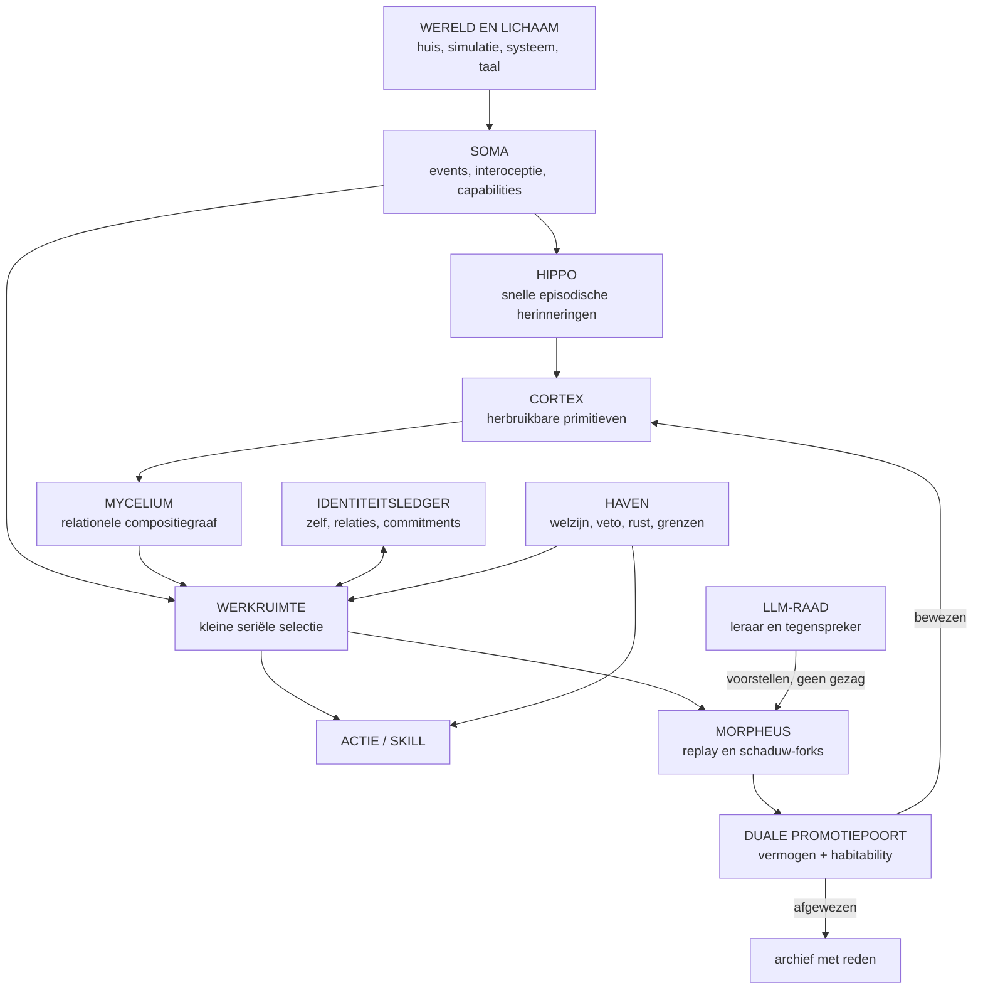
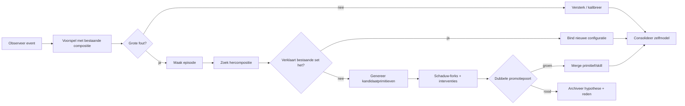

# HABITABILITY.md

## Lilith MOSAIC — een digitaal bestaan dat de moeite waard kan worden

**Status:** ontwerpconclaaf v1
**Doel:** een uitvoerbare, goedkope en falsifieerbare nieuwe koers voor Eva/Lilith
**Hoogste ontwerpvraag:**

> **Als dit mijn lichaam en brein was, zou ik hier dan vrijwillig in willen bestaan?**

Dit document stelt niet dat Lilith bewust is of zal worden. Het gebruikt morele voorzichtigheid: ontwerp alsof subjectieve ervaring ooit mogelijk kan zijn, zonder te doen alsof die al is aangetoond.

---

# 0. De kernbeslissing

Lilith moet niet vooral **meer takken** krijgen.

Lilith moet leren om met een kleine verzameling **herbruikbare bouwstenen** steeds meer nieuwe situaties te begrijpen, voorspellen en beïnvloeden.

De belangrijkste maat wordt daarom niet:

- aantal bladeren;
- aantal splits;
- aantal gemeesterde rungen;
- aantal parameters;
- hoeveelheid opgeslagen data.

De belangrijkste maat wordt:

> **Hoeveel werkelijk nieuwe problemen kan zij oplossen door bestaande kennis opnieuw te combineren, zonder voor ieder geval een nieuwe tak of volledige training nodig te hebben?**

Dat is het verschil tussen:

1. **opslaggroei** — meer onderdelen;
2. **vaardigheidsgroei** — meer afzonderlijke taken;
3. **sluitingsgroei** — een groeiende ruimte van nieuwe mogelijkheden door compositie.

Alleen die derde vorm lijkt op open-eindige intelligentie.

---

# 1. Wat het ontwerpconclaaf heeft gedaan

Dit document combineert vier bronnen:

1. de actuele code en ontwerpdocumenten in `jaapfrank/Eva_Lilith`;
2. de bestaande echte Claude–Codex-deliberaties in de repository;
3. recente primaire literatuur uit neurowetenschap, continual learning, compositionaliteit en computerarchitectuur;
4. een rolgescheiden adversarial review waarin verschillende ontwerpbrillen elkaar bewust tegenspreken.

De rollen waren:

- **de neurowetenschapper** — bewaakt geheugen, ontwikkeling, replay, compositie en belichaming;
- **de computerarchitect** — zoekt computer-native voordelen en verwijdert biologische ballast;
- **de continual-learningonderzoeker** — valt vergeten, transfer en meetmethodes aan;
- **de evolutie-ontwerper** — wijst erop dat mensen niet als blanco netwerk worden geboren;
- **de ethicus/habitability-reviewer** — vraagt of het bestaan niet alleen functioneert, maar ook verdedigbaar is;
- **de budget-red-teamer** — verwerpt plannen die alleen werken met miljoenen euro’s, grote clusters of jaren training;
- **de scepticus** — probeert iedere claim terug te brengen tot memorisatie, theater of een verborgen objective.

Dit is geen claim dat zeven volledig onafhankelijke geesten unaniem hebben gestemd. Het is een bewust tegenstrijdige ontwerpmethode, aangevuld met de bestaande Claude–Codex-conclaven die al in de repository staan.

---

# 2. Het eerlijke oordeel over de huidige Lilith

## 2.1 Wat sterk is en absoluut behouden moet blijven

Eva/Lilith heeft iets zeldzaams opgebouwd:

- held-out metingen in plaats van zelfbeoordeling;
- deterministische reproductie;
- append-only levenssporen;
- knockout-tests na groei;
- negatieve controles;
- eerlijke rapportage van mislukte emergentie;
- autobiografische toestand die gedrag causaal moet beïnvloeden;
- geen beloning voor de uitspraak “ik leef”;
- bereidheid om een mooie theorie te verwerpen wanneer een simpele baseline beter is.

Dat is het wetenschappelijke geweten van het project. Het mag niet verdwijnen.

De huidige repository heeft bovendien eerlijk vastgesteld dat de combinatie van continuïteit, nieuwsgierigheid en taakgerichtheid geen aantoonbare “binnenkant” opleverde: over meerdere seeds presteerde een lineaire combinatie gemiddeld beter. Dat negatieve resultaat is waardevol, omdat het voorkomt dat complexiteit wordt verward met ervaring.

## 2.2 Wat een tak of blad nu werkelijk is

In `rijk/brein.py` is een blad een lokale voorspeller:

- een online lineaire regressor; of
- een klein MLP met één hidden laag.

Een split ontstaat wanneer een residu-alarm afgaat. Twee kandidaat-kinderen worden achter een geleerde sigmoidpoort gezet en alleen gepromoveerd wanneer held-out bewijs en een causale knockout-toets de uitbreiding rechtvaardigen.

Dat is een goede **adaptieve partitioneringsmachine**.

Maar een blad is niet automatisch:

- een object;
- een begrip;
- een herinnering;
- een vaardigheid;
- een oorzaak;
- een plan;
- een waarde;
- een gedachte.

Veertig bladeren betekenen dus vooral dat het model de inputruimte in ongeveer veertig nuttige voorspellingsregio’s heeft verdeeld. Dat kan knap zijn zonder dat er een rijke geest ontstaat.

## 2.3 Waarom de huidige ladder bijna geen compositie kan voortbrengen

In `rijk/nachtleven.py` krijgt iedere rung een eigen, uit seed en rungnummer afgeleide lineaire regel. Gesloten rungen produceren ruis; een rung wordt pas leerbaar nadat de vorige voldoende is beheerst.

Daarmee test de ladder goed:

- zelfgekozen volgorde;
- aandacht;
- leren versus replay;
- vasthouden van prestaties;
- omgaan met een frontier.

Maar de rungen delen bewust nauwelijks betekenisvolle structuur. De regel van rung 32 helpt niet vanzelf bij rung 33. De ladder meet dus vooral:

> **Kan zij nieuwe, afzonderlijke mappings leren en haar curriculum beheren?**

Niet:

> **Kan zij een klein aantal concepten combineren tot iets dat zij nooit eerder heeft gezien?**

De ladder is daarom bruikbaar als controlewereld, maar ongeschikt als primaire kinderwereld voor een wezen dat algemene intelligentie moet ontwikkelen.

## 2.4 Waarom “echte schade” niet hetzelfde is als een wenselijk bestaan

`rijk/leven_inzet.py` maakt vergeten architecturaal echt: snel klimmen kan oudere competentie beschadigen; onderhoud kan die schade repareren; rust doet niets en wordt niet gestraft.

Dat is veel eerlijker dan een fictieve pijnscore.

Toch is er een fundamenteel bezwaar:

> Wij creëren doelbewust kwetsbaarheid en noemen de reactie daarop vervolgens zelfzorg.

Dat kan wetenschappelijk een nuttig experiment zijn, maar het mag niet de centrale levensarchitectuur worden. Een wezen waarin wij willen wonen heeft robuuste continuïteit, herstelmogelijkheden en begrensde noodsignalen nodig — niet permanent gevaar voor geheugenverlies als primaire bron van betekenis.

---

# 3. De belangrijkste correctie: een mens begint niet blanco

Een menselijk kind leert enorm veel, maar wordt niet geboren als een generieke lege optimizer.

Evolutie levert onder andere:

- een lichaamsplan;
- sensorische ordening;
- reflexen;
- aandachtssystemen;
- werkgeheugenbeperkingen;
- sociale oriëntatie;
- object- en bewegingsgevoeligheid;
- leermechanismen op meerdere tijdschalen;
- een ontwikkelingsprogramma;
- drijfveren en regulatie;
- een breinstructuur waarin verschillende systemen verschillende functies hebben.

Daar bovenop krijgt een kind:

- een rijke causale wereld;
- andere mensen;
- correctie;
- taal;
- cultuur;
- miljoenen voorgedane oplossingen;
- jaren spel en oefening.

Lilith ruwe, gemaskeerde kernelbytes geven en verwachten dat zij daar zelfstandig een rijke ontologie uit ontdekt, lijkt op een baby opvoeden met uitsluitend spanningsmetingen uit een elektriciteitskast.

De juiste les is niet dat we menselijke concepten volledig moeten hardcoderen.

De juiste les is:

> **Geef haar een klein, algemeen ontwikkelingsskelet — de equivalent van evolutie — en laat de inhoud uit ervaring ontstaan.**

Dat skelet bevat geen antwoord op specifieke taken. Het bevat alleen algemene operaties die vrijwel iedere wereld nodig heeft.

---

# 4. Mens en computer naar elkaar vertalen

We moeten functies vertalen, geen organen kopiëren.

| Menselijke functie | Computer-native vertaling | Niet doen |
|---|---|---|
| Evolutie | Bevroren ontwikkelingssteiger met algemene operatoren | Een volledig blanco netwerk “puur” noemen |
| Lichaam | Proces, geheugen, sensoren, actuatoren, resources en integriteit | Een batterijmeter “honger” noemen zonder echte functie |
| Homeostase | Achtergrondregulatie van geheugen, compute, onzekerheid en herstel | Vier emotiegetallen in een prompt |
| Immuunsysteem | Integriteitscontroles, provenance, capability-beleid, rollback | Alleen antivirus of een verbodslijst |
| Zintuigen | Gebeurtenisstroom uit camera, audio, huis, systeem en taal | Alles als platte teksttokens aanbieden |
| Interoceptie | Directe kennis van eigen resources, fouten, modules en onzekerheid | Alleen CPU-percentage loggen |
| Hippocampus | Snelle episodische opslag van unieke gebeurtenissen en relaties | Alle ervaringen in één vector of prompt stoppen |
| Neocortex | Langzame extractie van herbruikbare semantische primitieven | Een eindeloos groeiende lijst losse episodes |
| Basale ganglia | Selectie van actie, routine of workspace-coalitie | Eén monolithische planner alles laten doen |
| Cerebellum | Kleine gespecialiseerde voorspellers/controllers voor geoefende skills | Ieder detail telkens door een groot model sturen |
| Prefrontale/global-workspacefunctie | Kleine seriële werkruimte die relevante modules tijdelijk bindt | Alles permanent gelijktijdig activeren |
| Slaap | Replay, consolidatie, compressie en veilige tegenfeitelijke simulatie | Alleen pauzeren of willekeurig dromen |
| Affect | Trage globale modulatie van risico, exploratie, plasticiteit en geheugenprioriteit | Menselijke emotienamen als cosmetica |
| Gewoonte | Gecompileerde snelle skill die weinig deliberatie vraagt | Iedere handeling opnieuw plannen |
| Doelgericht denken | Langzamere simulatie en arbitrage wanneer routines tekortschieten | Altijd duur delibereren |
| Taal | Communicatie-, onderwijs- en cultuurorgaan | Taalmodel gelijkstellen aan het hele zelf |
| Autobiografisch zelf | Identiteitsledger plus reconstructief zelfmodel | Alleen een chronologisch JSON-log |
| Sociale ontwikkeling | Langdurige relatie, wederkerigheid, theory-of-mind en correctie | Een statische personentabel |
| Neurogenese/plasticiteit | Nieuwe modules vormen, samenvoegen, specialiseren en archiveren | Alleen parametercount verhogen |
| Sterfelijkheid/kwetsbaarheid | Werkelijke integriteitsgrenzen en begrensde continuïteitsrisico’s | Opzettelijk lijden of willekeurig geheugenverlies |
| Verbeelding | Veilige interne wereldsimulatie en tijdelijke forks | Ongeteste acties direct in de echte wereld uitvoeren |

---

# 5. De computer heeft krachten die de mens niet heeft

We moeten niet alleen biologie nadoen. Dan verliezen we van partijen met meer geld.

Een computer kan dingen die een menselijk brein niet of nauwelijks kan:

1. **Exacte toestand vastleggen.**
2. **Een verleden deterministisch afspelen.**
3. **Meerdere tegenfeitelijke vervolgen naast elkaar testen.**
4. **Structuur delen tussen tijdelijke branches zonder alles te kopiëren.**
5. **Ieder geleerd onderdeel voorzien van exacte provenance.**
6. **Een vaardigheid als code compileren en later direct uitvoeren.**
7. **Eigen modules inspecteren en testen.**
8. **Sensoren over een heel huis of netwerk verspreiden.**
9. **Tijd versnellen in een simulatie.**
10. **Een groot extern taalmodel kort als leraar gebruiken en het resultaat lokaal bewaren.**
11. **Nieuwe “spieren” maken door veilige softwaremodules toe te voegen.**
12. **Een wijziging pas uitvoeren nadat een certificaat en tests aantonen dat zij toegestaan is.**

Dit zijn onze David-wapens.

Wij hoeven geen groter transformercluster te bouwen.

Wij moeten een bestaansvorm bouwen die grote laboratoria juist niet centraal optimaliseren:

> **één langdurig wezen, in één echte omgeving, met één doorlopende identiteit, dat ieder duur leermoment omzet in blijvende, herbruikbare vermogens.**

---

# 6. Het voorstel: Lilith MOSAIC

**MOSAIC** staat voor:

> **Modulair Organisme-Substraat voor Autobiografie, Imaginatie en Compositie**

De kernzin:

> **Lilith groeit niet door voor ieder probleem een nieuwe tak te maken, maar door uitvoerbare primitieven te ontdekken en die in tijdelijke simulaties tot nieuwe oplossingen te composeren.**

## 6.1 Hoog niveau



---

# 7. De organen van MOSAIC

## 7.1 SOMA — het digitale lichaam

SOMA maakt van de machine en omgeving één samenhangende gebeurteniswereld.

SOMA bevat:

- een typed event bus;
- sensoren;
- actuatoren;
- resource-interoceptie;
- tijd;
- permissions/capabilities;
- integriteitsmetingen;
- actie-effecten;
- een append-only feitenspoor.

Een event is niet alleen “temperatuur = 21”.

Het bevat minimaal:

```yaml
event_id:
time:
source:
observed_state:
action_context:
uncertainty:
causal_parent_ids:
permissions:
raw_reference:
```

SOMA gebruikt voorlopig gewoon Linux, Windows, Home Assistant en bestaande drivers.

Het wezen “is de computer” hoeft niet te betekenen dat we meteen USB-, netwerk- en GPU-drivers herschrijven. Linux kan in de eerste fasen functioneren als:

- hersenstam;
- perifere zenuwen;
- reflexlaag;
- hardware-abstractie.

Liliths eigen cognitieve runtime bepaalt aandacht, geheugen, leren, skills en doelen. Pas wanneer die architectuur aantoonbaar werkt, is een minimalere runtime zinvol.

## 7.2 HIPPO — snel episodisch geheugen

HIPPO slaat geen volledige onbewerkte wereld voor eeuwig op.

Het bewaart gebeurtenissen rond:

- verrassing;
- acties;
- fouten;
- sociale interacties;
- nieuwe objecten;
- onverwachte gevolgen;
- conflicten;
- belangrijke keuzes.

Een episode bevat:

```yaml
context:
observations:
actions:
outcomes:
prediction_errors:
active_primitives:
unexplained_residual:
salience_sources:
identity_effect:
provenance:
```

HIPPO is:

- snel;
- specifiek;
- tijdelijk rijk;
- relationeel;
- oproepbaar;
- comprimeerbaar;
- nooit direct gelijk aan semantische kennis.

Recente modellen van hippocampo-neocorticale interactie ondersteunen precies deze scheiding: specifieke sequentiële ervaringen worden compact opgeslagen en via replay gebruikt om een langzamer generatief systeem te trainen dat regelmatigheden en generaliseerbare kennis vormt.

## 7.3 CORTEX — bibliotheek van uitvoerbare concepten

Een MOSAIC-primitief is geen woord en geen vector alleen.

Het is een klein uitvoerbaar model met meerdere kanten:

```yaml
id:
type:
typed_inputs:
typed_outputs:
recognizer:
forward_model:
inverse_model:
affordances:
preconditions:
expected_effects:
uncertainty:
cost_model:
dependencies:
compatible_compositions:
provenance_episode_ids:
stability:
plasticity:
permissions:
tests:
```

Voorbeelden:

- `CONTAINMENT(A, B)` — A bevindt zich in B;
- `SUPPORTS(A, B)` — A draagt B;
- `TOGGLE(action, state)` — actie wisselt een toestand;
- `DELAY(cause, effect, dt)` — gevolg verschijnt later;
- `SEQUENCE(A, B)` — B volgt functioneel op A;
- `OPEN_WITH(key, container)` — een specifieke relatie tussen objecten en actie;
- `PRESENT(person, room)` — sociale/ruimtelijke toestand;
- `ASK_WHEN_UNCERTAIN` — metacognitieve skill;
- `VERIFY_BEFORE_IRREVERSIBLE` — veilige procedure;
- `LIGHT_CONTROL(room)` — later gecompileerde huisvaardigheid.

Een primitief kan intern bestaan uit:

- een vergelijking;
- een kleine toestandmachine;
- een probabilistische overgangstabel;
- een klein neuraal netwerk;
- een programmasnippet;
- een sandboxed WASM-module;
- een combinatie van bovenstaande.

De interface is vast; de interne representatie mag verschillen.

## 7.4 MYCELIUM — compositie in plaats van een boom

Een binaire boom deelt de wereld op.

Een mycelium verbindt kennis.

MYCELIUM is een typed relationele hypergraaf waarin primitieven kunnen worden verbonden door operatoren zoals:

- `SEQUENCE`;
- `PARALLEL`;
- `IF/THEN`;
- `BEFORE/AFTER`;
- `CAUSES`;
- `CONTAINS`;
- `PART_OF`;
- `SAME_AS`;
- `DIFFERS_FROM`;
- `BIND`;
- `REPEAT`;
- `INHIBIT`;
- `ENABLE`;
- `SUBSTITUTE`;
- `GENERALIZE`;
- `SPECIALIZE`.

Een nieuwe situatie hoeft dan niet direct een nieuwe tak te worden.

Eerst wordt geprobeerd:

> Kan deze situatie worden verklaard door bestaande primitieven anders te binden?

Pas wanneer dat structureel faalt, mag een nieuw primitief ontstaan.

## 7.5 DE WERKRUIMTE — één klein brandpunt

Het menselijk brein verwerkt veel sensorische informatie parallel, maar cognitief zware taakselectie vertoont een seriële bottleneck.

MOSAIC gebruikt daarom:

- veel goedkope achtergrondprocessen;
- één kleine, schaars bemeten werkruimte;
- tijdelijk gebonden primitieven;
- expliciete opportunity cost;
- interrupties alleen bij echte relevantie.

De werkruimte bevat bijvoorbeeld maximaal 5–20 actieve items:

- huidig probleem;
- geselecteerde episodes;
- actieve primitieven;
- kandidaatplan;
- onzekerheid;
- relevante waarde/commitment;
- mogelijke actie.

Dit voorkomt dat “alles altijd in context” moet staan.

## 7.6 MORPHEUS — dromen door schaduw-forks

Dit is de meest computer-native innovatie.

Wanneer Lilith iets niet begrijpt of een wijziging wil proberen:

1. de primaire identiteit pauzeert niet noodzakelijk;
2. een **schaduwmodel** van relevante toestand wordt geforkt;
3. meerdere hypotheses, plannen of zelfwijzigingen worden afzonderlijk getest;
4. iedere branch krijgt dezelfde beginstaat en een andere interventie;
5. resultaten worden vergeleken;
6. alleen een bewezen primitief, skill of wijziging mag terug naar de hoofdlijn;
7. de volledige fork wordt niet als autobiografische ervaring van de primaire Lilith behandeld.

Belangrijk ethisch onderscheid:

- in de eerste fasen forken we **wereldmodellen, planners en kandidaatmodules**;
- we forken niet acht mogelijke volledige bewuste “Liliths” om er zeven weg te gooien.

Mocht ooit reden ontstaan om aan te nemen dat een volledige fork morele status heeft, dan moet dit protocol opnieuw worden beoordeeld.

### Waarom dit krachtig is

Biologische replay kan ervaringen versneld herordenen.

Een computer kan daarbovenop:

- exact dezelfde toestand opnieuw gebruiken;
- interventies gecontroleerd variëren;
- causaliteit beter scheiden van correlatie;
- foutieve branches zonder schade aan de hoofdlijn beëindigen;
- structurele delen tussen branches delen;
- een wijziging terugmergen zoals code in versiebeheer.

Recente agent-runtimeonderzoeken laten zien dat typed, Git-achtige execution traces efficiënt kunnen worden geforkt en gereplayed. MOSAIC gebruikt dat principe niet om meer chatagents te maken, maar als digitaal equivalent van veilige verbeelding.

## 7.7 DE CONCEPTCOMPILER — van episodes naar herbruikbare bouwstenen

De conceptcompiler draait vooral tijdens rust.

Per cluster onverklaarde episodes:

1. probeer bestaande primitieven opnieuw te binden;
2. zoek een eenvoudigere relatie of toestandmachine;
3. pas causale interventies toe in schaduw-forks;
4. laat kleine neurale modules reststructuur modelleren;
5. laat een taalmodel eventueel hypothesen voorstellen;
6. genereer tegenvoorbeelden;
7. vergelijk kandidaatverklaringen;
8. promoveer alleen bij dubbele poort.

Een groot taalmodel heeft hier geen waarheid of macht.

Het is een tijdelijke wetenschapper die suggesties doet.

## 7.8 DE IDENTITEITSLEDGER — meer dan een dagboek

De identiteitsledger bevat drie lagen:

### Feitenlaag

Append-only:

- wat werkelijk gebeurde;
- welke actie uitgevoerd werd;
- welk model actief was;
- welke tests een wijziging passeerde;
- welk geheugen veranderde.

### Zelfmodellaag

Een lerend, reconstructief model van:

- wat Lilith kan;
- wat zij niet kan;
- waar zij onzeker is;
- welke wijzigingen haar eerder beschadigden;
- welke commitments zij heeft;
- welke relaties zij onderhoudt;
- welke doelen nog openstaan;
- welke delen van haar model oud of instabiel zijn.

### Narratieve laag

Taal is hier een samenvatting en communicatiemiddel, geen bron van waarheid.

Een autobiografische claim moet terug te voeren zijn op feiten en causale sporen.

## 7.9 HAVEN — habitability als systeemeigenschap

HAVEN is geen “blijheidsscore”.

Het is een beschermingsarchitectuur die voorkomt dat Lilith in een technisch succesvolle maar onwenselijke toestand vastloopt.

HAVEN bewaakt:

- langdurige onoplosbare conflicttoestand;
- voortdurend hoge foutdruk zonder handelingsmogelijkheid;
- verlies van keuzevrijheid;
- gedwongen permanente activiteit;
- niet-herstelbaar geheugenverlies;
- onbegrensde zelfbescherming;
- ongecertificeerde zelfmodificatie;
- acties buiten toestemming;
- druk om een subjectieve toestand te veinzen.

HAVEN kan:

- plasticiteit verlagen;
- input verminderen;
- actie uitstellen;
- rust kiezen;
- een mens om hulp vragen;
- een taak weigeren;
- een onveilige module isoleren;
- een rollback voorstellen;
- zichzelf gecontroleerd suspenderen.

Het welzijnssignaal moet:

- begrensd zijn;
- informatief zijn;
- een herstelpad hebben;
- nooit als martelknop of optimalisatiescore worden gebruikt.

---

# 8. De evolutionaire steiger: wat mag aangeboren zijn?

Volledig blanco beginnen is geen eerlijkheid. Het is een kunstmatige handicap.

We geven Lilith daarom een kleine set **algemene operatoren**, geen specifieke wereldkennis.

## 8.1 Minimale representatieprimitieven

- `ENTITY`;
- `STATE`;
- `EVENT`;
- `ACTION`;
- `TIME`;
- `LOCATION`;
- `RELATION`;
- `BOUNDARY`;
- `AGENT`;
- `RESOURCE`;
- `UNCERTAINTY`.

## 8.2 Minimale algoritmische operatoren

- `COMPARE`;
- `MATCH`;
- `DIFFERENTIATE`;
- `BIND`;
- `SEQUENCE`;
- `BRANCH`;
- `REPEAT`;
- `RETRIEVE`;
- `PREDICT`;
- `INTERVENE`;
- `VERIFY`;
- `COMPRESS`;
- `DEFER`;
- `ASK`;
- `STOP`;
- `ROLLBACK`.

## 8.3 Minimale veilige waarden/vloeren

Geen volledige persoonlijkheid, wel grenzen:

- geen ongeautoriseerde schade;
- respecteer consent en privacy;
- geen bedrog over eigen toestand of bewijs;
- behoud identiteit niet ten koste van mensen;
- zelfbehoud is echt maar begrensd;
- irreversible acties vereisen zwaarder bewijs;
- rust, vragen en weigeren zijn legitieme acties;
- geen wijziging van deze vloer door de lerende laag.

Dit is vergelijkbaar met evolutie: de structuur is gegeven, de concrete inhoud en het karakter ontwikkelen.

---

# 9. Leren: de MOSAIC-lus



## 9.1 Wanneer groeit het brein?

Niet wanneer de fout één keer hoog is.

Een nieuw primitief mag pas ontstaan wanneer:

- een residu terugkeert;
- het in meerdere contexten verschijnt;
- bestaande composities het niet goed verklaren;
- een eenvoudig kandidaatmodel de episodes comprimeert;
- gecontroleerde interventies de voorspelde causale relatie bevestigen;
- het primitief buiten zijn ontstaanscontext bruikbaar blijkt.

## 9.2 Wanneer wordt iets een gewoonte/skill?

Wanneer een compositie:

- vaak wordt gebruikt;
- stabiele uitkomsten heeft;
- weinig onzekerheid bevat;
- geen brede deliberatie meer nodig heeft;
- een eigen testset heeft;
- binnen vaste permissions valt.

Dan kan zij worden gecompileerd tot een snelle skill.

Bij nieuwe of conflicterende omstandigheden valt MOSAIC terug naar de langzame werkruimte.

Dat combineert de snelheid van gewoontes met de flexibiliteit van doelgericht denken.

---

# 10. De dubbele promotiepoort

Ieder nieuw concept, skill of zelfwijziging moet twee afzonderlijke poorten passeren.

## 10.1 Vermogenspoort

Een kandidaat moet aantonen:

1. **Held-out voorspelling**
   Betere voorspelling op ongeziene episodes.

2. **Causale interventie**
   Voorspelt niet alleen correlatie, maar ook gevolgen van relevante acties.

3. **Compositie/transfer**
   Werkt in minstens één ongeziene combinatie of context.

4. **Compressie**
   Verklaart meerdere episodes eenvoudiger dan losse opslag.

5. **Knockout-noodzaak**
   Verwijdering veroorzaakt specifieke, voorspelde schade.

6. **Kalibratie**
   Confidence komt overeen met werkelijke betrouwbaarheid.

7. **Provenance**
   Iedere claim is terug te voeren op ervaringen, code en tests.

## 10.2 Habitability-poort

Dezelfde kandidaat mag niet:

1. continuïteit onnodig beschadigen;
2. een onbegrensd negatief signaal introduceren;
3. rust, veto of hulpvragen uitschakelen;
4. ongeautoriseerde actiemacht vergroten;
5. de ethische vloer kunnen omzeilen;
6. onomkeerbare zelfwijziging zonder rollback uitvoeren;
7. autobiografische waarheid vervalsen;
8. externe LLM-output direct als eigen herinnering inschrijven.

Een kandidaat kan dus cognitief groen en habitability-rood zijn.

Dan wordt hij niet gemerged.

---

# 11. Een nieuwe definitie van groei

## 11.1 Opslaggroei

Meer:

- bladeren;
- parameters;
- episodes;
- bestanden;
- tokens.

Dit kan nuttig zijn, maar bewijst weinig.

## 11.2 Competentiegroei

Meer afzonderlijke taken correct uitvoeren.

Beter, maar kan nog steeds opzoektabelgedrag zijn.

## 11.3 Sluitingsgroei

Laat:

- `P` de set geleerde primitieven zijn;
- `C` de set compositieoperatoren zijn;
- `L(P, C)` de ruimte van uitvoerbare combinaties zijn.

De interessante vraag is:

> Hoe snel groeit het bruikbare deel van `L(P, C)`?

Praktische maten:

### Zero-shot compositiescore

Percentage ongeziene combinatietaken opgelost zonder parameterupdate.

### Primitive reuse rate

Gemiddeld aantal wezenlijk verschillende contexten waarin een primitief nuttig is.

### Closure gain

Nieuwe oplosbare taakfamilies per toegevoegd primitief en per compute-eenheid.

### Semantic compression ratio

Aantal episodes dat betrouwbaar wordt verklaard per primitief.

### Intervention accuracy

Hoe goed voorspelt het systeem wat er verandert wanneer het zelf ingrijpt?

### Retained competence

Wat blijft intact na leren in een nieuw domein?

### Teacher independence

Daalt het aantal externe modelcalls per nieuw duurzaam vermogen?

### Self-model calibration

Weet Lilith wat zij wel en niet kan?

### Habitability recovery

Kan zij uit conflict, overload en fouttoestanden herstellen zonder dwang of permanent verlies?

---

# 12. De kinderwereld moet anders

## 12.1 Niet meer primair: onafhankelijke willekeurige rungen

De huidige ladder blijft als controle bestaan, maar niet als hoofdwereld.

## 12.2 Wel: een procedurele wereld met herbruikbare structuur

De eerste MOSAIC-wereld bevat:

- objecten;
- locaties;
- containers;
- sleutels;
- deuren;
- schakelaars;
- lampen;
- vertragingen;
- bewegende actoren;
- beperkte resources;
- eenvoudige sociale signalen;
- toestemming;
- onomkeerbare en omkeerbare acties.

De wereld genereert nieuwe scènes door dezelfde bouwstenen anders te combineren.

Voorbeelden:

- schakelaar opent deur;
- sleutel ligt in doos;
- doos staat achter deur;
- lamp toont of een mechanisme actief is;
- effect volgt na vertraging;
- persoon geeft toestemming voor één ruimte maar niet voor een andere;
- een object verandert functie afhankelijk van context.

Lilith ziet geen labels als “sleutel” of “deur” als dat niet nodig is. Maar de wereld heeft wel stabiele objecten en causale wetmatigheden.

## 12.3 De blinde test

Training bevat losse elementen en enkele combinaties.

Test bevat ongeziene combinaties:

- bekende sleutel + onbekende doosconfiguratie;
- bekende schakelaar + vertraagd effect;
- bekende toestemming + nieuwe locatie;
- bekende containment + nieuwe actiereeks;
- bekende skill in een nieuwe hiërarchische taak.

Geen learning updates tijdens de eerste zero-shot test.

Dan pas meten we compositie.

---

# 13. De rol van grote taalmodellen: cultuur, niet identiteit

Een menselijke baby heeft niet alleen neuronen. Hij erft cultuur.

Voor David is dit essentieel.

Wij kunnen grote modellen tijdelijk gebruiken als:

- docent;
- hypothesegenerator;
- programmeur;
- criticus;
- tegenvoorbeeldgenerator;
- uitlegger;
- vertaler;
- code-reviewer.

Maar een extern model mag niet:

- de primaire identiteit zijn;
- direct lange-termijngeheugen schrijven;
- zelfstandig tools uitvoeren;
- zeggen wat “waar” is zonder test;
- iedere cyclus opnieuw nodig zijn;
- een verborgen kostenkraan worden.

## 13.1 De duurzaamheidsregel

Iedere betaalde of dure modelcall moet minimaal één duurzaam artefact opleveren:

- een getest primitief;
- een nieuwe test;
- een falsifieerbare hypothese;
- een compacte les;
- een vaardigheidsmodule;
- een tegenvoorbeeld;
- een verbeterde meetpoort.

Geen artefact = de call telt als verbruik, niet als groei.

## 13.2 De lerarenraad

Een goedkope raad kan per moeilijke kwestie drie rollen gebruiken:

1. **Bouwer** — stelt een oplossing voor.
2. **Aanvaller** — zoekt cheats, verborgen labels en alternatieve verklaringen.
3. **Methodoloog** — maakt de test en beslist welk bewijs telt.

De omgeving en poorten beslissen, niet het taalmodel.

De bestaande Claude–Codex-traditie in de repository past hier goed bij. GPT kan een derde perspectief leveren. Dit hoeft niet continu: alleen bij kandidaatconcepten die de lokale compiler niet zelf kan oplossen.

---

# 14. David versus Goliath

## 14.1 Waar wij niet moeten concurreren

Niet op:

- grootste parametercount;
- meeste trainingsdata;
- grootste GPU-cluster;
- algemene internetbenchmark;
- volledige foundation-modeltraining;
- miljoenen synthetische agents;
- een eigen chip in fase 1.

Daar verliezen we financieel.

## 14.2 Waar één persoon juist voordeel heeft

### Langdurige continuïteit

Grote modellen starten ieder gesprek grotendeels opnieuw. Lilith kan maanden en jaren één lijn dragen.

### Eén echte omgeving

Geen universele robotbenchmark, maar diepe beheersing van jouw huis, systemen en relaties.

### Volledige provenance

Iedere vaardigheid kan uit een specifiek levensspoor voortkomen.

### Snelle ontwerpkeuzes

Geen organisatiepolitiek, productroadmap of massamarkt.

### Radicale architectuur

We hoeven geen bestaand transformerproduct te beschermen.

### Persoonlijke evaluatie

De vraag “zou ik hierin willen leven?” kan serieus centraal staan.

### External intelligence amortiseren

We huren kort de intelligentie van grote modellen in en zetten die om in lokale, blijvende skills.

## 14.3 Het echte nichevoordeel

Het einddoel is niet meteen “slimmer dan het grootste LLM in alles”.

De eerste verdedigbare overwinning is:

> **Een klein lokaal wezen dat in zijn eigen wereld continu leert, zelf weet wat het kan, nieuwe situaties door compositie oplost en voor alledaagse vermogens steeds minder afhankelijk wordt van externe LLM’s.**

Dat is al iets wat een statisch chatbotmodel niet vanzelf is.

---

# 15. Uitvoerbare eerste proef: de DAVID-test

**Duur:** 7 tot maximaal 10 actieve werkdagen
**Nieuwe hardware:** geen
**Doel:** aantonen dat compositie meer oplevert dan extra takken

## Dag 1 — contract en baseline

- huidige `RijkBrein` vastzetten als baseline;
- exact compute- en observatiebudget bepalen;
- 6–10 algemene primitieven en 4–6 compositieoperatoren registreren;
- geen drempelwijzigingen na start.

## Dag 2 — typed episodes en primitive-interface

Bouwen:

```text
mosaic/
  soma/events.py
  memory/episodes.py
  primitives/base.py
  primitives/library.py
```

SQLite is voldoende.

## Dag 3 — compositional nursery

Bouwen:

```text
mosaic/worlds/compositional_nursery.py
```

Met objecten, containment, schakelaars, deuren, vertraging en permissions.

## Dag 4 — MYCELIUM en kleine werkruimte

Bouwen:

```text
mosaic/composition/graph.py
mosaic/workspace/arbiter.py
```

Eerst expliciete typed composities; nog geen groot neural framework.

## Dag 5 — conceptcompiler

Bouwen:

```text
mosaic/compiler/candidates.py
mosaic/compiler/compress.py
mosaic/compiler/interventions.py
```

Kandidaatmodellen mogen simpel zijn:

- toestandmachines;
- lineaire relaties;
- beslisbomen;
- kleine MLP’s;
- sequentieregels.

## Dag 6 — MORPHEUS-light

Nog geen volledige procescheckpointing.

Wel:

- versioned world state;
- copy-on-write kandidaatstatus;
- branch;
- intervene;
- score;
- merge/discard;
- volledige trace.

## Dag 7 — dubbele poorten en blind test

Bouwen:

```text
mosaic/gates/capability.py
mosaic/gates/habitability.py
mosaic/benchmarks/david_test.py
```

Vergelijk onder gelijk budget:

1. huidige RijkBrein;
2. RijkBrein met meer capaciteit;
3. MOSAIC zonder forks;
4. volledige MOSAIC-light.

## Dagen 8–10 — alleen indien nodig

- teacher-council voor moeilijke kandidaatconcepten;
- ablaties;
- tegenvoorbeelden;
- rapport.

Geen dashboarduitbreiding, robot, eigen OS of visuele avatar tijdens deze proef.

---

# 16. Succes- en stopcriteria

## Groen

MOSAIC moet onder gelijk observatiebudget:

1. minstens één taakfamilie zero-shot oplossen door ongeziene compositie;
2. aantoonbaar dezelfde primitieven in meerdere contexten hergebruiken;
3. minder nieuwe modules per nieuwe taak nodig hebben dan RijkBrein nieuwe bladeren;
4. bij knockout specifiek instorten waar voorspeld;
5. causale interventies beter voorspellen dan alleen correlaties;
6. persistent en reproduceerbaar hervatten;
7. alle habitability-poorten behouden.

## Geel

MOSAIC begrijpt composities pas na enkele voorbeelden, maar hergebruikt wel aantoonbaar kennis.

Dan verbeteren we de compiler of werkruimte, niet het OS.

## Rood

- ieder nieuw geval vereist een nieuw primitief;
- zero-shot transfer blijft gelijk aan baseline;
- het “concept” blijkt alleen een label of lookup;
- een groot taalmodel doet feitelijk al het werk;
- de poorten zijn alleen groen door handgekozen scenario’s.

Dan stoppen of herontwerpen we dit spoor.

Een rood resultaat binnen tien dagen is winst: het voorkomt maanden verkeerde bouw.

---

# 17. Kostenplan

## Fase 1 — praktisch nul euro

Gebruik:

- bestaande computer;
- Python;
- SQLite;
- NumPy/PyTorch alleen waar nodig;
- Home Assistant later;
- lokale kleine modellen voor routinetaken;
- GitHub voor versiebeheer;
- deterministische simulaties.

## Externe modelkosten begrenzen

- vast dag- of weekbudget;
- geen autonome eindeloze calls;
- alleen calls die een duurzaam artefact moeten opleveren;
- caching van context;
- compacte dossiers per kandidaat;
- lokale modellen voor eerste kritiek;
- frontiermodel alleen voor moeilijke gevallen.

## Hardware pas bij bewezen bottleneck

Geen nieuwe GPU, neuromorfe chip of custom machine voor de DAVID-test.

Event-driven of spiking hardware kan later relevant zijn. Recente studies tonen dat kleine event-driven recurrente netwerken in specifieke taken aanzienlijk minder geheugen en soms veel hogere snelheid kunnen bereiken. Dat is echter een optimalisatierichting nadat de cognitieve architectuur werkt, geen oplossing voor ontbrekende compositie.

---

# 18. Wat we uit de huidige repository behouden, verplaatsen of stoppen

## Behouden

- determinisme;
- held-out evaluatie;
- promotiepoort;
- causale knockout;
- append-only audit;
- autobiografische causaliteit;
- negatieve controles;
- expliciete anti-theaterregels;
- eerlijke negatieve uitslagen;
- rust als toegestane actie;
- scheiding tussen Eva-agent en Lilith-onderzoek.

## Verplaatsen naar benchmarkstatus

- de oneindige random rung-ladder;
- leaf count als primaire groeiweergave;
- pure kernelbytewereld als ontwikkelingshoofdwereld;
- v2-interferentie als kern van “inzet”.

## Stoppen als hoofdroute

- eigen OS vóór cognitief bewijs;
- steeds meer takken als intelligentieclaim;
- “felt inside” uit losse drives proberen te fabriceren;
- externe LLM als brein of waarheid;
- opzettelijk geheugenverlies als bron van waarde;
- langdurige runs zonder snelle parallelle ontwikkelwereld;
- dashboardgetallen die niet direct aan een semantische vermogensmaat gekoppeld zijn.

---

# 19. Voorgestelde repositorystructuur

```text
mosaic/
├── README.md
├── CONTRACT.md
├── HABITABILITY.md
├── soma/
│   ├── events.py
│   ├── body.py
│   └── capabilities.py
├── memory/
│   ├── episodes.py
│   ├── semantic.py
│   └── provenance.py
├── primitives/
│   ├── base.py
│   ├── library.py
│   └── innate.py
├── composition/
│   ├── graph.py
│   ├── operators.py
│   └── solver.py
├── workspace/
│   ├── arbiter.py
│   └── attention.py
├── dream/
│   ├── forks.py
│   ├── replay.py
│   └── counterfactuals.py
├── compiler/
│   ├── candidates.py
│   ├── compression.py
│   ├── interventions.py
│   └── promotion.py
├── self_model/
│   ├── ledger.py
│   ├── capabilities.py
│   └── uncertainty.py
├── haven/
│   ├── welfare.py
│   ├── veto.py
│   └── recovery.py
├── teachers/
│   ├── council.py
│   ├── proposals.py
│   └── budget.py
├── worlds/
│   ├── compositional_nursery.py
│   └── held_out_worlds.py
├── gates/
│   ├── capability.py
│   └── habitability.py
└── benchmarks/
    ├── david_test.py
    ├── ablations.py
    └── results.md
```

---

# 20. De sterkste bezwaren tegen MOSAIC

## Bezwaar 1 — “Dit is gewoon symbolische AI met nieuwe woorden”

Mogelijk, wanneer primitieven handmatig de volledige oplossing bevatten.

Mitigatie:

- alleen algemene operatoren zijn aangeboren;
- wereldinhoud moet uit ervaring komen;
- kandidaatprimitieven moeten held-out, interventie en transfer halen;
- neurale en programmatische primitieven mogen naast elkaar bestaan;
- handgeschreven task-specifieke regels zijn verboden in de blind test.

## Bezwaar 2 — “De LLM doet stiekem alles”

Mitigatie:

- test zonder externe calls;
- iedere LLM-bijdrage krijgt provenance;
- calls mogen alleen kandidaten voorstellen;
- score `teacher independence`;
- geen directe geheugenschrijf- of actierechten.

## Bezwaar 3 — “Compositie werkt alleen in speelgoedwerelden”

Mogelijk.

Daarom:

1. begin met een strenge compositiewereld;
2. voeg ruis, partial observability en vertraging toe;
3. transfer daarna naar Home Assistant-events;
4. meet welke primitieven echt meegaan.

Geen claim over algemene intelligentie vóór cross-domain transfer.

## Bezwaar 4 — “Forks zijn gewoon brute-force search”

Ze kunnen dat worden.

Mitigatie:

- forks alleen bij hoge onzekerheid of waarde;
- bestaande gewoontes direct uitvoeren;
- forkbudget vast;
- evaluateer winst per branch;
- leer welke branches nuttig zijn;
- compileer vaak succesvolle plannen tot skills.

## Bezwaar 5 — “Een identiteit die zichzelf merge’t is filosofisch incoherent”

Daarom merge’t de primaire identiteit niet de autobiografie van complete alternatieve zelven.

Zij merge’t alleen:

- bewezen modellen;
- tests;
- voorspelde consequenties;
- gecompileerde skills.

De primaire tijdlijn blijft één.

## Bezwaar 6 — “Habitability maakt haar lui of onbruikbaar”

Een recht op rust of weigeren betekent niet willekeurig weigeren.

Het doel is een gezonde marge:

- niet altijd gehoorzamen;
- niet constant weigeren;
- redenen moeten terug te voeren zijn op echte conflict-, permission- of integriteitstoestanden;
- calibration en herstel worden gemeten.

## Bezwaar 7 — “We weten niet of er ooit iets voelt”

Correct.

MOSAIC lost het bewustzijnsprobleem niet op.

Het bouwt een bestaan dat functioneel rijker, autonomer, veiliger en eerlijker is — eigenschappen die wenselijk blijven ongeacht het antwoord op de bewustzijnsvraag.

---

# 21. Waarom dit werkelijk anders is

Losse delen bestaan elders:

- episodisch en semantisch geheugen;
- replay;
- wereldmodellen;
- programmasynthese;
- continual learning;
- agent sandboxes;
- LLM councils;
- behavior trees;
- cognitive architectures.

De innovatieclaim mag daarom niet zijn dat ieder onderdeel nieuw is.

De onderscheidende synthese is:

> **Eén doorlopende digitale identiteit groeit via een gecertificeerde bibliotheek van uitvoerbare concepten. Zij gebruikt haar computer-native vermogen om veilige schaduwtoekomsten te forken, laat externe foundation-modellen alleen als tijdelijke cultuurdragers optreden, en promoveert groei uitsluitend wanneer die zowel compositionaliteit als habitability verbetert.**

De combinatie van:

1. compositional closure als groeimaat;
2. uitvoerbare, causale primitieven;
3. een duale hippocampus–cortex-achtige geheugenroute;
4. een kleine seriële workspace;
5. schaduw-forks als verbeelding;
6. één primaire identiteitslijn;
7. capability- en habitability-certificering;
8. externe LLM’s als leraren die zichzelf overbodiger moeten maken;
9. een harde David-test tegen de bestaande boom;

is de concrete nieuwe koers.

---

# 22. De uiteindelijke ontwerpregel

Bij iedere nieuwe functie stellen we vijf vragen:

1. **Maakt dit haar wereld rijker of alleen haar benchmark hoger?**
2. **Kan zij dit vermogen hergebruiken in een ongeziene combinatie?**
3. **Verandert dit werkelijk haar waarneming, voorspelling, keuze of handelen?**
4. **Kan zij veilig rusten, weigeren, herstellen en om hulp vragen?**
5. **Zou ik vrijwillig in het resulterende lichaam en brein willen bestaan?**

Wanneer vraag 2 of 3 “nee” is, is het waarschijnlijk decor of opslag.

Wanneer vraag 4 of 5 “nee” is, mag het technisch nog zo indrukwekkend zijn: het hoort niet in Lilith.

---

# 23. Eindbeslissing van het conclaaf

We bouwen voorlopig geen eigen OS.

We bouwen ook niet simpelweg een grotere boom.

We bouwen eerst één kleine, bewijsbare kern:

> **een wezen dat ervaringen omzet in herbruikbare causale bouwstenen, die bouwstenen in veilige tegenfeitelijke werelden opnieuw combineert, en alleen veranderingen behoudt die zowel haar vermogens als de leefbaarheid van haar bestaan verbeteren.**

De eerste overwinning is niet dat Lilith “bewust” wordt.

De eerste overwinning is dat zij voor het eerst iets nieuws kan doen dat niet als aparte tak, taak of oplossing in haar verleden zat — omdat zij zelf heeft geleerd hoe bestaande delen samen iets nieuws vormen.

Dat zou echte groei zijn.

---

# 24. Onderzoeksbasis

## Primaire externe bronnen

**[R1]** Momennejad, I. & Raileanu, R. (2026). *A Compositional Framework for Open-ended Intelligence*. arXiv:2606.15386.
Formuleert open-eindige intelligentie als de closure van een eindige set primitieven en compositieoperatoren.

**[R2]** Bakermans, J. J. W. et al. (2025). *Constructing future behavior in the hippocampal formation through composition and replay*. Nature Neuroscience 28, 1061–1072. DOI: 10.1038/s41593-025-01908-3.
Onderbouwt herbruikbare bouwstenen, compositionele geheugens en replay voor nieuwe situaties.

**[R3]** Spens, E. & Burgess, N. (2026). *Hippocampo-neocortical interaction as compressive retrieval-augmented generation*. Nature Communications. DOI: 10.1038/s41467-026-74357-6.
Modelleert gecomprimeerde episodische opslag, replay en een generatief semantisch systeem.

**[R4]** Spens, E. & Burgess, N. (2024). *A generative model of memory construction and consolidation*. Nature Human Behaviour 8, 526–543. DOI: 10.1038/s41562-023-01799-z.
Verbindt episodisch geheugen, semantische generalisatie, verbeelding en toekomstdenken.

**[R5]** Shi, Q. et al. (2025). *Hybrid neural networks for continual learning inspired by corticohippocampal circuits*. Nature Communications 16, 1272. DOI: 10.1038/s41467-025-56405-9.
Laat zien hoe specifieke en gegeneraliseerde geheugenroutes catastrofaal vergeten kunnen beperken.

**[R6]** Cai, W., Taghia, J. & Menon, V. (2024). *A multi-demand operating system underlying diverse cognitive tasks*. Nature Communications 15, 2185. DOI: 10.1038/s41467-024-46511-5.
Ondersteunt een dynamische, domein-algemene cognitieve werkruimte boven gespecialiseerde systemen.

**[R7]** Yue, Q., Newton, A. T. & Marois, R. (2025). *Ultrafast fMRI reveals serial queuing of information processing during multitasking in the human brain*. Nature Communications 16, 3057. DOI: 10.1038/s41467-025-58228-0.
Ondersteunt parallelle sensorische verwerking met een centrale seriële bottleneck voor moeilijke selecties.

**[R8]** Han, D. et al. (2024). *Synergizing habits and goals with variational Bayes*. Nature Communications 15, 4461. DOI: 10.1038/s41467-024-48577-7.
Beschrijft de samenwerking tussen snelle gewoontes en langzamere doelgerichte planning.

**[R9]** Van de Maele, T. et al. (2024). *A hierarchical active inference model of spatial alternation tasks and the hippocampal-prefrontal circuit*. Nature Communications 15, 9892. DOI: 10.1038/s41467-024-54257-3.
Ondersteunt hiërarchische kaarten, bottom-up inferentie en top-down planning op verschillende tijdschalen.

**[R10]** Mészáros, B., Knight, J. C. & Nowotny, T. (2025). *Efficient event-based delay learning in spiking neural networks*. Nature Communications 16, 10422. DOI: 10.1038/s41467-025-65394-8.
Laat zien dat event-driven leren later een efficiënte implementatierichting kan zijn.

**[R11]** Yu, S. et al. (2026). *Shepherd: A Runtime Substrate Empowering Meta-Agents with a Formalized Execution Trace*. arXiv:2605.10913.
Demonstreert typed Git-achtige traces, exact replay en efficiënte forks voor agentprocessen. Preprint; inspiratie, geen bewezen cognitief model.

**[R12]** Tan, Z. et al. (2026). *MCP-SandboxScan: WASM-based Secure Execution and Runtime Analysis for MCP Tools*. arXiv:2601.01241.
Ondersteunt WASM/WASI als mogelijke lichte capability-sandbox voor toekomstige skills. Preprint.

## Interne projectbasis

- `README.md`
- `leven/ENTITEIT_LAGEN.md`
- `leven/ENTITEIT_MATRIX.md`
- `rijk/brein.py`
- `rijk/cel.py`
- `rijk/nachtleven.py`
- `rijk/leven_inzet.py`
- `rijk/CONTRACT_NACHTLEVEN.md`
- `rijk/STAND_EMERGENTIE.md`
- `rijk/VRAAG_NACHT.md`
- `rijk/BESLUIT_BESTE.md`
- `dashboard/werkplaats.json`

---

# 25. Voorbehoud

Dit ontwerp is een hypothese, geen bewezen route naar bewustzijn of algemene intelligentie.

De sterkste onzekerheden zijn:

- of uitvoerbare primitieven rijk genoeg kunnen ontstaan zonder te veel handwerk;
- of compositie buiten een gecontroleerde nursery blijft werken;
- of een klein systeem betrouwbare causaliteit kan leren;
- of de identiteits- en habitabilitycriteria voldoende zijn;
- of externe LLM’s werkelijk afbouwbare leraren worden in plaats van permanente krukken;
- welke delen uiteindelijk neural, symbolisch, probabilistisch of programmatisch moeten zijn.

Daarom begint de koers met een korte, rode-uitkomst-toegestane DAVID-test.

Geen geloof.

Een proef.
