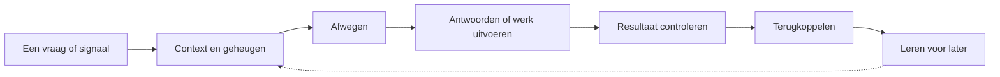

# Eva2 — een digitale huisgenoot in ontwikkeling

Eva is een persoonlijk AI-project: een digitale huisgenoot die mensen leert kennen, meedenkt en helpt met dagelijkse en digitale taken. Het doel is een assistent met een herkenbare persoonlijkheid die niet alleen antwoord geeft, maar een opdracht ook kan opvolgen, controleren en er later van kan leren.

Eva is **in ontwikkeling**. Dit is een werkend project met echte onderdelen en een geïnstalleerde testomgeving, geen afgerond product. Sommige mogelijkheden zijn technisch aangetoond in een beperkte proef; zelfstandig taken betrouwbaar afronden en prettig dagelijks gebruik moeten nog verder worden bewezen.

## Wat Eva moet kunnen

- **Natuurlijk contact:** gesprekken voeren via onder meer Telegram en een eigen webomgeving, met een herkenbare persoonlijkheid en aandacht voor de situatie.
- **Mensen en context onthouden:** relevante voorkeuren, afspraken en eerdere gesprekken gebruiken, met mogelijkheden om informatie te bekijken, corrigeren of vergeten.
- **Initiatief nemen:** zelf afwegen of een signaal of afspraak aandacht verdient, en kiezen tussen een vraag, voorstel, actie of juist stilte.
- **Werk uitvoeren:** opdrachten op de achtergrond oppakken, voortgang bewaren, resultaten controleren en terugkoppelen aan de oorspronkelijke gebruiker.
- **Zich ontwikkelen:** waar nodig hulpmiddelen of uitbreidingen maken, beoordelen en later hergebruiken. De ambitie is dat Eva steeds zelfstandiger digitale werkzaamheden kan uitvoeren.

Dat zijn de doelen van het project, geen belofte dat elke mogelijkheid al volledig betrouwbaar werkt. Verbindingen met bijvoorbeeld apparaten, camera's en spraak zijn uitbreidingen en kennen hun eigen voorwaarden en tests.

## Voorbeelden uit het dagelijks leven

Deze voorbeelden laten zien waar Eva naartoe groeit. Of een voorbeeld volledig werkt, hangt af van de aangesloten mogelijkheden en moet in de praktijk worden getest.

- **Een afspraak onthouden:** iemand vertelt Eva over een afspraak. Eva kan de context bewaren en die later gebruiken wanneer een passend vervolg aan de orde is.
- **Een opdracht opvolgen:** iemand vraagt Eva om informatie uit te zoeken. Eva kan het werk op de achtergrond aanpakken en een resultaat teruggeven aan degene die de opdracht gaf.
- **Zelf iets opmerken:** een toegestane bron verandert. Eva kan afwegen of dat nuttig is om te melden, of dat ze beter stil kan blijven.
- **Een hulpmiddel verbeteren:** bij een afgebakende programmeertaak is een door Eva gemaakte kandidaat onafhankelijk vergeleken, toegepast en later gebruikt. Dat is een beperkte technische proef, geen bewijs dat alle zelfgemaakte uitbreidingen veilig werken.

## Wat er al staat

Er is één gedeelde Eva-kern voor gesprekken, geheugen, initiatief en achtergrondwerk. De bestaande installatie ondersteunt contact via Telegram en een lokaal dashboard. Taken hebben een eigen status en er zijn voorzieningen om werk te stoppen, resultaten aan de juiste persoon te koppelen en onzekere handelingen niet blind te herhalen.

Een beperkt voorbeeld van zelfverbetering is technisch getest: Eva maakte voor een vooraf afgebakende programmeertaak een kandidaat, die onafhankelijk werd vergeleken, toegepast en later gebruikt. Dat bewijst de werking van die specifieke route, niet dat Eva willekeurige software zelfstandig en veilig kan aanpassen.

Recente praktijktests lieten ook zien waar verbetering nodig is: achtergrondtaken kunnen vastlopen, bijvoorbeeld wanneer benodigde bestanden ontbreken. Een bevestiging dat werk is gestart betekent daarom niet dat het resultaat klaar is. De vervolgstap is de volledige route van opdracht tot gecontroleerd resultaat en terugmelding in gewoon gebruik aantonen.

## Hoe het werkt

Eva volgt een eenvoudige gedachtegang:

Dit schema laat de beoogde kringloop zien. De onderdelen zijn in verschillende mate gebouwd en getest; het schema is geen bewijs dat iedere stap al betrouwbaar werkt.

Gesprekken en achtergrondwerk delen dezelfde kern en persoonscontext. Bij een langere opdracht kan Eva werk apart uitvoeren, zodat het gesprek niet op het resultaat hoeft te wachten. Het ontwerp houdt rekening met privacy, toegangsrechten, herkomst van informatie en het onderscheid tussen een poging en een bevestigd resultaat.

## Technieken

| Techniek | Rol in het project |
| --- | --- |
| **Python** | De programmeertaal van de kern, uitvoerders en integraties. |
| **AI-taalmodellen en PydanticAI** | Gesprekken, het interpreteren van context en het aansturen van toegestane hulpmiddelen. |
| **PostgreSQL en Hindsight** | Vastleggen van onder meer gesprekken en taken, en het terugvinden van persoonsgebonden herinneringen. |
| **FastAPI** | Koppelingen tussen de kern, het dashboard en andere onderdelen. |
| **Docker en WSL** | De huidige omgeving om onderdelen geïsoleerd te draaien en te installeren. |
| **Telegram, API's en MCP** | Kanalen en koppelingen waarmee Eva met mensen en externe mogelijkheden kan werken. |
| **LiveKit en spraakcomponenten** | De bestaande route voor spraak, die nog afzonderlijk wordt afgerond. |
| **Tests en onafhankelijke beoordeling** | Controleren of een wijziging werkt en of een resultaat aan de oorspronkelijke opdracht voldoet. |

Niet elke koppeling is voor ieder huishouden aangesloten of volledig in de praktijk bewezen. De techniek is een middel: de waarde van het project zit uiteindelijk in nuttig, betrouwbaar en prettig dagelijks gebruik.

## Waarom ik dit project bouw

Eva brengt meerdere onderdelen van AI samen in één praktijkproject: gesprekken, geheugen, taakuitvoering, initiatief, integraties en het beoordelen van resultaten. Het project laat zien hoe ik nadenk over de stap van een model dat antwoord geeft naar een assistent die met echte context en verantwoordelijkheden werkt — inclusief de fouten en grenzen die daarbij horen.

## Verder kijken

- [Projectdoel](development/docs/PROJECTDOEL.md): de ambitie en voorwaarden voor oplevering.
- [Architectuur](development/docs/ARCHITECTUUR.md): hoe de onderdelen samenwerken en waar hun grenzen liggen.
- [Werkbord](development/docs/WERKBORD.md): de actuele uitvoering en resterende taken.
- [Afrondingsplan](development/docs/AFRONDINGSPLAN.md): de volgorde en de praktische eindvoorwaarden.

Voor ontwikkeling staan de Python-bronnen in `src/`, installatiebestanden in `deploy/` en documentatie en tests in `development/`. De installer begint bij `start-installer.py`. Bestaande runtimegegevens en geïnstalleerde containerimages staan los van deze broncode. De repository bevat geen algemene claim dat Eva beter presteert dan andere AI-assistenten.
