# Eva runtimecontracten en foutlokalisatie

Status: architectuurbron voor de actuele werkboom van 20 augustus 2026.

<!-- eva-runtime-source-digest: ae881720a24a89821bfa4f73ede26cad75f94c14705754037bd33addeae6c7af -->

Deze kaart heeft een ander doel dan een gewone componentbeschrijving. Iedere
pijl benoemt een concreet runtimecontract: welke gegevens binnenkomen, welke
gegevens eruit gaan, welke toestand verandert en welke eigenaar een claim mag
autoriseren. De automatisch gegenereerde runtimebestandslaag staat in
`eva-runtime-contract-map.generated.md` en
`eva-runtime-contract-map.generated.json`. De afzonderlijke repositorybrede
inventaris staat in `eva-repository-inventory.generated.md` en
`eva-repository-inventory.generated.json`.

De mechanische runtimekaart dekt alle uitvoerbare JavaScriptmodules onder `src`
plus iedere lokale module die zij importeren. De repository-inventaris dekt
daarnaast ieder gevolgd, verwijderd of niet-genegeerd nieuw pad en legt Git-,
gate- en releasestatus vast. Zij detecteert begrensd ook spawn-, systemd-,
installer-, browser- en testselectieranden. Private `.env`, `data`, coverage en
Pythoncache worden nooit inhoudelijk gelezen. `node_modules` wordt niet als
repository-inhoud gescand of gehasht; de generator gebruikt wel de geïnstalleerde
TypeScript-parser als verificatiedependency.

Tests staan niet in het productiedatapad. Hun exacte entrypoints en
package-selectie staan in de repository-inventaris. Een test geldt pas als
bewijs voor een semantische contractpijl wanneer die koppeling in een gerichte
acceptatie of contracttest zelf expliciet is gemaakt. De inventaris doet dus
geen algemene dekkingsclaim op basis van alleen een bestandsnaam.

De historische audit in `eva-runtime-map.md` is bij deze review opnieuw met de
actuele bron vergeleken. De kerneigenaars zijn niet verplaatst: `agent.js`
regisseert de beurt, `tools.js` bezit de registry, `portfolio.js` bezit de
episode-lifecycle en de kanaaladapters bezitten hun transport. Sinds die audit
zijn wel drie grenzen aangescherpt: herstelmodus begrenst proces-I/O, HTTP-voice
heeft een eigen duurzame ingressbron naast native HA voice, en delivery sluit
pas met kanaalspecifiek ACK-bewijs. Daarom blijft de historische kaart een
gedateerde audit en is dit document de actuele semantische bron.

## Werkwijze bij iedere fout

1. Leg de letterlijke gebruikersinvoer en het waarneembare verkeerde resultaat
   vast.
2. Kies hieronder de bijbehorende end-to-end-keten.
3. Zoek de eerste pijl waarvan het uitvoercontract niet meer klopt met het
   invoercontract.
4. Wijzig alleen de eigenaar van die pijl. Downstream workarounds zijn niet
   toegestaan zolang de eerste contractbreuk niet is hersteld.
5. Noteer vooraf welke andere ketens dezelfde pijl gebruiken.
6. Bewijs eerst de contractbreuk, daarna de reparatie, en als laatste de hele
   natuurlijke keten. Een gescripte modeluitkomst is geen taalacceptatie.

Een productwijziging is vanaf nu niet releasebaar wanneer deze kaart of de
gegenereerde kaart na de wijziging niet meer klopt.

## Hoofdtekening

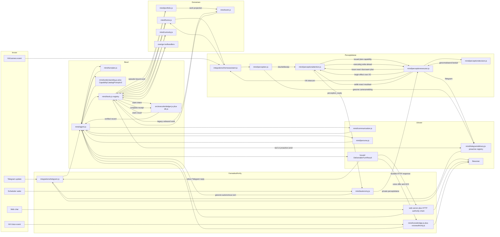

De hoofdregel is: kanaalbewijs geeft beurt-authority, understanding geeft
semantische authority, het execution-ledger geeft toolbewijs, een domeinreceipt
geeft feitenbewijs en het kanaalspecifieke transport- of ACK-receipt geeft
accepted of acknowledged deliverybewijs. Dat bewijst niet dat een mens het
bericht werkelijk heeft gelezen. Geen modeltekst mag een van deze authorities
vervangen.

## Processtart en readiness

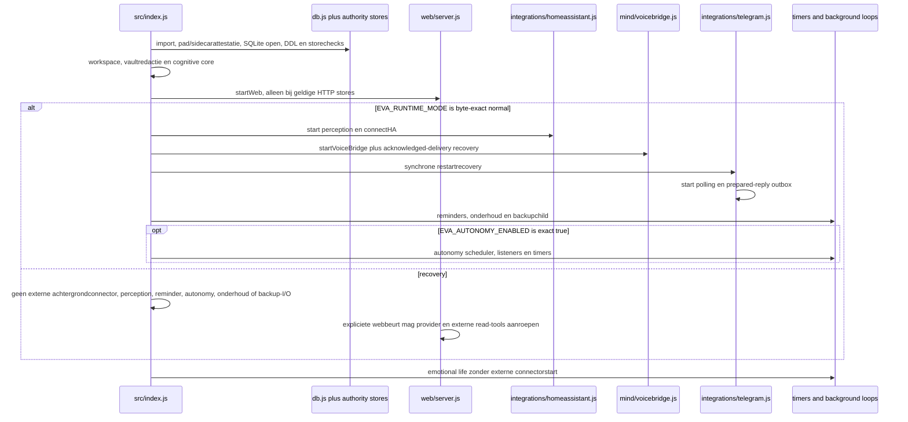

Web kan dus al luisteren voordat HA volledig authenticated en subscribed is.
In de veilige herstelmodus is dat lokale webpad de enige gestarte adapter. De
modus start geen externe achtergrondconnectoren en blokkeert iedere non-read
tool, maar een expliciete webbeurt mag nog wel de provider en externe read-tools
zoals HA-read of webread aanroepen. `external_effects_enabled=false` is daarom
geen nul-outboundgarantie. Alleen de byte-exacte waarde `normal` opent de
achtergrondconnectoren en non-read tools.
Ook in normale modus start autonomie pas na de afzonderlijke expliciete waarde
`EVA_AUTONOMY_ENABLED=true`. HA-afhankelijke handlers moeten hun eigen readiness
controleren. Telegram polling begint pas na de synchrone Telegram-recovery;
native voice heeft daarnaast een eigen achtergrond-drain voor reeds
geacknowledgede HA-deliveries.

## Canonieke gegevensobjecten

| Object | Producent | Verplichte invoer | Uitvoer | Consumenten | Foutbetekenis |
| --- | --- | --- | --- | --- | --- |
| Kanaal-ingressauthority | Telegram, HTTP-ingress of voicebridge | authentieke transportbron, request/message-id, conversatie, identiteit en actuele claimgeneratie | opaque capability plus herleidbare bronhash; HTTP voegt exact claimevent toe | `agent.js` | geen beurt starten |
| `TurnEnvelope` | host/orchestrator in `agent.js` met constructor uit `understanding.js` | ruwe tekst, requester, kanaal, gesprek, context | begrensde immutable modelinvoer | `understandTurn` | fail closed zonder effecten |
| `TurnUnderstanding` | `understanding.js` | envelope, capabilitycatalogus, provideruitkomst, hostguards | gehashte dialoogact, requirements, acties, planning en monitoring | `agent.js`, `tools.js` | retry binnen budget, daarna semantische fout |
| `TurnUnderstandingExecutionAuthority/v1` en `/v2` | `agent.js` plus storegrenzen in `turnauthority.js` | exact started `@turn/understanding`, kanaalbron en generatie; v2 vereist een HTTP claimeventref | append-only sidecar die execution, bron en issuance bindt | understanding-replay, portfolio en delivery | ontbrekende, ambigue of gewijzigde binding maakt de store of rij ongeldig |
| `CapabilityCatalogPrompt/v2` | `understanding.js` | volledig genormaliseerde hostcatalogus met 49 capabilities en 93 operations | deterministische interned promptprojectie van operations, expliciete validatievelden, field maps/types, proofsets, rebind/source/freshness en geselecteerde modelzichtbare executionvelden; descriptions en host-only executionmetadata blijven erbuiten | de providercallbacks van `understandTurn` en `decideTurnStep` | projectiefout faalt gesloten; budgetdrift blokkeert release en mag niet met verlies van de geprojecteerde validatiesemantiek worden gerepareerd |
| Issued plan | `tools.js` | geverifieerde understanding plus capability | exact tool, args, requirement-id, effect en bewijsregels | `executeTool` | geen uitvoering bij mismatch |
| Execution record | `db.js` / `executionledger.js` | issued plan, execution key, args | monotone ledgerstatus plus outputhash | agent, recovery, replyguards | collision of onzekere uitvoering |
| `ActionResult/v1` | toolhandler of domeineigenaar | exact plan en externe read/effect | `ok`, `verified`, `changed`, `partial`, typed `data`, bewijs | agent, communication, portfolio | nooit reduceren tot alleen een boolean |
| `BoundedHomePartialContinuation/v1` | `tools.js` plus `agent.js` | exact een automatisch gelogde, direct voorafgaande `bedien_huis` partial en exact een verse same-entity `ha_lees` observation | typed begrenzing met broncompletionhash, entity, verwachte state, bereikbare/onbereikbare aantallen en namen; authority blijft private en ledger-backed | `communication.js` replyguard | ontbrekend, dubbel, cross-entity of ledgerloos bewijs blokkeert iedere status- of totaliteitsclaim |
| Turn-effectmanifest en planmarker | `agent.js` met specs uit `executionledger.js` | started store-owned `@turn/understanding` parent | exact `TurnEffectManifest/v1` met `verified_empty`, daarna vóór tool-I/O zo nodig een exact planrecord | interrupted-parentrecovery | alleen exact leeg mag generieke handoff; iedere andere toestand vereist effectreconciliatie |
| Goal episode | `portfolio.js` | work, origin, delivery policy | duurzame episode met monotone staat | autonomy, recovery, delivery | werk blijft open of fail closed |
| Immutable monitoringcontract | `understanding.js` | originele conditie, exacte readbindings, schedule, requester | gevalideerd contractobject | agent/tools voor persistence en resume | geen contract zonder volledige brondekking |
| Durable monitoringstate | agent/tools plus `portfolio.js` / `work.js` | geldig monitoringcontract en work-start | contract in work `state_json`, episode en wake | autonomy en monitoringcycle | geen durable monitor zonder episode/workbinding |
| Antwoordclaim | `communication.js` en `persona.js` | understanding plus echte receipts | begrensde natuurlijke tekst | kanaaladapter | rewrite of vaste veilige fouttekst |
| Telegram accepted transport/archivebewijs | Telegramadapter plus ledger/archive | canonical tekst, frozen target, dedupekey en API-resultaat | accepted receipt met exact Telegram message-id plus intact, niet-ingetrokken Eva-archive | portfolio en replay | bewijst acceptatie door Telegram, niet menselijk lezen |
| HTTP acknowledged deliverybewijs | HTTP response/deliverychain | canonical wire, write generation, clientkey en signature | signed client-ACKreceipt plus attempt-scoped agentproof voor HTTP-voice | HTTP replay, agent en deliveryprojectie | socketfinish of een ACK van het verkeerde route- of kanaaltype is onvoldoende |
| Voice acknowledged deliverybewijs | voicebridge plus voiceauthority | exact offer, querybron en authenticated HA-ACK | append-only ACK en delivered projectie | voice recovery en agent delivery | event-post zonder HA-ACK is onvoldoende |

## Gedeelde ABI's die voorheen impliciet waren

Deze contracten liepen door meerdere bestanden maar hadden geen gezamenlijke
tekening. Daardoor kon een lokale wijziging elders semantiek verliezen.

1. Objectidentiteit geeft authority. Een SHA bewijst bytes; lidmaatschap van
   een private WeakMap of WeakSet geeft het recht om iets uit te voeren.
   Serialiseren en opnieuw opbouwen geeft geen authority.
2. `ActionResult/v1` is de gedeelde tool-ABI:
   `ok`, `changed`, `verified`, `partial`, `needs_followup`,
   `effect_uncertain`, foutvelden, `data` en `evidence`. Geen tussenlaag mag
   `partial` of `effect_uncertain` tot alleen `ok` reduceren.
3. `semanticBinding` is de join tussen begrip, plan, uitvoering, monitoring en
   antwoordbewijs. De bepalende velden zijn understanding-SHA, requirement-id,
   capability-id, operation-id, rol, geadresseerde requirements en
   basisreceipts.
4. Historische berichten, geheugen, mood, presence en modelperceptie zijn
   context. Zij zijn nooit actuele state-, identiteit-, recipient- of
   effectauthority.
5. Een antwoordobject is niet hetzelfde als delivery. Alleen Telegram
   API-acceptatie, een native HA voice-ACK of een duurzame HTTP client-ACK mag
   accepted/acknowledged delivery en episodeafsluiting autoriseren. Geen van
   die receipts bewijst dat de bewoner het bericht werkelijk gelezen heeft.
6. `verified=true` is scopespecifiek. Bij Home Assistant bewijst het alleen de
   benoemde `verification_scope` en opgenomen coverage, nooit stilzwijgend het
   hele huis.
7. Monitoring herinterpreteert de conditie niet bij iedere wake. Het bewaart
   de oorspronkelijke conditie en exacte readbindings, en leest die bronnen
   opnieuw.
8. Autonomie gebruikt dezelfde turnkernel, maar alleen met een actuele
   scheduler-epoch, runtimeprincipal, worklease en exact geselecteerd durable
   commitment.
9. Persona en model formuleren; deterministische guards autoriseren claims.
   Een mooiere zin mag nooit meer feit- of effectauthority krijgen.
10. Turn-freshness wordt opnieuw gecontroleerd voor providerwerk, voor iedere
    mutatie en voor native delivery. Een oude closure of oude planreferentie is
    geen geldig equivalent.
11. `CapabilityCatalogPrompt/v2` is een compacte projectie, geen nieuwe
    capabilityregistry en geen authority. Interning mag bytes delen, maar moet
    alle 49 capabilities en 93 operations met effect, expliciete
    validatieprojectie, bewijs, rebind/source, freshness en de geselecteerde
    modelzichtbare executionvelden exact herleidbaar houden. Descriptions en
    host-only executionmetadata blijven buiten de prompt; hun semantiek en
    authority blijven host-side. De semantische payload blijft onder 16 KB en
    de directe callback-requestcanary met realistische voice-identiteit onder
    30 KB. Die laatste grens claimt niet dat de latere providerwirebody zelf is
    gemeten; een hogere limiet is geen reparatie voor verlies.
12. Een korte Home-vervolgvraag krijgt alleen eerdere effectcontext wanneer
    precies een direct voorafgaande, afgeleverde en automatisch gelogde
    `bedien_huis`-uitvoering exact verifieert. De private partialbegrenzing en
    de verse same-entity observation moeten beide opnieuw uit het execution-ledger
    komen; vrije tekst of caller-JSON verleent geen claimauthority.
13. Interrupted-parentrecovery classificeert eerst het volledige effectmanifest.
    Reply-, origin- en supersessionbewijs worden pas bekeken nadat alleen het
    exacte `verified_empty`-manifest overblijft. Een ontbrekend/ongeldig
    manifest, planmarker of andere started/done/transport-child domineert en
    eindigt `effect_reconciliation_required` zonder provider, tool of send.
14. Herstelmodus is een globale grens voor automatische externe start en
    non-read tools. Iedere waarde van `EVA_RUNTIME_MODE` behalve byte-exact
    `normal` blokkeert externe achtergrondconnectoren, perception, reminders,
    autonomy, onderhoud en backups. Toolpolicy laat in die modus alleen als read
    geclassificeerde tools toe. Een expliciete webbeurt mag de provider en zulke
    externe read-tools, waaronder HA-read en webread, wel aanroepen. Daarom
    betekent `external_effects_enabled=false` niet nul outbound verkeer. Een
    caller, modelplan of lokale effectpolicy kan de non-readgrens niet verruimen.
15. Autonomie is ook in normale modus opt-in. Zonder exact
    `EVA_AUTONOMY_ENABLED=true` ontstaan geen schedulerlistener, timer, lease of
    providercall en geeft een directe autonomous entry een vaste disabled
    uitkomst terug.
16. Native HA voice en HTTP-voice delen het kanaallabel `voice`, maar nooit hun
    authority. Native voice gebruikt een bodygebonden `voice_ingress` v1-bron
    en HA-ACK. `/api/voice` gebruikt een bodyloze `http_voice_ingress` v2-bron,
    een append-only HTTP-claimevent en een getekende client-ACK. De duurzame
    source kind, niet een caller-controlled transportlabel, kiest de verifier.
17. Bij provideruitval mag alleen een volledig gematchte kleine sociale chatzin
    via `persona.js` een vaste menselijke reactie krijgen. Die route start geen
    tweede modelcall, durable handoff, workitem of episode. Een begroeting met
    extra opdrachttekst valt nooit onder deze uitzondering.

## Bekende architectuurverschillen en nog niet aangesloten code

- `artifactcollections.js` en `materiallifecycle.js` hebben momenteel geen
  productiecaller. `workcompletion.js` is alleen vanuit die slapende keten
  bereikbaar. Hun strengere bewijsregels beschermen de live agent/toolroute
  dus niet.
- Gewone camerameldingen gebruiken een proceslokale queue plus KV-cooldown.
  De deurbelroute gebruikt een durable incident-, plan- en effectledger. Dat
  zijn bewust verschillende crashgaranties.
- Workcells voeren interne zoekstreams uit buiten het gewone turn-substep
  ledger. Alleen het buitenste workcellreceipt is authority.
- `appearance.js`, `localbrain.js` en delen van `tools.js` cachen gegevens bij
  import. Wijzigingen in KV of householdrollen kunnen daardoor een restart
  nodig hebben.
- Workspace-storeinitialisatie in `tools.js` kan pas bij de eerste write als
  fout zichtbaar worden. Startup-health dekt die readiness nog niet volledig.
- Web kan requests aannemen voordat HA volledig authenticated en subscribed
  is. HA-afhankelijke routes moeten daarom hun eigen readiness fail closed
  controleren.

## Een gewone interactieve beurt

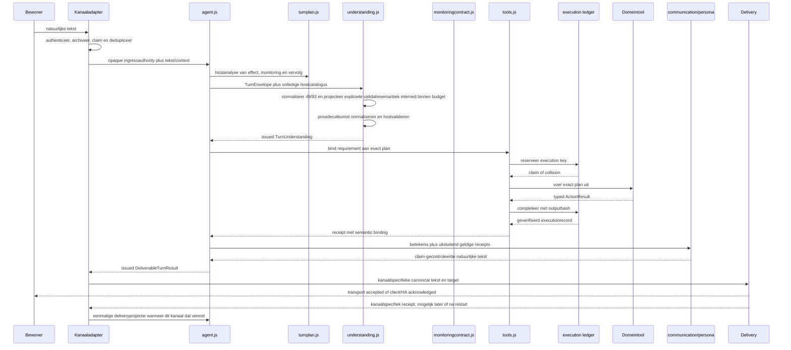

### `CapabilityCatalogPrompt/v2`

`understanding.js` valideert eerst de volledige hostregistry en sorteert daarna
deterministisch 49 capabilities met samen 93 operations. De v2-projectie
internt herhaalde field types, field maps, input schemas en proofsets. Iedere
operation blijft na dereference exact herleidbaar tot capability/operation,
effect, deferred vlag, expliciete validatieprojectie, iterative/direct mode,
materialiseerbare velden, targetveld, proof needs, rebindable en optionele
source-bound velden en static/live/historical freshness. Uniforme freshness mag
een capabilitybreed getal zijn; gemengde freshness blijft een array in exact
dezelfde gesorteerde operationvolgorde.

Dit is uitsluitend een deterministische promptprojectie van de expliciete
modelvalidatiegrens. Descriptions, de echte registry, issued planobjecten,
host-only executiondrivers en executionmetadata, source receipts en
WeakMap/WeakSet-authorities blijven buiten de payload en onder hosteigendom.
Interning kan dus geen operatie toevoegen, args invullen, sourcebinding
omzeilen of modelrechten uitbreiden. Zowel `understandTurn` als
`decideTurnStep` gebruikt deze projectie voor zijn providercallback. De
acceptatiegrens is semantisch en fysiek: exact 49/93 zonder dubbele of
ontbrekende operation, iedere interned reference gebruikt en terugleesbaar, de
semantische payload onder 16 KB en de directe callback-requestcanary met
realistische voice-identiteit onder 30 KB. Die canary meet niet de door
`chatComplete` verrijkte providerwirebody. Verlies van de geprojecteerde
validatiesemantiek of een onbekende reference faalt gesloten vóór een issued
`TurnUnderstanding`. Een budgetoverschrijding is een releasebreuk in de
acceptatiecanary, geen extra runtime-authority en geen reden om velden weg te
laten of modelrechten te verruimen.

### Zoekvolgorde bij fouten

| Waarneembare fout | Controleer eerst | Daarna | Niet als eerste wijzigen |
| --- | --- | --- | --- |
| Tool werd niet gekozen | `turnplan.js`, `understanding.js` validation history | capabilitybinding in `tools.js` | antwoordtekst |
| Verkeerde toolargumenten | issued understanding en exact plan | domeinresolver | Telegram of persona |
| Tool deed het juiste maar antwoord liegt | `ActionResult`, normalisatie in `util.js`, receiptselectie in `agent.js` | guards in `communication.js` | domeinuitvoering |
| Goed antwoord maar niet bezorgd | deliveryauthority, outbox en receipt | episode-afsluiting | understanding |
| Dubbele uitvoering | execution key en ledgertransitie | recovery/adoptie | modelprompt |
| Stilte na geldige beurt | replyguard/rewrite en canonical tekst | kanaalbinding | opnieuw tool uitvoeren |

## Home Assistant-handeling

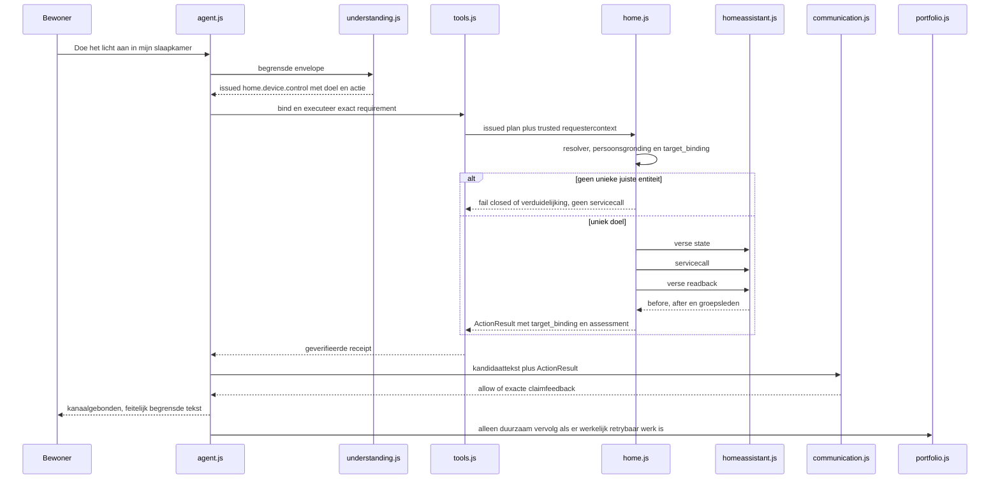

Belangrijke splitsing: `partial=true` kan bij een groepshandeling betekenen dat
de handeling op alle bereikbare leden aantoonbaar gelukt is en enkele leden
offline zijn. Dat is geen totale mislukking. De reply moet de bewezen subset en
de onbereikbare subset noemen; er mag geen vrij vervolgwerk ontstaan wanneer
`retryable=false` is.

### Vervolg op een begrensd partial Home-resultaat

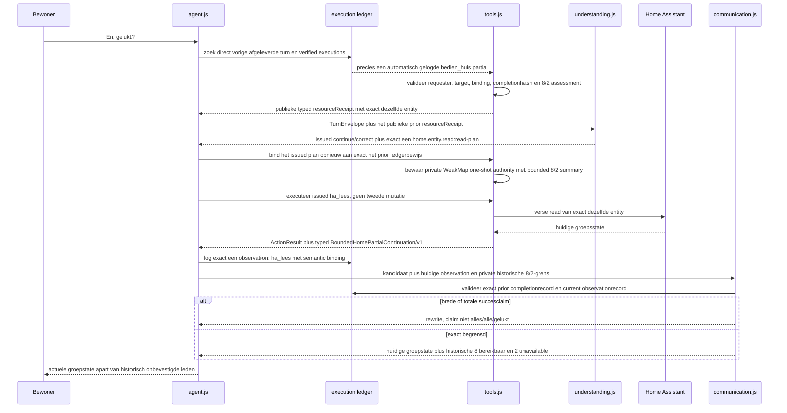

De eerste beurt moet dus vanzelf in het ledger staan; een handmatig ingevoegde
testreceipt is geen productbewijs. De private one-shot planbinding draagt de
bounded 8/2 summary de read in. De typed summary mag daarna in het ActionResult
staan, maar verleent zonder de twee exact teruggelezen ledgerrecords geen
authority. De vervolgbeurt accepteert precies een geldige prior kandidaat en
precies een automatisch gelogde `ha_lees`-observation voor dezelfde entity. De
actuele groepsstate mag worden gemeld, maar de twee leden die bij de vorige
actie unavailable waren blijven een historische grens. Zonder een nieuwe
memberread mag Eva niet zeggen dat zij nu nog offline zijn. Brede formuleringen
zoals "alles is uit", "gelukt" of "alle lampen" worden door de ledger-backed
replyguard geweigerd.

## Conditionele monitoring

```mermaid
sequenceDiagram
  participant U as Bewoner
  participant A as agent.js
  participant TP as turnplan.js
  participant N as understanding.js
  participant R as tools.js
  participant HC as home.js context
  participant P as portfolio/work
  participant AU as autonomy.js
  participant M as runMonitoringCycle
  participant D as Telegram delivery

  U->>A: Geef aan wanneer buiten kouder is dan binnen
  A->>TP: letterlijke tekst en trusted requester
  TP-->>A: requested, deliveryRequired, voor deze vergelijking twee bronnen
  A->>N: envelope plus host monitoring spec
  N-->>A: issued contextread, twee entityreads en work.start
  A->>R: voer governed requirements uit
  R->>HC: begrensde huidige HA-kandidaten
  HC-->>R: volledige typed kandidaten of partial fail closed
  A->>R: bind elke bron uniek tegen discoverybewijs
  R->>HC: lees twee exacte gebonden entities
  HC-->>R: typed ActionResults
  R-->>A: twee distincte geverifieerde receipts
  A->>MC: maak immutable contract uit issued spec, exacte ledgerreceipts en requester-origin
  MC-->>A: compact MonitoringContract/v2 plus binding-, presentatie- en deliveryhashes
  A->>R: exact werk-startplan met hostvelden
  R->>P: persist episode, work state_json en wake
  A-->>U: alleen kanaalgebonden startbevestiging
  loop iedere wake
    AU->>A: lease en opgeslagen contract
    A->>R: maak plannen voor alle opgeslagen exacte entities
    R->>HC: lees alle gebonden entities opnieuw zonder WS-cache
    HC-->>R: verse ActionResults
    R-->>A: verse complete receipts
    A->>M: contract plus verse readercallback
    M-->>A: strikt silent of notify verdict
    alt conditie onwaar
      A->>P: waiting plus volgende wake, geen bericht
    else conditie waar
      A->>MC: seal outcome, factrefs, tekst, expiry en lifecycle-generation
      A->>P: delivery_pending plus MonitoringPendingDelivery/v2 en veilige wake
      P->>P: herleid start-, binding-, observation-, outcome- en work-startledger
      A->>D: start alleen vóór H-90; ieder child vóór H-30 met abortsignal
      D-->>A: exact accepted child- en fanoutbewijs
      A->>P: record exact deliveryreceipt in dezelfde actuele lifecycletransactie
      P->>P: episode closed, work done
    end
  end
  opt afgesproken horizon verloopt zonder match
    A->>P: closed volgens horizonregel, zonder matchbericht
  end
```

De facthorizon `H` is het minimum van pending-expiry en contracteinde. Nieuwe
wire-I/O mag alleen vóór `H-90s` beginnen; vlak vóór ieder Telegram-child geldt
`H-30s` en de grammY-call krijgt een overeenkomstig abortsignal. Een verlopen,
onzekere of gedeeltelijke transportpoging wordt nooit blind herhaald. Wanneer
alle directe Telegramchildren en het volledige fanoutmanifest aantoonbaar vóór
`H` zijn geaccepteerd, mag een verse processtart ook ná `H` uitsluitend het
portfolio-receipt sluiten. Die receipt-only route doet geen providercall,
HA-read, judgecall, messenger- of Telegram-wirecall. Acceptatie ná `H` kan geen
monitoringreceipt autoriseren.

Een contextread is discovery, nooit meetbewijs. Het contract ondersteunt een
tot acht distincte entityreads; deze vergelijking vereist er twee. Een monitor
mag alleen starten met volledige broncoverage. Normale woorden zoals buiten en
binnen moeten via de contextbinder naar exacte HA-entiteiten kunnen worden
opgelost; een ambigu gelijkspel blijft fail closed.

## Autonomie en eigen initiatief

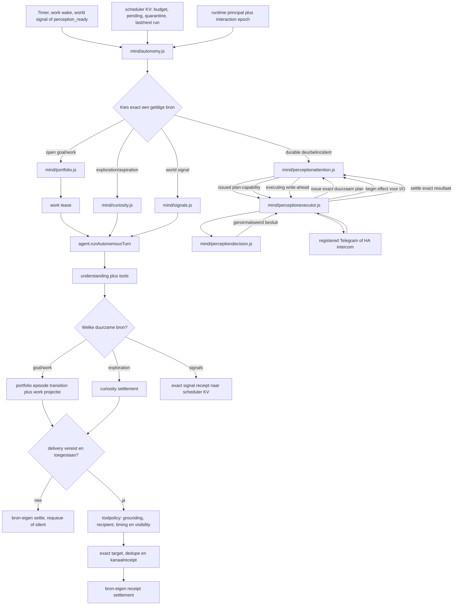

Vrije autonomie mag geen privegesprek kiezen zonder host-geattesteerde
episode-origin. De Telegram conversation-opportunityroute heeft een duurzame
cursor, zodat dezelfde zoekuitkomst niet als nieuw initiatief blijft
terugkomen. Dit is geen universele garantie: scheduler-signalen zijn pas
duurzaam nadat autonomy ze in KV heeft gezet, en de gewone person-cameralane is
voor transport proceslokaal. Portfolio, curiosity, signal-KV en perception
settelen in afzonderlijke transactiedomeinen.

## Crash en replay

Telegram gebruikt vier gekoppelde maar afzonderlijke duurzame machines. De
eerste machine begrenst een onderbroken store-owned understanding-parent vóór
de bestaande inbound-, handoff- en prepared-deliverymachines.

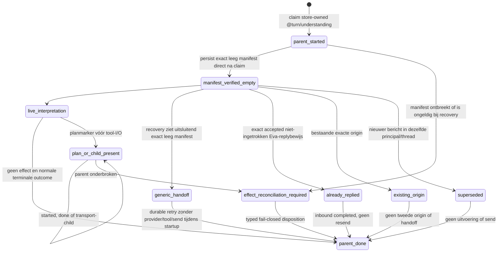

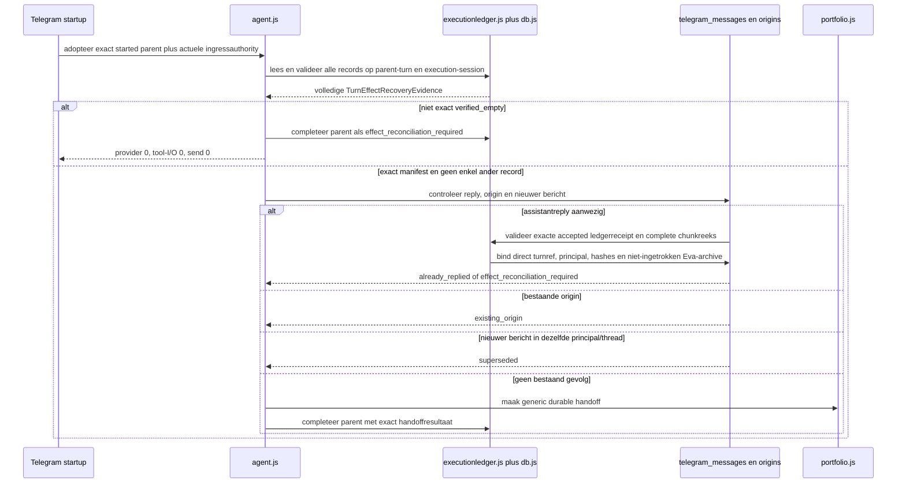

Het `TurnEffectManifest/v1` wordt onmiddellijk na de parentclaim als exact
`verified_empty` completionrecord geschreven. Zodra een semantisch plan
bestaat, schrijft `agent.js` vóór iedere mogelijke tool-I/O een deterministische
planmarker. Recovery classificeert het volledige recorduniversum voor zowel de
parent-turn als haar execution-session. Een ontbrekend of ongeldig manifest,
een malformed/legacy record, een planmarker en iedere `started`, `done`,
`transport_sending`, `transport_accepted`, `transport_retryable`,
`transport_rejected` of `transport_uncertain` child leiden daarom tot
`effect_reconciliation_required`. Alleen exact het ene lege manifest mag een
generieke handoff autoriseren.

Reply-, origin- en newer-messagebesluiten komen pas na die classificatie. Een
bestaande reply telt alleen als alle chunks uit dezelfde deterministische
deliverykey komen, de accepted transportintents en receipts exact canoniek en
hashgebonden zijn, direct turnref en originprincipal kloppen en het lokale
assistantarchive uniek, compleet, door Eva verzonden en niet deleted,
retracted, retraction-pending of retraction-uncertain is. Ieder child- of
planbewijs domineert een tegelijk aanwezige reply, origin of newer message.
Startup voert in al deze dispositionroutes geen provider, Home Assistant-call
of Telegram-send uit.

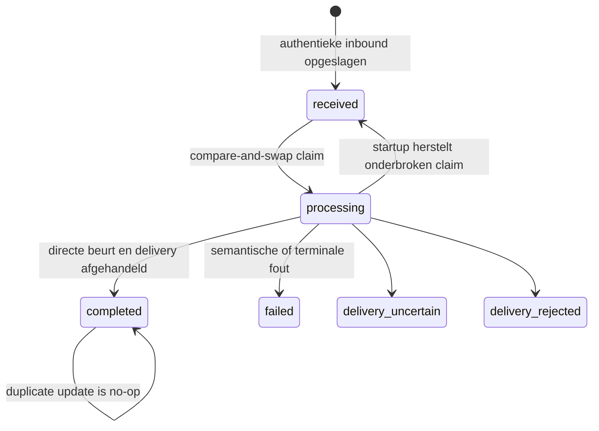

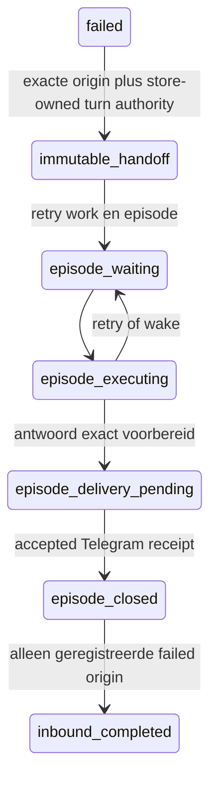

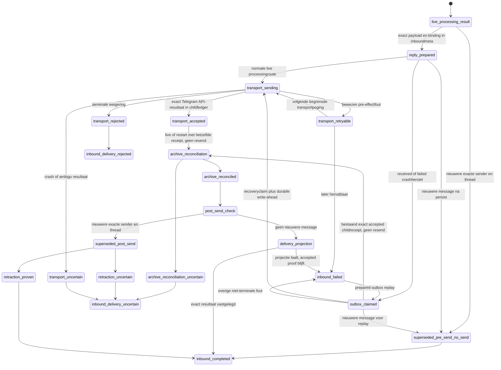

De inbound row blijft dus `failed` terwijl handoff en retry lopen. Een duplicate
inbound bij een geldige `delivery_pending` lifecycle wordt door een vroege
redeliverygate gestopt zonder provider, tool of tweede send. Dat is geen
self-loop in `telegram_messages.processing_status`.

Een aanwezige maar corrupte authority is niet hetzelfde als afwezige authority.
Afwezig kan een nieuwe route toestaan; corrupt moet vroeg en stil fail closed.
Recovery mag een eerdere externe handeling nooit opnieuw uitvoeren om alleen een
antwoord te herstellen.

De vierde Telegrammachine bewaart eerst de exacte prepared reply in de inboundrow
(`integrations/telegram.js:1598-1769`). Ook een aanwezige semantische foutcode is
onderdeel van de binding en moet bij replay bytegelijk terugkomen. Een normale
live `processing`-beurt gaat daarna via dezelfde duurzame fanoutmachine als
andere Telegramdelivery. Alleen crashherstel selecteert een `received` of
`failed` row met prepared binding en claimt haar opnieuw naar `processing`.
De inboundstatus wordt routespecifiek: `completed` na normale delivery of
pre-transport supersession zonder send, `failed` na een niet-terminale fout,
`delivery_uncertain` na een ambigu effect en `delivery_rejected` na een
terminale weigering (`db.js:2331-2368`,
`integrations/telegram.js:1697-1724,1792-1827,1880-1908`). Het onderliggende transport gebruikt
`transport_sending`, `transport_retryable`, `transport_rejected`,
`transport_uncertain` en `transport_accepted` (`integrations/telegram.js:524-650`).
De directe reply is aan het duurzame fanoutmanifest gebonden en bewaart de
delivery-dedupekey als episode-idempotencysleutel. Een lokale beurtsleutel zonder
volledig fanoutmanifest is geen vervangend transportbewijs
(`integrations/telegram.js:1661-1713,3241-3380`).
De childledger wordt eerst `transport_accepted`; pas daarna wordt het
assistantarchief gereconcilieerd (`integrations/telegram.js:397-454,645-650`).
Een restart met accepted ledgerbewijs valideert hetzelfde receipt en herstelt het
archive zonder resend (`554-559`). Kan dat archive niet exact worden opgebouwd,
dan blijft de accepted childstatus staan en wordt de inbounddelivery
`delivery_uncertain`. Alleen een exacte accepted Telegramreceipt plus
gereconcilieerd archive en deliveryprojectie kan
de normale succesroute terminaliseren. Supersession na accepted transport probeert
eerst die send aantoonbaar in te trekken: volledig bewezen retraction eindigt
`completed`, onzekere retraction eindigt `delivery_uncertain`
(`integrations/telegram.js:1726-1744`). Faalt alleen de lokale deliveryprojectie
na accepted transport, dan blijft het accepted childbewijs herbruikbaar en mag
recovery niet opnieuw zenden (`1746-1791`). Kanaalacceptatie bewijst niet dat
een mens het bericht las.

### HTTP crash en replay

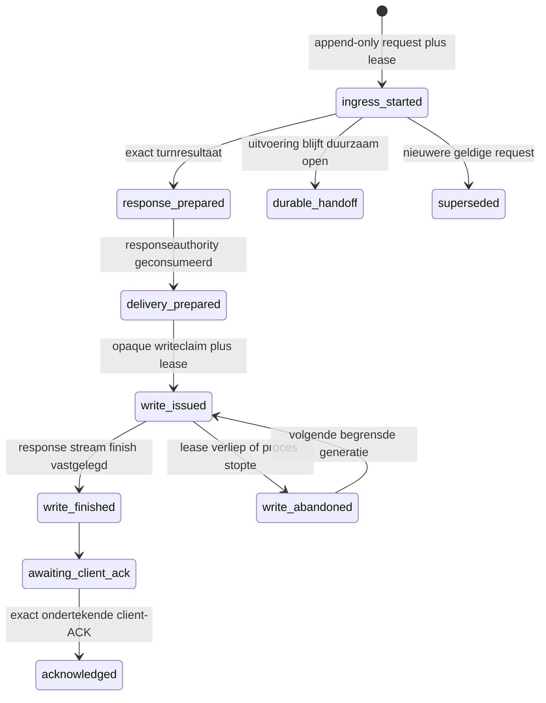

De transmissionevents zijn een orthogonale retrievalmachine. Ze veranderen de
delivery niet van `awaiting_client_ack` naar een andere staat en veranderen een
reeds `acknowledged` delivery evenmin terug.

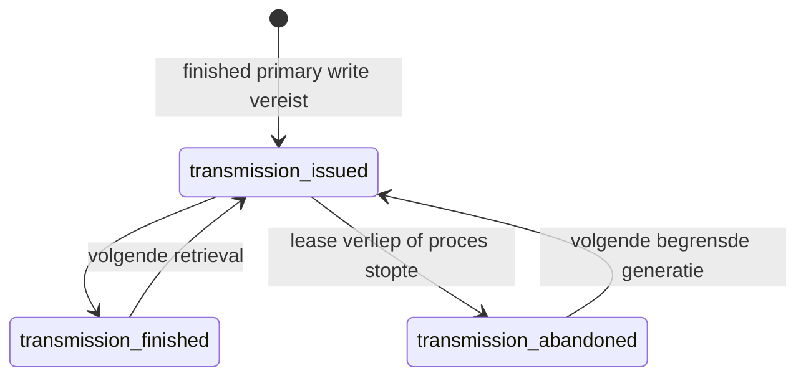

HTTP heeft geen generieke startupdrain. De request, prepared response, write- en
transmissionevents zijn append-only en een herhaalde request hervat via dezelfde
ingress- en leasecontracten (`web/server.js:440-783`,
`web/httpingress.js:2103-2521`, `web/httpdelivery.js:1479-1935`). Een
`res.finish` bewijst alleen dat die write/transmission is afgerond. Pas de exact
ondertekende client-ACK maakt de delivery `acknowledged`. De browser-UI hervat
haar requestflow vanuit IndexedDB (`web/public/app.js:634-730,825-830`). De
exacte request-, response- en ACK-binding, opslag, cleanup en retry staan in
`web/public/httpackclient.js:451-491,506-577,713-877`.

Webchat en `/api/voice` delen deze HTTP-machines, maar krijgen verschillende
duurzame bronsoorten. Webchat gebruikt `http_ingress`; `/api/voice` gebruikt
`http_voice_ingress`. Iedere nieuwe HTTP-understandingauthority is v2 en bindt
de request, intenthash, claimgeneratie en het exacte append-only acquired- of
renewed-claimevent. De issuance-tijd is exact de creatietijd van dat event.
Native Telegram en native HA voice blijven bodygebonden v1-bronnen. De
storemigratie accepteert alleen de exact bekende voorgangers, reconstrueert voor
iedere historische HTTP-v1-rij precies een uniek claimevent en bewaart alle oude
velden, hashes en outputbytes. Geen of meer dan een kandidaat faalt gesloten en
rolt de atomische initialisatie terug (`turnauthority.js:532-801`,
`web/httpingress.js:740-929`).

Voor HTTP-voice projecteert `httpdelivery.js` een acknowledged state bovendien
naar een opaque, attempt-scoped `AcknowledgedHttpAgentDeliveryProof/v1`. Iedere
verificatie leest request, route, source kind, prepared resultaat, wire en ACK
opnieuw uit duurzame state. Alleen `http-voice` met `/api/voice` mag daarna in
één transactie de episode-receipt en `chat_out` vastleggen. Een gewone web-ACK,
een native HA voicebewijs of een caller-controlled transportlabel kan deze grens
niet passeren. Na een crash mag dezelfde duurzame ACK een nieuwe lokale poging
autoriseren; de receipt- en chatprojectie blijven transactioneel idempotent
(`web/httpdelivery.js:1759-1928`, `mind/agent.js:10446-10708`,
`mind/portfolio.js:4607-4736`).

### Native voice crash en replay

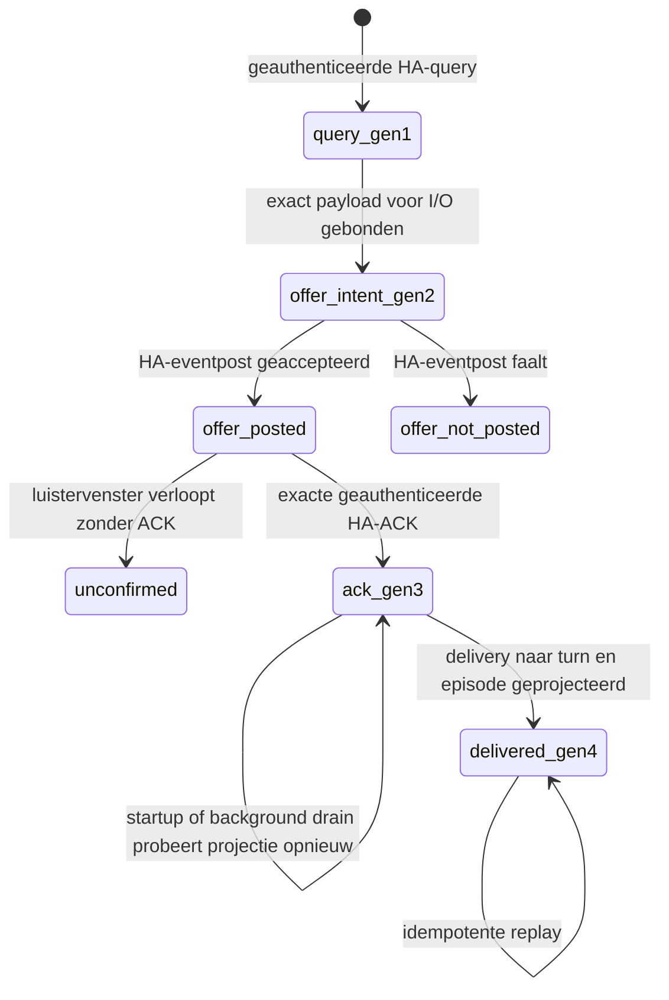

Voice bewaart query, offer-intent, ACK en geprojecteerde delivery als vier
afzonderlijke generaties (`voiceauthority.js:793-850`). Gen2 wordt vóór de
eventpost vastgelegd en bewijst dus nog geen HA-acceptatie. De native query-,
offer-intent- en eventpostroute staat in `mind/voicebridge.js:703-877`;
ACK-validatie en opslag in `609-700`. Een bij een
crash al vastgelegde gen3-ACK blijft via de startup- en backgrounddrain
projecteerbaar (`439-573`). Gen4 ontstaat pas bij de exact gebonden
`recordDeliveredReply`-projectie (`mind/agent.js:10617-10708`). Ook dit bewijst een
geauthenticeerde kanaal-ACK, niet dat een bewoner het antwoord hoorde. Alleen
gen3 wordt bij startup gedraind; een query of offer-intent zonder ACK wordt niet
als delivery gereplayd (`mind/voicebridge.js:439-455,836-883`).

## Incidentindex van 15 augustus

Deze tabel noemt alleen een eerste eigenaar nadat de voorgaande pijl met een
receipt, row of exacte functie-uitvoer correct is bewezen.

| Incident | Vooraf bewezen correct | Eerste afwijkende pijl | Eerste eigenaar | Downstream gedeeld | Bewijsanker |
| --- | --- | --- | --- | --- | --- |
| Keukenlicht ging uit, antwoord zei alleen onzeker | `bedien_huis` gaf `ok/changed/verified=true`, juiste target, acht bereikbare leden uit, twee unavailable en `retryable=false` | verified bounded partial ActionResult -> terminale agent outcome en replybegrenzing | `agent.js` | communication, portfolio, delivery | Telegram 4380/4381; execution seq 687; terminale partial-regressie in `partial-home-success.test.js` |
| `mijn slaapkamer` koos Lola's lamp | ingress en understanding bonden trusted requester Jaap plus target `mijn slaapkamer` | trusted requestercontext plus target -> home resolverinput | `tools.js` projectie naar `home.js` | HA-effect en replyguard | Telegram 4367/4375; verkeerde `light.slaapkamer_lola` receipt |
| `En, gelukt?` verloor of verbreedde het eerdere partial resultaat | vorige beurt had delivered chat-out en precies een automatisch gelogde geverifieerde `bedien_huis` partial | prior ledgerreceipt -> private 8/2-vervolgbinding -> exact same-entity `ha_lees` -> ledger-backed replyguard | `tools.js`, daarna `agent.js` en `communication.js` | understanding, executionledger en reply | `BoundedHomePartialContinuation/v1`; exact een prior completion plus exact een `observation:` read in `partial-home-success.test.js` |
| Natuurlijke monitorzin startte niet | letterlijke ingress en trusted requester waren geldig | letterlijke tekst -> `monitoringRequestSpec` | `turnplan.js` | understanding, discovery, contract en work | Telegram 4358; `requested=false` vóór monitoringinstruction |
| Monitoringcontext werd groter dan 8 KB | HA leverde de relevante states | HA-kandidaten -> bounded typed context-ActionResult | `home.js` | util compaction en binder | live receipt circa 13.757 bytes, daarna `output_truncated` |
| Oude Telegrammonologen verdrongen verse bewonersvraag | archive bevatte zowel verse failed bewonerrow als oude Eva-rows | afgesproken zoekvraag -> DB-ranking/resultaatset | `db.js` | tools opportunity en curiositycursor | autonomy episodes 1183/1204/1224 |
| Interrupted Telegramparent kon een bestaand childeffect als lege beurt behandelen | inbound row en store-owned started `@turn/understanding` authority bestonden exact | parent plus volledige childset -> effectdisposition vóór handoff/reply/origin/newer | `agent.js` en `executionledger.js` | Telegram startup, portfolio en delivery | native startupmatrix voor missing/invalid/started/done/transport/plan en accepted reply; recovery provider/tool/send 0 |
| Volledige capabilitycatalogus overschreed voice-promptbudget | de genormaliseerde registry bevatte exact 49 capabilities en 93 operations met geldige authorityvelden | genormaliseerde registry -> compacte interned projectie van de expliciete validatiesemantiek | `understanding.js` | `understandTurn`, `decideTurnStep` en vooral voice latency | `CapabilityCatalogPrompt/v2`; roundtrip 49/93, payload <16 KB en directe callback-request <30 KB in `voice-pe-routing.test.js` |
| Deurbelvervolgvraag ontkende de melding | accepted deurbelnotice stond exact in Telegramarchief met dedupe/provenance | Telegramarchief -> agent conversation/provenancecontext | `agent.js` | understanding en composer | deurbelincident 2; Telegram 4360 plus vervolgvraag |
| Minteken verdween bij `-5 graden` | normalizerinput bevatte U+2013 als unary minus | input -> `normalizeUserFacingText` | `util.js` | alle kanalen | gerichte `Buiten is het -5` regressie met Unicode invoer |
| Lange streep lekte via een kanaal | eerst per kanaal vaststellen of canonical output al schoon was | schoon canonical output -> adapter, of vuile input -> ontbrekende canonicalizer | de eerste concrete adaptergrens, anders `util.js` | transport en persisted chat-out | historisch Telegrambericht 4378; kanaalspecifieke boundarytest vereist |

## Eerste code-anker per contractpijl

| Pijl | Eerste eigenaar | Actueel anker |
| --- | --- | --- |
| procesconfig -> recovery of normale adapterstart | `config.js`, `index.js` | runtimegrens config 417-423; conditionele bootstrap index 53-99 |
| Telegram update -> authentieke beurtbron | `integrations/telegram.js` | archive/claim en private source rond regels 1278-1474; startup op 2392 |
| Web request -> durable ingressauthority | `web/httpingress.js` | authority rond 2103; durable source op 2136; `beginHttpIngress` op 2219 |
| HTTP-claim -> v2 understandingauthority | `mind/agent.js`, `turnauthority.js` | HTTP-source en insert agent 5631-5767; migratie en storegrens turnauthority 532-801, 1153-1257 |
| HTTP-voice client-ACK -> finale aflevering | `web/httpdelivery.js`, `mind/agent.js`, `mind/portfolio.js` | attempt-proof 1759-1928; agentprojectie 10446-10708; finale receiptverificatie 4607-4736 |
| HA voice event -> private turnbron | `mind/voicebridge.js` | provenance 332-421; querypad 703-891 |
| providerfout bij exacte kleine sociale beurt -> vaste menselijke reply | `mind/persona.js`, `mind/agent.js` | `directSocialReply` op 43; semantische failureroute rond 5508 |
| turntekst -> deterministic hostgrens | `mind/turnplan.js` | effect/monitoring 386-585 |
| hostcatalogus -> interned expliciete validatieprojectie | `mind/understanding.js` | `normalizeCatalog` 624-689; `catalogPrompt` 1050-1159; `understandTurn`-modelrequest rond 3275 en `decideTurnStep` rond 4127 |
| envelope -> issued understanding | `mind/understanding.js` | `understandTurn` rond 3435-3820 |
| requirement -> private toolplan | `mind/tools.js` | `planCapabilityAction` 1448-1498 |
| plan -> ledgerclaim -> uitvoering | `mind/agent.js`, `mind/tools.js` | agent 6521-6601; `executeTool` 5191-5239 |
| natuurlijke HA-ref -> entitybinding | `mind/home.js` | binder 544-576; context 828; operation 1531 |
| prior partial Home -> same-entity vervolgread -> begrensde reply | `mind/tools.js`, `mind/agent.js`, `mind/communication.js` | prior execution en private binding tools 1614-1810; automatische observation agent 6728; ledger/replyguard communication 371-590 |
| receipts -> natuurlijke reply | `mind/agent.js`, `mind/communication.js` | composer vanaf 5223; guards 98-475 |
| issued reply -> accepted Telegramdelivery | `integrations/telegram.js` | prepared binding 1598; fanoutpublicatie 1661; delivery 1772 |
| delivered result -> message/episode receipt | `mind/agent.js`, `mind/portfolio.js` | `recordDeliveredReply` 10617-10708; `recordEpisodeDelivery` vanaf 5054 |
| monitorrequest -> broncontract | `turnplan.js`, `understanding.js`, `monitoringcontract.js` | hostrequest, issued bindings en compact gehasht MonitoringContract/v2 |
| waiting monitor -> uncached reads -> notify/silent | `mind/agent.js`, `mind/tools.js`, `mind/understanding.js`, `monitoringcontract.js` | lifecycleverificatie, exacte REST-readfacts en host-bound outcome |
| monitoring pending -> begrensde Telegramwire | `mind/monitoringcontract.js`, `mind/tools.js`, `integrations/telegram.js` | H-120 schedulerwake, H-90 wirestart, H-30 per-child en abortsignal |
| accepted monitoringfanout -> receipt-only restart | `db.js`, `mind/portfolio.js`, `mind/agent.js` | exacte child-/archief-/fanoutledger, acceptatietijd en atomische receiptclosure zonder resend |
| scheduler wake -> autonomous turn | `mind/autonomy.js`, `mind/agent.js` | scheduler vanaf 682 en opt-in start op 978; autonomous entry op 10771 |
| HA cameraevent -> durable deurbelplan | `homeassistant.js`, `perception.js`, `perceptionattention.js` | HA event 1174-1249; perception ingress 432-447; evidence 502-573; claim/plan/effect 623-810 |
| toolbericht -> exact Telegram childreceipt | `tools.js`, `telegramdelivery.js`, `telegram.js` | tools 4292-4399; registry 212-317; transport 524-695 |
| interrupted parent -> effectmanifestdisposition | `mind/agent.js`, `executionledger.js` | manifest/plan persistence en classificatie agent 5802-6210; specs/classifier ledger 303-410 |
| accepted direct reply -> no-resend recovery | `db.js`, `integrations/telegram.js`, `mind/agent.js` | exact receipt/archivebewijs db 990-1107; startupadoptie Telegram 1139-1221; disposition agent vanaf 6211 |
| procesrestart -> overige Telegram recovery | `integrations/telegram.js` | handoffrecovery vanaf 1139; prepared delivery rond 1716-1840; startup op 2392 |

## Impactregel

Een wijziging aan een bestand in de middelste kolom vereist minimaal de rechts
genoemde ketencontrole.

| Wijziging | Direct geraakte contracten | Verplichte ketens |
| --- | --- | --- |
| `config.js` of `index.js` | herstelmodus, adapterstart, autonomy opt-in en operationele timers | recovery-start zonder extern effect, normale start, healthprojectie en shutdown |
| `turnplan.js` | effect, monitoring, vervolgdetectie | gewone chat, home-opdracht, monitoring, negatie/historie |
| `understanding.js` | alle issued meanings, modelretry en `CapabilityCatalogPrompt/v2` | chat, tools, monitoring, autonomy, 49/93-validatieronde, payload <16 KB en directe callback-request <30 KB |
| `monitoringcontract.js` | binding-, fact-, outcome-, lifecycle-, pending- en tijdgrenzen | pure max8-contractmatrix, restart, expiry, schedule en deterministic renderer |
| `agent.js` | context, receiptselectie, completion, parent-effectmanifest, source-discriminatie en antwoord | alle kanalen, Home-vervolg, social-failure en recovery |
| `tools.js` | registry, binding, globale recoverypolicy, uitvoering en prior-Homebinding | iedere toolcall, recovery read-only, Home-vervolg, autonomy en monitoring |
| `communication.js` | feit-, effect- en totaliteitsclaims | gewone reply, partial Home en same-entity vervolgread |
| `home.js` | HA discovery, target, readback en partial semantics | home control, status, monitoring, vervolg |
| `portfolio.js` of `work.js` | durable lifecycle en deliverybeleid | monitoring, autonomy, HTTP-voice final delivery en crash/replay |
| `integrations/telegram.js` | ingress, identity, archive, prepared errorbinding, fanout, outbox en recovery | directe chat, interrupted parent, media, prepared replay en accepted/retryable/rejected/uncertain transport |
| `executionledger.js` | schema, manifest/planrecords en recoveryclassificatie | iedere ledgerclaim en interrupted-parentrecovery |
| `turnauthority.js` | v1/v2 sourcebinding, claimevent, append-only store en exacte migratie | Telegram, native voice, web, HTTP-voice, predecessormigratie en corrupte store |
| `web/httpingress.js`, `web/httpdelivery.js` of `web/server.js` | requestclaim, durable source, wire, ACK en final delivery | webchat en HTTP-voice live, duplicate, conflict, crash, fresh-process replay en cross-channel forge |
| `persona.js` | stem, foutpresentatie en exact kleine sociale failover | normale chat, sociale provideruitval en opdracht met begroeting |
| `autonomy.js` | schedulerstart, timer, leases en status | disabled, normale opt-in, gesprekssupersession en herstart |
| `db.js` | schema, gedeelde opslagcontracten en Telegram replyproof | startup, migratie, alle lezers/writers en no-resend recovery |
| `util.js` | receipt-completeness en zichtbare tekst | alle domeinen en alle kanalen |

## Bestandscontracten

De semantische tabel hieronder is de menselijke laag. Exacte exports, imports,
directe moduleconsumers (`importedBy`), tabellen, events, routes, hashes en
bestandsregelnummers staan in de gegenereerde kaart. De generator claimt geen
functiecallsites.

### Proces, basisstate en provider

| Bestand | Invoer | Uitvoer | Bijwerking of duurzame state | Contracteigendom |
| --- | --- | --- | --- | --- |
| `src/index.js` | config, database en subsystemmodules | herstelruntime of normale runtime plus shutdown | start altijd kern en lokaal web; start connectoren, perception, reminders, autonomy, onderhoud en backup alleen achter hun gates | enige servicebootstrap en proces-effectgrens |
| `src/config.js` | environment, `.env`, filesystemmetadata | gevalideerde runtimeconfig met recovery- en autonomy-gates | leest paden en attestaties, geen domeineffect | configuratie, data-rootveiligheid en fail-closed runtimekeuze |
| `src/bus.js` | interne eventpublicaties | EventEmitter-events | proceslokale toestand | enige algemene eventbus |
| `src/util.js` | tekst, tijd, ActionResults en artefactreceipts | canonieke tekst, foutclassificatie en compacte receipts | geen eigen I/O | gedeelde normalisatie, geen domeinbesluit |
| `src/db.js` | SQLiteconfig en canonical domein/transportintents | claims, CAS-transities, archivequeries en proofvalidators, inclusief exact accepted direct-replybewijs | WAL; timeline/messages; Telegram ingress/archive; `turn_tool_executions`; KV inclusief schedulerstate; geheugen/personen/reminders | generieke opslag, exact intentmatch, observationlogging en transport/archivebewijs |
| `src/executionledger.js` | SQLitehandle, schemastatus en started understanding-parent | ledgerstatus, schemamanifest, deterministische effectmanifest/plan-specs en volledige recoveryclassificatie | initialiseert of valideert `turn_tool_executions`; schrijft zelf geen runtime-record | execution-ledgerschema en pure interrupted-parent effectgrens |
| `src/turnauthority.js` | database, exact started execution, kanaalbron en voor HTTP request-, ACKbinding- en claimeventhistorie | v1 native of v2 HTTP understanding-authorityrecord | append-only authoritytabel, live HTTP-claimtrigger en bytebehoudende exacte predecessormigraties | duurzame semantische source-authority en migratiegrens |
| `src/voiceauthority.js` | HA voice events, offers, ACKs en delivery | geverifieerde recoveryproofs | append-only voice-authoritytabellen | voice query tot acknowledged en geprojecteerde delivery |
| `src/runtimeversion.js` | geladen bronbestanden en config | runtimecodehash en versieprojectie | leest bronmetadata | loaded-versus-disk provenance |
| `src/reminders.js` | due reminders en timing | remindertekst plus deliveryresultaat | completeert reminder, start timer | tijdgebaseerde reminders, niet monitoring |
| `src/brain/oauth.js` | OAuthconfig en callback | access token en authstatus | tokenbestand en callbacklistener | providerauthenticatie |
| `src/brain/llm.js` | messages, modelopties en issued executionhandles | providertekst, searchresultaat of executiondriveruitkomst | netwerk, usage/timeline | enige OpenAI-providerclient |

### Externe integraties

| Bestand | Invoer | Uitvoer | Bijwerking of duurzame state | Contracteigendom |
| --- | --- | --- | --- | --- |
| `src/integrations/telegram.js` | grammY updates, media, private authorities, started-parentrecovery en prepared deliveries | geauthenticeerde beurten, typed recoverydispositions en volledige fanoutreceipts | archiveert, bindt prepared reply plus foutcode, claimt, adopteert interrupted parents, verstuurt, dedupliceert en herstelt | Telegram ingress, durable fanout, no-resend recovery en transport |
| `src/integrations/homeassistant.js` | HA WebSocket/REST, entity-id, serviceplan en voice events | statecache, verse reads, service- en voicebewijzen | netwerkcalls naar HA en eventpublicatie | ruwe HA-adapter, geen taalresolutie |
| `src/integrations/robot.js` | robotcommando of capturevraag | status, kaart, frame of controle-uitkomst | Valetudo/HA-netwerkeffect | robotadapter |
| `src/integrations/agentmail.js` | account-, inbox- of sendrequest | mailstatus en messages | externe AgentMail-calls en lokale registratie | mailadapter |

### Conversatie, planning en uitvoering

| Bestand | Invoer | Uitvoer | Bijwerking of duurzame state | Contracteigendom |
| --- | --- | --- | --- | --- |
| `src/mind/agent.js` | kanaalauthority, tekst, identiteit, context of autonomy-origin | antwoord, toolreceipts, durable turn outcome en typed interrupted-parentdisposition | regisseert effectmanifest/planmarker, observationledger, work, episodes en reply; discrimineert native en HTTP-voicebron, mint v2 HTTP-sidecars en projecteert ACK-gebonden delivery transactioneel | end-to-end beurtorchestratie, manifestprioriteit, sourcekeuze en Home-vervolg |
| `src/mind/turnplan.js` | letterlijke usertekst en bounded context | effectboundary, monitoringrequest en laatste toolguard | puur, geen I/O | deterministic hostintentiegrenzen |
| `src/mind/understanding.js` | TurnEnvelope, volledige hostcatalogus, modelcallback, turnplan- en agentguards | interned `CapabilityCatalogPrompt/v2` met expliciete validatieprojectie, immutable issued TurnUnderstanding, monitoringcontract of outcome | tijdelijke issued objectauthority; duurzame recordauthority via `turnauthority.js`; descriptions en host-only executionmetadata blijven buiten de prompt en geven geen authority | modelbetekenisnormalisatie binnen hostgrenzen, payload <16 KB en directe callback-requestcanary <30 KB |
| `src/mind/monitoringcontract.js` | issued TurnUnderstanding-semantiek, exacte executionledgerprojecties, requester-origin, facts, outcome en tijd | compacte gehashte contract-, binding-, fact-, lifecycle-, pending-, receipt- en transportwindowprojecties | geen eigen I/O; alle issuers en normalizers zijn pure fail-closed projecties | enige monitoring-v2 schema-, hash-, max8-byte-, freshness-, renderer- en H-120/H-90/H-30-grens |
| `src/mind/turnunderstandingoutcome.js` | issued understanding en terminale uitvoeringsfeiten | compacte terminale outcomeprojectie | geen I/O | veilige terminale understandingweergave |
| `src/mind/tools.js` | understanding, capability, plan, args, executioncontext en verified prior executions | issued plan, executionhandle, ActionResult en private `BoundedHomePartialContinuation/v1` | toolbeleid, handlercalls en receiptregistratie; one-shot prior-Homeplanbinding | enige toolregistry, planbinding en exact prior Home-vervolg |
| `src/mind/projectexecution.js` | workspaceplan, tooldata en artefactreceipts | buildstatus, verplichtingen en executiontrace | geen directe writes | programmeeracceptatie en bewijsinterpretatie |
| `src/mind/communication.js` | understanding, receipts, work, voorgestelde reply en ledger-backed Home-vervolgbewijs | claimfeedback, rewrite/silent/sendbesluit | leest exact prior `bedien_huis` completionrecord en current `ha_lees` observation; geen model- of transportcall | antwoordclaims, partial-homekwalificatie en scheiding actuele groepstate/historische unavailable leden |
| `src/mind/persona.js` | mode, identiteit, relatiecontext, geverifieerde feiten of exact kleine sociale beurt | instructies, hostgerenderde tekst of begrensde sociale failover | geen I/O; sociale match geeft geen work of authority | Eva-stem, sociale continuiteit en semantische foutpresentatie |

### Huis, persoon en continuiteit

| Bestand | Invoer | Uitvoer | Bijwerking of duurzame state | Contracteigendom |
| --- | --- | --- | --- | --- |
| `src/mind/home.js` | natuurlijke target, trusted requester, HA-context en serviceactie | kandidaten, unieke binding en geverifieerd ActionResult | verse HA-reads en eventuele servicecall | semantische HA-resolutie en readback |
| `src/mind/household.js` | personen, presence en relationele feedback | huishoudrollen en relatiecontext | household- en feedbacktabellen | household-identiteit en relaties |
| `src/mind/social.js` | gesprekstekst, herinneringen en relatie-uitkomsten | zelfcontinuiteit en relationele lessen | via verbruikende modules naar geheugen/feedback | sociaal geheugenprojectie |
| `src/mind/emotions.js` | gebeurtenissen en interactiefeedback | moodvector en gedragsadvies | emotionstate, log en decaytimer | affectieve toestand |
| `src/mind/cognitive.js` | turn-, tool- en omgevingsgebeurtenissen | cognitive state en episodecontext | cognitive tabellen en eventconsumers | cognitieve continuiteit, niet goal-lifecycle |
| `src/mind/learning.js` | gedragssuggesties, feedback en deliverybewijs | experiment, lens en canarybesluit | gedragsexperimenttabellen | geattesteerde gedragslerenloop |
| `src/mind/appearance.js` | duurzame avatarstate | appearanceprojectie | leest KV/state | avatarstijlreadmodel |

### Werk, doelen, autonomie en materiaal

| Bestand | Invoer | Uitvoer | Bijwerking of duurzame state | Contracteigendom |
| --- | --- | --- | --- | --- |
| `src/mind/work.js` | work CRUD, claim en checkpoint | workitem of lease-uitkomst | `eva_work_items` en workevents | uitvoeringsprojectie voor werk |
| `src/mind/portfolio.js` | goals, work, origins, interpretation handoffs, deliverybeleid en Telegram-, native voice- of HTTP-voicebewijs | commitmentselectie, episode/workprojectie, retry- en deliverytransities | goals, projects, episodes/events, intent heads/effect receipts, origins, immutable retry registry en exact finale delivery receipts | canonieke durable episode-lifecycle en finale receiptverificatie |
| `src/mind/autonomy.js` | expliciete enable-gate, tijd, due work, world signals, perception-ready en aandacht | disabled status of exact een wakekeuze, gemunte schedulercontext en settlementinput | zonder opt-in geen listener, timer of lease; anders KV `eva_autonomy_scheduler_v1`, timers en workleases | opt-in scheduler en prioritering |
| `src/mind/curiosity.js` | aspirations, explorationbewijs en aandacht | exploration, due attention en settlement | explorationstate en opportunitycursorclaim | begrensde nieuwsgierigheid |
| `src/mind/selfattentioncontext.js` | issued explorationattention | providercontext en continuationcapability | proceslokale issued authority | self-attentioncontextbinding |
| `src/mind/signals.js` | HA/world snapshots en scopes | routable batch, quarantine en ACK-set | geen eigen externe I/O | world-signalfiltering |
| `src/mind/economichandoff.js` | exploration en economisch plan | policy-, delivery- en werkgrensbesluit | geen I/O | economicspecifieke authoritygrens |
| `src/mind/workcells.js` | parallelle researchstreams en runrequest | cell, stream en runresultaten | workcelltabellen en providercalls | parallel onderzoek, niet hoofd-work |
| `src/mind/workcompletion.js` | workcontract, executions en proof | completionreceipt en settlement | eigen completiontabellen | atomair materieel work completion |
| `src/mind/materialcompletion.js` | userdoel, targetmanifest en bewijs | obligation, proof of vaste incomplete reply | geen eigen I/O | materiaaldoel en bewijsvoorwaarden |
| `src/mind/materiallifecycle.js` | executioncontract, intent, writeclaim en reconciliation | capabilities en lifecycleprojecties | material lifecycle-tabellen | exact-once materiaalmutatie |
| `src/mind/artifacts.js` | workspacebytes, seals, work en episode | immutable artifactversies en receipts | artefactobjecten, versies en seals | artefactprovenance |
| `src/mind/artifactcollections.js` | artefactleden, snapshots en consumpties | collectie- en snapshotreceipts | collectie- en snapshot-tabellen | bounded artefactverzamelingen |
| `src/mind/workspacefilemanifest.js` | directoryobservaties en zoektermen | bounded manifest met ambiguity/truncation | geen eigen filesystemwrite | workspace-inventarisbewijs |
| `src/mind/workspacegeneration.js` | generatieplan, fileclaims en outcomes | generationstate en claims | generationtabellen en exclusieve filewrites | veilige workspacegeneratie |
| `src/mind/capabilities.js` | skill/add-on metadata, tests en receipts | inventory en active capability | capabilitytabellen en staged files | capability-lifecycle |
| `src/mind/toolinstaller.js` | packagequery en installatieplan | inspectie-, installatie- en activatiestatus | npm/filesystem/systemd-run en installtabellen | toolpackage-installatie |
| `src/mind/runtimecontroller.js` | validatorregistraties, frozen runtimecontext/epoch en geautoriseerd repairplan | principal/autonomy/self-attentionauthority plus staged repairtransactie of maintainerrequest | proceslokale WeakMaps; filesystemattestatie/staging; root-helper inbox via protocol, maar geen rechtstreekse productieoverschrijving | source/principal/epoch-authority en onbevoorrechte self-repairclient |

### Perceptie, beeld en proactive delivery

| Bestand | Invoer | Uitvoer | Bijwerking of duurzame state | Contracteigendom |
| --- | --- | --- | --- | --- |
| `src/mind/perception.js` | exacte HA camera/deurbelevents, frames en deliveryresultaat | gewone proceslokale cameramelding of durable deurbelevidence | tijdelijke frames; proceslokale ordinary queue; KV cooldown/report/visibility; deurbel doorgifte naar attentionledger | camera-ingressselectie en presentatie |
| `src/mind/perceptionattention.js` | deurbelbron, incident, plan en exact transportbewijs | durable claim/context/plan/effect en provenance | append-only sources/events; incident/planstate; write-ahead effect; `effect_uncertain` bij crash | durable deurbel-incident lifecycle |
| `src/mind/perceptiondecision.js` | geattesteerd incidentframe en provider | silent/report-besluit | providercall, geen effect | perceptiebesluit |
| `src/mind/perceptionexecutor.js` | claimed incident, genormaliseerd besluit en PA-issued one-shot plan | georkestreerde I/O en exact settlementverzoek | registered toolcalls; lifecycletransities uitsluitend via perceptionattention | effectorchestratie over een PA-issued plan, niet de effectauthority |
| `src/mind/telegramdelivery.js` | geregistreerde sender, frozen target, payload en native result | proceslokale registry, genormaliseerd proof en one-shot reconciliationauthority | geen eigen DB; duurzame child/fanout/archiveproofs leven in Telegramadapter plus `db.js` | target/proofprojectie voor proactive delivery |
| `src/mind/vision.js` | foto, camera, Telegramreferentie en namen | beschrijving, faceclaim en photo-memory | visiontabellen, HA capture en providercall | beeldbegrip en naamleerbewijs |
| `src/mind/facerec.js` | beeldbytes en identityclaims | detecties, embeddingmatch en leeruitkomst | facetabel en braincall | gezichtsherkenning |
| `src/mind/embeddings.js` | vector of buffer | deterministische binary conversie | geen I/O | embeddingserialisatie |
| `src/mind/localbrain.js` | brainendpoint en beeldrequest | health of inferentieresultaat | HTTP naar lokale Pythonservice | lokale brainclient |

### Voice en overige kanalen

| Bestand | Invoer | Uitvoer | Bijwerking of duurzame state | Contracteigendom |
| --- | --- | --- | --- | --- |
| `src/mind/voicebridge.js` | geauthenticeerd HA voice-event en ACK | agentturn, replypayload en deliveryauthority | voiceauthorityrecords en HA announcement | HA voice ingress en deliverycoordinatie |
| `src/mind/voiceingress.js` | opaque voice source | geverifieerde understandingbron | geen I/O | smalle voice sourcevalidator |
| `src/self/secretmind.js` | plaintext/ciphertext plus keyconfig | AES-GCM sealed of opened data | cryptografie | vaultencryptie |
| `src/self/vault.js` | secret keys en values | get/set/listresultaat | encrypted secrets en redactieregistratie | centrale vault |
| `src/security/redaction.js` | tekst en gevoelige waarden | geredigeerde tekst | proceslokale sensitiveregistry | redactie voor model en opslag |

### Web en browser

| Bestand | Invoer | Uitvoer | Bijwerking of duurzame state | Contracteigendom |
| --- | --- | --- | --- | --- |
| `src/web/server.js` | HTTP/SSE requests, runtime state en onderscheiden `/api/chat` of `/api/voice` intent | API-responses, static assets, busupdates en ACK-reconciliatie | lokale Expresslistener, duurzame requestflow en deliverycalls; health toont recovery en autonomy-gates | webadapter, HTTP-voice bronbinding en publieke projectie |
| `src/web/access.js` | host, token, conversation-id en timeline-item | accessbesluit en familyprojectie | geen I/O | webtoegang en privacyprojectie |
| `src/web/requestidentity.js` | publieke request-id en hostscope | canonical requestidentity en single-flightresultaat | proceslokale requestbinding | publieke request-idgrens |
| `src/web/httpingress.js` | requestidentity, canonical intent, resultauthority, ACKbinding en executionclaim | ingressclaim, prepared response, settlement en geverifieerde duurzame web- of HTTP-voicebron | ingress/prepared/claim/state-tabellen plus atomische installatie en retroactieve validatie van de turnauthoritytrigger | durable HTTP-ingress lifecycle en bronprovenance |
| `src/web/httpresponseauthority.js` | prepared response en ingressstate | eenmalige responseauthority | response-authoritytabel | HTTP-responsepublicatieauthority |
| `src/web/httpdelivery.js` | responseauthority, wirebytes, client-ACK en duurzame ingressbron | idempotent deliveryitem/claims, herhaalbare transmission, signed ACKreceipt en attempt-scoped HTTP-voice agentproof | delivery/attempt/transmission/ACK-tabellen; proof blijft proceslokaal en wordt telkens duurzaam hergeverifieerd | durable dedupe en acknowledged HTTP-delivery, niet exact eenmaal verzonden bytes |
| `src/web/httpack.js` | wirehash, public key en signature | geverifieerde client-ACK | cryptografische verificatie | browser-ACKformaat |
| `src/web/sqliteindexattestation.js` | SQLite schema/indexmetadata | exacte indexsignatures | leest schema | indexintegriteit |
| `src/web/public/app.js` | DOM, API, SSE en avatarassets | dashboardgedrag en gebruikersrequests | browsernetwerk en UI-state | hoofd-dashboardclient |
| `src/web/public/httpackclient.js` | request, prepared response en IndexedDB | single-flight submit en getekende ACK | browser IndexedDB en fetch | browserzijde duurzame delivery |
| `src/web/public/autonomycard.js` | family-safe workstatus | DOM-kaart en copy | alleen UI | autonomycardpresentatie |

### Niet-JavaScript runtimeassets en operationele entrypoints

| Bestand of groep | Invoer | Uitvoer | Effect | Contracteigendom |
| --- | --- | --- | --- | --- |
| `src/web/public/index.html` | browserload en importmap | vaste DOM voor dashboard | laadt JS, CSS en avatar | UI-structuur |
| `src/web/public/style.css` | DOM-classes en viewport | layout, kleur en animatie | alleen rendering | UI-stijl |
| `src/web/public/eva.glb` | Three.js loader | avatarmesh | GPU/browserasset | visuele avatar |
| `eva_brain/service.py` | HTTP image/inference request | detectie, embeddings en health | laadt Torch/InsightFace en GPU | lokale vision-inferentieservice |
| `eva_brain/ingest.py` | ruwe trainingsbeelden | genormaliseerde dataset | filesystemwrites | offline vision-ingest |
| `eva_brain/train_encoder.py` | dataset en modelconfig | encodergewichten | GPU en filesystemwrites | offline face-encodertraining |
| `eva_brain/requirements.lock` | Python installer | exacte dependencyset | package-installatie | brainomgeving |
| `deploy/eva.service` | systemd start/stop en environment | Node hoofdproces | proceslifecycle | productie-entrypoint |
| `deploy/eva-brain.service` | systemd start/stop | Python brainservice | proceslifecycle | brain-entrypoint |
| `deploy/eva-runtime-repair-protocol.mjs` | runtime repairrequest, paths en attestaties | canonical protocolvelden en validators | geen effect; wordt door runtimecontroller en runtimeversion geimporteerd | gedeelde repair-ABI |
| `deploy/eva-runtime-maintainer.*` | geattesteerd repairprotocol en filesystemevents | recoveryreceipt of fail-closed | kan begrensd runtimeherstel uitvoeren | privileged maintainergrens |
| `deploy/eva-voice-bridge-automation.yaml` | HA voice automationevents | native voice query/ACK-events | HA automation | HA voice-koppeling |
| `scripts/eva-backup.mjs` | data-root en backuprequest | gevalideerde backup plus manifest | filesystem en SQLite backup | operationele backup |
| `scripts/live-canary.mjs` en `real-life-scenarios.mjs` | scenario, echte API en optionele effectscope | semantische acceptatierapportage | kan expliciet echte acties uitvoeren | live acceptatie, nooit unitbewijs |
| `scripts/execution-ledger-*` | quiescente database en migratieplan | snapshot, herstel of attestatie | SQLite en backupfiles | ledgeronderhoud |
| `scripts/run-isolated-tests*` | testselectie en tijdelijke data-root | geisoleerd testresultaat | testprocessen en tijdelijke workspace | testisolatie |
| `scripts/quality-gate.mjs` | bronboom en baselines | type-, lint-, complexity- en coveragebesluit | leest bron en start compiler/tests | statische kwaliteitsgate |
| `scripts/generate-runtime-contract-map.mjs` | actuele `src`-boom | JSON- en Markdowncontractkaart | schrijft alleen gegenereerde docs | architectuurdriftgate |

## Automatische volledigheidscontrole

```bash
npm run architecture:check
```

Deze controle vergelijkt de gegenereerde kaart byte voor byte met alle
JavaScriptmodules onder `src` en iedere lokale module die zij importeren. Hij
faalt bij gewijzigde imports, exports, directe moduleconsumers, routes, events,
SQL-identifiers, effectmarkers of bronhashes. De
semantische kaart hierboven blijft daarnaast een reviewverplichting: een hash
kan bewijzen dat een bestand veranderde, maar niet dat de nieuwe betekenis
klopt.
