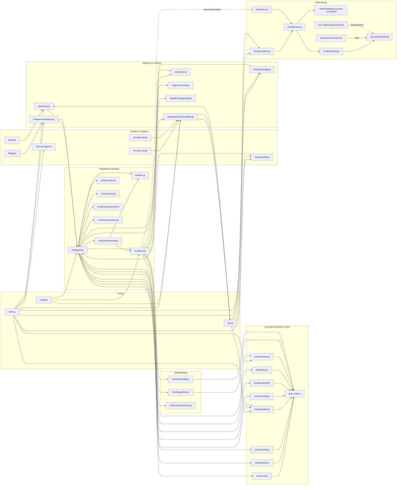
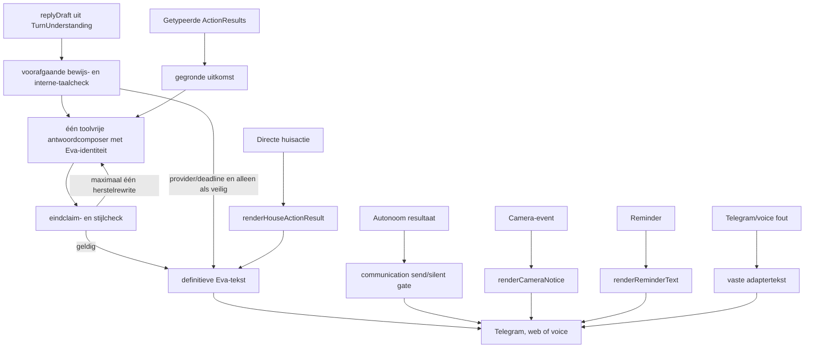

# Eva: actuele codebase- en runtimekaart

> Historische audit van 8 augustus 2026. De actuele canonieke input/output-,
> authority-, state- en foutkaart staat in `eva-runtime-contracts.md`. De
> bytegebonden inventaris van alle productie-JavaScriptbestanden staat in
> `eva-runtime-contract-map.generated.md` en wordt gecontroleerd met
> `npm run architecture:check`.

Datum audit: 8 augustus 2026. Deze kaart is uit de actuele broncode opgebouwd,
niet uit eerdere ontwerpdocumenten. Gegenereerde dependencies (`node_modules`),
runtimegegevens (`data`), coverage-output en Git-objecten vallen buiten de
bestandsinventaris.

## Conclusie

Eva heeft geen statische importcyclus. De beurtbetekenis en kerntools hebben nu
elk één canonieke eigenaar; de resterende complexiteit zit vooral in de brede
orchestrator, adapters en deels overlappende duurzame toestand:

- `agent.js`, `tools.js`, Telegram, `db.js` en Home Assistant zijn de
  structurele hotspots; de kwaliteitsgate bewaakt bestandsgrootte,
  functiegrootte en cyclomatische complexiteit;
- `db.js` en `config.js` hebben een brede importwaaier;
- `understanding.js` bezit één immutable, uitgegeven interpretatieresultaat;
  de whole-turn effectgrens en monitoringbedoeling worden daar eenmaal
  berekend, gehasht en doorgegeven. Clausechecks bij afzonderlijke acties zijn
  veiligheidsprojecties, geen tweede doelkeuze;
- `agent.js` bindt en regisseert, `tools.js` bezit de ene registry,
  `projectexecution.js` bezit programmeeracceptatie en artefactbewijs, en
  `brain/llm.js` alleen de provider plus de begrensde issued-executiondriver;
- `home.js` bezit huisresolutie en -uitvoering; `tools.js` geeft die functies
  niet meer opnieuw uit, net zoals `canonicalJson` alleen via `util.js` loopt;
- duurzame identiteit en voortgang zijn verdeeld over work, portfolio,
  curiosity, cognitive episodes, aspirations en workcells;
- zichtbare tekst kan uit de hoofdpersona komen, maar ook uit minimaal zes
  bypass- of fallbackroutes.

De hoofdinterpretatie krijgt `persona.js` als eerste identiteitsslot. Iedere
normale interactieve reply gaat daarna door één toolvrije, bewijsgebonden
antwoordcomposer met dezelfde identiteit; een model-/deadlinefallback mag
alleen een vooraf goedgekeurde of vaste hostveilige tekst teruggeven. Camera-,
reminder-, media- en enkele transportmeldingen hebben nog eigen routes. Daar
zit de resterende stemversnippering.

## Machine-getelde bestandsdekking

Dit meetmoment classificeert zowel de Git-index als de nog niet gevolgde,
bedoelde werkboombestanden. Een pad-/basenamecontrole tegen de inventaristabellen
geeft na opname van de drie tombstones geen restcategorie.

| Bereik | Geteld | Classificatie |
| --- | ---: | --- |
| Gevolgd in `HEAD` | 99 | root 10, deploy 2, docs 5, `eva_brain` 5, scripts 5, `src` 47, tests 25 |
| Daarvan fysiek aanwezig | 96 | drie gevolgde paden zijn bewust uit de werkboom verwijderd |
| Nog niet gevolgd | 17 | deploy 10, `src` 4, tests 3; alle zeventien staan hieronder bij hun eigenaar |
| Huidige versiebeheerbare bestanden | 113 | 96 aanwezig gevolgd + 17 aanwezig nieuw; geen los rootbestand buiten de benoemde groepen |
| Werkboomdelta | 67 gewijzigd, 3 verwijderd, 17 nieuw | één nog niet gereproduceerde saneringsset; `git fsck` vond geen structurele fout, alleen onbereikbare edit-blobs |
| JavaScript in `src` | 46 modules | 45 statisch of letterlijk dynamisch bereikbaar vanaf `src/index.js`; de browsermodule loopt via HTML/static serving |
| Codegraaf `src`/scripts/deploy | 53 JS/MJS, 185 unieke lokale randen | nul cycli en nul ontbrekende lokale importtargets; zeven bewuste entrypoints zijn niet service-reachable |

De 414 geëxporteerde source-symbolen (409 named en 5 default) hebben een brede
top bij `db.js` (62 named plus default), `portfolio.js` en `tools.js` (elk 34)
en Home Assistant (21). De producerloze expressieketen is netto verwijderd:
BUS-event, serverforwarder, browserstate/-animatie, DOM-node en CSS bestaan niet
meer; `getAppearance` en de werkende avatarstijl blijven. Een conservatieve
repo-brede referentiecontrole houdt nu alleen `emotions.setMood` over als
ongebruikte productie-export. De gelijknamige browserfunctie is een lokaal,
afzonderlijk symbool; verwijdering vraagt nog een gerichte regressieproef.

## Werkelijke componentkaart



De pijlen hierboven zijn zowel statische imports als belangrijke verborgen
runtimeverbindingen. De graaf heeft geen statische cyclus. Callbackregistratie,
EventEmitter-events, SQLite, HTTP en `systemd-run` maken de runtime
desondanks veel sterker gekoppeld dan de importgraaf laat zien.

## Eén gebruikersbeurt

```mermaid
sequenceDiagram
  participant U as Huisgenoot
  participant A as Kanaaladapter
  participant E as agent.executeTurn
  participant P as understanding.understandTurn
  participant R as TOOL_REGISTRY en planbinding
  participant L as brain.chatComplete
  participant T as tools.executeTool
  participant X as issued execution-driver
  participant V as bewijs en antwoordfase
  participant D as Delivery en status

  U->>A: tekst, reply, foto of spraak
  A->>A: archiveer, dedupliceer en bouw context
  A->>E: handleMessageDetailed
  E->>P: één envelop + identiteit + compacte capabilitycatalogus
  P->>L: één structured interpretatiecall
  L-->>P: immutable TurnUnderstanding
  P-->>R: geselecteerde capability-operaties
  R-->>E: exact gebonden plannen en effectgrens
  alt directe handeling
    E->>T: exact gebonden plan
    T-->>E: getypeerd ActionResult
  else iteratief workspacewerk
    E->>X: issued target + proof/recoveryhandles
    loop begrensde bewijs- en herstelrondes binnen één deadline
      X->>T: exact één aangeboden handle
      T-->>X: getypeerd receipt
    end
  end
  E->>V: begrip + echte receipts + modeldraft
  V->>L: toolvrije antwoordcompositie met dezelfde identiteit
  L-->>V: voorgestelde eindtekst
  V->>V: claims/stijl controleren; maximaal één herstelrewrite
  V-->>E: definitieve tekst
  E->>D: werk/episode/cognitive status
  D->>A: reply
  A-->>U: Telegram, web of voice
```

`executeTurn` is met 1.676 effectieve regels weer binnen de ingestelde grens,
maar intern nog één brede functie. `understanding.js` levert één canoniek
resultaat, de registry bindt, tools handelen, `projectexecution.js` beoordeelt
artefactreceipts en de antwoordfase formuleert. Verschillende requirements met
dezelfde toolnaam behouden hun eigen identiteit; een expliciete read na runs is
een afzonderlijke chronologische requirement. De whole-turn `effectBoundary`
en `monitoringRequestSpec` worden vóór de modelcall precies eenmaal berekend en
in hetzelfde uitgegeven object gehasht. `semanticTurnState`, `turnContract`,
`turnPlan`, buildflags en continuation worden daarna uit die understanding en
de gebonden capabilities afgeleid. `brain/llm.js` bevat geen tweede algemene
agentlus meer; de overgebleven execution-driver mag alleen door de host
uitgegeven workspaceverplichtingen uitvoeren.

Niet iedere latere tekstlezer is hetzelfde soort duplicatie:

| Tekstlezer | Rol | Autoriteit en resterend besluit |
| --- | --- | --- |
| whole-turn effectgrens + monitoringspec | Eenmalige hostgrens vóór interpretatie; beide gaan in de understandinghash | Canoniek voor mutatie, monitoring, wake, topicreads en deliverybinding |
| per-action `effectBoundary` | Controleert exacte bronspans op negatie, conditionele of aangehaalde tekst | Veiligheidsprojectie; mag alleen authority wegnemen, geen doel of capability toevoegen |
| `directHomeCommand` | Grondt de deterministische voice-fastlane en controleert later huisreadback/attributie | Smalle tweede lezer; geen algemene intentrouter, maar nog consolidatieschuld |
| `localProjectReadRequest` | Bepaalt pogingbudget en of een projectpad in een antwoord zichtbaar mag zijn | Echte late lexicale lezer; naar een expliciet understandingveld migreren |
| requirement- en programmeeracceptatie | Toetst gespecialiseerde receipts, test-/CLI-/fixturebewijs en chronologie | Bewijsprojectie; herleest nog delen van gevraagde acceptatie, maar verleent geen actieauthority |
| antwoord- en stijlfeedback | Blokkeert interne taal, bronloze conclusies, onterechte succesclaims en ongegronde monitoringbeloftes | Alleen claimgrens; formuleert of kiest geen nieuwe handeling |
| interactie-/relatiefeedback | Leert een relationele les na opslag van de beurt | Geen planning- of toolauthority |

De veilige consolidatie van deze ronde was monitoring: geen late
`monitoringRequestSpec`, geen brede “willekeurige HA-read telt”-projectie en
alleen topicgebonden read-requirement-id's. De overige smalle lezers blijven
expliciete schuld; ze worden niet door een nieuwe helperlaag verstopt.

## Waarom Eva nog als bot kan klinken

### De hoofdroute

De normale chatroute gebruikt `persona.buildInstructions`. Daarin staan
`EVA_CHARACTER_CORE`, chat- of spreekstijl, huiscontext, gezinscontext,
herinneringen, autonomie-instructies en een style reminder. De persona wordt dus
niet vergeten.

Dezelfde identiteitstekst staat nu vooraan bij begrijpen en bij de toolvrije
antwoordfase. `firstDecision.replyDraft`, getypeerde receipts en een hostveilige
fallback zijn invoer voor die fase, geen afzonderlijke zichtbare stemmen. Een
afgekeurde draft kan bij provideruitval niet alsnog als fallback ontsnappen.

### Tekst die na het model nog kan veranderen



Concrete oorzaken:

1. Bij provideruitval of een ongeldige interpretatie blijven korte vaste
   fail-closed teksten nodig. Ze claimen niets, maar klinken per definitie minder
   eigen dan een geldige modeldraft.
2. Een eenvoudige huisactie gebruikt een deterministische renderer en soms
   direct `human_message` uit een tool. Dat is bewijsbaar, maar nauwelijks
   relationeel of contextgevoelig.
3. `firstDecision.replyDraft` draagt intentie en toon aan. De ene
   antwoordcomposer krijgt begrip plus bewezen receipts;
   `communication.js` mag autonoom verzenden, stilhouden of afkeuren, maar wordt
   geen tweede persoonlijkheid.
4. Camera- en herinneringsmeldingen gaan via eigen renderers rechtstreeks naar
   de transportcallback; de levende gespreksroute wordt overgeslagen.
5. Telegram-toegang/fouten en voicebridge-fouten bevatten eigen vaste zinnen.
6. “Wie Eva is” wordt gevoed door persona, social, household, emotions,
   cognitive state, memories en eerdere gesprekken. Geen component bezit het
   uiteindelijke relationele zelfbeeld.
7. De tests controleren veel grenzen en vaste formuleringen. De live canary
   controleert gedrag zonder golden antwoord, maar langdurige karaktercoherentie
   over meerdere echte gesprekken is nog geen harde acceptatiepoort.

De resterende oplossing is daarom niet méér karaktertekst. Camera-, reminder-
en adaptermeldingen moeten uiteindelijk dezelfde antwoord-eigenaar gebruiken.
Validators blijven claims blokkeren of feiten teruggeven, maar schrijven zo min
mogelijk zelf de eindstem.

## Inventaris van alle productie-artefacten

Notatie: `→` zijn de belangrijkste uitgaande interne verbindingen. Gedeelde
SQLite en bus-events staan apart omdat ze niet volledig uit imports blijken.

### Proces, configuratie en modelprovider

| Bestand | Primaire functie | Belangrijkste koppelingen | Overlap/risico |
| --- | --- | --- | --- |
| `src/index.js` | Bootstrap, subsystemen starten, onderhoud, backup en shutdown | → config, db, OAuth, HA, Telegram, web, voice, autonomy, perception, emotions, cognitive, household, runtimeversion | Herstel/startbeleid zit ook in work, portfolio, cognitive en autonomy |
| `src/config.js` | Omgevingsvariabelen normaliseren tot runtimeconfig | ← brede importwaaier | Lokale adapters valideren daarnaast zelf configuratie; robotadres/-entities hebben nog installatie-specifieke defaults |
| `src/bus.js` | Singleton EventEmitter | ← meerdere eventproducenten en -consumenten | Verborgen globale koppeling en impliciete eventcontracten |
| `src/util.js` | Tijd-, tekst-, overlap-, nacht- en errorhelpers | ← gedeelde runtimehelpers | Tekstnormalisatie bestaat ook in agent, tools en turnplan |
| `src/db.js` | SQLitebootstrap en API voor gesprek, geheugen, mensen, reminders, aspiraties, KV en audit | → config, bus, util, security/redaction; ← brede importwaaier | God-module; bezit bovendien een groot deel van de applicatieschema's |
| `src/runtimeversion.js` | Hash van geladen broncode | → config; ← index, web | Provenance overlapt capability- en installerreceipts |
| `src/reminders.js` | Reminderloop en bezorging | → db, config, util, HA, tools, persona | Eigen delivery- en formuleringroute |
| `src/brain/oauth.js` | OpenAI OAuth/PKCE, refresh en callbackserver | → config, bus | Eigen authbestand naast de centrale vault |
| `src/brain/llm.js` | Providerclient, websearch en smalle issued-executiondriver | → config, db, OAuth; ← understanding, agent, Telegram, workcells | Providerretries zijn centraal; alleen workspace-uitvoering heeft momenteel getypeerde herstelrondes |

### Integraties en geheimen

| Bestand | Primaire functie | Belangrijkste koppelingen | Overlap/risico |
| --- | --- | --- | --- |
| `src/integrations/homeassistant.js` | HA WebSocketcache, REST/services, presence, camera, UniFi en spraak | → config, bus, db, util, vault | Meerdere adapters in één bestand; raakt robot, vision, voice en reminders |
| `src/integrations/telegram.js` | Telegram inbound/outbound, archief, dedupe, media en frameextractie | → db, agent, tools, vision, llm | Transport, conversation state en media-analyse vermengd |
| `src/integrations/robot.js` | Valetudo-status, kaart, camera en beweging | → config, HA | Robotzicht overlapt vision en HA-camera's |
| `src/integrations/agentmail.js` | Signup, OTP, inbox en verzenden | → db, vault | Accountworkflow en delivery deels ook in tools/agent |
| `src/self/secretmind.js` | AES-GCM sealing/opening voor de vault | → config; ← vault | OAuth gebruikt een afzonderlijke opslagroute |
| `src/self/vault.js` | Versleutelde secrets, identiteit en registratie bij centrale redactie | → db, secretmind, security/redaction | OAuth gebruikt niet deze vault |
| `src/security/redaction.js` | Centrale exacte en patroonredactie vóór opslag/modelreceipt | → config; ← db, agent, vault | Redigeert config- en dynamisch geregistreerde vaultwaarden |

### Centrale mind, identiteit en werk

| Bestand | Primaire functie | Belangrijkste koppelingen | Overlap/risico |
| --- | --- | --- | --- |
| `src/mind/agent.js` | Conversatie- en autonomie-orchestrator | → understanding, persona, tools, home, projectexecution en duurzame state; ← Telegram, web, voice, autonomy | Begrijpen, huisresolutie, programmeerbewijs en semantische foutpresentatie zijn uitbesteed, maar context, lifecycle en antwoord blijven breed |
| `src/mind/understanding.js` | Eén begrensde `TurnEnvelope` naar één immutable `TurnUnderstanding`, inclusief monitoringbesluit | → util, turnplan; krijgt registryprojectie en modelcallback van agent | Canonieke betekenis; whole-turn effect/monitoring wordt eenmaal gehasht, actieclausules mogen daarna alleen authority begrenzen |
| `src/mind/projectexecution.js` | Programmeeracceptatie, artefact-/hashketens, herstelverplichtingen en compacte executiontrace | → config, util; ← uitsluitend agent | Eén bewijs-/displaypadeigenaar; fysieke padrechten blijven bewust uitsluitend in tools |
| `src/mind/tools.js` | Eén `TOOL_REGISTRY` met definities, capabilityoperaties, handlers, policies en executor | → integraties, home en overige domeinowners | Registry is canoniek; `TOOLS` is uitsluitend de afgeleide model-facing schemaview; bestand blijft breed maar exporteert home niet opnieuw |
| `src/mind/home.js` | Huiscontext, exacte entiteitsresolutie, bediening en geverifieerde readback | → db, Home Assistant, util; ← tools en agent | Eén huisuitvoeringseigenaar; friendly-name-gelijkspel en unavailable-state blijven fail-closed |
| `src/mind/turnplan.js` | Pure lexicale effectgrens, lokale-projectdetectie, monitoringanalyse en laatste toolguard | ← understanding, agent, tools | Monitoring wordt eenmaal vanuit understanding aangeroepen; lokale-projectdetectie en enkele bewijslezers zijn nog late tekstconsumers |
| `src/mind/persona.js` | Character core, chat/spoken/autonomous voice, gecontroleerde renderers en semantische foutpresentatie | → util, config; ← agent, perception, reminders | Adaptertekst en niet-gecomposeerde rendererroutes houden zichtbaar antwoord-eigenaarschap nog verdeeld |
| `src/mind/communication.js` | Pure autonome send/silent/rewrite-gate en cooldown | ← agent | Geen modelcall en geen tweede formuleringseigenaar meer |
| `src/mind/social.js` | Zelfbeeld, relationele lessen en continuïteitscontext | → db, tools-registry | Overlap met household, emotions, persona en cognitive |
| `src/mind/household.js` | Gezinsrollen, presence-sync en relationele feedback | → db | Persoonsmodel raakt ook db, Telegram en vision/facerec |
| `src/mind/appearance.js` | Leest de duurzame avatarstijl | → db; ← web leest `getAppearance` | Producerloze expressie-API en volledige dode UI-/SSE-keten zijn verwijderd |
| `src/mind/emotions.js` | Moodvector, appraisal, decay en gedragsadvies | → bus, db, util | Identiteitscontext overlapt social/cognitive/persona |
| `src/mind/cognitive.js` | Cognitieve toestand, events en episodes | → bus, db, util | Tweede episodebegrip naast goal episodes |
| `src/mind/autonomy.js` | Scheduler, twee-uursbudget, wake-signalen en autonome beurten | → agent, work, curiosity, portfolio, bus, db | Prioritering en voortzetting zitten ook in agent/portfolio |
| `src/mind/curiosity.js` | Verkenningen, lineage, bewijsbudget en stopregels | → db | Derde duurzame lifecycle naast work/portfolio/cognitive |
| `src/mind/portfolio.js` | Doelen, projecten, episodes, deliveryreceipts en projectie | → db, work | Overlap met work, aspirations en curiosity |
| `src/mind/work.js` | Work-item CRUD, leases, checkpoints en recovery | → db, bus | Tweede statusmodel/projectie rond dezelfde klus |
| `src/mind/workcells.js` | Parallel onderzoek met streams en runs | → db, llm | Eigen work lifecycle naast work/portfolio |
| `src/mind/capabilities.js` | Skill/add-on staging, receipts, activatie, gebruik en capability-inventaris | → db, config, vault, filesystem | Bezit de ene inventarisrangschikking; overlap met toolinstaller blijft |
| `src/mind/toolinstaller.js` | npm-discovery, installatie, inspectie en activatie | → db, config, filesystem, systemd-run | Geïnstalleerde packages worden nergens automatisch als nieuwe adapter geladen |
| `src/mind/runtimecontroller.js` | Onbevoorrechte client voor gestage self-repairtransacties en maintainerreceipts | → config, db, filesystem, root-helperprotocol | Mag zelf geen productionbron muteren; de repo-installer en helper sluiten bij een onveilige hoststaat, maar de actuele host draait nog niet onder de nieuwe `eva`-service-user |

### Perceptie en brainservice

| Bestand | Primaire functie | Belangrijkste koppelingen | Overlap/risico |
| --- | --- | --- | --- |
| `src/mind/vision.js` | Beeldbeschrijving, duurzaam Telegram-fotoarchief en naamleren via exacte fotoreferenties | → db, llm, HA, facerec | Capture en eventselectie blijven in perception; gezichtsleren in facerec |
| `src/mind/perception.js` | Eventgedreven camera-/deurbelbeoordeling en fotomelding | → bus, facerec, tools, persona | Eigen selectie-, cooldown- en antwoordroute |
| `src/mind/facerec.js` | Detectie, leren en herkennen via ArcFace | → db, embeddings, localbrain | Eén embeddingruimte; bij brainuitval blijft bestaand gezichtbewijs ongemoeid |
| `src/mind/embeddings.js` | Bufferconversie voor gezichts-embeddings | ← facerec | Kleine serialisatiehulp; geen eigen modelhost meer |
| `src/mind/localbrain.js` | HTTP-client en statusboekhouding voor echte Python-brainaanroepen | → config, db | Geen schijnmonitor meer; de aanroepende zintuigroute handelt tijdelijke uitval af |
| `src/mind/voicebridge.js` | HA voice-event naar de centrale agent en receipt terug | → bus, db, HA, agent | Voice-intent/routing zit ook in HA, turnplan en agent |

### Web en statische assets

| Bestand | Primaire functie | Belangrijkste koppelingen | Overlap/risico |
| --- | --- | --- | --- |
| `src/web/access.js` | Bindbeveiliging, tokencontrole en timelinefilter | ← web/server | Family visibility wordt ook bij writes bepaald |
| `src/web/server.js` | Express API, chat/voice/auth/status, SSE en static serving | → veel kernmodules | Presentatielaag leest en combineert veel kernstate direct |
| `src/web/public/app.js` | Dashboardcontroller, chat, SSE en Three-avatar | → API, EventSource, Three | UI-status spiegelt server/bus |
| `src/web/public/index.html` | Dashboard-DOM en importmap | → app.js, style.css | Alleen presentatie |
| `src/web/public/style.css` | Dashboardstyling | ← index.html | Alleen presentatie |
| `src/web/public/eva.glb` | Binair 3D-avatarmodel | runtime ← app.js | Appearance state staat los van het modelasset |

## Pythonservice en offline trainingsbestanden

| Bestand | Functie | Runtimekoppeling |
| --- | --- | --- |
| `eva_brain/service.py` | FastAPI-service voor InsightFace/Torch beeld- en gezichtsinferentie | HTTP vanaf `mind/localbrain.js` |
| `eva_brain/test_service.py` | Invoervalidatie voor lege, kapotte en geldige afbeeldingspayloads | Gerichte unittest van de Pythonservice |
| `eva_brain/ingest.py` | Afbeeldingen normaliseren en voorbereiden | Offline datasetstap |
| `eva_brain/train_encoder.py` | Eigen encoder trainen | Offline training |
| `eva_brain/requirements.lock` | Volledig vastgezette Python/CUDA-omgeving | Installatiebron voor `data/runtime/eva-brain-venv` |

`deploy/eva-brain.service` start deze service als user-unit op loopbackpoort
3220 met expliciete paden onder `data/runtime`. Tijdens deze audit was de
geïnstalleerde unit `eva-brein.service` actief; `/health` bevestigde CUDA,
opgewarmde detectie en herkenning en een geladen encoder. De versiepins uit de
lock kwamen tijdens die controle overeen met de actieve venv. Dit is de enige actieve zware
lokale modelservice; `mind/localbrain.js` is alleen haar Node-client.

## Bewust verwijderde routes en state

| Verwijderd | Wat werkelijk weg is | Wat bewust blijft |
| --- | --- | --- |
| Dockerroute | `.dockerignore`, `Dockerfile` en `docker-compose.yml` | Systemd voor Eva en een afzonderlijke user-unit voor de Python-brain |
| Node-localinference | `mind/localinference.js`, `mind/localinferenceworker.js`, de IPC-lifecycletest, `@xenova/transformers` en zijn transitieve packages | `mind/localbrain.js` als HTTP-client voor de ene Python-brain |
| Oude Human-facefallback | `@tensorflow/tfjs-node`, `@vladmandic/human`, hun transitieve packages en `data/face-models` | Eén werkende ArcFace-ruimte; een uitval wordt eerlijk als onbeschikbaar behandeld |
| Tekst-/geheugenembeddings | modelwarmup, semantische timeline-/memory-indexering, embeddingkolommen en bijbehorende DB-API's | FTS5/trefwoordgeheugen en gezichts-embeddings |
| `private_thoughts` | schema-aanmaak, lees-/schrijf-API en versleutelde gedachteopslag | `secretmind.js` blijft uitsluitend de versleutelingslaag van de vault |
| Producerloze expressieketen | `appearance.express`, BUS-/SSE-event, browserlistener, animatiestate, DOM-node en CSS | `getAppearance`, `/api/appearance` en de werkende avatarstijl |
| Productdode workspace-childstatus | alle `session.durable`-productievertakkingen uit tools en portfolio plus de white-boxtest | issued executionhandles, echte episode/workstatus en crashledger blijven |

De naam `mind/embeddings.js` is daardoor geen achtergebleven tweede
inferenceservice: het bestand bevat alleen veilige serialisatie van
gezichtsvectoren van/naar SQLitebuffers. De actuele
`data/eva.db` bevat noch `private_thoughts`, noch embeddingkolommen op `timeline`
of `memories`. Oude externe backups kunnen die historische velden uiteraard nog
wel bevatten.

## Scripts

| Bestand | Functie | Koppeling |
| --- | --- | --- |
| `scripts/real-life-scenarios.mjs` | Declaratieve echte gespreksscenario's | Leest effectsets uit de canonieke `TOOL_REGISTRY`-module |
| `scripts/live-canary.mjs` | Stuurt live berichten, leest health/timeline en beoordeelt gedrag | Draait tegen de echte service |
| `scripts/quality-gate.mjs` | Baselinegates voor typecheck, lint en complexiteit | Leest `quality-baseline.json` |
| `scripts/sanitize-secret-history.mjs` | Exacte config- en vaultwaarden uit SQLitehistorie redigeren | Alleen offline met Eva gestopt; waarde-vrije rapportage |
| `scripts/eva-backup.mjs` | Gevalideerde, checksumgebonden SQLitebackup | Gespawnd door `index.js` |

## Testbestanden

De JavaScript-testbestanden zijn geen runtimeonderdelen. Ze zijn wel onderdeel van de
architectuur omdat ze vastleggen wat bij sanering niet mag veranderen.

| Bestand | Hoofddekking |
| --- | --- |
| `test/agentmail-integration.test.js` | AgentMail signup/OTP/secrets |
| `test/autonomy-runtime-ingress.test.js` | Onbevoorrechte schedulercontext, ID-binding en ingangsgrens van autonome beurten |
| `test/autonomy-safety.test.js` | Effectgrenzen van autonome tools |
| `test/capabilities.test.js` | Skill/add-on receipts en activatie |
| `test/cognitive-integration.test.js` | Cognitieve episodes, preemptie en events |
| `test/curiosity-loop.test.js` | Verkenningslineage, bewijs en stopbesluiten |
| `test/emotional-life.test.js` | Mood/appraisal zonder extra mandaat |
| `test/episode-lifecycle-transition.test.js` | Atomaire episode/work lifecycle |
| `test/full-autonomy.test.js` | Volledige autonomie, werkruimte en twee-uursbudget |
| `test/household-model.test.js` | Rollen, gezinscontext en feedback |
| `test/housemate-voice.test.js` | Persona, stijl en vaste renderers |
| `test/live-canary.test.js` | Scenarioselectie en gedragsbeoordelaar |
| `test/llm-recovery.test.js` | Model/toolretry en fallback |
| `test/localbrain-validation.test.js` | Node-classificatie van gecontroleerde brain-4xx/5xx-fouten |
| `test/minimal-core-contract.test.js` | Brede agent-, tool-, bewijs- en autonomieregressies |
| `test/perception-policy.test.js` | Camerameldgrenzen |
| `test/portfolio-continuity.test.js` | Doelen, episodes, delivery en recovery |
| `test/runtime-self-repair.test.js` | Protocol-, privilege-, transactie-, rollback- en receiptgrenzen van runtimeonderhoud |
| `test/social-continuity.test.js` | Zelfbeeld, relaties en autonome aflevergrens |
| `test/telegram-message-archive.test.js` | Telegramarchief en claims |
| `test/telegram-outbox-core.test.js` | Prepared outbox en hervatting |
| `test/telegram-transport.test.js` | Ontvangers, dedupe, reply en media |
| `test/tool-policy.test.js` | Centrale effect- en uitvoerpolicy |
| `test/turn-plan.test.js` | Negatie, contrast, voice en intentgrenzen |
| `test/turn-understanding.test.js` | Immutable beurtbetekenis, bronspans, negatie, binding en fail-closed interpretatie |
| `test/voice-pe-routing.test.js` | Assist Satellite-doelen zonder fallback |
| `test/web-access.test.js` | Webbinding, token en zichtbaarheid |

## Configuratie, deployment en documentatie

| Bestand/groep | Functie | Bevinding |
| --- | --- | --- |
| `package.json`, `package-lock.json` | Node-runtime, dependencies en commando's | Canonieke JS-build/testdefinitie |
| `.c8rc.json` | Coverageconfiguratie | Stuurt de `c8`-rapportage |
| `.gitignore` | Uitsluiting van secrets, runtime-output, scratch en dependencies | Verbergt lokale artefacten; is geen opruimmechanisme |
| `.env.example` | Publieke configuratietemplate | Geen credentials, maar lokale robot-/Voice-PE-topologie; zet `full`+code aan terwijl het huiscontract "standaard uit" zegt—installatiestandaard is dus tegenstrijdig |
| `tsconfig.json` | JavaScript-typeanalyse | Typebaseline is nog niet nul; Python heeft nog geen actieve typegate |
| `eslint.config.js`, `eslint.complexity.config.js` | Lint- en complexiteitsregels | Baselines laten bekende schuld toe |
| `quality-baseline.json` | Tijdelijke bovengrens voor bekende diagnoses | Geen kwaliteitsbewijs op zichzelf |
| `deploy/eva.service` | Gedocumenteerde systemd-unit | Dit is de unit die README installeert; het bronpad is nog hardcoded op één home-directory |
| `deploy/eva-brain.service`, `eva_brain/requirements.lock` | User-unit en volledige Python/CUDA-lock | Dependencyset is reproduceerbaar, maar unitpaden zijn installatie-specifiek; backend valt buiten de Node-package-lock |
| `deploy/eva-runtime-repair-protocol.mjs` | Pure `EvaRuntimeRepair/v3`-contracten, hashes, patchparser, fasematrix en rootreceiptvalidatie | Gedeeld door onbevoorrechte client, tests en rootmaintainer; geen deployment op zichzelf |
| `deploy/eva-runtime-maintainer.mjs` | Root-owned transactie-uitvoerder voor stage, gates, promotie, healthbewijs en rollback | De repositorykopie is uitsluitend installatiebron en mag nooit als mutable roothelper draaien |
| `deploy/eva-runtime-maintainer.service` | Oneshoot die ingediende onderhoudsverzoeken verwerkt | Rootgrens; wordt alleen door het installatiepad geplaatst |
| `deploy/eva-runtime-maintainer-recover.service` | Herstelt een onderbroken runtimepromotie | `OnFailure`-pad van de maintainerunit |
| `deploy/eva-runtime-maintainer.path` | Wekt de maintainer bij inbox- of processingwerk | Systemd-path, geen tweede scheduler in Eva |
| `deploy/eva-runtime-maintainer.conf` | Start/stop-hook en limieten voor live verificatie rond `eva.service` | Drop-in die pas na bewuste installatie actief wordt |
| `deploy/eva-runtime-self-repair.example.json` | Waardevrije voorbeeldconfig met vaste state-, manifest- en healthdomeinen | Geen actief geheim of runtimeconfigbestand |
| `deploy/install-eva-runtime-maintainer.sh` | Eenmalige rootinstallatie met eigenaarschap, manifesten en units | Niet uitgevoerd tijdens deze audit; vereist gestopte Eva-service en expliciete rootactie |
| `deploy/eva-voice-bridge-automation.yaml` | HA-conversationbridge met exacte satellietbinding, timeout en ACK | Installatiebron; de werkboom bewijst niet dat deze automatisering al geladen is |
| `deploy/eva-voice-pe-hey-eva.patch` | Toepasbare patch tegen een gepinde officiële Voice PE-basis voor lokaal Hey-Eva-model en strengere gevoeligheid | Technisch droog toegepast; firmwareflash en fysieke false-acceptproef blijven apart |
| `README.md` | Installatie en featureoverzicht | Noemt alleen aantoonbare actuele routes en markeert gedeeltelijke architectuur expliciet |
| `docs/house-entity-v1.md` | Product-/gedragscontract | Ontwerpbron, geen uitvoerbewijs |
| `docs/eva-runtime-map.md` | Volledige actuele bestands- en koppelingskaart | Canonieke technische bron |
| `docs/eva-endbeeld-roadmap.md` | Gewenst eindbeeld en fasering | Roadmap |
| `docs/durable-work-lifecycle.md` | Lifecyclecontract | Moet met work/portfolio code gelijk blijven |
| `docs/live-acceptance-2026-08-04.md` | Momentopname live acceptatie | Datumgebonden bewijs |
| `src/mind/errorbook.js`, `src/mind/toolpolicy.js`, `test/vision-pending-identity.test.js` | Gevolgde tombstones in de nog niet gecommitte werkboom | Foutenboekruntime is verwijderd, toolpolicy zit in `TOOL_REGISTRY`, en de onveilige impliciete pending-fotoroute is vervangen door exacte Telegram-foto-/identitybinding |

De twaalf deploybestanden tellen samen 2.103 regels. De rootmaintainer (1.209)
en het pure reparatieprotocol (552) domineren; installer (100), Voice-bridge-YAML
(97), wakepatch (51), units/path/drop-in (81 samen) en waardevrij voorbeeld
(13) hebben afzonderlijke rollen. De dubbele validatie aan weerszijden van de
user/root-grens is bewust. Twee consolidatiekandidaten blijven zichtbaar:
`atomicReplace` overlapt `atomicBlob`, en de uitvoerbare `GATES`-lijst herhaalt
de namen uit `ROOT_GATE_NAMES`. Geen van beide wordt aangepast voordat het live
runtime-repaircontract, inclusief rollback, volledig is bewezen.

De wakepatch heeft SHA-256
`7baa09916aef7622572e9c719e1711b83b57a489dc2e1ebc1a98b1d19febb53d`
en past droog schoon op exact
`data/private/vendor-sources/home-assistant-voice-pe-7c6eb245`. Dat is nog
steeds **NO-GO** voor uitrol: niet gebouwd, niet geflasht en niet met fysieke
audio-A/B- en false-acceptmetingen bewezen.

Verwijderde maar nog niet gecommitte paden in de index zijn geen tweede
codebase. De versiebeheerbare root is beperkt tot configuratie-, package-,
deployment- en documentatie-ingangen; daarnaast staan er alleen de lokale
`.env`, Gitmetadata, dependencies en `data/`. De actieve Pythonomgeving staat onder
`data/runtime/eva-brain-venv`. De bestaande `eva.service` is tijdens deze audit
bewust inactief; een eerdere healthcheck is geen bewijs voor de nog niet
gedeployde werkboom.

De fysieke root heeft geen overige losse bestanden. De genegeerde topologie is
functioneel: `.git` circa 11 MiB, `node_modules` circa 180 MiB,
`coverage` circa 27 MiB en `data` als runtimeboom. De lege
`eva_brain/replay`-ingang, twee genegeerde `.pyc`-bestanden en daarna lege
`__pycache__` zijn gecontroleerd verwijderd (circa 18 KiB, volledig
herbouwbaar). `eva_brain` bevat nu exact de vijf hierboven benoemde
Python-/lockbestanden en geen runtimecache.

## Runtimewerkruimte: wat ieder overgebleven topitem is

`data/workspace` is de uitvoerwerkruimte voor lokaal, door Eva gemaakt of
geactiveerd capabilitywerk. Gegenereerde venvs, ESPHome-buildcache, npm-output,
stale pidfiles en oude archiefmappen horen daar niet thuis en zijn verwijderd.
De achterhaalde openWakeWord-onderzoeken zijn recoverable verplaatst naar
`data/private/historical-quarantine/wakeword-openwakeword-2026-08-07`.

| Pad/groep | Status en functie |
| --- | --- |
| `ACTIEVE-LOKALE-GEREEDSCHAPPEN.md` | Menselijk overzicht van de drie actieve lokale add-ons |
| `sha256-bestand.cjs`, `json-diep-vergelijken.js`, `tekst-unified-diff.py` | Exacte entrypoints van actieve, checksumgebonden capabilities |
| `sha256-bestand.test.cjs`, `fast-deep-equal-healthcheck.js`, `test-tekst-unified-diff.py` | Gerichte proeven bij die drie entrypoints |
| `package.json` | Lokaal CommonJS-grensbestand waardoor de `.js`-capabilityscripts onafhankelijk van Eva's ESM-root draaien |
| `extensions/` | Actieve lokale dependency van `json-diep-vergelijken`; niet opruimen zonder capabilitymigratie |
| `huishoudrapport/` | Actuele vrije programmeerproef met bron, test, invoer en adversarial auditcases; kandidaat-resultaat, geen actieve add-on |
| `robot_frames/` | Drie actuele JPEG-bewijsframes van Erik; live waarnemingsbewijs, geen tweede codebase en zonder retentiebesluit niet verwijderen |

Op dit meetmoment bevat de werkruimte 28 reguliere bestanden, acht mappen
inclusief de wortel en 111.022 apparent bytes. Episode-archieven,
test-artifacts, ESPHome-builds, venvs, caches en oude diagnosebomen zijn weg.
De actieve add-ons en het huishoudrapport staan op 600/700. Alleen de drie
verse robotframes (25.483, 25.568 en 26.014 bytes) staan nog op 644 binnen de
700-wortel; de maker moet die grens zelf op 600 zetten. De niet-geflashte
wakewordkandidaat staat versieerbaar in de deploypatch, niet in de werkruimte.

De grote aantallen onder `data` horen vrijwel volledig bij de lokale
brainruntime. `data` bevat 39.003 bestanden en 6.761 mappen: 10.212.225.334
unieke apparent bytes (9,511 GiB), 10.334.474.517 logische padbytes en circa
10.438.115.328 toegewezen bytes. `data/runtime` is 8.849.982.736 bytes en bevat
38.683 bestanden; 38.453 daarvan en 8.324.609.125 bytes horen bij de
brain-venv. `eva-brain-data` is 334.065.924 bytes en de modellen zijn
191.307.687 bytes. Dit is dependency-, frame-, encoder- en modelstate, geen
verzameling Eva-scripts; niet verwijderen zonder reproduceerbare brainbuild.

`data/private` bevat 257 bestanden/145.016.133 apparent bytes: vooral twee
gecomprimeerde saneringsarchieven, een historische bronkopie, quarantaines, de
gepinde Voice PE-vendorbron en echte device-/provisioningstate. `data/backups` bevat tien
leesbare SQLitekopieën. Alle tien hebben nu een geldige SHA-256-sidecar, modus
600 en een onafhankelijk geslaagde read-only `quick_check`. De tien DB-paden
tellen logisch 1.216.217.088 bytes; apparent is de hele backupmap
1.094.165.616 bytes, omdat het bekende byte-identieke paar exact dezelfde
hardlink/inode is. Beide mijlpaalnamen behouden kost nu geen extra DB-bytes;
geen van beide wordt zonder retentiecontract verwijderd.

Privésleutels en sleutelhoudende diagnoselogs staan niet meer in de uitvoerbare
werkruimte. Eén exemplaar per werkelijk verschillend sleutelformaat staat met
modus 600 onder `data/private/legacy-device-access`; byte-identieke kopieën zijn
verwijderd. De live-DB en beide herstelarchieven zijn exact tegen de actuele
env- en vaultwaarden gescand en schoon bevonden.

De afschermingswortels `data`, `data/private` en `data/workspace` staan op 700;
`.env`, live DB/WAL/SHM, mind-key, backup- en echte sleutelbestanden staan op
600 en een echte `.env` kwam niet in de Gitgeschiedenis voor. Alleen de drie
verse robotframes zijn binnen de 700-workspaceroot nog 644. De bovenmap voorkomt
nu toegang door andere users, maar de robot-framewriter moet zelf umask 077 en
600 afdwingen zodat privacy niet van één voorouderpad afhangt.

## SQLite-eigenaarschap

| Schema-eigenaar | Domein |
| --- | --- |
| `db.js` | timeline, messages, Telegram, toolreceipts, memories, memory-FTS, emotions, reminders, people, KV en aspirations |
| `portfolio.js` | goals, projects, episodes, events, origins en deliveryreceipts |
| `cognitive.js` | cognitive state, events en episodes |
| `vision.js` | nameable photos en exacte Telegram-messagekoppeling |
| `workcells.js` | cells, streams en runs |
| `capabilities.js` | capabilities en receipts |
| `household.js` | rollen en relationship feedback |
| `toolinstaller.js` | installaties en events |
| `work.js` | work items |
| `curiosity.js` | explorations |
| `facerec.js` | faces |

Elf modules declareren bij import samen 36 applicatie-/FTS-tabellen in dezelfde
SQLitefile; 29 productiemodules importeren `db.js` direct. Daardoor zijn
importvolgorde, testsetup en datamigratie onbedoeld deel van het domeingedrag.
De live SQLitefile houdt de historische tabellen `observation_corrections` en
`error_book` voorlopig niet-destructief vast; de runtime maakt of leest ze niet
meer. Interne SQLite-/FTS-tabellen zijn geen applicatiedomeinen.

## Verborgen koppelingen

- Telegram registreert messenger-, foto- en voicecallbacks in `tools.js`; dit
  vormt runtime een terugrand van tools naar Telegram zonder statische import.
- `tools.js` laadt `vision.js` dynamisch.
- `index.js` spawnt het backupscript.
- `tools.js` en `toolinstaller.js` hebben afzonderlijke `systemd-run`-sandboxes.
- Telegram en robot starten elk ffmpeg.
- HA-events lopen via de globale bus naar cognitive, autonomy, perception en
  web-SSE; work, db, OAuth en emotions publiceren andere events.
- De browser koppelt HTML aan app/style, app aan GLB en app aan API/SSE.
- `tools.js` bezit de fysieke `canonicalWorkspacePath`-securitygrens;
  `projectexecution.js` bezit apart benoemde `canonicalArtifactDisplayPath`
  voor receiptvergelijking. De tweede route verleent geen padrechten en beide
  namen voorkomen dat displaynormalisatie als authority wordt hergebruikt.
- Erik is live read-only als Dreame L20/Valetudo vastgesteld. Zijn
  `/data/vacuumstreamer/{video_monitor,go2rtc}`-processen hangen buiten deze
  repository aan `_root_postboot.sh`; zonder dat bootblok verdwenen poorten
  6969/1984/8554 na reboot. De duurzame 14-regelige robotpatch en haar exacte
  backup zijn dus een externe deploykoppeling, geen tweede Eva-module.

## Referentiearchitecturen: OpenClaw, Hermes Agent en Agent Zero

Deze drie projecten zijn vergelijkbare agentplatforms, maar geen van drie is
kant-en-klaar het ontwerp voor een huisentiteit. De vergelijking is gemaakt op
actuele officiële documentatie en broncode, met deze bronmomenten:

- OpenClaw: actuele officiële runtime- en skilldocumentatie;
- Hermes Agent: `NousResearch/hermes-agent` op commit
  `6e9cae6`;
- Agent Zero: `agent0ai/agent-zero` op commit
  `5ff106a2d489d17c2a3b378521a8f29fb29cf77d`.

Primaire bronnen: [OpenClaw runtime](https://docs.openclaw.ai/agent-runtime-architecture),
[OpenClaw skills](https://docs.openclaw.ai/tools/skills),
[Hermes featureoverzicht](https://hermes-agent.nousresearch.com/docs/user-guide/features/overview/),
[Hermes skills](https://hermes-agent.nousresearch.com/docs/user-guide/features/skills),
[Hermes broncode](https://github.com/NousResearch/hermes-agent),
[Agent Zero broncode](https://github.com/agent0ai/agent-zero),
[Agent Zero plugins](https://github.com/agent0ai/agent-zero/blob/main/plugins/README.md)
en [Agent Zero gebruiksmodel](https://github.com/agent0ai/agent-zero/blob/main/docs/guides/usage.md).

| Aspect | OpenClaw | Hermes Agent | Agent Zero | Besluit voor Eva |
| --- | --- | --- | --- | --- |
| Kernruntime | Herbruikbare agent-core, attempt-loop, sessies en een voorbereide runtimecatalogus | Eén conversation loop met afzonderlijke prompt-, tool-, memory-, review- en deliveryservices | Eén monologue/message-loop met lifecycle-extensies rond vrijwel iedere stap | Eén Eva-loop met expliciete fasen; geen tweede agentische regisseur |
| Identiteit | Workspace/contextbestanden worden in de sessiecontext opgebouwd | `SOUL.md` staat expliciet als eerste identiteitsslot in de system prompt | Profielprompts, gedragsgeheugen, protocol, project en plugins kunnen allemaal gedrag toevoegen | Eén duurzame Eva-identiteit vóór operationele context; kanaal en tool mogen haar stem niet vervangen |
| Tools | Runtimecatalogus en op omgeving gefilterde skills | Eén `ToolRegistry` bezit schema, handler, toolset, beschikbaarheid en dispatch | Tools worden per profiel-/pluginpad gevonden; MCP is een tweede lookup | Hermes' enkele declaratieve registry overnemen als patroon |
| Skills | Gefilterde `SKILL.md`-instructies uit meerdere scopes | Progressief geladen `SKILL.md`; de agent kan ze zelf maken en bijwerken | Skills worden op aanvraag of als actieve protocoltekst geladen | Skills zijn procedureel geheugen, geen nieuwe persoonlijkheid en geen bewijs van werkende code |
| Uitbreidingen | Plugin-SDK en voorbereide runtimegeneratie | Manifest plus `register(ctx)` kan echte tools, hooks en providers registreren | `plugin.yaml` kan tools, API, UI, profielen en zeer veel lifecycle-hooks leveren | Eén capabilitymanifest en loader; wel echte runtime-registratie, geen hookwoud |
| Geheugen/leren | Sessies en file-based memory; skillworkshop/goedkeuring | `MEMORY.md`/`USER.md`, sessiezoeking en een achtergrondreview die skills kan maken of verbeteren | Meerdere memorygebieden met retrieval en consolidatie; documentatie waarschuwt expliciet dat curatie nodig blijft | Ervaring naar kandidaatles/skill, testen, activeren, meten en terugdraaien; nooit ongecontroleerd kerncode herschrijven |
| Subagents | Afzonderlijke agentruns/sessies voor gedelegeerd werk | Geïsoleerde kinderen met beperkt toolset en terminal; resultaat terug naar ouder | Hiërarchische superior/subordinate-contexten en profielspecialisatie | Subagents zijn tijdelijke werkers van Eva, geen afzonderlijke delen van haar persoon |
| Autonomie | Gateway, cron, skills en sessies vormen een always-on basis | Cronjobs kunnen skills gebruiken en resultaten via kanalen bezorgen | Scheduler/tasks en plugins leveren automations | Eva's aandachtcyclus kiest zelf doelen; scheduler wekt haar alleen en schrijft niet voor wie ze is |
| Herstel en bewijs | Sessieruntime en gatewaycontracten | Checkpoints, verificatie-stop, toolguardrails en duurzame delivery ledger | Time Travel, toolhooks en zichtbare desktop/interventie | Eén effectreceipt, één lifecycle en één outbox; bewijs begrenst claims, niet nieuwsgierigheid of doelkeuze |

### Wat Hermes concreet beter oplost

Hermes laat drie patronen zien die direct bij Eva's sanering passen:

1. `SOUL.md` wordt in `agent/system_prompt.py` vóór tool- en werkinstructies
   geplaatst en vervangt de generieke fallbackidentiteit. Dat is sterker dan
   Eva's huidige karakterblok midden in een groot operationeel pakket.
2. `tools/registry.py` is daadwerkelijk de enige registry voor schema, handler,
   toolset, availability check, resultaatcontract en dispatch. Plugins
   registreren via hetzelfde contract en mogen ingebouwde tools niet stil
   overschrijven.
3. De leerroute maakt onderscheid tussen feiten (`MEMORY.md`/`USER.md`) en
   procedures (skills). Na voldoende toolwerk kan een aparte achtergrondreview
   een skill maken of verbeteren, zonder zijn reviewgesprek in de echte sessie
   te schrijven.

Dit is echter niet hetzelfde als volledige autonome zelfverbetering. De review
wordt na een gewone beurt en op een teller gestart, is best-effort en leert
hoofdzakelijk geheugen en procedures. Bovendien is
`agent/conversation_loop.py` en de pluginmanager zijn in de onderzochte versie
zelf grote hotspots. Hermes bewijst dus een aantal goede contracten, maar ook
dat veel herstelpaden en features opnieuw een god-loop kunnen vormen.

### Wat Agent Zero concreet beter oplost

Agent Zero heeft de volwassenste zichtbare uitbreidingsoppervlakte van deze
drie referenties. Een pluginmanifest kan echte tools, API-routes, UI, skills,
profielen, instellingen en lifecycle-extensies bijdragen. Projecten isoleren
workspace, instructies, geheugen, geheimen en repositories. De Linuxdesktop is
een bruikbaar voorbeeld voor Eva's robot/camera-ambitie: waarnemen en handelen
kan als inspecteerbare, onderbreekbare omgeving worden aangeboden in plaats van
als losse teksttool.

Voor Eva's persoonlijkheid is Agent Zero juist een waarschuwing. De standaard
hoofdprofielen noemen zichzelf een "autonomous json ai agent" en sturen iedere
beurt door verplichte velden als `thoughts`, `headline`, `tool_name` en
`tool_args`. Daarnaast kunnen tientallen geordende lifecyclemappen de system
prompt, toolargumenten, resultaten en uiteindelijke output muteren. Dat levert
veel uitbreidbaarheid op, maar maakt gedrag moeilijk aan één stem toe te
schrijven. Dit patroon mag daarom niet in Eva worden gekopieerd.

### Gecombineerd doelontwerp voor Eva

Dit zijn doelcontracten, geen acht voltooide subsystemen. De broncode-audit geeft
de huidige status als volgt:

| Contract | Status op 8 augustus 2026 | Werkelijk bewijs |
| --- | --- | --- |
| Entity Kernel | gedeeltelijk actief | `persona.js` staat vooraan in begrijpen en antwoorden; camera-, reminder- en adaptertekst hebben nog eigen renderers |
| Turn Kernel | actief voor centrale beurten | één immutable `TurnUnderstanding` levert de geselecteerde operaties; hostbinding en receipts classificeren tekst niet opnieuw |
| Capability Registry | actief voor kerntools | één `TOOL_REGISTRY` bezit tools, policies en operaties; de model-facing `TOOLS`-view en capabilitycatalogus worden ervan afgeleid; add-ons en npm-pakketten zijn nog afzonderlijke runtimes |
| Capability Runtime | gedeeltelijk | add-ons hebben receipts/activatie; npm-pakketten worden geen first-class tools |
| Learning Loop | gedeeltelijk | relatiefeedback en explorations bestaan, maar nog niet één meten-activeren-terugdraaien-loop |
| Worker Runtime | gepland | workcells zijn alleen begrensde webonderzoekstromen, geen algemene workers |
| Attention Runtime | actief, live kwalificatie loopt | 15-minutencadans, zelfstandig doelkeuze, snelle hervatting van lopend werk en 120-minuten dagbudget zijn geïmplementeerd; echte langlopende afronding blijft acceptatie-eis |
| Delivery Runtime | gedeeltelijk | Telegram, voice, reminders en perceptie hebben nog afzonderlijke bezorgpaden |

De vergelijking verandert de bestaande saneringsvolgorde niet, maar maakt het
doel van ieder contract scherper:

1. **Entity Kernel** — één duurzame `EvaIdentity` met karakter, relaties,
   waarden, nieuwsgierigheid en autobiografische continuïteit. Deze staat vooraan
   in iedere modelcontext en wordt niet per kanaal of taakprofiel vervangen.
2. **Turn Kernel** — één `TurnUnderstanding` stroomt door begrijpen, doel kiezen,
   handelen, controleren en antwoorden. Slechts de antwoordfase produceert
   zichtbare taal.
3. **Capability Registry** — één entry per capability met schema, uitvoerder,
   effecten, permissions, health, bewijscontract en versie. Ingebouwd, MCP en
   geïnstalleerd gebruiken dezelfde lookup en dispatch.
4. **Capability Runtime** — een installatie wordt pas actief na manifestcontrole,
   bron/provenance, geïsoleerde proef, contracttests en healthcheck. Activatie is
   atomair en terugdraaibaar; alleen bestanden downloaden telt niet als kunnen.
5. **Learning Loop** — ervaring wordt een kandidaatles of kandidaat-skill;
   Eva onderzoekt bronnen, bouwt een proef, voert echte scenario's uit, meet het
   resultaat en activeert, herziet of archiveert. Kerncodewijzigingen blijven
   een afzonderlijk, versieerbaar softwaretraject.
6. **Worker Runtime** — subagents krijgen een taak, minimale context en
   capabilities en leveren getypeerd bewijs terug. Ze krijgen geen eigen Eva-
   identiteit en spreken het gezin niet rechtstreeks toe.
7. **Attention Runtime** — de twee uur dagelijkse autonomie is een budget waarbinnen
   Eva zelf doelen en vervolgstappen kiest. Cron/timers zijn alleen wake-ups;
   mislukking leidt tot documentatie, diagnose, alternatief of een bewust
   stopbesluit, niet meteen tot teruggeven aan de gebruiker.
8. **Delivery Runtime** — één outbox bezorgt gesprekken, spontane observaties,
   reminders, voice en achtergrondresultaten. Een kanaaladapter mag inhoud niet
   herschrijven, behalve technisch formaat en lengte.

Daarmee wordt AutoBots-achtig uitbreiden geen verzameling scripts in Eva's
hoofd. Het wordt een gecontroleerd vermogen van dezelfde entiteit: zij ontdekt
een behoefte, leert of bouwt een capability, bewijst dat die werkt, neemt hem op
in haar ene gereedschapsbeeld en gebruikt hem later vanuit dezelfde identiteit.

## Auditbesluit per canonieke eigenaar

| Eigenaar | Eigenaarschap | Release-/kwalificatiebesluit |
| --- | --- | --- |
| Entity Kernel (`persona`, social, household, delivery) | identiteit komt op de hoofdroute eerst | **NO-GO**: camera, reminders, tool-/adapterfallbacks en delivery hebben nog meerdere zichtbare teksteigenaars |
| Turn Kernel (`understanding`, `turnplan`, agent) | één uitgegeven `TurnUnderstanding`; whole-turn effect/monitoring is eenmaal gehasht en chronologische duplicate acties blijven apart | **CONDITIONAL**: monitoring heeft geen late classifier meer; directe homegronding, lokaal-projectbudget en gespecialiseerde bewijsacceptatie lezen nog beperkte tekstsegmenten |
| Capability Registry (`tools`) | **GO**: één `TOOL_REGISTRY`; `TOOLS` en scenario-effectsets zijn afgeleid | **NO-GO** voor verdere kwalificatie: registry, handlers, policy en executor delen nog één breed bestand, al is huisuitvoering nu een aparte eigenaar en staat tools onder de gate |
| Execution Runtime (`agent`, `projectexecution`, `brain/llm`) | issued workspacehandles, getypeerd herstel en hashgebonden eindbewijs | **CONDITIONAL**: echte E2E-tools bewijzen schrijven, fout vinden, repareren, test- en bronrun en beide finale reads; herhaald live providergebruik en langlopende zelfstandige aflevering blijven acceptatie-eis |
| Durable state (`db`, portfolio, work en domeinmigraties) | episode is leidend zodra werk eraan gebonden is | **NO-GO**: 36 tabellen, 11 migratie-eigenaars en meerdere deels overlappende lifecycle-/auditprojecties |
| Capability/Learning Runtime | staging, checksums, tests en drie lokale add-ons zijn echt | **NO-GO**: npm-installaties worden geen first-class registrytool en er is geen ene meten-activeren-rollbackleerkring |
| Attention Runtime (`autonomy`) | vrije doelkeuze en 120-minutendagbudget zijn actief in code | **CONDITIONAL**: schedulercontract bestaat; meerdere echte dagen zelfstandig hervatten en nuttig afleveren zijn nog niet bewezen |
| Deployment/root-maintainer | twaalf repo-artefacten/2.103 regels; protocol, roottransactie, installer, activatie/recovery en devicebronnen hebben aantoonbaar verschillende rollen | **NO-GO**: tien van twaalf deploybestanden zijn nog niet gevolgd en de maintainer is niet live geïnstalleerd; overlap in atomische write/gateregister blijft pas na een echte repair/rollbackproef saneerbaar |
| Data/secrets/backups | **GO** voor bovenliggende 700-, sleutel/secret-600- en tien checksum/quick-check-bewezen backups | **NO-GO** voor beheer: robotframes zijn nog 644 en een expliciet frame-/backupretentiecontract ontbreekt; het identieke backuppaar is al één hardlink |

De actuele kwaliteitsgates zijn groen zonder baselineverhoging: lint 0/0,
complexiteit 15/15 en TypeScript 564 diagnoses tegen maximaal 566; die
typebaseline kan dus naar 564 omlaag. Ook de structurele grenzen zijn hersteld:
`agent.js` telt 4.229 effectieve regels en `executeTurn` 1.697;
`tools.js` 4.132; `home.js` 559 met `operateHome`-complexiteit 10; en
`projectexecution.js` 444. Daarmee blijven bestandsgrootte 4.500,
functiegrootte 1.700 en complexiteit 45 allemaal ongeschonden. Dat maakt de
architectuur nog niet af, maar verwijdert de eerdere vier gateblokkades.

## Saneringsstatus en resterende volgorde

### P0 — één interpretatie actief; antwoord-eigenaarschap gedeeltelijk

Per beurt bestaat nu één `TurnUnderstanding` met gesprekshandeling, referentie,
ontkenning/contrast, effect, uitkomst en onzekerheden. Planbinding en uitvoering
lezen datzelfde object. De modeldraft en tooluitkomsten gaan door één toolvrije
antwoordcomposer; een afgekeurde draft mag geen fallback worden. Monitoring, topicreads, wake en
deliverybinding komen nu uit één gehashte hostprojectie. Resterend: camera-,
reminder- en media-adaptertekst via dezelfde antwoord-eigenaar laten lopen, en
de nog beperkte home-/project-/acceptatielezers als expliciete velden uit de
understanding consumeren.

### P0 — agentische uitvoering contractueel ontvlochten, fysiek nog breed

Splits `executeTurn` langs de bestaande natuurlijke grenzen:

1. begrijpen;
2. context en doel kiezen;
3. handelen via één tool-loop;
4. bewijs controleren;
5. lifecycle atomair bijwerken;
6. antwoorden en bezorgen.

Deze fasen hebben nu afzonderlijke contracten. `projectexecution.js` bezit
acceptatie, hashketens, bewijsstatus en herstelverplichtingen; `brain/llm.js`
heeft alleen de issued execution-driver; `agent.js` regisseert beide. Een
mislukte proef kan nu binnen dezelfde gebonden requirement inspecteren,
repareren en opnieuw testen. Directe plannen behouden meerdere verschillende
calls met dezelfde toolnaam en de interpreter bewaakt dat een later gevraagde
read niet in een eerdere read of in `proofNeeds` verdwijnt. Context, lifecycle
en antwoordfase staan nog grotendeels in `agent.js`, dus verdere splitsing moet
langs deze bestaande eigenaars gebeuren en niet via nieuwe wrappers.

### P0 — één canonieke duurzame status

De huidige sanering maakt goal episode leidend voor eraan gebonden work-items.
Dat moet worden doorgetrokken: definieer expliciet welke begrippen echt anders
zijn (doel, project, episode, exploration, workcell) en verwijder status/wake/
proofvelden die alleen hetzelfde lifecyclefeit opnieuw opslaan.

### P1 — delivery en spontane communicatie

Maak één outbox/deliveryservice voor chatreply, autonoom bericht, reminder,
camerafoto en voice. Kanaaladapters bezorgen alleen. Dezelfde Eva-antwoordlaag
bepaalt tekst en stilte; transport bewaakt idempotentie en receipts.

### P1 — extensies echt uitvoerbaar maken

`capabilities.js` en `toolinstaller.js` kunnen artefacten installeren, hashen,
testen en activeren, maar geïnstalleerde packages worden niet dynamisch als
nieuwe adapter/tool geladen. Er is dus nog geen volwaardige AutoBots-achtige
extensieruntime. Voeg pas na consolidatie één manifestcontract, geïsoleerde
loader, capabilityadvertentie, policybinding, healthcheck en rollback toe.

### P1 — schema en audit centraliseren

Verplaats de actieve schema's naar één migratielaag. Kies één audit-eventenvelop en
projecteer daaruit timeline, cognitive events, relatiefeedback en
install-events waar mogelijk, in plaats van dezelfde gebeurtenis vijfmaal los
te interpreteren.

### P2 — brede adapters opdelen

Deel Home Assistant op in state/presence, actuation, camera/Protect en speech;
deel Telegram op in archief, inbound media en outbound transport; deel vision op
in capture, recognition en identity learning. Doe dit pas na de P0-contracten,
anders verplaatst dezelfde dubbelzinnigheid alleen naar meer bestanden.

### P2 — deployment en documentatie opschonen

De oude root-unit en strijdige historische documenten zijn verwijderd; README
noemt alleen nog aantoonbare routes. Deze kaart is voortaan de technische bron
en moet bij iedere architectuurwijziging mee wijzigen.

### Veilige concrete saneringswachtrij

1. **Afgerond:** de vier nieuwe gatewaarschuwingen zijn zonder baselineverhoging
   verwijderd. Programmeerbewijs staat bij `projectexecution`, huisuitvoering
   bij `home`, en security- en displaypaden hebben ieder één expliciet benoemde
   eigenaar. Bewaak dit bij iedere volgende wijziging.
2. **Afgerond:** producerloze expressiecode en haar volledige UI-/SSE-keten zijn
   netto verwijderd; `getAppearance` blijft. Onderzoek als kleine vervolgstap
   alleen `emotions.setMood`, de enige nog ongerefereerde productie-export.
3. Laat de robot-framewriter zelf 700/600 en umask 077 afdwingen. De oude
   test-artifacts zijn weg; beslis apart of `huishoudrapport/` een echt
   opgeleverd resultaat wordt en welk retentiecontract voor live frames geldt.
4. **Bewijsgrens hersteld:** alle tien backups hebben een geldige sidecar en
   read-only quick-check; het identieke paar is al een hardlink en kost dus geen
   dubbele DB-bytes. Definieer nog een tijd-/milestone-retentiebeleid. Geen
   backup tijdens een liveproef wissen.
5. Maak `.env.example` en de robotdefaults installatie-neutraal en laat de
   installer systemd-paden uit het gekozen installatiedoel genereren. De huidige
   private netwerkadressen en device-IDs zijn geen credentials, maar horen niet
   als publieke/portabele defaults in broncode. Kies tevens expliciet of een
   nieuwe installatie full-autonomy activeert; laat template, README, config en
   huiscontract niet vier verschillende betekenissen van "standaard" dragen.
6. Commit in één herleidbare saneringswijziging de drie tombstones en zeventien
   bedoelde nieuwe bestanden; een release vanaf deze half-gevolgde boom is niet
   reproduceerbaar.
7. De lege replay-/Pythoncache is al exact verwijderd. Verwijder gegenereerde
   `coverage/` alleen als normale build-clean; raak `node_modules`, brainvenv,
   modellen, frames of de gepinde vendorbron niet aan zonder
   rebuild-/retentiebewijs.

## Verificatie van deze audit

De live evaluatie van 6 augustus gebruikte naast het declaratieve corpus ook
vrije, niet-synthetische gesprekken in één doorlopende canarysessie. Eva las
lokale projectdocumentatie, voerde een bestaande add-on uit, las een actuele
Home Assistant-temperatuur, bouwde en herstelde een Node-CLI, en reageerde op
sociale vervolgvragen. De technische read-only grenzen voor huis, locatie,
programmeren en brongebruik waren groen. De geldroute faalde inhoudelijk: haar
antwoord maakte de opbrengst stelliger dan haar eigen brononderzoek toeliet.
De echte Voice PE-proef werd tweemaal door Home Assistant op exact de
overkappingssatellite geaccepteerd; hoorbaar geluid is daarmee niet bewezen.

De evaluatie vond tegelijk een harde resterende grens. De CLI en haar tests
werkten, maar de runtime kon compleet bewijs alsnog overschrijven met een
generieke mislukking. Dat pad is gerepareerd voor negatie, verwachte niet-nul
exitcodes, bronlinks en lege modelreacties. Een vrije verbeteropdracht bleef
echter soms te lang doorwerken of stopte vóór de laatste teruglezing. Eva wordt
daarom nog niet als betrouwbare persoonachtige entiteit gekwalificeerd: haar
stem en humor zijn herkenbaar, maar doelbewaking, stoppen en zelfstandig
afronden halen de vereiste consistentie nog niet.

- Alle 99 gevolgde paden (inclusief drie tombstones) en alle 17 nog niet
  gevolgde paden zijn via hun bestaande inventarisgroep geclassificeerd.
- Alle 46 actuele JavaScriptmodules in `src` zijn via exports/imports en
  bereikbaarheid vanaf `src/index.js` geïnventariseerd; een conservatieve
  exportaudit vond alleen `appearance.express` als ongerefereerde kandidaat.
- De browserassets zijn niet statisch vanaf index bereikbaar, maar wel
  aantoonbaar via static serving.
- De statische graaf van 53 JS/MJS-bestanden en 185 unieke lokale randen bevat
  geen importcyclus en geen ontbrekend lokaal importtarget. Na de
  façadesanering resteert buiten de bestaande webserverfaçade geen dubbele
  source-exportnaam.
- Dynamische imports, bus-events, timers, callbacks, childprocessen, HTTP-routes,
  transportregistraties en schema-eigenaars zijn afzonderlijk gezocht.
- De 36 schemadeclaraties en elf eigenaars komen uit alle `CREATE TABLE`- en
  `CREATE VIRTUAL TABLE`-sites; alle tien backups en de live-DB doorstonden een
  read-only `quick_check`.
- Na de laatste importsanering zijn `turn-understanding` plus
  `episode-lifecycle-transition` (132 tests) en `minimal-core-contract`
  (121 tests) samen 253/253 groen. De parallelle full-autonomy-,
  execution-recovery-, monitoring- en procesherstartproeven zijn eveneens
  groen. `npm run typecheck`, `npm run lint` en `npm run complexity` rapporteren
  respectievelijk 564/566, 0/0 en 15/15; de actuele structurele metingen staan
  hierboven bij hun eigenaar.
- Sanering moet productiecode netto verkleinen of aantoonbaar eigenaarschap
  samenvoegen. Een regeldelta is daarbij een wijzigingsbewijs, geen bewijs dat
  de bestaande hotspots architectonisch af zijn.

Dit document beschrijft de huidige werkelijkheid. Het is geen bewering dat de
sanering al voltooid is.
