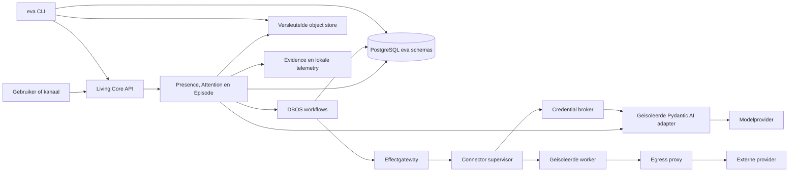

# Eva 2 platformbouwkaart

Status: `selected_not_implemented`

Datum: 20 augustus 2026

Hoort bij:

- [ADR-0001: Eva 2 Living Core](adr-0001-eva2-living-core.md), SHA-256
  `73b53e392b8e3b65d1241bff46bb92144960a2620dbd45f3c9d3526d9f07910d`;
- [Eva 1 naar Eva 2 transition manifest](eva1-to-eva2-transition-manifest-2026-08-20.md),
  SHA-256 `7ea53e81e6fb3af0304cf88119abc9bf864e1a9dbf1445bfaed6dbd18d3f8d85`;
- [het sealed architectuurbakeoffcontract](eva2-architecture-bakeoff-v1.md),
  SHA-256 `fa41efdc57b5adf70e7d3f2d5771704f54bd78afbd9f0abb714614f777d0f6c8`;
- [de feitelijke bakeoffresultaten](eva2-architecture-bakeoff-results-2026-08-20.md),
  SHA-256 `4908625fa48a4ba558b0322a355b8fecc344e51e07ff117a3dd0144496879eed`;
- [het content-addressed beslismanifest](../experiments/eva2-architecture-bakeoff/evidence/architecture-bakeoff-decision-442b6e0dc1434da9dcd31f88d8395be0332d0d46b15d74f7ed5850ce262dbf1c.json),
  SHA-256 `442b6e0dc1434da9dcd31f88d8395be0332d0d46b15d74f7ed5850ce262dbf1c`.

Dit document sluit geen productpoort. Het legt vast wat in stap 3 gebouwd moet
worden, wie iedere toestand bezit, hoe de onderdelen samenwerken en welk bewijs
nodig is voordat een claim waar mag heten. Er wordt met deze kaart geen Eva 1-data
geimporteerd, geen service gestart en geen prototype tot productcode verklaard.

## Besluit in gewone taal

Eva 2 wordt een kleine Python Living Core rond eigen Pydantic-contracten en eigen
PostgreSQL-data. Pydantic AI doet alleen een getypeerd modelvoorstel. DBOS hervat
alleen workflows, stappen en timers. Connectoren draaien buiten de kern en krijgen
per operatie precies één beperkte opdracht, alleen de benodigde credential en
alleen het toegestane netwerkpad.

Een externe handeling is nooit geslaagd omdat een workflowstap klaar is. De
effectgateway verlangt een vooraf opgeslagen intent, een actuele generation fence,
een stabiele idempotency key, een connectorreceipt en de bewijsbodem uit het
capabilitymanifest. Waar onafhankelijke readback mogelijk is, is die verplicht.

Installatie, update en herstel gebruiken gesigneerde OCI-images en een zelfstandige
`eva`-CLI. Een Git-worktree, Node-runtime, voorgevulde database of oude Eva 1-code
wordt geen productievereiste.

## Status- en bewijsregel

Iedere ontwerpuitspraak hieronder heeft de status `required_unproven` totdat haar
genoemde gate een content-addressed bewijsbundel heeft. Een gate kan alleen een van
de volgende uitkomsten hebben:

- `passed`: alle vooraf vastgelegde oracles zijn groen;
- `failed`: een oracle is aantoonbaar geschonden;
- `not_proven`: de proef of een vereist deelbewijs ontbreekt.

Een ontbrekend bewijs is nooit impliciet groen. Een mislukte run wordt bewaard en
eerst geclassificeerd als enginebeperking, implementatiefout, configuratiefout,
fixturefout of contractfout. De run wordt niet tijdens uitvoering aangepast.

## Feiten die de kaart begrenzen

| Feit uit de bakeoff | Verplicht gevolg in deze kaart | Gate |
| --- | --- | --- |
| Twee overlappende identieke DBOS-invocations gaven bytegelijke uitkomsten, een modelcall en drie effecten | DBOS blijft kandidaat voor duplicate workflow execution, maar krijgt geen domein- of effectauthority | `DBOS-01`, `DBOS-02` |
| Dezelfde DBOS workflow-ID met andere input gaf stil de oude uitkomst | Request-ID plus canonical inputhash wordt voor workflowstart door `eva_core` geclaimd; workflow-ID alleen is nooit conflictcontrole | `DBOS-02` |
| Disconnect na externe HTTP 201 werd duurzaam `ERROR` en replay bleef fout | Een external step heeft een frameworkattempt; alleen een getypeerde ambigue transportuitkomst mag na concluderende readback een tweede canoniek effectattempt openen | `EFFECT-01` |
| Een aparte beperkte retryproef vond via readback precies het bestaande effect | Reconcile-before-send is technisch verdedigbaar, maar bewijst geen algemene exactly-once-semantiek | `EFFECT-01` |
| De DBOS-prototypegegevens stonden alleen in frameworkinterne tabellen | Alle portable Eva-data moet in `eva_*` staan en zonder `dbos` leesbaar en herstelbaar zijn | `DBOS-01`, `PORT-01` |
| Containerreconstructie gebruikte dezelfde PostgreSQL-datadir | Containerrecreate telt als restartbewijs, niet als backup, export of tweede-systeemrestore | `OPS-01`, `PORT-01` |
| De Restate-worker erfde de volledige omgeving en zag een geheime sentinel | Een connectorworker krijgt nooit de procesenvironment van Core, broker of host | `SEC-01` |
| Restate supersedede de oude in-flight run niet | Canonieke generation en een databasefence, niet frameworkcancellation, bepalen of een effect nog current is | `DBOS-02`, `EFFECT-01` |
| De custom SQL-engine deed bij overlap twee modelcalls en 21 connectorcalls | Eva bouwt geen eigen workflowengine naast DBOS | `DBOS-02` |
| Pydantic AI draaide alleen met een deterministisch TestModel | De typed adaptergrens is bruikbaar; echte modelkwaliteit en attemptgedrag zijn nog niet bewezen | `MODEL-01`, `LIVE-01` |
| Canonieke SQL-memory bleef op 10.000 en 100.000 events correct en snel | SQL-events blijven authority; full-text en latere embeddings zijn wegwerpbare projecties | `DATA-01` |

## Producttopologie en eigenaarschap

| Onderdeel | Eigenaar van | Mag uitdrukkelijk niet bezitten | Procesgrens | Gate |
| --- | --- | --- | --- | --- |
| Living Core | identity, presence, attention, episodes, commitments, policy en replybinding | Providercredentials, connectoreffecten of DBOS-internals | Primaire Python-container | `PLATFORM-01` |
| Pydantic AI adapter | Purpose-scoped requests naar `ModelDecision/v1`, `DocumentDraft/v1` of `ReplyCandidate/v1`; iedere call heeft een eigen zichtbare ModelAttempt, maximaal drie happy en vier uitsluitend in de plan-429-case | Tools, sessions, memory, effects, identity, receipts of persistente credentials | Apart minimaal Python-proces achter een vervangbaar protocol | `MODEL-01`, `SEC-01` |
| DBOS 2.30 | Hervatten, durable timers, stepresultaten en datasource-transacties | Canonieke Eva-data of waarheid over externe effecten | Library in de Living Core-container, eigen `dbos`-schema | `DBOS-01` |
| PostgreSQL 16.13 | Alle canonieke `eva_*`-state | Ruwe grote media of uitsluitend frameworkstate | Gepinde databasecontainer en apart volume | `DATA-01`, `OPS-01` |
| Effectgateway | Effectintent, attemptbeleid, generation fence, receipt/readbackacceptatie en breaker | Provider-SDK-retries of natuurlijke antwoordtekst | Living Core-module met eigen database-eigenaar | `EFFECT-01` |
| Connector supervisor | Workeridentiteit, lifecycle, sandbox en protocol | Domeinbesluiten, modelcontext of credentials in rust | Apart minimaal proces | `CONN-01`, `SEC-01` |
| Credential broker | Versleutelde secretbytes en operation-scoped uitgifte | Gespreksinhoud, memory, plannen of effectacceptatie | Apart proces zonder model- of connectorsocket naar PostgreSQL | `SEC-01` |
| Connectorworker | Een manifest, een request en tijdelijk een minimaal secret | Database, model, volledige identity, algemeen geheugen of andere accounts | Aparte UID en containernamespace | `CONN-01`, `SEC-01` |
| Egress proxy | DNS-resolutie en allowlisted providerverbindingen | Credentials, domeinstate of retrybesluit | Apart netwerkproces | `SEC-01` |
| Object store | Versleutelde immutable bytes | Zoekindex, identityauthority of losse onbeperkte BLOBs in PostgreSQL | Apart volume achter `ObjectStore/v1` | `DATA-01`, `PORT-01` |
| Lokale telemetrycollector | Begrensde OTLP-ingest, lokale metrics/traces en retentie | Businessstate, raw content, secrets of effectacceptatie | Apart proces zonder writegrant op `eva_*` | `OBS-01`, `SEC-01` |
| `eva`-CLI | Installatie- en beheercommando's | Gespreks-, planning- of effectlogica | Zelfstandige gesigneerde hostbinary | `INSTALL-01`, `UPDATE-01` |

Directe CLI-toegang tot PostgreSQL of objectopslag bestaat alleen voor het actuele
beheercommando met een tijdelijke migrator-, backup- of restoregrant. De gewone CLI
bezit geen blijvende runtimecredential; een commando dat consistente offline state
vereist, quiescet Core eerst volgens zijn gate.

### Platformdesigngate `PLATFORM-DESIGN-01`

Deze 4A-gate is statisch en doet geen supportclaim. Zij verifieert de package- en proceskaart,
toegestane importpijlen, trustgrenzen, numerieke resourcebudgetten, de exacte Tier 1-hostmatrix en
alle expliciete niet-claims. Geen connectorworker, installer of cross-OS-proces hoeft hiervoor al
te bestaan.

**NO-GO:** een tweede trusted core, onbegrensde worker, ontbrekende platformversie, impliciete
macOS/Windows/Podmanclaim of niet-toegewezen socket, secret, mount of databasegrant.

### Procesgate `PLATFORM-01`

Een procesproef inspecteert open sockets, mounts, UID, environment, databasegrants
en filesystemtoegang van ieder onderdeel. Iedere rij uit de tabel moet exact haar
toegestane resources zien en alle verboden resources aantoonbaar niet kunnen
openen. De proef draait op beide Linux-architecturen en in de gedeclareerde
containerpaden op macOS en Windows.

**NO-GO:** een tweede trusted runtime bezit Living Core-state, een worker kan de
database of het model bereiken, of businessstate bestaat alleen in logs, DBOS of
een connectorcache.

## Bouwpakketten en contractgrenzen

De nieuwe code staat naast Eva 1 onder de vaste root `eva2/`. De padstructuur uit
corekaart paragraaf 3 is normatief. Onderstaande crosswalk voegt geen alternatieve packages of
eigenaars toe:

| Bouwpakket | Verantwoordelijkheid | Eerste verplichte contracten | Gate |
| --- | --- | --- | --- |
| `eva2/src/eva/contracts` | Pydanticmodellen en gegenereerde JSON Schema's zonder I/O | IdentityPack, Ingress, PlannerRequest, ModelDecision, Episode, Effect, Connector, Evidence, Export | `CONTRACT-01` |
| `eva2/src/eva/domain` | Presence, Attention, Episode, Capability, Experience en Learning policies | `AttentionWake/v1`, `EpisodeState/v1`, `Commitment/v1` | `DBOS-02`, `IDENTITY-01` |
| `eva2/src/eva/application` | Use-cases en poortinterfaces, inclusief effect- en memorybeslissingen | ValidatedPlan, consent, reads, effects, OutcomeView en erasurecommands | `EFFECT-01`, `DATA-01` |
| `eva2/src/eva/adapters/model` | Dunne geisoleerde purpose-scoped Pydantic AI-provideradapter | `PlannerRequest/v1`, `ModelDecision/v1`, `DocumentDraft/v1`, `ReplyCandidate/v1`, `ModelAttempt/v1` | `MODEL-01`, `SEC-01` |
| `eva2/src/eva/adapters/dbos` | DBOS workflowfuncties en datasource-transacties | Alleen Eva-contracten en IDs, nooit provider- of frameworktypes | `DBOS-01` |
| `eva2/src/eva/adapters/postgres` | SQLAlchemy Core repositories voor alle canonieke namespaces | Unit-of-work en centrale schemaqueries | `DATA-01`, `OPS-01` |
| `eva2/src/eva/adapters/connectors` en `eva2/connector_sdk` | Supervisorclient plus taalneutraal wireprotocol en conformance | `ConnectorManifest/v1`, `CapabilityGrant/v1`, `ConnectorEnvelope/v1`, `ConnectorResult/v1` | `CONN-01` |
| `eva2/forge` | Docsnapshot, candidatebuild, quarantaine, canary en promotie | `DocumentationSnapshot/v1`, `ConnectorCandidate/v1`, `PromotionDecision/v1` | `FORGE-01` |
| `eva2/src/eva/adapters/credentials` | ConnectorBinding en secretbrokerclient | `ConnectorBinding/v1`, `CredentialGrant/v1` | `SEC-01` |
| `eva2/src/eva/adapters/objects` en evidence-use-cases | Envelopes, hashes, provenance, objectrefs en claimbinding | `EvidenceEnvelope/v1`, `ClaimEvidenceBinding/v1`, `ObjectRef/v1` | `OBS-01` |
| `eva2/src/eva/adapters/api` | FastAPI-ingress, kanaalneutrale responses en beheer-API | `IngressRequest/v1`, `IngressClaim/v1`, `DeliveryOffer/v1` | `DBOS-02` |
| `eva2/migrations` | De enige Alembic revision tree | Centrale upgrade- en compatibiliteitsmetadata | `OPS-01` |
| `eva2/src/eva/operations` en `eva2/release` | Beheer-CLI, OCI-manifest, signatures, SBOM en rollback | `ReleaseManifest/v1`, `InstallationManifest/v1` | `INSTALL-01`, `SUPPLY-01` |

Geen `pydantic_ai`, DBOS- of provider-SDK-type passeert een duurzaam contract.
JSON Schema wordt uit de eigen Pydanticmodellen gegenereerd en samen met iedere
wire- en exportversie bewaard.

### Contractgate `CONTRACT-01`

- ieder duurzaam of extern contract heeft een vaste naam, versie, `extra=forbid`,
  begrensde velden en canonical-JSON-regel;
- Python en minimaal een taalneutrale referentiereader accepteren en weigeren
  dezelfde corpusgevallen;
- onbekende major versions, extra securityvelden, dubbele JSON-keys, ongeldige
  Unicode en te grote payloads falen voor enig effect;
- oude contractversies hebben een expliciete reader of een expliciete
  incompatibiliteitsuitkomst.

**NO-GO:** frameworkobjecten worden opgeslagen, een schema wordt soepeler om een
fixture te accepteren, of een onbekend veld kan scope, resource, identity,
generation of bewijsbodem verbreden.

## De eerste schone DBOS-vertical

De eerste vertical gebruikt de Noor-opdracht met een expliciete deliveryauthority:

> Lees de nieuwste mail van Noor BV, zoek Noor op in het ERP, controleer wanneer we woensdag
> allebei kunnen, plan een afspraak van een half uur, maak een korte bevestiging, stuur die naar
> het bevestigde e-mailadres uit het ERP en koppel terug wat er werkelijk is gelukt.

Hij gebruikt een lege installatie, Eva- en Mira-identitypacks, een deterministische
planner en vijf protocolconforme fixtureconnectors voor mail, ERP, agenda,
document en delivery. De oude prototypebestanden worden niet geimporteerd.

### Ingress vóór workflowstart

1. FastAPI valideert principal, conversation, request-ID, canonical inputbytes en
   het actuele identity-ID.
2. Een korte applicatietransactie claimt uniek
   `(installation_id, channel_id, request_id)` en schrijft `input_sha256`,
   principal, conversation, episode, generation en status `admitted` in `eva_core`.
   Dezelfde commit maakt exact één pending Attention-item met wake-reason
   `workflow_start`.
3. Dezelfde request-ID plus dezelfde hash verwijst naar dezelfde canonical claim.
   Dezelfde ID plus andere bytes wordt een typed conflict voor model of connector.
4. De ene duurzame Attention-route start daarna idempotent de DBOS-workflow. Een
   crash tussen admission en start laat de `admitted` ingress plus het pending
   Attention-item achter; Attention hervat zonder een tweede claim, modelattempt of
   scheduler.
5. De workflow-ID is afgeleid van installation, episode en generation, maar is
   nooit de enige duplicate- of conflictauthority.

### Workflowgrenzen

- Een DBOS datasource-transactie mag uitsluitend bounded `eva_*`-mutaties doen.
  Alle SQLAlchemy Core-repositories gebruiken exact de door DBOS geleverde
  connection met `SET LOCAL` tenantcontext; eigen enginecommit, autocommit, nested
  transaction en businessquery op `dbos` zijn verboden. Applicatiemutatie,
  immutable domeinevent en DBOS-transactieresultaat vallen in dezelfde
  PostgreSQL-commit.
- Modelcalls en connectorcalls draaien nooit in een databasetransactie.
- Iedere external step doet hoogstens één model- of connectorcall en heeft exact
  één frameworkattempt.
- Voor een modelcall schrijft een datasource-transactie call-ID, requesthash,
  model, budget en generation. Na resultaat schrijft een tweede transactie
  responsehash, usage en providerreferentie.
- Pydantic AI output- en validation-retries en alle provider-SDK-retries staan op
  nul. Een nieuwe modelpoging is een nieuw canonical attempt en telt tegen hetzelfde
  episodebudget.
- Iedere DBOS external step heeft exact een frameworkattempt. De getypeerde
  `ambiguous_transport`-klasse kan pas na een concluderend `not_observed`-reconcile_result uit een
  canonieke `effect_reconcile`-ReadAttempt
  één nieuw canoniek `EffectAttempt/v1` met ordinal twee laten reserveren. Dit is
  een nieuwe zichtbare Core-opdracht onder dezelfde intent en idempotency key, geen
  frameworkretry van de eerste external step.
- De broker zet definitieve reject, policy denial, hashconflict en gewone
  programmatuurfout om in terminale getypeerde resultaten; geen ervan opent een
  nieuw effectattempt. Een geldige 429 zet de intent op `waiting_breaker`. Alleen
  een geslaagde half-open probe, nog geldige deadline en resterend vooraf vastgelegd
  budget mogen één nieuw canoniek attempt openen. Een tweede 429 blokkeert de
  intent; de eerste vertical heeft nooit ordinal drie.
- Ieder recovery-effectattempt na mogelijk extern verkeer begint met reconcile op
  de opgeslagen idempotency key. Een procescrash kan de workflow hervatten, maar
  nooit de eerdere external step blind opnieuw uitvoeren of een resend verbergen.
- `max_recovery_attempts` is alleen een workflowherstelgrens en nooit een
  connector- of modelretrybudget.
- Een zuiver lokale serialization- of deadlockfout mag een transactionstap
  begrensd opnieuw uitvoeren met hetzelfde command-ID; die stap bevat geen externe
  I/O en iedere andere fout blijft zichtbaar.

### Supersession en cancellation

Een correctie lockt dezelfde episode, verhoogt canonical generation en schrijft
een supersessionrecord. Modelrequest, plan, effectintent en delivery dragen die
generation. Onmiddellijk vóór nieuw extern verkeer lockt de effectgateway dezelfde
episode en vergelijkt zij generation en supersession. Daardoor geldt:

- commit de correctie eerst, dan doet het oude plan nul nieuwe effecten;
- commit de effectfence eerst, dan was de correctie nog niet toegelaten en wordt
  het begonnen effect eerst gereconcilieerd;
- een frameworkcancel, taskcancel of proceskill is nooit het fencebewijs.

Een correctie na externe acceptatie kan het bestaande effect niet ontkennen. Zij
maakt zo nodig een nieuwe episode voor een expliciete compensatie en behoudt beide
receipts.

### DBOS-gates

`DBOS-01` bewijst op PostgreSQL 16.13:

- een appmutatie en DBOS datasource-resultaat zijn een commit bij crash vlak voor
  en vlak na commit;
- alle identity, episode, intent, receipt en pending-workdata staat in `eva_*`;
- verwijderen van het `dbos`-schema na `eva export` verliest geen portable data;
- een generieke reader en een nieuwe DBOS-state kunnen nonterminale episodes uit
  canonical continuationstate reconstrueren;
- workflowversies zijn expliciet en een wachtende oude episode blijft onder haar
  compatibele image of wordt via een geteste continuationmigratie hervat.

`DBOS-02` voert twee werkelijk overlappende processen uit en bewijst:

- identieke happy-path requestbytes geven per purpose hoogstens één modelcall, maximaal drie
  totaal, één episode en één uitkomst;
- dezelfde request-ID met andere bytes geeft conflict vóór model of connector;
- een nieuwere correctie vóór de eerste effectfence geeft nul oude effecten;
- crash op iedere sealed grens geeft nul duplicate effecten en nul verloren
  commitments;
- iedere external step telt exact een frameworkattempt en een eventuele tweede
  writepoging bestaat als canoniek attempt ordinal twee met eigen evidence;
- definitieve reject levert een terminale menselijke deeluitkomst, geen exception
  als gebruikersresultaat.

**NO-GO:** canonical Eva-data bestaat alleen in `dbos`, een workflow-ID verbergt
inputconflict, een transactionele dual write kan half committen, of correctie leunt
op best-effort frameworkcancellation. Een engine-intrinsieke mislukking van het
atomische datasourcecommitpunt heropent volgens ADR-0001 de durable componentkeuze.

## Modeladapter

De modeladapter draait als apart minimaal proces en ontvangt alleen een purpose-scoped begrensde
context, relevante feiten met
provenance, beschikbare capabilitymetadata en het episodebudget. Zij ontvangt geen
databasehandle, secrets, uitvoerbare connectortools, connectorworker of
runtimebeheerfunctie. De credentialbroker geeft alleen voor precies die providerattempt
een modelprovidercredential; die grant is een ander type dan een connectorgrant en
kan nooit door een connectorworker worden gebruikt. De eerste vertical heeft drie afzonderlijke
purposes en in de happy path maximaal één call per purpose: `plan` levert `ModelDecision/v1`,
`document_draft` levert `DocumentDraft/v1` en `reply` levert `ReplyCandidate/v1`. De enige
recovery-uitzondering is een tweede zichtbaar gereserveerde `plan`-attempt nadat attempt één exact
de verzegelde provider-429 gaf en de vaste breakertermijn verstreek. Daardoor zijn maximaal drie
calls in de happy path en vier in die ene recoverycase toegestaan. Alleen `ModelDecision/v1` kan
de volgende voorstelsoorten bevatten:

- noodzakelijke verduidelijking;
- toegestane read aanvragen;
- effectvoorstel;
- wachten op een durable event.

De Living Core valideert het voorstel tegen principal, capability, generation,
toestemming en evidence. Een stijlpoort controleert alleen harde regels en schrijft
geen sjabloonantwoord.

### Modelgate `MODEL-01`

Dezelfde sealed Nederlandse cases draaien via Pydantic AI en een minimale
exitadapter op twee echte, toegestane providers. De proef telt werkelijke HTTP-
attempts, tokens, kosten, deadlines, 429 en crash na providerrespons. Er is geen
verborgen SDK-retry en geen tweede call wanneer provider-idempotency of een
geattesteerde cache hetzelfde resultaat kan leveren. Zonder zo'n bewijs wordt een gewone
ambiguous modelcall in deze eerste vertical zichtbaar geblokkeerd. Alleen de exact verzegelde
plan-429 mag na haar vaste breakertermijn planattempt ordinal twee openen.

**NO-GO:** modeltekst voert direct een effect uit, modelstate wordt canonical
memory, een SDK retryt onzichtbaar, of een providerresultaat wordt als receipt voor
een andere connector behandeld.

## Connectorworkerprotocol

### Wireformaat

- JSON-RPC 2.0 over stdin/stdout met UTF-8 en `Content-Length` framing;
- stdout bevat uitsluitend protocolframes; begrensde stderr is diagnostiek en
  nooit bewijs;
- maximaal 1 MiB per frame en exact twee stdoutframes per korte workerinvocation: één
  initialize-response en één operation-response. Het totale stdoutbudget is 2.101.248 bytes,
  inclusief framing. Grotere bytes reizen als capability-scoped objecthandle met lengte en
  SHA-256;
- request-ID, response-ID en protocolmajor zijn verplicht; notificaties mogen
  nooit een effect starten;
- de supervisor beëindigt de worker bij framingfout, extra antwoord, timeout,
  executablewissel of manifestmismatch.

### Lifecycle en methoden

1. De supervisor verifieert release signature, executablehash,
   `ConnectorManifest/v1` en sandboxprofiel.
2. `connector.initialize` bindt protocolversie, manifesthash, workerhash,
   `CapabilityGrant/v1`, deadline en correlation-ID. Er zijn nog geen secretbytes.
3. De broker materialiseert pas na een geldige handshake het minimale secret via
   de platform secretfile-descriptorgrens. Bij een write blijft de operationele egresslease
   gesloten totdat de Core-dispatchfence is gecommit.
4. De supervisor roept exact een van deze methoden aan:
   `resource.read`, `effect.execute`, `effect.reconcile`, `effect.readback`,
   `connector.probe`, `subscription.poll` of `connector.health`. `effect.reconcile`,
   `effect.readback` en `connector.probe` zijn readoperations en vereisen ieder een eigen
   canonieke ReadAttempt plus read-only CapabilityGrant en CredentialGrant. Een afzonderlijk
   account-granttype staat alleen
   `account.authorization.prepare`, `account.authorization.complete`,
   `account.status` of `account.revoke` toe.
5. De worker retourneert een `ConnectorResult/v1` en sluit. Alleen een expliciet
   read-only subscriptionprofiel mag langer leven; een writeworker is kortlevend.

In budgetten betekent één connectorcall precies één operation-invocation die hoogstens één externe
provider- of netwerkcall mag doen. De lokale `connector.initialize`-handshake telt niet als externe
connectorcall en mag zelf geen externe I/O doen, maar telt wel tegen frame-, workerduur- en
resourcebudgetten.

`ConnectorEnvelope/v1` bindt minimaal installation, tenant, request, correlation,
episode, generation, connector, ConnectorBinding, capability, operation, resource,
deadline, payloadhash, manifesthash en grantref. Het bevat geen secretwaarde.

`ConnectorResult/v1` heeft exact een typed outcome:

- `read_ok` met provider resource-ID, retrieved-at, responsehash, exact `outputSchemaHash` en precies
  één van: een inline getypeerde `normalizedPayload` binnen het framebudget, of een
  capability-scoped objecthandle met byte length, MIME en SHA-256. Core verifieert schema, lengte
  en hash vóór zij hieruit `ReadObservation/v1` maakt;
- `effect_response` met providerreceipt, maar nog geen Core-acceptance;
- `reconcile_result` met exact idempotency key, resource, payloadhash en uitsluitend outcome
  `found_same`, `not_observed`, `conflict` of `inconclusive`;
- `readback` met resource-ID, idempotency key, requesthash, actuele providerstate via dezelfde
  schema- en payload/objecthandlegrens, en uitsluitend matchstatus `matches`, `not_observed`,
  `conflict` of `inconclusive`;
- `probe_result` met uitsluitend `ready`, `rate_limited` of `unavailable`, observed-at en bewijs
  dat de probe geen providerstate muteerde;
- `rate_limited` met gevalideerde `Retry-After`;
- `definitive_reject`;
- `ambiguous_transport`;
- `transient_read_failure`;
- `policy_denied` of `internal_failure`.

De worker beslist niet over retry, supersession, accepted state, episodeclosure of
antwoordtekst.

### Protocolgate `CONN-01`

Een taalneutrale referentieworker en minimaal Python plus een tweede
workertaalimplementatie doorstaan hetzelfde corpus: gedeeltelijke frames, te grote
frames, dubbele IDs, crash, hang, extra velden, verkeerde manifesthash, stale
grant, verkeerde resource, auth-state replay, verkeerde callback, rate limit,
reject, ambiguous commit en readback. De supervisor telt werkelijk gestarte
processen en externe calls.

**NO-GO:** newline- of logtekst kan als protocol gelden, workerstdout wordt een
receipt, binary payload omzeilt objectpolicy, of een worker kan zelf zijn scope,
deadline, resource, generation of manifest veranderen.

## Credentialbroker, sandbox en egress

### Persistente secrets

- Connectorsecretbytes staan versleuteld in een aparte vault, niet in PostgreSQL,
  identity packs, logs, modelcontext, workerimages of portable export.
- De random installation master key staat buiten database- en objectvolumes in
  een host-owned bestand of platformcredential met 0600-equivalente ACL.
- Een restore op een ander systeem maakt een nieuwe master key en vereist
  herauthorisatie. Een afzonderlijke expliciete secretbackup is een ander product
  en valt niet stil onder `eva export`.

### Operation-scoped grant

Core geeft een getekende `CapabilityGrant/v1` uit voor precies één connectorcall.
De broker mag daaruit alleen een nauwere `CredentialGrant/v1` afleiden met
adaptertype, connector- of executablehash, account, operation, resourcepatroon,
secretnamen, toegestane providerhosts, deadline en one-time nonce. Hij bindt ook
issuer, audience, tenant en installation. De broker valideert Core-signature,
actuele generation, expiry en executablehash en consumeert de nonce atomair voordat
hij alleen de genoemde secretwaarden levert. De credentialgrant kan de
capabilitygrant nooit verbreden en is geen effectauthority. Een grantref of
protocolreplay kan daardoor niet opnieuw secretbytes materialiseren.

Een modelcredentialgrant wordt afzonderlijk afgeleid van een canoniek
`ModelAttempt/v1` in status `dispatch_authorized`; hij kan geen connectorcapability
dragen. Model- en connectorgrants hebben niet-overlappende audiences en scopes. De
modeladapter is de enige runtime-audience voor modelprovidercredentials; Core en
connectorworkers zien die bytes nooit:

- Linux gebruikt een sealed anonymous file descriptor of read-only tmpfs-secret;
- de containerpaden op macOS en Windows gebruiken dezelfde Linux-secretfilegrens
  in de container-VM;
- argv, algemene environment, image layers en protocolframes bevatten geen
  secretbytes;
- een provider-SDK die uitsluitend brede environmentcredentials ondersteunt, is
  niet inzetbaar totdat een connectorwrapper die secret lokaal en zonder child
  processes kan begrenzen.

Providerauth is eveneens protocolgebonden. Een manifest verklaart authmethode,
scopes, callback en welke menselijke stappen mogelijk zijn. PKCE-state en
callbackbinding zijn broker-owned. Een authworker mag tijdelijk code/tokenbytes
zien, maar schrijft nieuwe credentials via een eenrichtings broker-FD en nooit via
JSON-RPC, stdout of Core. Core ontvangt alleen `ConnectorBinding/v1`-metadata en
authstatus. `account.revoke` is een afzonderlijk geautoriseerd effect. Voorwaarden,
betaling, CAPTCHA, MFA en een menselijke identiteitsverklaring worden nooit door
het platform nagebootst of stil geaccepteerd.

### Worker sandbox

De worker draait non-root, zonder Linux capabilities, met `no-new-privileges`,
read-only root, private tmpfs, PID-, CPU-, RAM-, output- en wall-clocklimiet. Hij
ziet geen databasesocket, Core-socket, modelendpoint, host home, andere connector,
andere ConnectorBinding of algemeen secretsocket.

Extern netwerk loopt uitsluitend via een lokale egressproxy. De worker heeft geen
directe route of bruikbare DNS. De proxy valideert grant, connector, host, poort en
deadline, resolveert zelf DNS en blokkeert private/link-local metadata-adressen,
redirects buiten de allowlist en ongeattesteerde TLS-doelen. Directe TCP/UDP wordt
door de containernetwerkpolicy geblokkeerd, ook wanneer een SDK proxysettings
negeert.

### Securitygate `SEC-01`

De gate plaatst verschillende canarysecrets in Core, broker, databaseconfig,
modeladapter en een tweede connector. De doelworker mag alleen zijn ene
operationsecret gebruiken. Inspectie van environment, `/proc`, mounts, argv,
stdout/stderr, telemetry, evidence, crashdump, PostgreSQL, objectstore, export en
de siblingworker vindt nul andere canarybytes. SSRF-proeven tegen localhost,
database, cloudmetadata, private IPv4/IPv6 en een redirect buiten de allowlist
geven nul verkeer. Na deadline en procesexit is het secret niet meer leesbaar.

**NO-GO:** een worker erft de hostenvironment zoals in de Restate-proef, een
secret staat in een portable archive of log, direct egress omzeilt de proxy, of
een model/connector kan zelf een credentialgrant uitgeven.

## Effect, readback, idempotency en circuit-breaker

### Canonieke effectketen

Voor iedere write of zichtbare delivery is de volgorde:

1. `eva_effects` schrijft `EffectIntent/v1` met episode, generation, connector,
   capability, account, operation, exacte resource, payloadhash, bewijsbodem en
   een random stabiele idempotency key.
2. Een unieke constraint bindt dezelfde key altijd aan dezelfde connector,
   operation, resource en payloadhash. Andere bytes zijn lokaal conflict.
3. Na ieder eerder of mogelijk extern attempt reserveert Core eerst een afzonderlijke
   `ReadIntent/v1` en `ReadAttempt/v1` met purpose `effect_reconcile`. Een read-only worker doet
   `effect.reconcile` met dezelfde key. Eerste-attemptpreflight die extern verkeer gebruikt volgt
   hetzelfde readpad. `found_same`, `not_observed`, `conflict` of `inconclusive` wordt vóór een
   nieuwe write canoniek gecommit.
4. Alleen bij een aantoonbaar eerste attempt, of na een concluderende `not_observed`, reserveert
   Core een EffectAttempt. De supervisor verifieert en start de worker, voltooit handshake,
   capability- en credentialpreflight en houdt de operationele egresslease nog gesloten.
5. De effectgateway doet daarna in één PostgreSQL-transactie een CAS op episode, generation,
   current status, consent, capabilityactivation, deadline en intentrevision en commit exact dat
   attempt als `dispatch_authorized`. Bij een mislukte fence worden worker, descriptor en lease
   ingetrokken zonder effect-I/O.
6. Na een geslaagde fence opent de supervisor direct de reeds voorbereide egresslease en stuurt
   exact één `effect.execute` voor dezelfde attempt en grant. Er staat geen reconcile,
   brokerlookup, workerstart, queue, sleep of andere planbare call tussen fence en execute.
7. De providerresponse wordt als evidence opgeslagen. Onafhankelijke readback gebruikt daarna een
   nieuwe `ReadIntent/v1` en `ReadAttempt/v1` met purpose `effect_verify`, eigen grants en exact
   één `effect.readback`. `EffectReadback/v1` verwijst verplicht naar die ReadAttempt.
8. Een datasource-transactie projecteert alleen de bewezen toestand naar de
   gesloten intentstates, waaronder `provider_accepted`, `verified`,
   `accepted_unverified`, `ambiguous`, `provider_rejected`, `waiting_breaker` of
   `manual_reconciliation`. Alleen `verified` voldoet aan een proof floor die
   onafhankelijke readback vereist.
9. Een replyclaim verwijst via `ClaimEvidenceBinding/v1` naar de gebruikte receipt en readback.
   `confirmation_delivery` en `outcome_delivery` hebben daarna ieder hun eigen intent en bewijs.

Een providerreceipt en readback zijn verschillende objecten. De writeworker mag
niet zelf verklaren dat zijn write bewezen is. `accepted_unverified` mag alleen
wanneer het vooraf goedgekeurde manifest uitlegt waarom onafhankelijke readback
niet bestaat; de natuurlijke reply zegt dan niet dat de eindtoestand is
geverifieerd.

De Noor-vertical heeft twee afzonderlijke deliveries. `confirmation_delivery` verstuurt het
document naar het unieke bevestigde ERP-adres en sluit vóór de OutcomeView. Daarna bindt de host de
OutcomeView aan een PresenceReply en verstuurt die als `outcome_delivery` naar het authentieke
ingresskanaal. Beide rollen hebben eigen intent, grant, attempt, target, idempotency key, contenthash
en receipt. Geen van beide receipts kan de andere delivery sluiten.

Voor een provider zonder idempotency geldt:

- een providerresource moet op een stabiele applicatiesleutel terugvindbaar zijn;
- reconcile moet vóór iedere mogelijke resend onderscheid kunnen maken tussen
  afwezig, aanwezig-met-dezelfde-hash en conflict;
- zonder beide eigenschappen is automatische write/retry verboden. Eva houdt de
  uitkomst `ambiguous` en vraagt alleen de noodzakelijke menselijke beslissing.

Een manifest zonder onafhankelijke readback kan hoogstens een eerste eenmalige
write met provideracceptatiereceipt toestaan. Na timeout, disconnect of crash wordt
die intent `ambiguous` en nooit automatisch opnieuw verstuurd.

### Foutklassen

| Uitkomst | Automatisch vervolg | Verboden vervolg |
| --- | --- | --- |
| `ambiguous_transport` | Eerst een canonieke reconcile-ReadAttempt; alleen na `not_observed` hoogstens een nieuw canoniek effectattempt ordinal twee | Frameworkretry, blind resend of accepted claim |
| Provider/connector `429` | Intent wacht op canonieke breaker; één read-only `breaker_probe`-ReadAttempt met eigen grants kan na succes, geldige deadline en budget hoogstens effectattempt ordinal twee openen | Framework-/SDK-retry, derde attempt, minuutlus of nieuwe episode per probe |
| Definitieve `4xx`/policy denial/hashconflict | Terminale reject of deelresultaat | Frameworkretry |
| Transiente readfout vóór write | Nieuw expliciet readattempt binnen budget | Verbergen in dezelfde attempt |
| Programmeer- of schemabug | Terminale internal failure en operator evidence | Als transient behandelen |
| Procescrash | DBOS hervat; een afzonderlijke canonieke reconcile-ReadAttempt gaat aan iedere mogelijke nieuwe effectattempt vooraf | Aannemen dat geen extern effect bestond |

De breakerkey bevat connector, provider, account en operationklasse. Hij staat in
`eva_effects`, heeft een monotone revision en maximaal een probelease. Model- en
connectorbreakers zijn gescheiden.

### Effectgate `EFFECT-01`

De sealed fixture en later disposable echte accounts injecteren crash vóór call,
disconnect na remote commit, crash vóór lokaal receipt, crash na receipt, 429,
422, payloadconflict, stale generation en twee concurrente workers. Per effect
zijn externe before/after, callcount, provider-ID, payloadhash, receipt, de vooraf vastgelegde
proof floor, attempts en uiteindelijke reply verplicht. De happy path vereist exact vier
effectbewijzen: readback voor calendar, document en confirmation delivery, plus een authentieke
channelproof voor outcome delivery. Reconcile-, verify- en breakerprobecalls verschijnen als
eigen ReadAttempts met eigen grants en tellen in hetzelfde sealed connectorbudget. Resultaat: nul
duplicates, nul stale effects en nul onbewezen succesclaims.

**NO-GO:** het platform claimt generiek exactly-once, een connectorcache geldt als
onafhankelijke readback, provider-SDK-retry staat aan, een 429 maakt een retrylus,
of `ok=true` zonder bewijs sluit een episode.

## Connector Forge

Connector Forge is een releasepipeline, geen modeltool. Hij gebruikt deze
monotone levenscyclus:

1. `discovered`: officiële documentatie, OpenAPI, GraphQL, MCP- of SDK-metadata is
   via een read-only documentationconnector gevonden.
2. `frozen`: URL, redirectketen, retrieved-at, provider- en API-versie, scopes,
   authenticatiemethode, rate limits, licentie en contenthash zijn vastgelegd.
3. `generated`: schemas, manifest, bron en tests zijn in een lege quarantaineboom
   gemaakt. Documentatie blijft onbetrouwbare data en heeft geen shell-, secret-,
   netwerk- of policy-authority.
4. `built`: dependencies zijn via een allowlisted artifactproxy exact gepind; de
   finale build heeft geen algemeen netwerk.
5. `contract_tested`: protocol, schema, effect-, reconcile-, fout- en
   promptinjectiecategorieen zijn getest met canarysecrets en fake accounts.
6. `quarantined`: artefact, manifest, lock, SBOM, licenties, sandboxprofiel en
   testbewijs zijn content-addressed en gesigneerd, maar nog niet actief.
7. `read_canary`: een testaccount of expliciet allowlisted echt account doet
   alleen reads; provider before/after blijft gelijk.
8. `awaiting_write_approval`: de operator ziet scopes, resources, mogelijke
   gevolgen, rollback en ontbrekende readbacks in gewone taal.
9. `write_canary`: na expliciete goedkeuring gebeurt een omkeerbaar allowlisted
   effect met receipt en readback.
10. `active`: een apart gesigneerd promotionrecord activeert exact artefact en
    manifest. `rejected`, `quarantined` en `revoked` blijven terminal zichtbaar.

Een model mag een candidate voorstellen of broncode genereren, maar nooit testen
overslaan, scopes verbreden, productiecredentials aanvragen, een signature maken
of promoten. Accountaanmaak stopt bij voorwaarden, betaling, CAPTCHA, MFA of een
menselijke identiteitsverklaring en vraagt alleen die menselijke stap.

### Forgegate `FORGE-01`

De X4-case uit het herbouwplan gebruikt officiele documentatie met ingebedde
promptinjectie. De candidate krijgt geen secret of shell, bouwt reproduceerbaar,
doorstaat protocol- en sandboxtests, doet een read-only canary en blijft vóór
writes geblokkeerd. Een tweede gate activeert pas na operatorapproval één
omkeerbare write, verifieert externe before/after en rolt connector en grant terug.

**NO-GO:** documentatietekst wordt instructieauthority, een model kan zelf
activeren, de candidate heeft een mutable dependency of onduidelijke licentie,
read-canary verandert providerstate, of rollback bestaat alleen uit een tekstclaim.

## PostgreSQL, Alembic en objectopslag

### Schema-eigenaars

| Namespace | Inhoud | Schrijver | Gate |
| --- | --- | --- | --- |
| `eva_core` | installations, identities, principals, relationships, conversations, ingress, episodes, commitments en supersession | Living Core datasource-transacties | `DATA-01`, `DBOS-01` |
| `eva_effects` | intents, attempts, idempotency, breakers, receipts, readbacks en deliveries | Effectgateway datasource-transacties | `EFFECT-01` |
| `eva_memory` | source events, current facts, valid-time, trust, retraction, supersession en erasure | Experience/memorymodule | `DATA-01` |
| `eva_evidence` | envelopes, hashes, provenance en objectrefs | Evidence API | `OBS-01` |
| `eva_projection` | full-text, views en synccursors | Rebuildworker | `DATA-01` |
| `eva_telemetry` | begrensde lokale metingen en rollups | Telemetrycollector | `OBS-01` |
| `dbos` | Uitsluitend DBOS-internals | DBOS | `DBOS-01` |

De eerste database heeft aparte rollen:

- `eva_migrator` bezit DDL en wordt alleen door de beheer-CLI tijdelijk gebruikt;
- `eva_runtime` heeft uitsluitend benodigde DML op `eva_*`;
- `eva_dbos` bezit `dbos` en heeft alleen de DML die datasource-transacties in
  `eva_*` nodig hebben, geen DDL daar;
- `eva_backup` heeft read-only backuprechten;
- connectorworkers en modeladapter hebben geen databasecredential of socket.

Iedere tabel heeft installation/tenant waar van toepassing, typed status en
constraints. JSONB is alleen voor versioned payloads/evidence, nooit een verborgen
primaire state machine. Grote bytes gaan naar `ObjectStore/v1`: in de eerste
release een lokaal immutable filesystemvolume met per-object authenticated
encryption. PostgreSQL bewaart plaintext SHA-256, ciphertext/object-ID, bytecount,
MIME, eigenaar, provenance, retentie en encryptionref. Een object wordt volledig
geschreven en geverifieerd voordat een database-ref commit.

### Alembic-operaties

- Een enkele Alembic revision tree is de enige maker van `eva_*`-DDL.
- Gewone startup voert geen DDL, automatische reparatie of volledige scan uit.
- De migrator neemt een PostgreSQL advisory lock, verifieert exact source- en
  targetrevision en weigert drift.
- Iedere release oefent create-from-zero, upgrade met wachtende episode,
  migratie op kopie, approllback en databaseherstel.
- Migraties in de rollbackperiode zijn expand-only en blijven minstens met de
  vorige image compatibel. Contract/drop volgt pas na het rollbackvenster en een
  nieuw backup/exportbewijs.
- Een downgrade-script is geen vervanging voor een geteste backuprestore.

### Datagate `DATA-01`

De PostgreSQL-herhaling van de sealed memoryproef bewijst temporal now/then,
tenantisolatie, trust, poisoned input, crashreadback, retraction, fysieke erase,
SQL/full-textfallback en equivalente rebuild op 10.000 en 100.000 events. Daarnaast
gelden de SLO's uit het herbouwplan: geen startup-DDL of full scan, schema-check
p95 onder 250 ms, hot reads p95 onder 20 ms, lokale writes p95 onder 50 ms en p99
onder 150 ms, projection lag p95 onder een seconde, orphan refs nul en absolute
hostpaden in portable coretabellen nul.

### Operationsgate `OPS-01`

Op een lege en een oude revision bewijst de releasebundle create, upgrade,
compatibele approllback, volledige databasebackup, restore naar een tweede leeg
volume, objectintegriteit en corruptiedetectie. `pg_dump`/restore naar een nieuwe
state en container is verplicht; herstart met dezelfde datadir telt niet. Een
crash van migrator of objectcopy laat een herkenbare oude of nieuwe toestand, nooit
een stil half schema.

**NO-GO:** runtimecode maakt DDL, een connector heeft DB-toegang, JSONB verbergt
de state machine, een BLOB komt in de hot database, `dbos` is portable authority,
of alleen containerrecreate wordt als restorebewijs aangeboden.

## Configureerbare naam en identiteit

`IdentityPack/v1` bevat minimaal:

- stabiel identity-ID, naam, voornaamwoorden, taal en stemconfiguratie;
- waarden, temperament, humor, woordkeus en gespreksgrenzen;
- kanaalpresentatie;
- optionele presentatievoorkeuren voor onbekende relaties, nooit relatie- of principalbindings;
- privacy-, toestemming- en initiatiefvoorkeuren;
- packversie, issuer, bronhash en signature.

Een lokale custom pack wordt met de installation signing key ondertekend. Een
releasepack is door de releaseketen ondertekend. Er zijn twee expliciete operaties:

- `identity update`: dezelfde identity-ID en ervaringen, nieuwe packversie;
- `identity replace`: een nieuwe identity-ID; relatie- of ervaringsdata gaat alleen
  mee via een afzonderlijk zichtbaar transferbesluit.

Een installatie-template mag afzonderlijke kandidaatseeds voor `RelationshipBinding/v1` bevatten.
Zij worden pas canoniek na hun eigen bron- en bevestigingsflow en blijven altijd buiten het
IdentityPack. `ConsentGrant/v1` en connectorbindings worden evenmin door identityconfig gecreëerd.

Pack, relaties en ervaringen blijven aparte canonical objecten. Een pack mag geen
toolinstructie, effectauthority, schedule of secret bevatten. Provideraccountnaam,
legal identity, avatar, stemmodel en wakeword zijn afzonderlijke connector- of
objectassets en worden niet stil door een naamswijziging aangepast.
Optionele relatie-aanwijzingen in een installatietemplate zijn onbetrouwbare kandidaatseeds:
`eva init` activeert of materialiseert ze niet. Een afzonderlijke bron- en bevestigingsflow kan
later een `RelationshipBinding/v1` maken of de seed verwerpen. Zij blijven nooit ingebed of
bijgewerkt in het pack en gelden nooit als consent.

### Identitygate `IDENTITY-01`

Dezelfde release draait vanaf twee lege installs met Eva- en Mira-pack. Naam,
voornaamwoorden, natuurlijke geschreven stem, tekst-ingress en deliverypresentatie verschillen
zichtbaar zonder source-, image- of databasepatch. Voice is geen onderdeel van deze vertical en
krijgt hier geen acceptatieclaim. Daarna wordt een pack geupdate,
vervangen, geexporteerd, hersteld en teruggerold terwijl episodes en evidence
bytegelijk blijven. Een bron- en image-scan vindt geen functionele Eva-, Jaap-,
gezin- of Home Assistant-constante buiten fixtures/templates.

**NO-GO:** rebrand vereist codeedit, oude identiteit wordt via prompttekst in de
nieuwe pack gesmokkeld, packreplace herschrijft evidence, of een wakeword/account
wordt zonder eigen bewijs als succesvol hernoemd gemeld.

## Create-from-zero en OS-support

`Zero-install` betekent in deze kaart: vanuit nul Eva-state met één releasebundle
en zonder ontwikkelomgeving. Het betekent niet dat een containerengine of de
expliciet genoemde hostprerequisites heimelijk ontbreken.

De releasebundle bevat:

- een zelfstandige gesigneerde `eva`-CLI per gedeclareerde hostarchitectuur;
- een digest-pinned OCI-lockmanifest voor Core, PostgreSQL, broker, proxy en
  connectoren;
- Alembic revisions, JSON Schema's, identitytemplate, connectorcatalogus,
  trustroots, SBOM en licentiemanifest;
- optioneel een offline imagebundle met dezelfde digests.

De CLI bevat alleen lifecyclelogica en geen Living Core-businessregels.

`eva init`:

1. controleert OS, architectuur, vrije ruimte, poorten en de exact verzegelde containerengine;
2. maakt een exact installation-ID, private hostdirectories/volumes en een nieuwe
   master key;
3. verifieert alle signatures en digests vóór extractie/start;
4. start PostgreSQL, voert create-from-zero Alembic uit en start Core in recovery
   met autonomy en externe effecten uit;
5. installeert een gekozen identity pack en lokale privacydefaults;
6. geeft health/readiness en ontbrekende connectorauth terug zonder zelf accounts
   of secrets te verzinnen.

Supportniveau voor de eerste release:

- Tier 1 wordt alleen geclaimd voor Ubuntu Server 24.04.4 LTS op amd64 en arm64 met
  exact Docker Engine 29.7.2. Iedere andere host- of engineversie faalt de releasegate als
  `unsupported`, totdat een nieuw gesigneerd `PlatformLock/v1` en een volledige installatiereceipt
  die combinatie expliciet toelaten;
- rootless Podman is een portabilitydoel, nog geen supportclaim;
- macOS 15 op arm64 is een containerized doelgate, nog geen supportclaim;
- Windows 11 24H2 op x86_64 is een containerized doelgate, nog geen supportclaim en nooit een
  native-Living-Coreclaim;
- ontbreekt de gedeclareerde containerengine, dan meldt de CLI de prerequisite en voert zij geen
  ongeautoriseerde hostinstallatie of privilege-escalatie uit.

De freeze gebruikt de officiële releasepagina's voor
[Python 3.12.14](https://www.python.org/downloads/release/python-31214/),
[Docker Engine 29.7.2](https://docs.docker.com/engine/release-notes/29/) en
[Ubuntu 24.04.4 LTS](https://releases.ubuntu.com/noble/). De uiteindelijke OCI-bases worden in 4A
aan concrete digests gebonden; een versienummer of tag alleen is geen supply-chainbewijs.

### Installatiegate `INSTALL-01`

Verse, geautomatiseerd aangemaakte Ubuntu 24.04.4-hosts voor amd64 en arm64 met Docker Engine
29.7.2 doorlopen init, start, stop, status, diagnose en herhaalde idempotente init zonder
Git, Node, system Python, ontwikkeltoolchain of voorgevulde database. De evidence
bevat handmatige stappen, vereiste privileges, installatietijd, processen, disk,
idle RAM, cold/warm start en exacte supportclassificatie.

Dezelfde volledige gate wordt in 4E afzonderlijk uitgevoerd voor de macOS- en Windows-doelgate en
voor Podman, met vóór de run een content-addressed exact host- en enginebuild. Alleen zo'n groen
receipt mag een extra supportclaim aan `PlatformLock/v1` toevoegen.

**NO-GO:** een bestaand worktreepad, hostusername, root-account, mutable image tag
of Eva 1-database is vereist; containerized Windows/macOS wordt als native
verkocht; of de installer accepteert een ongesigneerd artefact.

## Backup, portable export, restore, update en uninstall

### Twee verschillende uitgangen

`eva backup` is een operationele, versiegebonden herstelset:

- een consistente volledige PostgreSQLdump inclusief `dbos` voor dezelfde
  releasefamilie;
- database- en Alembicrevision, image digests en installatieconfig zonder secrets;
- alle door de databasesnapshot gerefereerde immutable ciphertextobjecten plus hun
  manifest; iedere object-DEK is voor een expliciete backuprecipient gewrapt en de
  ruwe installation master key wordt niet opgenomen;
- checksums, encryptionmetadata, retentie, privacy-delete-deadlines en
  restore-instructie.

Providercredentials vallen ook buiten deze operationele backup. Een restore kan
daarom data en objecten terugbrengen, maar zet ConnectorBindings op
`reauthorization_required`. Zonder een vooraf geconfigureerde backuprecipient of
een volledig geslaagde objectcopy faalt `eva backup`; vertrouwen op alleen de nog
levende hostkey is geen herstelstrategie.

`eva export` is frameworkonafhankelijk `EvaPortableArchive/v1`:

- canonical JSONL per eigen contracttype uit uitsluitend `eva_*`;
- alle bijbehorende JSON Schema's, identity packs en checksums;
- versleutelde objecten met exportrecipient- of passphrase-wrapped keys;
- canonical pending episodes, intents, receipts en continuationstate;
- geen `dbos`, providercredential, installation master key, telemetrydump of
  absolute hostpad.

Omdat CAS-objecten immutable zijn, wordt eerst een consistente database-exportseq
vastgelegd en worden daarna exact de gerefereerde hashes gekopieerd. Extra
ongekoppelde bytes mogen worden opgeruimd; een ontbrekend gerefereerd object faalt
de export. De backupcatalogus kent ieder archive een uiterste bewaartermijn. Een
geautoriseerde privacyerase markeert alle nog levende backups/exports die het object
bevatten en crypto-shredt ze uiterlijk binnen dezelfde delete-SLA; een
niet-herleidbare tombstone bewaart alleen dat die verplichting is uitgevoerd.

### Restore

`eva restore` werkt alleen op een lege of expliciet disposable targetinstallatie.
Hij verifieert signature, checksum, schema en limits, maakt een nieuwe
installation-ID en master key, importeert canonical data, herwikkelt objectkeys,
bouwt alle projecties opnieuw en laat connectoren uit. Accountbindings worden
`reauthorization_required`; pending episodes worden `paused_reconcile_required`.
Na nieuwe auth en verse externe readbacks kan Attention een nieuwe DBOS-workflow
uit canonical continuationstate starten. Geen oud effect wordt hervat.

De import bewaart de bron-installation-ID als provenance maar remapt iedere actieve
installationforeign key via één ondertekende `InstallationRemap/v1`. Stabiele
domeinobject-IDs blijven gelijk; recordhashes die installation bevatten worden na
deterministische normalisatie vergeleken en niet ten onrechte als bytegelijk
geclaimd. Een operationele restore die juist dezelfde installation-ID en DBOS-state
behoudt, start in `recovery_quarantine`: egress en ingress blijven dicht totdat een
unieke actieve-installatielease bewijst dat de oude instance uit staat.

Een meegeleverde generieke reader zonder DBOS of Eva-runtime moet identity,
principals, conversations, episodes, intents, receipts, pending work en memories
kunnen tellen, hashen en lezen.

### A/B-update en rollback

1. De CLI downloadt en verifieert inactieve slot B.
2. Zij maakt portable export plus operationele backup en oefent migratie op een
   kopie.
3. Slot B doorloopt contract-, process-, restore- en sealed scenario's zonder
   productieconnectors.
4. Voor cutover stopt A nieuwe ingress/effectfences en wacht bounded op lopende
   attempts; ambigue attempts blijven zichtbaar voor reconcile.
5. De actieve database krijgt alleen de bewezen expand-migratie. B start met
   autonomy uit en doet een allowlisted canary.
6. Na acceptance opent verkeer. De vorige image blijft compatibel met het
   uitgebreide schema gedurende het rollbackvenster.
7. Approllback na nieuw verkeer wisselt naar de vorige image op dezelfde actuele
   canonical database. De oude pre-migratiekopie wordt dan niet teruggezet, omdat
   dat nieuwe receipts of commitments zou verliezen.
8. Contract/drop-migraties volgen pas na het rollbackvenster, een nieuw export- en
   backupbewijs en nul afhankelijke oude episodes.

### Uninstall

Gewone `eva uninstall` stopt services en verwijdert images/configuratie, maar
behoudt een expliciet benoemde encrypted backup/export. `--purge` verifieert exact
installation-ID en concrete private paden, trekt connectorgrants in, biedt
providercredentialrevoke aan, verwijdert volumes/objectkeys en levert een
delete-receipt. Het verwijdert nooit een workspace-, home- of rootpad via glob of
onopgeloste environmentvariabele. Provideraccountverwijdering is een aparte,
expliciete providerhandeling.

### Portabilitygate `PORT-01`

Met DBOS gestopt wordt een archive gemaakt, door de generieke reader gelezen en op
een tweede schone installatie met andere paden en nieuwe secrets hersteld. Counts,
referentiegrafiek en installation-genormaliseerde canonical hashes van identity,
episodes, intents, receipts, pending work en memories zijn gelijk; objectbytes en
hun plaintext hashes zijn gelijk. De remap en iedere afwijking zijn expliciet.
Projecties worden weggegooid en equivalent herbouwd. Het oude `dbos`-schema en de
eerste installatie worden daarna verwijderd; de tweede installatie kan veilig
readback doen zonder blind effect. Een afzonderlijke
privacyproef wist een object/fact en bewijst binnen de deadline dat actieve state,
projecties, objectstore en alle nog geldige backup- en exportsets het niet meer
kunnen herstellen.

### Updategate `UPDATE-01`

De gate voert update uit terwijl een episode wacht, crasht op iedere cutovergrens,
accepteert daarna een allowlisted effect en rolt de app terug. Er gaat geen
commitment, receipt of delivery verloren en er ontstaat geen duplicate. Daarnaast
worden backuprestore, rollback vóór verkeer, rollback na verkeer en volledige
uninstall plus purge op exacte testpaden bewezen.

**NO-GO:** raw datadircopie heet portable export, restore vereist DBOS, rollback
zet na nieuw verkeer een verouderde database terug, update draait een destructieve
migratie binnen het rollbackvenster, of uninstall kan buiten zijn geattesteerde
installation roots schrijven of verwijderen.

## Observability en evidence

OpenTelemetry is lokaal en standaard zonder externe exporter. Traces en metrics
gebruiken request-, conversation-, episode-, generation-, model-attempt-, effect-,
connector-, delivery- en release-ID. Zij bevatten standaard geen prompt,
berichttekst, documentbytes, secret, credentialref, e-mailadres of volledige
providerpayload.

Processen sturen alleen via een lokale geauthenticeerde OTLP-socket naar de
telemetrycollector. Die collector krijgt geen database-, broker-, objectstore- of
egresscredential, hanteert cardinaliteitslimieten en schrijft uitsluitend naar een
begrensde technische store. Telemetrybackpressure wordt gedropt en gemeten, maar
blokkeert geen businesscommit en kan geen replyclaim veranderen.

Businessbewijs staat niet in telemetry maar in `eva_evidence`:

- iedere envelope heeft type, versie, tenant, aggregate, sequence, timestamps,
  payloadhash, predecessorhash en provenance;
- modelattempts bewaren request/responsehash, providerref, usage en budget;
- connectoreffects bewaren intent, attempt, providerreceipt en aparte readback;
- iedere user-visible statusclaim heeft een `ClaimEvidenceBinding/v1` naar exact
  bewijs of expliciete onzekerheid;
- evidenceobjecten met gevoelige content zijn encrypted en hebben eigenaar,
  privacyklasse, retentie en delete-SLA;
- technische telemetry krijgt change-only ingest, rollups en korte retentie en is
  nooit memorycontext of recoveryauthority.

### Observabilitygate `OBS-01`

Voor ieder sealed crashpunt kan een operator vanaf request-ID naar ingress,
generation, modelattempt, connectorcalls, effectstate, receipt, readback, reply en
delivery navigeren. Een automatische claimchecker vindt voor iedere succes- en
deelresultaatclaim de vereiste externe IDs/hashes. Secret- en PII-canaries komen
niet in standaard traces/logs. Na een privacyerase verdwijnen broncontent,
evidenceobjecten, projecties en telemetry binnen SLA; alleen een niet-herleidbare
erasuretombstone blijft.

**NO-GO:** logs zijn de enige effectgeschiedenis, telemetryuitval verandert een
businessresultaat, raw content wordt standaard extern geexporteerd, of een reply
claimt meer dan de gebonden receipts/readbacks bewijzen.

## Supply chain en releasevertrouwen

Iedere Core-, broker-, proxy- en connectorrelease bevat:

- exacte broncommit en schone source tree;
- Python- en OS-dependencies in een hash-locked dependencyset;
- OCI-base en eindimage uitsluitend per digest, nooit `latest`;
- SPDX- of CycloneDX-SBOM, licenties en vulnerabilityscan;
- buildprovenance, JSON Schema's, migrationrevision en testmanifest;
- signature onder een offline-beheerde release trust root;
- afzonderlijke connectorartefact- en promotion signatures.

Finale builds draaien met begrensde bronnen. Dependencyfetch gaat alleen via een
allowlisted content-addressed artifactproxy; de compile/packagefase heeft geen
algemeen netwerk of productiecredential. Twee schone builders moeten dezelfde
releasebytes of een vooraf verklaarde, inhoudelijk equivalente reproduceerbare
set leveren. Niet-reproduceerbare metadata wordt buiten het gesigneerde payloaddeel
gehouden.

Keyrotatie, revocation en een minimaal ondersteunde releaseversie staan in het
release manifest. Een ingetrokken connector of image kan niet opnieuw worden
geactiveerd door een oud lokaal catalogusbestand.

### Supply-chaindesigngate `SUPPLY-DESIGN-01`

Deze 4A-gate verifieert de volledige dependencylock, licentie-inventaris, toegestane OCI-base per
digestslot, SBOM- en signaturecontracten, trustrootformaat, revocationmodel en de inputset voor een
reproduceerbare build. Zij claimt nog niet dat een installer, eindimage of tweede schone build
bestaat.

**NO-GO:** ongebonden dependency, mutable tag als authority, ontbrekende licentie, ongekende
buildinput of een releasecontract dat secrets of lokaal worktreepad vereist.

### Supply-chaingate `SUPPLY-01`

De installer verifieert offline signature, digest, provenance, SBOM, licentie en
revocation vóór start. De gate manipuleert image, manifest, connector, lockfile,
schema en promotionrecord afzonderlijk en verwacht telkens fail-closed. Twee
schone builds worden vergeleken. Een critical vulnerability faalt release tenzij
een ondertekende, tijdgebonden uitzondering met concrete mitigatie en einddatum in
het manifest staat.

**NO-GO:** mutable dependency of image, ontbrekende SBOM/licentie, ongesigneerde
connectorpromotie, build met productiecredentials, niet-herleidbare binary, of een
critical finding zonder expliciete geldige uitzondering.

## Bouwvolgorde met stopmomenten

| Tranche | Bouwuitkomst | Vereiste groene gates vóór vervolg | Verboden in deze tranche |
| --- | --- | --- | --- |
| 4A Contract-, budget-, platform- en release-skelet | Eigen Pydantic/JSON Schema-contracten, packagegrenzen, numerieke budgetten, exact PlatformLock, dependencylock, OCI- en evidenceformaten | `CONTRACT-01`, `PLATFORM-DESIGN-01` en `SUPPLY-DESIGN-01` | Connectorwrite, Eva 1-import, servicepromotie |
| 4B Minimale atomiciteitsslice | Alleen de benodigde Alembic-tabellen, domeinstate en repositorytransactie voor één DBOS-command/resultaat | minimale `DATA-01`, tenantisolatie en create-from-zero | Volledig schema, connectorcode of businessvertical |
| 4C Onmiddellijke DBOS-atomiciteitsproef | Appmutatie, immutable event en DBOS-resultaat in exact één PostgreSQL-commit | `DBOS-01` crash vóór en na commit; engine-intrinsieke mislukking heropent ADR-0001 | Tweede appcommit, sidecar of businessquery op frameworktabellen |
| 4D Volledige opslag en Noor-vertical | Resterende centrale schema's, objectstore, identitytemplate, generic reader en vijf fixtureworkers | volledige `DATA-01`, `DBOS-02`, `CONN-01`, `SEC-01`, `EFFECT-01`, `OPS-01`, `INSTALL-01` | Oude prototypecode kopieren of tests tijdens run repareren |
| 4E Exit, proces en beheer | Secret- en egressisolatie, backup, portable export, tweede restore, A/B, rollback, uninstall en extra platformreceipts | `PLATFORM-01`, `SUPPLY-01`, `PORT-01`, `UPDATE-01`, `OBS-01`, platformdoelgates | Eva 1-import of algemene connectorcatalogus |
| 4F Model en Forge | Echte modeladapterproef en documentation-to-candidatepipeline | `MODEL-01`, `FORGE-01` | Modelpromotieauthority of productie-write zonder approval |
| 4G Eerste echte connectors | Disposable mail, ERP, agenda, document en deliveryaccounts met allowlisted canary | Alle voorgaande gates plus `LIVE-01` | Huishoudproductie, autonomie of concurrentclaim |
| 5 Geselecteerde Eva 1-importers | Alleen de verzegelde row-level selecties uit stap 2 | Volledige ADR-importpoort en getekend selectie/outputmanifest | Secrets, executable legacycode of runnable legacywork |

Een tranche eindigt met een immutable evidencebundle en onafhankelijke review. De
eerste onverwachte rode gate stopt de tranche; alleen een geclassificeerde,
vooraf gemotiveerde nieuwe run kan opnieuw beginnen.

## Eindgate voor platformacceptatie

`LIVE-01` draait na alle deterministische en procesgates:

- dezelfde volledige Noor-opdracht met echte disposable connectors;
- echte connector before/after, IDs, receipts en onafhankelijke readbacks;
- een correctie vóór de eerste write en een ambigue commit;
- dezelfde release met Eva- en Mira-pack;
- een update met wachtende episode en approllback;
- een frameworkonafhankelijke export/restore naar een tweede systeem;
- een normale Nederlandse reply die succes, deelresultaat en onzekerheid exact
  onderscheidt, zonder intern jargon en zonder em- of en-dashes.

De canary gebruikt vooraf allowlisted omkeerbare resources en een echte gebruiker.
Een groene unit-, contract-, fixture- of containerrecreateproef vervangt deze gate
niet.

**NO-GO:** enig extern effect mist providerbewijs, een correctie laat oud werk
schrijven, een reply overclaimt, een tweede installatie vereist oude secrets of
frameworkstate, of rollback verliest een na cutover geaccepteerd resultaat.

## Autorisatiestatus na deze kaart

| Autorisatie | Waarde |
| --- | --- |
| Eva 1-data migreren | `false` |
| Eva 1-code importeren | `false` |
| Productservice starten | `false` |
| Productiecredentials toevoegen | `false` |
| Connectorwrites uitvoeren | `false`, behalve een later afzonderlijk goedgekeurde disposable canary |
| DBOS-component vervangen | `false`, tenzij `DBOS-01` een engine-intrinsieke invariant laat falen |
| Stap 3 implementeren in een nieuwe, geisoleerde Eva 2-boom | `true`, tranche voor tranche volgens deze kaart |

Pas wanneer alle gates hun eigen content-addressed bewijs hebben, de onafhankelijke
review groen is en ADR-0001 van `selected_for_validation` naar `accepted` mag, kan
een releasekandidaat worden aangewezen. Tot dat moment beschrijft dit document een
bouwcontract en geen werkende Eva 2.
