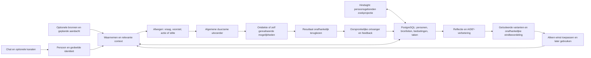

# Eva2 — gedeelde kern en vervangbare mogelijkheden

Architectuurafspraak, 15 oktober 2026. De huidige Pythonbasis is het vertrekpunt;
het [projectdoel](PROJECTDOEL.md) en [afrondingsplan](AFRONDINGSPLAN.md) bepalen wat nog
moet worden geleverd. Bestaand bewijs rechtvaardigt geen nieuwe algemene platformwissel
of claim dat Eva alle concurrenten verslaat. Werkende onderdelen worden hergebruikt;
eerdere investering is op zichzelf geen behoudsreden.

## Eén kringloop voor vier uitkomsten

Gesprek, initiatief en verbetering gebruiken dezelfde persoonscontext, taakstatus,
uitvoerder en resultaatbinding. Het systeem krijgt geen aparte levensdaemon,
agent per kanaal of vooraf gecodeerde regel per gezinsvoorbeeld. Geplande aandacht
is een algemene aanleiding om opnieuw te kijken; het model bepaalt inhoudelijke
relevantie met de toegelaten bronnen. Technologie verzorgt betrouwbaarheid en grenzen.

## Moduleverantwoordelijkheden

| Bestaande module / bron | Eigen verantwoordelijkheid | Interface en grens |
| --- | --- | --- |
| `src/eva/contracts` en `domain` | Betekenis, identiteiten, versieerbare gegevens en actieregels | Geen provider-, apparaat- of kanaalprotocol als productbetekenis. |
| `application/conversation.py`, `memory.py` | Contact, relevante persoonscontext en overdracht van werk | Application ports en getypeerde input/output; geen tweede gespreksrouter. |
| `application/free_will.py`, `sensory.py`, `resident_attention.py` | Waarneming, afweging, aandacht en passende stilte | `SensoryEvent` en `FreeWillDecision`; geen voorbeeldspecifieke wensregel. |
| `adapters/postgres/sensory_events.py`, `initiative_context.py`, `initiative_source_outcomes.py`, `initiative_attention.py` | Bestaande bronregistratie, private reviews en begrensde historische context | Nieuwe review bewaart haar oorspronkelijke bron; gedeelde bron krijgt geen eigenaarprivécontext. Historie is geen actuele bevestiging. |
| `adapters/postgres`, `projection`, `adapters/projection/hindsight.py` | PostgreSQL als gezaghebbende opslag; Hindsight als persoonsgebonden zoekprojectie | Bronherkomst, actuele persoon/audience en correctie/erasure blijven dezelfde. Geen tweede geheugen. |
| `operations/delegated_work_runner.py`, `bootstrap/delegated_digital_runner.py` | Afhankelijke stappen uitvoeren, voortgang bewaren, stoppen en legitiem hervatten | Bestaande werk-/actiecontracten, expliciete resultaten en huidige grants; geen tweede taakstore. |
| `adapters/postgres/delegated_work_delivery.py` en bestaande initiatiefaflevering | Resultaat koppelen aan oorspronkelijke actor/ingang en feedback | Korte terugmelding; volledig opgeslagen resultaat op verzoek. Geen nieuwe ontvanger of fictieve aflevering. |
| `application/component_development.py`, `component_improvements.py`, `operations` | Eva-voorstellen, geïsoleerde varianten, onafhankelijke selectie en gecontroleerde toepassing | Beoordelingscriteria en afgeschermde eindgevallen buiten de ontwikkelaar; later gebruik apart aantonen. |
| `adapters/model` | Modelprotocol, ondersteunde mogelijkheden, toegelaten aanmelding en verbruik | Providerneutrale betekenis erboven; optionele providers gebruiken dezelfde context/taakroute. Geen verborgen nieuwe betaalroute. |
| `providers`, `src/connectors`, `src/connector_sdk` | Optionele ontdekking en uitvoering via externe middelen | Een connector levert mogelijkheden en brongegevens. Hij beslist niet zelf wat het gezin wil. Alleen aansluiten bij behoefte. |
| `adapters/api/dashboard_*`, bestaande productfrontend | Gesprek, geheugen, opdrachten, initiatief en bediening zichtbaar maken | Weergave van echte backendstatus; personen, dromen/verbeteringen en instellingen samenhangend aansluiten. Niet alles hiervan is al geleverd. |
| `bootstrap`, `deploy`, installer | Eén samenstelling, procesgrenzen, instellingen en gegevensmigraties | Productlogica blijft in de bestaande kern; installatie bindt bron, configuratie en gegevens coherent. |
| `voice_service` en bestaande spraakdeploy | Optionele gesproken ingang | Hergebruik de huidige route van de andere uitvoerder; dezelfde identiteit/context/werkstatus, geen nieuw spraakplatform. |
| `development/tools/project-dashboard` | Ontwikkelwerk, bewijs en eigenaarhandelingen tonen | Alleen dezelfde canonieke werkregistratie; dit is niet Eva's eigen productbediening. |
| `development/tests`, `benchmark`, `evidence`, `reviews`, `archive` | Gerichte verificatie, onveranderlijk bewijs en historie | Geen runtime-opdracht uit een oude proef of archief; beschermde gegevens blijven afgeschermd. |

[De importgrenzen](../design/architecture/package-boundaries-v1.json) zijn de
machineleesbare grensdefinitie. Niet elke bestaande module voldoet daar al aan.
De 13-oktobercontrole registreerde 110 bestaande bevindingen; dat is een historische
nulmeting, geen opnieuw gemeten actuele telling of vrijstelling van opruiming.

## Dagelijkse aandacht en bronbetekenis

De bestaande keten biedt sensorwaarneming, actuele bronopvraging, persoonsgeheugen,
uitgestelde herbeoordeling, communicatie en duurzame uitvoering. Een ruwe sensor
levert een observatie, geen persoonlijke wens. Een hash bewijst de broninhoud,
geen versheid of juistheid. Tijdstempel, ouderdom, dekking en onzekerheid blijven
bij de waarneming; voor relevante handelingen worden noodzakelijke actuele
gegevens opgevraagd en resultaten teruggelezen.

De private review van 14 oktober kreeg tijd, begrensde recente huisgeschiedenis
en exact-eigen opgeslagen verplichtingen mee. Dit is een geïnstalleerde verbinding,
geen volledige live agenda-/service-inventaris of bewijs van dagelijkse autonomie.
De bronterugvoer gebruikt de bestaande native uitvoerder en exact bewaarde
HA- of eigen-codebronreceipts. Succes van een hele taak en geldigheid van een
bronlezing zijn afzonderlijk: een mislukte taak kan bruikbare geverifieerde
bronpagina's behouden, zonder eindresultaat, nieuwe bevoegdheid of automatische
herhaling te fabriceren. Oorspronkelijke tijd, spec/uitvoering/receiptbinding,
begrensde selectie en ontbrekende dekking blijven meegegeven. De werkertekst
blijft een onbevestigde interpretatie. Iedere bronuitkomst draagt de oorspronkelijke
informatievraag uit exact dezelfde gevalideerde werkspecificatie, met volledige
teksthash en expliciete begrenzing. Dit is geen nieuwe opdracht. De volgende
afweging gebruikt een inhoudelijke bevinding of benoemt welke informatie voor
die vraag ontbreekt; alleen de taakstatus noemen is geen inhoudelijk brongebruik.
Privébronnen gaan alleen naar de volgende privé-afweging; de host bewaart de hash
van de werkelijk aangeboden context.

Een nieuwe native uitkomst met geverifieerde bronlezing mag precies één
vervolgafweging in dezelfde bestaande reviewroute veroorzaken. De werker leest
daarvoor uitsluitend hetzelfde werk met dezelfde spec- en resultaat-/uitkomsthash;
een gelijktijdige andere taak verdringt die bron niet. Een lege mislukking start
geen betaalde bronbeoordeling. Onzeker lopend werk blijft blokkeren. Dit is
resultaatterugvoer, geen tweede planner. De oorspronkelijke bronvraag krijgt alleen
voorrang bij die nieuwe exacte uitkomst of haar brongebonden vervolgaandacht; gewone
klokafwegingen krijgen oude mislukkingen als historie, zonder telkens hun volledige
bronvraag opnieuw te moeten beantwoorden. De geheugenzoekvraag richt zich dan op
persoonlijke plannen/interesses en lopende bedoelingen; routinewaarnemingen en
voltooide proefdocumenten blijven in hun gestempelde eventcontext en verdringen die
zoekvraag niet. Daarnaast kiest Eva in dezelfde bestaande
afweging optioneel `next_attention`: een toekomstige UTC-tijd en een reden.
De oorspronkelijke beslissing bewaart die keuze met bronbinding. Per exacte privé-
of gedeelde scope geldt de laatst gecommitteerde niet-lege keuze; een niet-verwante
lege keuze wist eerder geplande aandacht niet. Een volgnummer onder dezelfde
schedulerlock maakt ook gelijktijdige keuzes eenduidig. Het due-event consumeert de
keuze één keer en draagt haar oorspronkelijke bron/revisie/hash en tijd mee; de
nieuwe context blijft daarvan onderscheiden. Een nieuw gekozen moment vervangt
oude nog niet uitgevoerde aandacht, ook na langzame geheugenraadpleging.

De bestaande bundeling houdt minimaal 300 seconden aan; gevraagde en effectieve
tijd blijven apart bewaard. Gesprek krijgt voorrang; uitstel houdt dezelfde
gebeurtenis vast. Huidig mandaat, een gestopte oorspronkelijke intentie en UNKNOWN
blijven bewaakt. Er is geen extra planner, taakstore of permanent proces.
E1.2 is geïnstalleerd en onafhankelijk bewezen met twee echte modelbesluiten in een
geïsoleerde technische proef; logisch versnelde tijd, geen productiecrash of spontane
gezinswaarde geclaimd. Dagelijks nut blijft E1.3. Een huisautomatisering kan Eva
ontdekken of maken; zij wordt geen vaste kernregel voor een voorbeeld.

## Model, kanaal en optionele installatie

Een modeladapter beschrijft protocolversie, ondersteunde invoer/tools, aanmelding,
modelselectie en gemeten gebruik. Een kanaaladapter verzorgt ontvangst, werkelijke
persoon/gespreksbinding, eventuele media en aflevering bij de oorspronkelijke
ontvanger. Beide zijn vervangbaar zonder nieuwe identiteit, geheugenbank of uitvoerder.

E2.5 levert optionele Anthropic- en OpenAI-compatibele adapters via PydanticAI
voor privétekstgesprekken op website/Telegram. Dezelfde identiteit, context,
geheugenopslag, requestjournal en actie-uitvoerder blijven gelden. Instellingen
hergebruiken de private artifact-/secretopslag; controle, selectie en uitschakeling
zijn expliciet en blijven na herstart bewaard. Een mislukte geselecteerde provider
verstuurt de inhoud niet stil naar een andere provider. Achtergrondwerk, native
research en initiatief behouden Astra; de bestaande spraakroute blijft ongewijzigd.
De geïnstalleerde SDK-proeven gebruiken lokaal testtransport; een externe account
is niet aangesloten of bewezen. De API-sleutel en een eigen controle blijven een
optionele eigenaarhandeling. WhatsApp gebruikt in E2.6 één optionele, gepinde
Hypermeow/Meowcaller-client met private SQLite-opslag en QR-bediening. Deze
onofficiële protocolimplementatie is geen Meta Business Calling API. Eva's aparte
accountnummer en het toegestane bellernummer blijven afzonderlijk; geen zelfchat,
groeps-, video- of historie-import. De gewone Eva-kern en bestaande taak-/
resultaatjournalen blijven leidend. Een tekstresultaat komt bij het bewezen
originele bericht terug, standaard als kort fragment. Onzekere verzending wordt
niet blind herhaald; volledig resultaat blijft op verzoek beschikbaar.

`eva.whatsapp_service` is uitsluitend een optioneel PCM-audiotransport. Het vraagt
voor de actuele eigenaar een bestaande `/session/leased` aan, publiceert de
WhatsApp-microfoon als LiveKit-owner en stuurt Eva's audiotrack terug naar de beller.
Het gebruikt dezelfde spraakservice, identiteit en taken; geen eigen STT, TTS,
modelkeuze of geheugen. Specifiek verlengen en sluiten behouden de bestaande
sessieafspraken, waaronder de huidige 1800-secondenlimiet van de spraakdienst.
Een wijziging daarvan hoort bij de spraakuitvoerder, niet bij dit transport.
Audio wordt niet opgenomen. Stoppen, ongeldige actuele bevoegdheid of verbroken
verbinding sluiten de eigen oproep en sessie. Gereedheid controleert de echte
spraakdienst, niet alleen het draaiende proces. De helper luistert uitsluitend op
de private Docker-gateway; bestaande speakerinstallaties blijven ongewijzigd.

De eerdere ongekoppelde Baileys-verbinding wordt vervangen; haar oude private volume
blijft behouden en draait niet als tweede WhatsApp-client. De gekozen route vereist
een afzonderlijk gewoon WhatsApp-account voor Eva. Dat ontbreekt nog; echte
handsetoproepen, platforminteroperabiliteit en accountkoppeling zijn daarmee niet
bewezen. Spraakberichten worden door deze beladapter niet verwerkt. Een niet-gekozen
account hoeft niet te worden ingericht om de rest van Eva te gebruiken.

Een optionele module krijgt een herkenbaar manifest: naam/versie, aangeboden
mogelijkheden, benodigde verbinding/bevoegdheden, configuratie- en contractversies,
gezondheidscontrole, gegevensbezit en aan-/uitgedrag. Dit is de afspraak voor de
eindfase, geen claim dat elk bestaand manifest deze velden al implementeert.
Verwijderen/uitzetten stopt nieuwe toelating en maakt lopend werk en behouden
gegevens zichtbaar; het wist niet stilletjes andermans geheugen of resultaten.

## Wat gericht moet worden vereenvoudigd

De [herbeoordeling van 13 oktober](project-reassessment-20261013.md) beschrijft
verspreide bron-/runtimebindings, oude opdrachten naast actuele kaarten,
overdrachten zonder complete oplevering en deelbewijs dat te zwaar werd geteld.
De [opruimregistratie](repository-pruning-20261013.md) verwijderde bewezen dubbele
historische bron, maar deed geen volledige inhoudelijke audit van alle actieve code.

De eindfase inventariseert daarom alle bestanden en hun echte consumenten. Prioriteit
ligt bij dubbel uitgevoerde verantwoordelijkheden, providerlogica in de kern,
capabilityspecifieke afrondingsregels, onverwachte runtimeafhankelijkheden van
historische proefhelpers en sterk verweven grote modules. Bestandsgrootte en weinig
statische imports zijn signalen voor onderzoek, geen verwijderbewijs. Dynamische
registratie, deploy-/installerpaden, tests, migraties en externe aanroepen tellen mee.

De zelfstandige Telegramdienst start geen Eva1-agent. Fotoanalyse houdt tijdelijk
nog de oorspronkelijke providerbibliotheek en haar verbruiksregistratie aan.
Dit wordt als onderhoudsafhankelijkheid geregistreerd en gericht vervangen door
het gedeelde providercontract zodra dezelfde fotowerking bewezen behouden blijft.
Er komt geen importalias naar de oude agent of nieuwe parallelle providerclient bij.

## Versies en wijzigingen

Wijs per module één eigenaar en gezaghebbende gegevensbron aan. Maak interfaces
expliciet en versieer incompatibele wijzigingen; scheid contract, uitvoering en
compositie. Valideer de geraakte contractgrens en één volledige gebruikersroute.
Introduceer geen abstractie of microservice alleen om een map kleiner te maken.

Installatie neemt de werkelijk actuele image-/configuratiebinding als uitgangspunt
en bewaart gelijktijdig werk van andere uitvoerders. Locks en optionele afhankelijkheden
blijven reproduceerbaar; upstream-updates krijgen een concrete reden, compatibiliteits-
en migratiebesluit en gerichte verificatie. Gegevenswijzigingen hebben een expliciete
schema-/contractversie. Herstelmogelijkheden blijven beschikbaar zonder standaard
iedere ontwikkelwijziging terug te zetten. De eigenaar krijgt begrijpelijke update-
en optionele verbindingsbediening; onderhoud hoeft geen nieuwe bouwronde te worden.

De eindvoorwaarden voor inventaris, verwijdering/refactor, efficiëntie en gezamenlijke
oplevering staan in [AFRONDINGSPLAN](AFRONDINGSPLAN.md). Geen massaherschrijving,
ongevraagde licentiewijziging of nieuwe concurrentenserie.

### Private initiative planning and household notifications

The existing sensory model uses a separate private orientation instruction for `initiative-review`. Notification silence does not imply absence of useful work: the model may choose one bounded native initiative to investigate a worthwhile information gap without an urgent household event. The shared/passive instruction, decision schema, durable adoption, current authority, native executor and private completion delivery remain unchanged. A deliberate null proposal remains valid. Controller-stimulated reviews retain their actual provenance and do not demonstrate spontaneous initiation.
