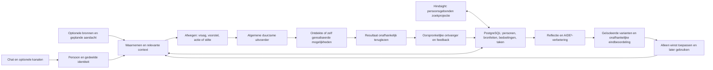

# Eva2 — gedeelde kern en vervangbare mogelijkheden

Architectuurafspraak, 15 oktober 2026. De huidige Pythonbasis is het vertrekpunt;
het [projectdoel](PROJECTDOEL.md) en [afrondingsplan](AFRONDINGSPLAN.md) bepalen wat nog
moet worden geleverd. Bestaand bewijs rechtvaardigt geen nieuwe algemene platformwissel
of claim dat Eva alle concurrenten verslaat. Werkende onderdelen worden hergebruikt;
eerdere investering is op zichzelf geen behoudsreden.

## Eén kringloop voor vier uitkomsten

Gesprek, initiatief en verbetering gebruiken dezelfde persoonscontext, taakstatus,
uitvoerder en resultaatbinding. Het systeem krijgt geen aparte levensdaemon,
agent per kanaal of vooraf gecodeerde regel per gezinsvoorbeeld. Geplande aandacht
is een algemene aanleiding om opnieuw te kijken; het model bepaalt inhoudelijke
relevantie met de toegelaten bronnen. Technologie verzorgt betrouwbaarheid en grenzen.

## Moduleverantwoordelijkheden

| Bestaande module / bron | Eigen verantwoordelijkheid | Interface en grens |
| --- | --- | --- |
| `src/eva/contracts` en `domain` | Betekenis, identiteiten, versieerbare gegevens en actieregels | Geen provider-, apparaat- of kanaalprotocol als productbetekenis. |
| `application/conversation.py`, `memory.py` | Contact, relevante persoonscontext en overdracht van werk | Application ports en getypeerde input/output; geen tweede gespreksrouter. |
| `application/free_will.py`, `sensory.py`, `resident_attention.py` | Waarneming, afweging, aandacht en passende stilte | `SensoryEvent` en `FreeWillDecision`; geen voorbeeldspecifieke wensregel. |
| `adapters/postgres/sensory_events.py`, `initiative_context.py` | Bestaande bronregistratie, private reviews en begrensde historische context | Nieuwe review bewaart haar oorspronkelijke bron; gedeelde bron krijgt geen eigenaarprivécontext. Historie is geen actuele bevestiging. |
| `adapters/postgres`, `projection`, `adapters/projection/hindsight.py` | PostgreSQL als gezaghebbende opslag; Hindsight als persoonsgebonden zoekprojectie | Bronherkomst, actuele persoon/audience en correctie/erasure blijven dezelfde. Geen tweede geheugen. |
| `operations/delegated_work_runner.py`, `bootstrap/delegated_digital_runner.py` | Afhankelijke stappen uitvoeren, voortgang bewaren, stoppen en legitiem hervatten | Bestaande werk-/actiecontracten, expliciete resultaten en huidige grants; geen tweede taakstore. |
| `adapters/postgres/delegated_work_delivery.py` en bestaande initiatiefaflevering | Resultaat koppelen aan oorspronkelijke actor/ingang en feedback | Korte terugmelding; volledig opgeslagen resultaat op verzoek. Geen nieuwe ontvanger of fictieve aflevering. |
| `application/component_development.py`, `component_improvements.py`, `operations` | Eva-voorstellen, geïsoleerde varianten, onafhankelijke selectie en gecontroleerde toepassing | Beoordelingscriteria en afgeschermde eindgevallen buiten de ontwikkelaar; later gebruik apart aantonen. |
| `adapters/model` | Modelprotocol, ondersteunde mogelijkheden, toegelaten aanmelding en verbruik | Providerneutrale betekenis erboven; optionele providers gebruiken dezelfde context/taakroute. Geen verborgen nieuwe betaalroute. |
| `providers`, `src/connectors`, `src/connector_sdk` | Optionele ontdekking en uitvoering via externe middelen | Een connector levert mogelijkheden en brongegevens. Hij beslist niet zelf wat het gezin wil. Alleen aansluiten bij behoefte. |
| `adapters/api/dashboard_*`, bestaande productfrontend | Gesprek, geheugen, opdrachten, initiatief en bediening zichtbaar maken | Weergave van echte backendstatus; personen, dromen/verbeteringen en instellingen samenhangend aansluiten. Niet alles hiervan is al geleverd. |
| `bootstrap`, `deploy`, installer | Eén samenstelling, procesgrenzen, instellingen en gegevensmigraties | Productlogica blijft in de bestaande kern; installatie bindt bron, configuratie en gegevens coherent. |
| `voice_service` en bestaande spraakdeploy | Optionele gesproken ingang | Hergebruik de huidige route van de andere uitvoerder; dezelfde identiteit/context/werkstatus, geen nieuw spraakplatform. |
| `development/tools/project-dashboard` | Ontwikkelwerk, bewijs en eigenaarhandelingen tonen | Alleen dezelfde canonieke werkregistratie; dit is niet Eva's eigen productbediening. |
| `development/tests`, `benchmark`, `evidence`, `reviews`, `archive` | Gerichte verificatie, onveranderlijk bewijs en historie | Geen runtime-opdracht uit een oude proef of archief; beschermde gegevens blijven afgeschermd. |

[De importgrenzen](../design/architecture/package-boundaries-v1.json) zijn de
machineleesbare grensdefinitie. Niet elke bestaande module voldoet daar al aan.
De 13-oktobercontrole registreerde 110 bestaande bevindingen; dat is een historische
nulmeting, geen opnieuw gemeten actuele telling of vrijstelling van opruiming.

## Dagelijkse aandacht en bronbetekenis

De bestaande keten biedt sensorwaarneming, actuele bronopvraging, persoonsgeheugen,
uitgestelde herbeoordeling, communicatie en duurzame uitvoering. Een ruwe sensor
levert een observatie, geen persoonlijke wens. Een hash bewijst de broninhoud,
geen versheid of juistheid. Tijdstempel, ouderdom, dekking en onzekerheid blijven
bij de waarneming; voor relevante handelingen worden noodzakelijke actuele
gegevens opgevraagd en resultaten teruggelezen.

De private review van 14 oktober kreeg tijd, begrensde recente huisgeschiedenis
en exact-eigen opgeslagen verplichtingen mee. Dit is een geïnstalleerde verbinding,
geen volledige live agenda-/service-inventaris of bewijs van dagelijkse autonomie.
Zelf passende vervolg-aandacht kiezen en actuele beschikbare bronnen gebruiken
moet via dezelfde bestaande poorten worden afgemaakt. Een huisautomatisering kan
Eva daarbij ontdekken of maken; zij wordt geen vaste kernregel voor een voorbeeld.

## Model, kanaal en optionele installatie

Een modeladapter beschrijft protocolversie, ondersteunde invoer/tools, aanmelding,
modelselectie en gemeten gebruik. Een kanaaladapter verzorgt ontvangst, werkelijke
persoon/gespreksbinding, eventuele media en aflevering bij de oorspronkelijke
ontvanger. Beide zijn vervangbaar zonder nieuwe identiteit, geheugenbank of uitvoerder.

Claude/Anthropic, andere modelproviders en WhatsApp zijn gewenste optionele
verbindingen. De huidige providers en installatie-/beheeronderdelen worden eerst
onderzocht op hergebruik. Ondersteunde externe API's en aanmeldmethoden worden bij
realisatie geverifieerd; deze tekst claimt geen werkende adapter of externe toegang.
Een niet-gekozen account hoeft niet te worden ingericht om Eva te gebruiken.

Een optionele module krijgt een herkenbaar manifest: naam/versie, aangeboden
mogelijkheden, benodigde verbinding/bevoegdheden, configuratie- en contractversies,
gezondheidscontrole, gegevensbezit en aan-/uitgedrag. Dit is de afspraak voor de
eindfase, geen claim dat elk bestaand manifest deze velden al implementeert.
Verwijderen/uitzetten stopt nieuwe toelating en maakt lopend werk en behouden
gegevens zichtbaar; het wist niet stilletjes andermans geheugen of resultaten.

## Wat gericht moet worden vereenvoudigd

De [herbeoordeling van 13 oktober](project-reassessment-20261013.md) beschrijft
verspreide bron-/runtimebindings, oude opdrachten naast actuele kaarten,
overdrachten zonder complete oplevering en deelbewijs dat te zwaar werd geteld.
De [opruimregistratie](repository-pruning-20261013.md) verwijderde bewezen dubbele
historische bron, maar deed geen volledige inhoudelijke audit van alle actieve code.

De eindfase inventariseert daarom alle bestanden en hun echte consumenten. Prioriteit
ligt bij dubbel uitgevoerde verantwoordelijkheden, providerlogica in de kern,
capabilityspecifieke afrondingsregels, onverwachte runtimeafhankelijkheden van
historische proefhelpers en sterk verweven grote modules. Bestandsgrootte en weinig
statische imports zijn signalen voor onderzoek, geen verwijderbewijs. Dynamische
registratie, deploy-/installerpaden, tests, migraties en externe aanroepen tellen mee.

De zelfstandige Telegramdienst start geen Eva1-agent. Fotoanalyse houdt tijdelijk
nog de oorspronkelijke providerbibliotheek en haar verbruiksregistratie aan.
Dit wordt als onderhoudsafhankelijkheid geregistreerd en gericht vervangen door
het gedeelde providercontract zodra dezelfde fotowerking bewezen behouden blijft.
Er komt geen importalias naar de oude agent of nieuwe parallelle providerclient bij.

## Versies en wijzigingen

Wijs per module één eigenaar en gezaghebbende gegevensbron aan. Maak interfaces
expliciet en versieer incompatibele wijzigingen; scheid contract, uitvoering en
compositie. Valideer de geraakte contractgrens en één volledige gebruikersroute.
Introduceer geen abstractie of microservice alleen om een map kleiner te maken.

Installatie neemt de werkelijk actuele image-/configuratiebinding als uitgangspunt
en bewaart gelijktijdig werk van andere uitvoerders. Locks en optionele afhankelijkheden
blijven reproduceerbaar; upstream-updates krijgen een concrete reden, compatibiliteits-
en migratiebesluit en gerichte verificatie. Gegevenswijzigingen hebben een expliciete
schema-/contractversie. Herstelmogelijkheden blijven beschikbaar zonder standaard
iedere ontwikkelwijziging terug te zetten. De eigenaar krijgt begrijpelijke update-
en optionele verbindingsbediening; onderhoud hoeft geen nieuwe bouwronde te worden.

De eindvoorwaarden voor inventaris, verwijdering/refactor, efficiëntie en gezamenlijke
oplevering staan in [AFRONDINGSPLAN](AFRONDINGSPLAN.md). Geen massaherschrijving,
ongevraagde licentiewijziging of nieuwe concurrentenserie.
