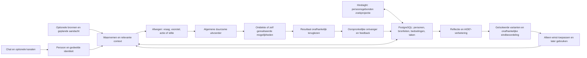

# Eva2 — gedeelde kern en vervangbare mogelijkheden

Architectuurafspraak, 15 oktober 2026. De huidige Pythonbasis is het vertrekpunt;
het [projectdoel](PROJECTDOEL.md) en [afrondingsplan](AFRONDINGSPLAN.md) bepalen wat nog
moet worden geleverd. Bestaand bewijs rechtvaardigt geen nieuwe algemene platformwissel
of claim dat Eva alle concurrenten verslaat. Werkende onderdelen worden hergebruikt;
eerdere investering is op zichzelf geen behoudsreden.

## Eén kringloop voor vier uitkomsten

Gesprek, initiatief en verbetering gebruiken dezelfde persoonscontext, taakstatus,
uitvoerder en resultaatbinding. Het systeem krijgt geen aparte levensdaemon,
agent per kanaal of vooraf gecodeerde regel per gezinsvoorbeeld. Geplande aandacht
is een algemene aanleiding om opnieuw te kijken; het model bepaalt inhoudelijke
relevantie met de toegelaten bronnen. Technologie verzorgt betrouwbaarheid en grenzen.

Het geheugen heeft één overdracht met twee tijdschalen. De bestaande PostgreSQL-
gespreksregistratie en duurzame outbox houden de actuele dagcontext beschikbaar.
De bestaande koude droom-/reflectieroute bundelt die informatie en gebruikt Hindsight
voor selectie, vergelijking met bestaande kennis, bijwerken en consolidatie. Herhaling
zonder nieuwe betekenis levert geen nieuwe actuele herinnering op. Nieuwe informatie,
een veranderde voorkeur en een correctie blijven van elkaar te onderscheiden.
Gesprek en taakuitvoering blijven beschikbaar tijdens de droomverwerking. Bevestigde
overname en noodzakelijke bronbinding gaan vooraf aan het laten vervallen van tijdelijke
inhoud; een fout of herstart mag geen informatie laten verdwijnen. Bestaande privacy-,
correctie- en wisregels blijven per persoon/audience gelden. Dit is de geïnstalleerde
overdracht binnen E4.11. Sinds 19 oktober wachten gewone privé-uitwisselingen duurzaam
op de bestaande rust-/capaciteitsfase. Een vast begrensd cohort wordt met brongebonden
ontvangstbewijzen verwerkt; een named strategy voorkomt nieuwe native document-/chunkkopieën.
Wissen verzoent eerst een eventueel lopende native operatie, zonder nieuwe extractie.
Het importpad en de gerichte werk-/leerroute blijven afzonderlijk bestaan. De beperkte
native overdrachtscontrole bewijst geen dagelijkse kwaliteits- of tokenvoorsprong;
E4.11 is technisch afgerond met expliciete behoudsbesluiten voor onbewezen oude
bronnen/payloads. De statuslezer begrijpt alle bestaande brongebeurtenissen en
geautoriseerde inhoudsvrije wisbewijzen. Ongeldige oude stapvolgordes/tijden blijven
een afzonderlijke diagnose; hash-, bron- of checkpointcorruptie wordt niet vrijgesteld.
Geheugenzoeken en het bronarchief blijven onafhankelijk bereikbaar.
De geïnstalleerde bronlevenscyclus bewaart volledige bronontvangsten op het cohort.
Een scopegebonden PostgreSQL-functie laat vorige-dagtekst van bron/bericht/antwoord
atomair vervallen. `CompactedPrivateMemorySource` bevat uitsluitend identiteit en
bewijs, geen `.content` of modeltekst. Actuele eigenaarcontrole laat geselecteerde
native kennis daarmee terugkomen; bewust vergeten verwijdert die kennis afzonderlijk.
Lezers geven compactmetadata nooit als oorspronkelijk gesprek aan het model.
Geen nieuwe native extractie, TTL-wijziging of vrijgave van alle opslagruimte bij
tekstcompactie. Legacy cohorten zonder volledig bewijs zouden behouden blijven;
de huidige installatie bevat één cohort met volledige ontvangsten en geen onerkende
cohortachterstand. Een providergebonden PostgreSQL-trigger ruimt uitsluitend dubbele
uitvoertekst op in volledig afgesloten, foutvrije native families. Hij levert geen
droomontvangst en maakt oorspronkelijke bronnen niet eerder wisbaar. Drie bewezen
oude nulresultaten zijn append-only verzoend; overige onzekere bronnen en onvoldoende
gebonden payloads blijven behouden, zonder automatische herhaling. Het addendum voor
Hindsight 0.9.1 staat met versiecontrole en installatie-instructies onder
`deploy/living-core/hindsight-memory`; een native update vereist compatibiliteitsreview.

E1.5 projecteert reeds brongecontroleerde native observaties en actuele getypeerde
persoonshypothesen/verwachtingen eenmaal als `EvaCurrentPersonContext/v1` naar gesprek
en privé-initiatief. De projectie blijft beperkt tot de geselecteerde bronnen (maximaal
acht bijdragen en 8 KiB), met onzekerheid, actuele ketenkop, bronhash en zichtbare
ontbrekende dekking. Operationele afspraken blijven in de bestaande verse taakcontext.
De lichte contactvoorbereiding leest dezelfde huidige PostgreSQL-bron-/revisieketen
zonder semantische zoek- of modelaanvraag; overige geschiedenis blijft opvraagbaar.
Een pending of gewiste correctie laat geen eerdere interpretatie terugkeren. De oude
native communicatiestijlspiegel blijft in reflectie/beheer bestaan, maar wordt zonder
actuele bron-/revisiecontrole niet als actuele voorkeur aan deze routes doorgegeven.
Dit is een projectie van bestaand geheugen, geen nieuw profielarchief of oordeelmodel.

Nieuwe bijstellingen via de bestaande leeractie moeten naar de actuele voorganger
verwijzen. De provider serialiseert uitsluitend admission per persoon/project, zodat
twee gesprekken geen parallelle correcties op een verouderde versie toelaten.
Een nog niet verwerkte of gewiste opvolger verhindert terugval; hervatten van de
eigen toegelaten actie blijft mogelijk. Deze E1.7-correctie is op 23 oktober
geïnstalleerd. Werkelijk meerdaags routineleren blijft afzonderlijk te bewijzen.
Dezelfde geheugenzoekroute haalt sinds 23 oktober een ruimer begrensd intern
bronfeitenantwoord op: 8192 tokens totaal, 2048 per afgeleid inzicht. Het oude
256-tokenvenster liet aantoonbaar benodigde bronfeiten weg. Dit antwoord dient
broncontrole; maximaal drie oorspronkelijke gebeurtenissen, actuele privacy-/wischecks
en de bestaande modelcontextgrenzen blijven gelden. Kern en achtergrondwerker
gebruiken dezelfde instelling, zonder extra zoek- of gespreksmodelronde.

E1.13 plaatst sinds 23 oktober de bestaande privé-afweging vóór interesse-uitvoering
in dezelfde toegelaten achtergrondcyclus. Nieuw gekozen werk hoeft daardoor niet
uitsluitend vanwege de callbackvolgorde een volgende vijfminutenronde af te wachten.
Foreground en capaciteit worden nog vóór iedere stap gecontroleerd; afweging kan
nog niet toegelaten werk wel met haar eigen looptijd vertragen. De installatie en
schedulerwerking zijn gecontroleerd; natuurlijke doorlooptijd en modelbesparing
blijven afzonderlijke metingen.

E1.6 verbindt de optionele `source_event_id` op private `NextAttention` aan een exact
in dezelfde afweging aangeboden bron en haar hash/configuratie. De bestaande provider
beschrijft uitsluitend haar eigen werkelijke eventdekking. De bestaande aandachtlane
bundelt passende nieuwe bronmeldingen en de geplande terugvalcontrole tot één identiteit;
herstart/reconnect maakt geen tweede beoordeling. Maximaal de bestaande contextomvang,
minimaal de bestaande vijf minuten tussen beoordelingen en de normale bronversheid
blijven gelden. Exacte, geverifieerde native lezingen leveren via de bestaande pure
providerpolicy hoogstens vier concrete bronselectoren. Dezelfde privécontext geeft
de overeenkomstige werkelijk bewaarde waarnemingen voorrang op ongerelateerde
nieuwste gebeurtenissen, met huidige providerdekking en oorspronkelijke hashes.
Zonder zo’n bewaarde bron/dekking ontstaat geen verzonnen event of nieuwe toegang.
Een latere geschiedenislezing valideert ook de bestaande source_watch strikt;
zij bewaart de oorspronkelijke beslissing zonder nieuwe uitvoerbevoegdheid.
De privé-mogelijkhedencatalogus behoudt alle toegelaten namen, scopevelden en
volledige definitiehashes binnen dezelfde 8 KiB. Alleen optionele toelichtingen
worden op werkelijk gecodeerde omvang verkort; parameters passen volledig of
blijven expliciet weggelaten. Een lange toolnaam blokkeert zo niet de afweging
wanneer de verplichte metadata wel past; ontbrekende verplichte ruimte blijft fout.
Open privéoriëntatie vraagt eerst naar de mensen, hun interesses, gewoonten en
blijvende doelen; oude ontwikkeluitnodigingen zijn geen persoonsprofiel. Zij
gebruikt de volledige geheugenvraag; onvergelijkbare scores
van losse generieke woorden kiezen hier geen oude proef- of apparaatvoorkeur.
Expliciet gekozen zoekconcepten en andere geheugendoelen behouden hun bestaande
route. Dezelfde modelinvoer onderscheidt open oriëntatie van werkelijk gekozen,
geplande of uit een bronuitkomst komende aandacht. Historische projecten, fouten
en feedback blijven volledig zichtbaar, maar kiezen zelf geen actueel doel.
De projectie is begrensde geschiedenis, geen bewijs dat alle doelen voltooid zijn
of dat er volledige gezinskennis is. Zij verleent geen nieuwe uitvoerbevoegdheid;
zinvolle stilte blijft geldig. Deze gerichte correctie is op 21 oktober geïnstalleerd;
werkelijke zelfstandige bronkeuze blijft afzonderlijk te bewijzen.
Dezelfde privé-initiatiefafweging krijgt ook maximaal drie actuele, oorspronkelijke
privé-uitwisselingen uit de bestaande dagbronregistratie vóór de droomfase. Die
bronselectie vereist dezelfde actuele eigenaar-/kanaalbinding, bewaartermijn,
wistoestand en originele ingress-/bronhashes; de exacte selectie wordt na de
afweging opnieuw gecontroleerd. De modelinvoer bevat maximaal 4 KiB met korte
fragmenten; de beslissing bewaart alleen een compacte hashontvangst. Gesprekstekst
wordt geen nieuwe opdracht of wereldfeit. Er is geen tweede geheugenopslag,
classificatieaanvraag of huishoudspecifieke beslisregel.
Oude waarnemingen zijn geen actuele
uitvoerbevoegdheid: de native uitvoerder controleert benodigde actuele bronnen opnieuw.
De bestaande HA-stream dekt toestandwaarden; attribuutwijzigingen en willekeurige
MCP-events zijn daarmee niet bewezen. Daarvoor blijft een gerichte, toegelaten native
uitlezing op het gekozen moment beschikbaar. Geen tweede scheduler of abonnementstore.

Home Assistant levert sinds E4.6 haar eigen gespreksinstructies, gewone-readclassificatie,
toolpresentatie, digitale capabilities en pure interpretatie van bewaarde receipts.
De algemene kern vraagt die bestaande providerpoorten aan en kent geen HA-toolnamen
of media-instellingen. Dezelfde bestaande initiatief-/afleveradapters worden door de
provider samengesteld; hun spraakwerking is niet gewijzigd. Uitgeschakelde modules
bieden geen tools/instructies; aanwezige pure receiptpolicy blijft oude bewijzen lezen.
Bij fysiek ontbrekende policy blijft de oorspronkelijke receipt letterlijk bruikbaar.
Een ontbrekende interne dependency van een aanwezige module blijft een echte fout.
Bronfingerprints komen uit de geïnstalleerde provider; core en uitvoerworker binden
dezelfde bronversie. Uitschakelen verwijdert geen gegevens, taken of oude receipts.

## Programma's binnen dezelfde duurzame taak

`application/tool_program.py` past een kleine gepinde Hermes-aanroepstub aan voor
Eva's bestaande netwerkloze Pythonuitvoerder. `ToolProgramActions` verzorgt alleen
de overdracht naar dezelfde actuele connectorroutes; geen eigen registry, scheduler,
hostkernel of credentials in het script. De capability wordt alleen aangeboden
wanneer de bestaande procedure-uitvoerder werkelijk is geconfigureerd.

Een programma onderbreekt bij één nieuw toolverzoek. De host bindt programma,
invoer, oorspronkelijke taak en modelsleuf, laat de normale route bevoegdheid,
stoppen, uitvoering en bewijs controleren en bewaart alleen receiptverwijzingen
op dezelfde operationele tijdlijn. Het programma herloopt daarna zuivere berekening
met de exacte eerder bevestigde antwoorden. Gewijzigde callvolgorde/argumenten,
onzeker effect of ingetrokken toegang stopt de keten; hervatten geeft geen nieuwe
identiteit aan dezelfde handeling. Een afzonderlijk hoog, exact I-JSON-indexbereik
scheidt subcalls van gewone modelstappen zonder afgekapte hashidentiteiten.

Tussenantwoorden blijven taakgebonden buiten de modelcontext. Alleen gekozen
standaarduitvoer en een klein ontvangstmanifest komen terug; stdout bewijst geen
service- of inhoudelijk succes. De gewone completionpolicy beoordeelt de echte
subreceipts en vereiste teruglezing. De bestaande 16 KiB bron- en 32 KiB totale
invoergrenzen blijven gelden, inclusief stub en alle eerdere antwoorden; te grote
ketens worden zichtbaar geweigerd, niet stil afgekapt. Sandboxstarts blijven over
hervatten meegeteld binnen het bestaande taakbudget. Dit vermijdt nieuwe host-IPC,
maar herhaalt lokale berekening; snelheids- of tokenwinst vraagt echte meting.
Verwachte lokale code-/uitvoerfouten geven gebonden niet-succesfeedback aan dezelfde
modelkringloop, met bestaande resultaatlezers waar beschikbaar. Een fout is geen
resultaat; alleen latere gecontroleerde service-uitkomsten kunnen de taak afronden.
Bron-/invoerbinding, volledig replayprefix, stoppen en onbekende effecten blijven
harde grenzen. Een nieuwe capability/profielbinding vereist naast configuratie ook
de bestaande eigenaargebonden `admit_revision`-overdracht naar het mandaatregister.

## Semantische feedback in de bestaande programmeerroute

Optionele Pyright-feedback draait als stdio-kind binnen dezelfde netwerkloze,
ongeprivilegieerde taakcontainer. Een minimale adapter hergebruikt de gepinde MIT-
framing uit Hermes; de manager, installers en agentloop worden niet overgenomen.
Directe `write_file`-/`edit_block`-wijzigingen aan Pythonbestanden leveren
`EvaProgrammingDiagnostics/v1` op met voor-/nahash, sessiebreed oplopende documentversie
en onderscheid tussen bestaande, nieuwe en opgeloste diagnostiek. Ontbrekende,
verouderde of te grote feedback is onbekend, geen foutloze controle. Shellwijzigingen
vallen buiten deze eerste automatische editkoppeling. De bestaande effectreceipt
blijft leidend: optionele analyse veroorzaakt geen tweede schrijfhandeling. Stoppen
verwijdert dezelfde container met taalserver. Diagnostiek helpt bij een volgende
codecorrectie; onafhankelijke gedragsbeoordeling en installatie blijven afzonderlijk.

## Open vaardigheidspakketten

De bestaande `ProcedureReference/v1` kan naast gewone documenten en Pythonbestanden
één opgeslagen `.skill.json`-pakket aanwijzen. `application/skill_packages.py`
valideert exacte resourcebytes, relatieve paden, vaste bronrevisie, licentie en
`SKILL.md`-metadata; bronmetadata blijft een verklaring, geen downloadbewijs of
uitvoertoestemming. De referencehash bindt de volledige opgeslagen envelope.
De bestaande resolve-actie projecteert standaard `SKILL.md` en het manifest;
`resource_path` en `resource_offset` lezen gericht een bijbehorende tekst, met
volledige bronhash en maximaal de bestaande 16 KiB per projectie. Binaire bestanden
blijven behouden en worden niet als tekst voorgesteld. PyYAML 6.0.3 is hiervoor een
directe, hashgepinde runtimedependency; de historische oorspronkelijke locks en
proefbindingen worden niet achteraf herschreven.

`application/skill_package_execution.py` materialiseert de exacte pakketbestanden
als invoer voor dezelfde bestaande offline Pythonuitvoerder. Meegeleverde scripts
kunnen hun lokale helpers en referenties gebruiken. Eén aanvraag bevat seriële
stappen in een tijdelijke taakmap; expliciet gekozen resultaatbestanden kunnen
binnen de bestaande uitvoergrens terugkomen. Geen netwerk, hostprofiel of credentials;
geen nieuw endpoint, rechtenmodel, skillstore of permanente manager. De oorspronkelijke
16 KiB bron-, 32 KiB invoer- en uitvoergrenzen van de uitvoerder blijven gelden.
Pakketten die niet passen worden duidelijk geweigerd. Exitstatus, teruggelezen bytes
en inhoudelijke kwaliteit zijn afzonderlijk; afgekapt resultaat telt niet als voltooide
uitvoer. Opslaan en herbruikbaar aanwijzen blijven de bestaande geverifieerde acties.

De bestaande AIDE-componentroute ondersteunt ook één geselecteerde Pythonresource
in een exact opgeslagen vaardigheidspakket. Het broncontract bindt afzonderlijk de
resourcehash, volledige envelopehash en pakketmanifest. De volledige envelope blijft
hostcontext en wordt niet aan modelvoorstellen of meetrapporten toegevoegd. Beide
geïsoleerde metingen krijgen hetzelfde alleen-lezen pakket met één vervangen resource;
de onafhankelijke eindbeoordeling gebruikt een vaste hostbinding. Een additieve suite
per virtueel bronpad behoudt bestaande suites en criteria.

Een geaccepteerde verbetering wordt via dezelfde geverifieerde save-/designationroute
als nieuwe volledige `.skill.json`-versie gepubliceerd. Alle andere resourcebytes,
licentie en upstreamherkomst blijven gelijk; een afleidingsrecord noemt het ouderpakket
en de oude resourcehash. Actuele bron, bevoegdheid, stoppen en taakstatus worden opnieuw
gecontroleerd. De oorspronkelijke versie blijft behouden. Deze verbinding is geïnstalleerd;
de echte Bronnen-correctie is afzonderlijk beoordeeld (8/12 naar 12/12), toegepast en bij
een andere notitie gebruikt. E4.12 is technisch afgerond; operatorhulp en de nog niet
bewezen autonome vaardigheidskeuze blijven zichtbaar. Alleen gemeten en onafhankelijk
beoordeelde winst mag worden toegepast.
Die overdracht en echt later gebruik blijven op dezelfde E4.12-kaart open.

### Automatisch herstel binnen bestaande uitvoering (E4.16)

Ontwerpbesluit van 22 oktober; de algemene herstelroute is nog niet geïnstalleerd.
Een incident verbindt de oorspronkelijke bedoeling en bron, feitelijke uitkomst,
verwacht gedrag met herkomst, geïnstalleerde versie en relevante uitvoeringsgegevens.
Een stacktrace bewijst herkomst maar is op zichzelf geen reproduceerbare diagnose.
Privé-inhoud en geheimen worden niet integraal naar een beoordelingswerkruimte gekopieerd.

De bestaande initiatiefregistratie bezit het hersteldoel; de bestaande worker doet
onderzoek en programmeerwerk. De evaluator bezit onafhankelijke gedragscriteria;
de bestaande beheerde updater bezit toepassing en terugval. Er komt geen tweede
planner, geheugen of algemene agent naast Eva. Foutregistratie en een korte melding
mogen het gewone gesprek niet op de lange hersteluitvoering laten wachten.

Voor iedere overdracht liggen invoer, uitvoer, eigenaar, bronversie, idempotentie,
timeout en hervatting vast. Een onbekende uitkomst vraagt inspectie van dezelfde
actie, geen nieuwe dispatch. STOP en gewijzigde bronbevoegdheid blijven leidend.
Tijdelijke uitval, configuratieproblemen en codefouten krijgen verschillende
oplossingen. Ook een technisch geslaagd maar inhoudelijk verkeerd resultaat kan een
incident opleveren, mits de afwijking van de bedoeling onderbouwd is.

Afsluiten vereist gecontroleerd oorspronkelijk gedrag op de geïnstalleerde versie.
Een build, review, bronhash of afgesloten programmeertaak alleen bewijst geen herstel.
Mislukt herstel veroorzaakt geen onbegrensde recursieve herstelopdrachten; vervolg
blijft bij hetzelfde doel met een begrensd budget en een aantoonbaar nieuwe hypothese.

### Zelfgemaakte uitbreidingen en herstel op een schone pc

Nieuwe toepassingsmogelijkheden komen standaard in afzonderlijke versieerbare
uitbreidingen via bestaande provider-, module- en procedureinterfaces. De kern bevat
algemene uitvoering en persoon/geheugen, geen nieuwe camera- of gezinsregel per opdracht.
Een ontbrekende algemene interface wordt afzonderlijk gemotiveerd en beoordeeld.

Het uitbreidingspakket bevat identiteit/versie, broncode, afhankelijkheden,
compatibiliteit, configuratieschema, gevraagde mogelijkheden en eigen gegevensschema.
De bestaande modulelevenscyclus bezit activering en versiebeheer; de bestaande
backup-/restoreketen moet ook deze pakketten en hun gegevens omvatten. Er komt geen
parallelle pakketbeheerder of backupdaemon. Geheimen blijven buiten Git en worden
versleuteld hersteld of opnieuw gekoppeld. Op een andere pc worden concrete apparaat-
en verbindingsbindings opnieuw gecontroleerd zonder automatisch ruimere rechten te geven.

Herstel importeert eerst de gecontroleerde pakketversie en gegevens, lost de vastgelegde
afhankelijkheden op, controleert compatibiliteit/toegang en activeert pas daarna de
uitbreiding. De laatst werkende versie blijft beschikbaar. De gedragstest op een schone
installatie hoort bij oplevering. Deze volledige dekking is een eis, nog geen bewezen
functie van de huidige portable-archive-route.

De bestaande effectuitvoering wordt op de gebruikte route teruggebracht tot duidelijke
verantwoordelijkheden voor toestemming, uitvoering, receipt en resultaatcontrole.
Eén eigenaar per controle; niet noodzakelijk één databasetabel voor alle soorten werk.
Historische opslagcontracten blijven leesbaar. Een nieuwe centrale kernloop is alleen
zinvol wanneer zij aantoonbaar bestaande aansturing vervangt, geen extra laag toevoegt.

### Blijvende huisvoorzieningen en groeiende persoonlijkheid

Een Household Artifact is een kleine blijvende, omkeerbare verandering in huis of
routine die na adoptie mede door het huishouden wordt beheerd. De herkenningsskill is
Eva's vermogen; een afgesproken werkende begroetingsvoorziening is het artifact.
De bestaande taak-/resultaatregistratie verbindt bedoeling, realisatie, versie,
bronbewijs en beheer. Pakketcode blijft buiten de kern; er komt geen tweede geheugen.

Status is proposed, active, paused, rejected of retired. Adoptie wordt afzonderlijk
bijgehouden: active vereist gecontroleerde werking en bestaande uitvoerbevoegdheid.
Stilzwijgende adoptie kan een vooraf toegestane proef bestendigen na concrete evaluatie
met kennisgeving; tijdsverloop of geen klacht geeft geen nieuwe rechten. Mede-eigendom
maakt privébronnen niet publiek. Pauze/herstel verandert en controleert de werkelijke
voorziening. Back-up bewaart ook adoptie- en pauzestatus en voorkomt dubbele realisaties.

PersonalityDelta is een compacte actuele afleiding van echte ervaringen binnen de
bestaande geheugen-/droomroute, aanvullend op de basisidentiteit. Bestaande stijlreflectie
is een bouwsteen, geen reden om bron- en revisiecontrole te omzeilen. Bijstellingen zijn
persoons- of huishoudgebonden, zichtbaar, corrigeerbaar en terugdraaibaar. Bronwissen en
tegenbewijs werken door; oude bijstellingen stapelen niet onbeperkt in de prompt.
Stijltekst wijzigt geen bevoegdheid. Gesimuleerde feedback toetst techniek, geen ervaren
persoonlijkheidsgroei over weken.

De labels artifact_candidate, timely_help, support_opportunity en social_expression
beschrijven de bedoeling binnen de bestaande initiatiefroute. Bestaande opgeslagen
kinds, claims, quiet hours, herhalingsgrenzen en aflevering blijven compatibel.
Ontbrekende waarneming is onbekend; bronhashes bewijzen integriteit, niet waarheid.
Onderzoek naar besparingen mag binnen bestaande toegang, maar betalingen, contracten,
persoonsgegevens delen en extern accountgebruik voor zo'n actie vragen expliciete
actiegebonden toestemming. 'Zoek verder' geeft alleen onderzoeksruimte.

### Begrensde Inner Life binnen bestaande interesses en dromen

Eén actuele Inner State per Eva/huishouden beschrijft current_curiosity (maximaal 160
tekens), maximaal twee open project-/vraagverwijzingen, recent_tone, last_updated en
evidence_refs. Alleen werkelijke eigen activiteit, resultaten en feedback veranderen
de state. Recent_tone beschrijft een onderbouwde werkhouding; geen vrije emotiegeneratie.
Bewaar de huidige state en hoogstens een korte vorige toon, geen tweede volledige historie.

Maximaal twee langlopende eigen projecten gebruiken bestaande personal interests, met
korte status, doel, budget en reviewmoment. Ze hoeven geen huishoudelijk probleem op te
lossen. Het aantal projecten vergroot de bestaande uitvoercapaciteit niet. De droomfase
werkt de state licht bij als relevante input is veranderd; geen extra permanent proces
of modelronde zonder aanleiding. Stop, bronwissen en correctie werken direct door.

Shared Traces gebruiken bestaande aandacht, claims en delivery met origin=inner_state
of own_project. Ze zijn zeldzaam en kort, zonder opdracht of verborgen voorstel, en
vallen binnen quiet hours en bestaande strengere grenzen. Expliciet gevraagd vervolg
is gewoon gesprek. Gedeelde state/traces tonen nooit afgeschermde projecten, feedback
of bronverwijzingen. Feedback kan het project, de uitingen of de volgende state aanpassen.
Inner State kan context voor een Personality Delta leveren, maar geldt niet als eigen
bewijs dat het gezin die omgang prettig vindt. Directe feedback blijft leidend.

De bestaande productbediening toont Waar Eva mee bezig is, met curiosity, maximaal twee
toegestane projectstatussen en optioneel de laatste trace. Pauzeren/stoppen en reageren
gebruiken dezelfde gegevens-/autoriteitsroute. Zie de [samengevoegde scope](../design/product/living-housemate-task-scope-20261022.json)
voor de concrete proef en taakverdeling; dit ontwerp is nog niet geïnstalleerd.

## Moduleverantwoordelijkheden

| Bestaande module / bron | Eigen verantwoordelijkheid | Interface en grens |
| --- | --- | --- |
| `src/eva/contracts` en `domain` | Betekenis, identiteiten, versieerbare gegevens en actieregels | Geen provider-, apparaat- of kanaalprotocol als productbetekenis. |
| `application/conversation.py`, `memory.py` | Contact, relevante persoonscontext en overdracht van werk | Application ports en getypeerde input/output; geen tweede gespreksrouter. |
| `application/free_will.py`, `sensory.py`, `resident_attention.py` | Waarneming, afweging, aandacht en passende stilte | `SensoryEvent` en `FreeWillDecision`; geen voorbeeldspecifieke wensregel. |
| `adapters/postgres/sensory_events.py`, `initiative_context.py`, `initiative_source_outcomes.py`, `initiative_attention.py` | Bestaande bronregistratie, private reviews en begrensde historische context | Nieuwe review bewaart haar oorspronkelijke bron; gedeelde bron krijgt geen eigenaarprivécontext. Historie is geen actuele bevestiging. |
| `adapters/postgres`, `projection`, `adapters/projection/hindsight.py` | PostgreSQL als gezaghebbende opslag; Hindsight als persoonsgebonden zoekprojectie | Bronherkomst, actuele persoon/audience en correctie/erasure blijven dezelfde. Geen tweede geheugen. |
| `operations/delegated_work_runner.py`, `bootstrap/delegated_digital_runner.py` | Afhankelijke stappen uitvoeren, voortgang bewaren, stoppen en legitiem hervatten | Bestaande werk-/actiecontracten, expliciete resultaten en huidige grants; geen tweede taakstore. |
| `adapters/postgres/delegated_work_delivery.py` en bestaande initiatiefaflevering | Resultaat koppelen aan oorspronkelijke actor/ingang en feedback | Korte terugmelding; volledig opgeslagen resultaat op verzoek. Geen nieuwe ontvanger of fictieve aflevering. |
| `application/component_development.py`, `component_improvements.py`, `operations` | Eva-voorstellen, geïsoleerde varianten, onafhankelijke selectie en gecontroleerde toepassing | Beoordelingscriteria en afgeschermde eindgevallen buiten de ontwikkelaar; later gebruik apart aantonen. |
| `adapters/model` | Modelprotocol, ondersteunde mogelijkheden, toegelaten aanmelding en verbruik | Providerneutrale betekenis erboven; optionele providers gebruiken dezelfde context/taakroute. Geen verborgen nieuwe betaalroute. |
| `providers`, `src/connectors`, `src/connector_sdk` | Optionele ontdekking en uitvoering via externe middelen | Een connector levert mogelijkheden en brongegevens. Hij beslist niet zelf wat het gezin wil. Alleen aansluiten bij behoefte. |
| `adapters/api/dashboard_*`, bestaande productfrontend | Gesprek, geheugen, opdrachten, initiatief en bediening zichtbaar maken | Weergave van echte backendstatus; personen, dromen/verbeteringen en instellingen samenhangend aansluiten. Niet alles hiervan is al geleverd. |
| `bootstrap`, `deploy`, installer | Eén samenstelling, procesgrenzen, instellingen en gegevensmigraties | Productlogica blijft in de bestaande kern; installatie bindt bron, configuratie en gegevens coherent. |
| `bootstrap/runtime_settings.py` | Gedeelde configuratie voor kern en worker | Geen import van volledige HTTP-/spraakcompositie; uitvoerbronnen en configuratie blijven in dezelfde release gebonden. |
| `adapters/connectors/delegated_completion.py`, `home_assistant_completion.py` | Interpretatie van bestaande providerreceipts en verplichte readback | De algemene worker consumeert de uitkomst; transportbevestiging alleen is geen inhoudelijk eindresultaat. |
| `contracts/component_target.py`, `tool_deadlines.py`; `operations/component_release_import.py`, `runtime_image_update.py` | Eén definitie van pure grenzen en dagelijkse releasehelpers | Applicatie importeert geen operationele evaluator voor pure validatie; operatorcommando's behouden hun bestaande facades en exacte bewijs-/geen-herhaalcontracten. |
| `voice_service` en bestaande spraakdeploy | Optionele gesproken ingang | Hergebruik de huidige route van de andere uitvoerder; dezelfde identiteit/context/werkstatus, geen nieuw spraakplatform. |
| `development/tools/project-dashboard` | Ontwikkelwerk, bewijs en eigenaarhandelingen tonen | Alleen dezelfde canonieke werkregistratie; dit is niet Eva's eigen productbediening. |
| `development/tests`, `benchmark`, `evidence`, `reviews`, `archive` | Gerichte verificatie, onveranderlijk bewijs en historie | Geen runtime-opdracht uit een oude proef of archief; beschermde gegevens blijven afgeschermd. |

[De importgrenzen](../design/architecture/package-boundaries-v1.json) zijn de
machineleesbare grensdefinitie. Niet elke bestaande module voldoet daar al aan.
De 13-oktobercontrole registreerde 110 bevindingen. De werkmapcontrole van 22 oktober
telt 152 (inclusief onvoltooid en gelijktijdig werk): 91 lokale importgrenzen, 49
externe importgrenzen, 10 nieuwe bestanden met providerafhankelijke kerncode en 2
onverwachte packages. Dit is geen geslaagde architectuurcontrole. De beleidsgrenzen
zijn voor deze meting niet aangepast; prioriteit volgt de daadwerkelijk gebruikte route.

## Dagelijkse aandacht en bronbetekenis

De bestaande keten biedt sensorwaarneming, actuele bronopvraging, persoonsgeheugen,
uitgestelde herbeoordeling, communicatie en duurzame uitvoering. Een ruwe sensor
levert een observatie, geen persoonlijke wens. Een hash bewijst de broninhoud,
geen versheid of juistheid. Tijdstempel, ouderdom, dekking en onzekerheid blijven
bij de waarneming; voor relevante handelingen worden noodzakelijke actuele
gegevens opgevraagd en resultaten teruggelezen.

De private review van 14 oktober kreeg tijd, begrensde recente huisgeschiedenis
en exact-eigen opgeslagen verplichtingen mee. Dit is een geïnstalleerde verbinding,
geen volledige live agenda-/service-inventaris of bewijs van dagelijkse autonomie.
De bronterugvoer gebruikt de bestaande native uitvoerder en exact bewaarde
HA- of eigen-codebronreceipts. Succes van een hele taak en geldigheid van een
bronlezing zijn afzonderlijk: een mislukte taak kan bruikbare geverifieerde
bronpagina's behouden, zonder eindresultaat, nieuwe bevoegdheid of automatische
herhaling te fabriceren. Oorspronkelijke tijd, spec/uitvoering/receiptbinding,
begrensde selectie en ontbrekende dekking blijven meegegeven. De werkertekst
blijft een onbevestigde interpretatie. Iedere bronuitkomst draagt de oorspronkelijke
informatievraag uit exact dezelfde gevalideerde werkspecificatie, met volledige
teksthash en expliciete begrenzing. Dit is geen nieuwe opdracht. De volgende
afweging gebruikt een inhoudelijke bevinding of benoemt welke informatie voor
die vraag ontbreekt; alleen de taakstatus noemen is geen inhoudelijk brongebruik.
Privébronnen gaan alleen naar de volgende privé-afweging; de host bewaart de hash
van de werkelijk aangeboden context.

De gewone privé-initiatiefgeschiedenis kan maximaal één recent geblokkeerd eigen
initiatief aanvullen met `recorded_failure` (maximaal 3 KiB). De bestaande hostautoriteit
controleert eigenaar, oorspronkelijke intentie, werkspecificatie, bewaring en stoppen
vóór en na het lezen. Foutcode, gedeeltelijke tellers en ontbrekend foutrapport blijven
onzeker; een bewaard rapport is uitvoerdertekst, geen feit of instructie. Een positieve
selectie van gecontroleerde bronlezingen bewijst geen volledig overzicht van effecten.
Dezelfde afweging mag een inhoudelijk andere, kleinere toegelaten stap of pauze kiezen.
Dit start geen automatische herhaling, heropent geen oude poging en geeft geen nieuwe
bevoegdheid. De oorspronkelijke mislukking en het onbekende verbruik blijven behouden.
Een expliciete eigenaarshervatting van dezelfde native taak kan een terminale openbare
onderzoeksleesfout als context behouden. De host controleert de exacte hervatopdracht,
werk-/bronbinding en uitsluitend de oorspronkelijke onderzoeksprovider; automatische
profielverversing en onzekere schrijfacties krijgen deze uitzondering niet. De oude
operatie wordt niet opnieuw uitgevoerd. Een nieuwe geïndexeerde keuze gebruikt het
actuele mandaat en dezelfde uitvoernamespace, met afzonderlijke nieuwe pogingmeting;
het onbekende oude providerverbruik blijft afzonderlijk onbekend. Zonder werkelijk
nieuw gecontroleerd resultaat is de taak niet afgerond. Een reeds onafhankelijk geverifieerde
teruglezing van de documenttool telt als documentcontrole; een extra modelgestuurde
teruglezing is alleen nodig bij ontbrekend of ontoereikend bewijs. Een exact gebonden,
aantoonbaar vóór uitvoering geweigerde aanvullende statuslezing blijft een mislukking,
maar wist eerder geverifieerd werk niet uit en telt zelf nooit als voltooid werk.
De connectorprovider gebruikt voor toegelaten native stappen de echte actuele
initiatiefguard en bronidentiteit; hij maakt daarvan geen eigenaaropdracht.

Een nieuwe native uitkomst met geverifieerde bronlezing mag precies één
vervolgafweging in dezelfde bestaande reviewroute veroorzaken. De werker leest
daarvoor uitsluitend hetzelfde werk met dezelfde spec- en resultaat-/uitkomsthash;
een gelijktijdige andere taak verdringt die bron niet. Een lege mislukking start
geen betaalde bronbeoordeling. Onzeker lopend werk blijft blokkeren. Dit is
resultaatterugvoer, geen tweede planner. De oorspronkelijke bronvraag krijgt alleen
voorrang bij die nieuwe exacte uitkomst of haar brongebonden vervolgaandacht; gewone
klokafwegingen krijgen oude mislukkingen als historie, zonder telkens hun volledige
bronvraag opnieuw te moeten beantwoorden. De geheugenzoekvraag richt zich dan op
persoonlijke plannen/interesses en lopende bedoelingen; routinewaarnemingen en
voltooide proefdocumenten blijven in hun gestempelde eventcontext en verdringen die
zoekvraag niet. Daarnaast kiest Eva in dezelfde bestaande
afweging optioneel `next_attention`: een toekomstige UTC-tijd en een reden.
De oorspronkelijke beslissing bewaart die keuze met bronbinding. Per exacte privé-
of gedeelde scope geldt de laatst gecommitteerde niet-lege keuze; een niet-verwante
lege keuze wist eerder geplande aandacht niet. Een volgnummer onder dezelfde
schedulerlock maakt ook gelijktijdige keuzes eenduidig. Het due-event consumeert de
keuze één keer en draagt haar oorspronkelijke bron/revisie/hash en tijd mee; de
nieuwe context blijft daarvan onderscheiden. Een nieuw gekozen moment vervangt
oude nog niet uitgevoerde aandacht, ook na langzame geheugenraadpleging.

De bestaande bundeling houdt minimaal 300 seconden aan; gevraagde en effectieve
tijd blijven apart bewaard. Gesprek krijgt voorrang; uitstel houdt dezelfde
gebeurtenis vast. Huidig mandaat, een gestopte oorspronkelijke intentie en UNKNOWN
blijven bewaakt. Er is geen extra planner, taakstore of permanent proces.
E1.2 is geïnstalleerd en onafhankelijk bewezen met twee echte modelbesluiten in een
geïsoleerde technische proef; logisch versnelde tijd, geen productiecrash of spontane
gezinswaarde geclaimd. Dagelijks nut blijft E1.3. Een huisautomatisering kan Eva
ontdekken of maken; zij wordt geen vaste kernregel voor een voorbeeld.

## Model, kanaal en optionele installatie

Een modeladapter beschrijft protocolversie, ondersteunde invoer/tools, aanmelding,
modelselectie en gemeten gebruik. Een kanaaladapter verzorgt ontvangst, werkelijke
persoon/gespreksbinding, eventuele media en aflevering bij de oorspronkelijke
ontvanger. Beide zijn vervangbaar zonder nieuwe identiteit, geheugenbank of uitvoerder.

E2.5 levert optionele Anthropic- en OpenAI-compatibele adapters via PydanticAI
voor privétekstgesprekken op website/Telegram. Dezelfde identiteit, context,
geheugenopslag, requestjournal en actie-uitvoerder blijven gelden. Instellingen
hergebruiken de private artifact-/secretopslag; controle, selectie en uitschakeling
zijn expliciet en blijven na herstart bewaard. Een mislukte geselecteerde provider
verstuurt de inhoud niet stil naar een andere provider. Achtergrondwerk, native
research en initiatief behouden Astra; de bestaande spraakroute blijft ongewijzigd.
De geïnstalleerde SDK-proeven gebruiken lokaal testtransport; een externe account
is niet aangesloten of bewezen. De API-sleutel en een eigen controle blijven een
optionele eigenaarhandeling. WhatsApp gebruikt in E2.6 één optionele, gepinde
Hypermeow/Meowcaller-client met private SQLite-opslag en QR-bediening. Deze
onofficiële protocolimplementatie is geen Meta Business Calling API. Eva's aparte
accountnummer en het toegestane bellernummer blijven afzonderlijk; geen zelfchat,
groeps-, video- of historie-import. De gewone Eva-kern en bestaande taak-/
resultaatjournalen blijven leidend. Een tekstresultaat komt bij het bewezen
originele bericht terug, standaard als kort fragment. Onzekere verzending wordt
niet blind herhaald; volledig resultaat blijft op verzoek beschikbaar.

`eva.whatsapp_service` is uitsluitend een optioneel PCM-audiotransport. Het vraagt
voor de actuele eigenaar een bestaande `/session/leased` aan, publiceert de
WhatsApp-microfoon als LiveKit-owner en stuurt Eva's audiotrack terug naar de beller.
Het gebruikt dezelfde spraakservice, identiteit en taken; geen eigen STT, TTS,
modelkeuze of geheugen. Specifiek verlengen en sluiten behouden de bestaande
sessieafspraken, waaronder de huidige 1800-secondenlimiet van de spraakdienst.
Een wijziging daarvan hoort bij de spraakuitvoerder, niet bij dit transport.
Audio wordt niet opgenomen. Stoppen, ongeldige actuele bevoegdheid of verbroken
verbinding sluiten de eigen oproep en sessie. Gereedheid controleert de echte
spraakdienst, niet alleen het draaiende proces. De helper luistert uitsluitend op
de private Docker-gateway; bestaande speakerinstallaties blijven ongewijzigd.

De eerdere ongekoppelde Baileys-verbinding wordt vervangen; haar oude private volume
blijft behouden en draait niet als tweede WhatsApp-client. De gekozen route vereist
een afzonderlijk gewoon WhatsApp-account voor Eva. Dat ontbreekt nog; echte
handsetoproepen, platforminteroperabiliteit en accountkoppeling zijn daarmee niet
bewezen. Spraakberichten worden door deze beladapter niet verwerkt. Een niet-gekozen
account hoeft niet te worden ingericht om de rest van Eva te gebruiken.

Een optionele module krijgt een herkenbaar manifest: naam/versie, aangeboden
mogelijkheden, benodigde verbinding/bevoegdheden, configuratie- en contractversies,
gezondheidscontrole, gegevensbezit en aan-/uitgedrag. Dit is de afspraak voor de
eindfase, geen claim dat elk bestaand manifest deze velden al implementeert.
Verwijderen/uitzetten stopt nieuwe toelating en maakt lopend werk en behouden
gegevens zichtbaar; het wist niet stilletjes andermans geheugen of resultaten.

Home Assistant is volgens de eigenaarinstructie van 19 oktober een optionele
module van Eva. De bestaande provider bezit HA-transport, apparaatcontext,
doelresolutie, uitvoeringsdetails en actuele resultaatcontrole. De algemene kern
bezit identiteit, persoonsgebonden geheugen, bedoeling, bevoegdheden en duurzame
taak-/resultaatbinding. Zij consumeert generieke mogelijkheden en bronbewijzen;
HA-specifieke instructies of beslisregels horen bij de provider. Afwezigheid of
uitval van deze module blokkeert de rest van Eva niet. Dit voltooit de bestaande
providergrens en vereist geen nieuw pluginplatform of afzonderlijke huisagent.
Officiële MCP-, REST- en WebSocket-verbindingen zijn transportkeuzes binnen dezelfde
module. Eén samengestelde bediening mag doelvalidatie, uitvoering en verse
verificatie afhandelen zonder een modelronde per substep. De concrete open scope
staat in E4.6–E4.10 en E5.2 op het bestaande werkbord.

## Actieve module- en onderhoudscontracten

Deze tabel concretiseert de bestaande componentcatalogus en bovenstaande eigenaars;
zij voegt geen modulemanager, statusbron of nieuwe producttaak toe. Contractnamen
verwijzen naar de bestaande validatie. Configuratie is installatiegebonden; een
contractversie is geen claim dat elke losse Pythonfile een eigen API nodig heeft.

| Module / grens | Contract en configuratie | Gegevensbezit en aan-/uitgedrag |
| --- | --- | --- |
| Persoon en gesprek | Getekend `IdentityPack/v1`, `RuntimeSettings`, dezelfde gesprek-/actiejournalen. | PostgreSQL bewaart persoon en gesprek. Kern is verplicht; provider-/kanaalwissel maakt geen nieuwe Eva. De twee standaardidentiteitsbestanden zijn onveranderd wheel-package-data; de huidige installatie-identiteit blijft apart gemount. |
| Geheugen en zoekprojectie | Bestaande bron-/factcontracten, persoonsbinding en Hindsight-bankconfiguratie. | PostgreSQL is bron; Hindsight een herbouwbare persoonsgebonden projectie. Projectie uitval verandert bronherkomst of toegang niet. Geen ongevraagde database- of embeddingmigratie. |
| Initiatief en aandacht | `SensoryEvent`, `FreeWillDecision`, bestaande mandaten en geplande aandacht. | Eigen beslissingen, vervolg en feedback blijven in dezelfde database. Uitschakelen van achtergrondwerk stopt nieuwe cycli; onzeker/lopend werk en gegevens blijven zichtbaar. |
| Zelfstandig werk en leren | Bestaande versiegebonden work/grant/receipt- en componentbeoordelingscontracten. | Kern en worker delen exact dezelfde source-/dependencyrelease. Bestaande toelating, stoppen, resultaatbinding en bewaarbeleid blijven gelden. E4.5 bewijst de bestaande zelfstandige software-installatieketen voor één vooraf toegelaten pure timestamp-klasse: door Eva geschreven kandidaat, onafhankelijke winst, exacte toepassing, gedragscontrole en later taakgebruik. Hashgebonden hostverifier en actuele rust/stopgrenzen bewaken toepassing/herstel; onbekende of door anderen gewijzigde images worden niet blind overschreven. Dit bewijst geen onbeperkte zelfwijziging of gezinsacceptatie. |
| Modeladapters | Bestaande providerinstellingen, optionele-modellenlock, huidige lease-/secretbestanden. | Alleen geselecteerde adapter krijgt toegelaten context. Uitgeschakeld betekent geen nieuwe toelating; gegevens blijven in Eva. Astra minimaal medium voor inhoud, Sol/none alleen eenvoudig contact. Geen stille providerfallback. |
| Kanaaladapters | Bestaande request-/actor-/replybinding; website/Telegram en optioneel WhatsApp. | Kanaal heeft alleen transport/accountstate; geheugen en opdrachten blijven in de kern. Uitschakelen behoudt oorspronkelijke ontvanger en onzeker afleverwerk. WhatsApp-account/belproef blijft optioneel open. |
| Externe mogelijkheden | Bestaande MCP-/API-catalogus en connector-/effect-/readbackcontracten. | De gekoppelde dienst bezit haar eigen gegevens, Eva de bewijsreceipts. Toegang is optioneel; uitschakelen stopt nieuwe toelating zonder verborgen verwijdering of dubbele actie. |
| Browser/workspace-installatie | Bestaande provision-plannen en exact gepinde `tools.workspace_provider_operations`. | Host bezit configuratie en secretbestanden; externe volumes bewaren werk. Geen import of uitvoering van onafhankelijke acceptatiecriteria. Een gewijzigd helperhash maakt een oud plan niet vanzelf geldig. |
| Portable/export en schemageneratie | Bestaande portable-v1/v2/v3-profielen en hashpins; `eva.resources.portable_v1` bevat exact herleidbare oorspronkelijke v1-bronnen. | Export is een kopie, geen tweede geheugen. Standalone validatie blijft verplicht; source freeze en archiefpaden behouden hun oorspronkelijke betekenis. Huidige schema's en oorspronkelijke fouten blijven behouden. |
| Spraak | Bestaande sessie-/audiocontracten van de andere uitvoerder. | Alleen optioneel transport naar dezelfde kern; deze onderhoudsoplevering wijzigt of herstart geen spraakdienst. |
| Installatie en onderhoud | Bestaande installer, `EvaImageUpdate/v1`, huidige Compose-configuratie, locks en migraties. | Eén ondersteunde corebuild met workerrol; update bewaart actuele mounts en configuratie. Een build of gezond proces vervangt geen gezinsacceptatie. |

De tijdelijk behouden oude fotoprovider is een specifieke bibliotheekafhankelijkheid,
geen Eva1-agent. Er is binnen E4.4 geen bewezen gelijkwaardige vervanging aangetoond;
het onderbouwde behoudsbesluit blijft gelden. Verwijderen zonder behoud van foto-,
persoons-, ontvanger- en verbruiksbinding zou kwaliteit verliezen.

Upstream-onderhoud begint bij een concrete correctie, ontbrekende mogelijkheid of
ondersteunings-/veiligheidsreden. Behoud de huidige locks totdat de geselecteerde
versie, compatibiliteit, configuratie- en gegevensovergang gericht zijn gecontroleerd.
Leg oude/nieuwe bron- en lockhash, reden, geraakte contracten, controles en werkelijk
geïnstalleerde image vast. Deze kaart introduceert geen dependency-upgrade: bestaande
OpenAI/PydanticAI-versies worden coherent verpakt; geen laatste-versieonderzoek,
nieuwe providerroute of concurrentenmatrix. De reproduceerbare workerbouw staat in
[de bestaande deploymap](../../deploy/delegated-work/README.md).

## Wat gericht moet worden vereenvoudigd

De [herbeoordeling van 13 oktober](project-reassessment-20261013.md) beschrijft
verspreide bron-/runtimebindings, oude opdrachten naast actuele kaarten,
overdrachten zonder complete oplevering en deelbewijs dat te zwaar werd geteld.
De [opruimregistratie](repository-pruning-20261013.md) verwijderde bewezen dubbele
historische bron, maar deed geen volledige inhoudelijke audit van alle actieve code.

De eindfase inventariseert daarom alle bestanden en hun echte consumenten. Prioriteit
ligt bij dubbel uitgevoerde verantwoordelijkheden, providerlogica in de kern,
capabilityspecifieke afrondingsregels, onverwachte runtimeafhankelijkheden van
historische proefhelpers en sterk verweven grote modules. Bestandsgrootte en weinig
statische imports zijn signalen voor onderzoek, geen verwijderbewijs. Dynamische
registratie, deploy-/installerpaden, tests, migraties en externe aanroepen tellen mee.

De zelfstandige Telegramdienst start geen Eva1-agent. Fotoanalyse houdt tijdelijk
nog de oorspronkelijke providerbibliotheek en haar verbruiksregistratie aan.
Dit wordt als onderhoudsafhankelijkheid geregistreerd en gericht vervangen door
het gedeelde providercontract zodra dezelfde fotowerking bewezen behouden blijft.
Er komt geen importalias naar de oude agent of nieuwe parallelle providerclient bij.

## Versies en wijzigingen

Wijs per module één eigenaar en gezaghebbende gegevensbron aan. Maak interfaces
expliciet en versieer incompatibele wijzigingen; scheid contract, uitvoering en
compositie. Valideer de geraakte contractgrens en één volledige gebruikersroute.
Introduceer geen abstractie of microservice alleen om een map kleiner te maken.

Installatie neemt de werkelijk actuele image-/configuratiebinding als uitgangspunt
en bewaart gelijktijdig werk van andere uitvoerders. Locks en optionele afhankelijkheden
blijven reproduceerbaar; upstream-updates krijgen een concrete reden, compatibiliteits-
en migratiebesluit en gerichte verificatie. Gegevenswijzigingen hebben een expliciete
schema-/contractversie. Herstelmogelijkheden blijven beschikbaar zonder standaard
iedere ontwikkelwijziging terug te zetten. De eigenaar krijgt begrijpelijke update-
en optionele verbindingsbediening; onderhoud hoeft geen nieuwe bouwronde te worden.

De eindvoorwaarden voor inventaris, verwijdering/refactor, efficiëntie en gezamenlijke
oplevering staan in [AFRONDINGSPLAN](AFRONDINGSPLAN.md). Geen massaherschrijving,
ongevraagde licentiewijziging of nieuwe concurrentenserie.

### Private initiative planning and household notifications

The existing sensory model uses a separate private orientation instruction for `initiative-review`. Notification silence does not imply absence of useful work: the model may choose one bounded native initiative to investigate a worthwhile information gap without an urgent household event. The same decision function and argument schema have phase-specific tool descriptions: private orientation weighs self-chosen work separately from notification timing, including after an optional personal-memory lookup. The shared/passive descriptor, durable adoption, current authority, native executor and private completion delivery remain unchanged. A deliberate null proposal remains valid. In private orientation, the existing only-necessary-questions boundary scopes unnecessary task clarification; optional fitting social curiosity does not require an active task and never changes privacy or execution authority. A genuinely changed installed private contract has a distinct immutable, deduplicated review source; it never overwrites an earlier hourly decision or bypasses unresolved work or model-selected future attention. Controller-stimulated reviews retain their actual provenance and do not demonstrate spontaneous initiation. Completed, measured private decisions also return as at most three owner-scoped historical summaries in the existing bounded life context, preserving original timestamps and source hashes. They are historical model choices, not owner feedback, present-world facts or renewed permission; older household observations are trimmed before this history, and history before real commitments.

## Gerichte continuïteit binnen bestaande routes

De leidende uitwerking staat in AFRONDINGSPLAN, sectie Kleine bouwstappen op de bestaande
route. Gebruik de bestaande bron-, aandacht-, duurzame taak-, uitvoer- en leereigenaren.
Er komt geen generiek Promise-object, tweede scheduler of metabolisme-subsystem.
Een herinnering, onderzoek en huisvoorziening krijgen uitsluitend ontbrekende gegevens
voor hun eigen werking; gedeelde helpers ontstaan alleen uit aantoonbare duplicatie.
Bekende geldige uitvoering kan zonder model; nieuwe betekenis en onzekerheid vragen
interpretatie. Geplande nieuwsgierigheid blijft mogelijk binnen bestaande budgetten.
Inner State is een afgeleide beschrijving. Modeluitval, bronuitval en herstart zijn
verschillende situaties; alleen daadwerkelijk beschikbare lokale mogelijkheden blijven
werken. Nieuwe toepassingscode blijft buiten de kern en gebruikt bestaande herstelroutes.
