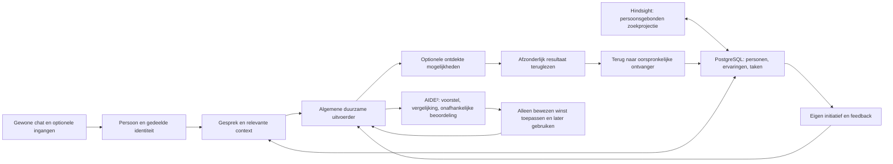

# Eva2 — actuele architectuur en herbeoordeling

De bestaande Pythonkern blijft. Er is geen aangetoond voordeel dat vervanging door
Hermes, OpenClaw of Agent Zero rechtvaardigt. Eerdere vergelijkingen geven beperkte
geheugenvoordelen, verliezen en gelijke taakresultaten; geen algemene winnaar.
Nieuwe vergelijkingsseries zijn geparkeerd. Deze keuze hergebruikt bestaande code,
niet de gedachte dat eerdere investering op zichzelf waarde heeft.

## Vier productuitkomsten, één uitvoeringsroute

| Module / bron | Verantwoordelijkheid en interface | Actuele beoordeling |
| --- | --- | --- |
| src/eva/contracts + domain | Providerneutrale betekenis, getypeerde invoer/uitvoer, persoons- en actieregels | Behouden; geen HA- of browserprotocol in domein |
| src/eva/application/conversation.py | Contact, context en overdracht aan bestaand achtergrondwerk via application ports | Behouden; geen tweede gespreksrouter |
| src/eva/adapters/postgres + projection | PostgreSQL is gezaghebbend; Hindsight is een persoonsgebonden projectie | Import en HUE1–4 later-gebruik behouden; geen nieuw geheugen |
| src/eva/providers | Optionele providerbijdragen leveren ontdekking en mogelijkheden aan algemene kern | Behouden; voorbeelden zijn geen ingebouwde verplichte functies |
| src/eva/operations/delegated_work_runner.py | Afhankelijke acties, duurzame voortgang en stop/herstart | Behouden; capabilityspecifieke afrondingsregels zijn concrete schuld |
| src/eva/adapters/postgres/delegated_work_delivery.py | Resultaat aan oorspronkelijke actor/ingang koppelen | Korte terugmelding standaard; volledige opgeslagen tekst als één gecontroleerd document op expliciet verzoek |
| src/eva/application + adapters/postgres: initiatief | Waarnemen, afwegen, uitgevoerd resultaat en echte reactie onthouden | HUE5 afgerond met echte feedback en later gedrag; dagelijkse autonome beschikbaarheid en aandacht/stilte afzonderlijk controleren |
| src/eva/operations: component evaluation/application | Eva-voorstel → geïsoleerde vergelijking → onafhankelijke eindbeoordeling → gecontroleerde toepassing | HUE6 afgerond binnen oorspronkelijke scope: codewinst toegepast/later gebruikt; agentbeoordeling gelijk, referentie behouden; geen algemene voorsprong |
| src/eva/bootstrap | Eén samenstelling van poorten en adapters; geen productlogica in extra daemon | Behouden |
| src/connectors + src/connector_sdk + deploy | Optionele protocollen, installatie en procesgrenzen | Alleen aansluiten bij behoefte; bestaande ingangen blijven |
| development/tools/project-dashboard | Ontwikkeloverzicht uit hetzelfde werkbord | Geen Eva-productfunctie of afzonderlijke waarheid |
| development/benchmark + evidence + reviews | Bestaande meetmiddelen en ongewijzigd bewijs | Historisch verlies/UNKNOWN behouden; geen nieuwe matrix |

De importgrenzen zijn machineleesbaar in development/design/architecture/package-boundaries-v1.json.
Modulair betekent duidelijke eigendom, poorten en vervangbare adapters. Het betekent
niet dat alle modules apart opnieuw gebouwd of elke mogelijke koppeling geleverd wordt.

## Optionele modelproviders en communicatiekanalen

De eigenaar wil Claude/Anthropic en andere modelproviders kunnen toevoegen, en
WhatsApp als optioneel communicatiekanaal. Modeladapters verzorgen uitsluitend
providerprotocol, aanmelding, ondersteunde modelmogelijkheden en gebruiksregistratie;
kanaaladapters verzorgen ontvangst, persoonsbinding en aflevering aan de oorspronkelijke
ontvanger. Identiteit, geheugen, initiatief en duurzame taken blijven in de gedeelde kern.
Een kanaalwissel of modelwissel maakt geen nieuwe Eva of afzonderlijke uitvoerder.

Het Eva-beheer verbindt de bestaande chat-, geheugen-, werk- en initiatiefpagina's
met personen, reflectie-/verbeteruitkomsten en optionele verbindingsinstellingen.
Installatievoorzieningen worden hergebruikt waar passend. Dit is een gewenste
uitbreiding, geen claim dat deze adapters of volledige beheeromgeving al geleverd zijn.
Actuele provider- en kanaalvereisten worden vóór concrete aansluiting gecontroleerd.

## Waar de uitvoering vastliep

1. **Tegenstrijdige aansturing:** verouderde Actueel-opdrachten, 41/54 naast 43/54,
   een oude primaire AU-008-kaart naast het actuele HUE-werk. Oplossing nu: één doel,
   één actuele werkregistratie; historische instructies in development/archive.
2. **Verspreide versieconfiguratie:** runtime, evaluatiehost, client en suite waren
   niet altijd aan dezelfde bron gebonden. Een eerdere evaluatie stopte hierdoor
   vóór uitvoering. Vervolg moet één coherent pakket van bestaande bindings gebruiken;
   de controles of oude hashes worden niet versoepeld.
3. **Overdrachten zonder complete gebruikersuitkomst:** bron, modelweergave, bewijs,
   voortgang en terugmelding hebben verschillende overgangen. Een ACK op 772 bytes
   samenvatting was geen volledige documentoplevering. De laatste verbinding is
   nu geïnstalleerd en echt gebruikt: één document, oorspronkelijke vraag en
   ontvanger, alle providerbytes teruggelezen. Bijlagen zijn geen standaardmelding.
4. **Deelbewijs als voortgang:** afgesloten proef, groene controles en metadataherstel
   werden te zwaar gewogen. De 54 taken blijven met oorspronkelijke criteria zichtbaar;
   vier huisgenootuitkomsten en gezinsacceptatie zijn de productmaatstaf.

## Behouden, archiveren, gericht veranderen

- Behouden: huidige application ports, getypeerde contracten, PostgreSQL/Hindsight,
  providerbijdragen, gewone uitvoerder, result binding, verbeter-/toepassingsroute,
  locks, schema's en echte acceptaties. Nieuwe bronlocatie: src/eva.
- Historie: de oude Node/Eva1-applicatie en dubbele bronbackups staan op exacte Git-revisie.
  Alleen nog gebruikte referenties blijven lokaal; zie repository-pruning-20261013.md.
  Gedateerde instructies zijn geen nieuwe uitvoeropdrachten.
- Expliciet actief maken: het gebruikte dashboard als development/tools/project-dashboard en
  de installer-gateway als deploy/gateway; geen runtimecode verstopt als experiment.
- Gericht vervolgen: coherente bestaande verbeterbinding,
  echte feedback/latere toepassing en samenhangend chatgebruik. Geen nieuw platform.

## Afronden zonder opnieuw uit te waaieren

Het werkbord bepaalt exact één huidige gebruikersuitkomst en de noodzakelijke
bestaande modules. Leg vóór een wijziging de concrete ontbrekende overgang en het
bruikbare eindresultaat vast. Controleer bestaande code én de gebruikte installatie.
Voer alleen passende gerichte controles uit, bundel onafhankelijke review en installeer
het werkende geheel eenmaal. Herhaal alleen bij een gewijzigde bewezen oorzaak.
Gebruik onbekende vergelijkingsdekking niet als reden voor een nieuwe serie.

Bronnen: development/docs/project-reassessment-20261013.md en het behoudmanifest. Dit document
beschrijft de aangetroffen basis en resterende tekorten; het is geen claim dat Eva af is.
