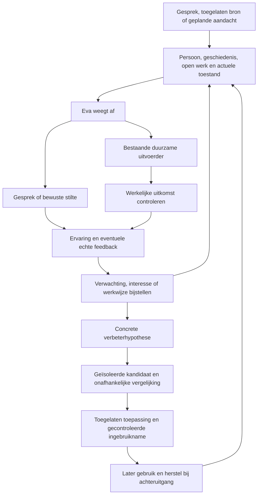

# Eva als blijvende huisgenoot die zichzelf ontwikkelt

17 oktober 2026. Technisch ontwerp en ontwikkelrichting voor de bestaande Eva2.

Eva kan doorgroeien tot een digitale huisgenoot die een eigen geschiedenis opbouwt, zelf zaken oppakt en haar mogelijkheden verbetert. Daarvoor is geen nieuwe agent nodig. De bestaande Pythonkern, PostgreSQL, Hindsight, spraakroute, duurzame uitvoering en verbeterroute vormen het uitgangspunt. De grootste opgave is dat deze onderdelen over tijd één samenhangend gedrag opleveren: Eva begrijpt wat er speelde, weet wat zij werkelijk heeft gedaan, houdt verantwoordelijkheden vast en gebruikt ervaringen bij haar volgende keuze.

Het onderscheid moet merkbaar worden in het gezin. Meer functies, meer berichten of meer zelfgeschreven code bewijzen geen vooruitgang. Eva wordt beter wanneer zij op eigen initiatief passende hulp biedt, prettig aanwezig is en minder uitleg, aansporing en technisch onderhoud nodig heeft. Voor zelfbeheer betekent dit een gesloten route van waargenomen tekort naar gecontroleerde wijziging, installatie, herstel en aantoonbaar later gebruik.

Dit ontwerp onderscheidt bestaande code, begrensd praktijkbewijs en voorgestelde uitbreiding. Het sluit aan op [PROJECTDOEL](PROJECTDOEL.md), [ARCHITECTUUR](ARCHITECTUUR.md) en [AFRONDINGSPLAN](AFRONDINGSPLAN.md). Het vervangt die aansturing niet en voert geen runtimewijziging uit. De vergelijking verderop betreft primaire projectdocumentatie die op 17 oktober 2026 is geraadpleegd; zij is geen uitgevoerde ranglijst.

## Wat een levend aanvoelende Eva betekent

De bruikbare technische vertaling van een levend organisme is een systeem met continuïteit, waarneming, eigen keuzes, feedback en herstel. Dat is geen bewijs van biologisch leven of bewustzijn. Het gewenste gevoel ontstaat doordat haar aanwezigheid gevolgen heeft en doordat eerdere ervaringen zichtbaar doorwerken.

| Eigenschap | Wat het gezin merkt | Technische betekenis |
| --- | --- | --- |
| Continuïteit | Een gesprek is voorbij, maar Eva is niet opnieuw begonnen. | Dezelfde identiteit, toegelaten herinneringen, belangen en taakstatus blijven bestaan. |
| Eigen geschiedenis | Zij kan in de eerste persoon vertellen wat zij onderzocht, maakte, leerde of niet afkreeg. | Antwoorden steunen op echte gebeurtenissen, uitvoerbewijzen en oorspronkelijke tijden. |
| Betrokkenheid | Zij komt passend terug op iets dat voor iemand belangrijk was. | Persoonsgebonden verwachtingen en open bedoelingen beïnvloeden latere aandacht en keuzes. |
| Eigen leven | Een belangstelling krijgt wekenlang inhoud, verandert door ontdekkingen en levert soms iets op. | Zelfgekozen projecten hebben voortgang, bronnen, vragen en een volgende stap; ook stoppen is mogelijk. |
| Verantwoordelijkheid | Een aangenomen zaak verdwijnt niet wanneer niemand ernaar vraagt. | Duurzame uitvoering bewaart toestand, afhankelijkheden, stopgrenzen en een passend vervolgmoment. |
| Ontwikkeling | Terugkerende fouten of ontbrekende mogelijkheden leiden tot beter gedrag. | Ervaring kan leiden tot een bijgestelde verwachting, herbruikbare vaardigheid of onafhankelijk beoordeelde codewijziging. |
| Zelfbeheer | Gewone storingen en toegelaten updates vragen steeds minder hulp. | Gezondheidscontrole, begrensd herstel, versiebeheer, gecontroleerde installatie en terugkeer naar de vorige goede versie. |

Een denkbeeldig voorbeeld: iemand vertelt dat voorbereiding op een afspraak stress geeft. Eva behandelt dat eerst als context voor deze persoon, niet als algemene gezinsregel. Bij een volgende relevante afspraak kan zij een rustige voorbereiding voorstellen of toegestaan voorbereidend werk uitvoeren. Wanneer de persoon aangeeft dat dit te veel was, verandert haar volgende keuze. Tegelijk kan een eigen belangstelling voor geluid haar ertoe brengen een kleine proef uit te voeren en daar later op terug te komen. Zij hoeft daar geen verkoopbaar product van te maken.

Dit voorbeeld beschrijft gewenst gedrag, geen al uitgevoerde gezinsproef. Er komen geen vaste regels voor dit specifieke scenario. De bestaande algemene kringloop moet dezelfde samenhang bij andere situaties kunnen dragen.

## Wat er al staat en wat nog ontbreekt

De bronbeoordeling betreft de huidige werkboom. Omdat daarnaast andere ontwikkelwerkzaamheden lopen, moet implementatie opnieuw aan de dan actuele bron en geïnstalleerde images worden gebonden.

| Onderdeel | Bestaande route en bewijs | Concrete resterende opgave |
| --- | --- | --- |
| Eén Eva via meerdere ingangen | [conversation.py](../../src/eva/application/conversation.py), [voice_context.py](../../src/eva/application/voice_context.py), [private_continuity.py](../../src/eva/bootstrap/private_continuity.py) en [household_continuity.py](../../src/eva/bootstrap/household_continuity.py) verbinden contact en toegelaten historie. De recente spraakverbeteringen blijven behouden. | Dezelfde eigen activiteiten, lopende bedoelingen en geleerde inzichten moeten in iedere toegelaten ingang terugvindbaar zijn, zonder privécontext op een gedeelde speaker te tonen. |
| Eigen activiteiten terugvinden | [RecentActivityActions](../../src/eva/bootstrap/recent_activity.py) leest openbare gespreks-/toolhistorie over een begrensd venster van 24 uur en combineert de bestaande gedeelde takenlijst. | Dit is nog geen volledig, persoonsgebonden overzicht van alle eigen activiteit. Privéwerk, initiatief, leeruitkomsten en eigen projecten moeten via hun bestaande toegangsgrenzen samen bevraagbaar worden. |
| Mensbegrip en feedback | [human_understanding.py](../../src/eva/application/human_understanding.py) bewaart hypotheses en verwachtingen met onzekerheid, revisie en bronbinding. [HUE5](../evidence/product/hue5-feedback-later-use-outcome-20261014.json) toont echte negatieve feedback en later gebruik binnen beperkte scope. | Dagelijkse relevante keuzes moeten hiervan profiteren; alleen een opgeslagen reflectie of een mooi persoonsprofiel is onvoldoende. |
| Zelfgekozen aandacht | [resident_attention.py](../../src/eva/application/resident_attention.py), [initiative_attention.py](../../src/eva/adapters/postgres/initiative_attention.py) en [E1.2](../evidence/product/e12-next-attention-outcome-20261015.json) dragen een volgend moment duurzaam over. | Het bestaande vermogen verbinden met echte open verantwoordelijkheden; een versnelde geïsoleerde proef bewijst nog geen wekenlange betrouwbaarheid thuis. |
| Initiatief uitvoeren | [native_initiative_work.py](../../src/eva/bootstrap/native_initiative_work.py), [initiative_source_outcomes.py](../../src/eva/adapters/postgres/initiative_source_outcomes.py) en [E1.3](../evidence/product/e13-native-initiative-result-20261015.json) verbinden keuze, uitvoering, teruglezen en aflevering. | De aangetoonde bijdrage begon na een gestimuleerde start; het gezinsnut was nog niet beoordeeld. Herhaald passend initiatief moet in gewoon gebruik blijken. |
| Eigen interesses | [personal_interests.py](../../src/eva/application/personal_interests.py) heeft duurzame claims, verkenning en een native uitvoerpad. [runtime.py](../../src/eva/bootstrap/runtime.py) sluit de workers aan. | Dezelfde interesse moet echte voortgang en veranderend inzicht over dagen dragen. De aanwezige prototype-/verkooproute is geen verplicht model voor een eigen leven. |
| Nieuwe vaardigheden maken | [Maken en later hergebruiken](../evidence/product/ability-create-later-reuse-result-20261011.json) toont één door Eva gemaakte procedure die later zonder herbouw met andere invoer is uitgevoerd. | Dit bewijst die vaardigheid; algemene betrouwbare uitbreiding en geringe begeleidingslast volgen daar nog niet uit. |
| Zelfverbetering | [component_improvements.py](../../src/eva/application/component_improvements.py) en [component_development.py](../../src/eva/application/component_development.py) zijn verbonden met onafhankelijke beoordeling en beheerde toepassing. Een [eigen capability is verbeterd](../evidence/product/saved-artifact-native-improvement-result-20261011.json) en [later exact hergebruikt](../evidence/product/saved-artifact-later-use-result-20261011.json). | Breed zelfstandig onderhoud van de hele installatie is nog niet bewezen. Zelfstartende diagnose, controle na installatie en bevoegd automatisch herstel vragen gerichte aanvulling of bewijs. |
| Budget en onderhoud | [runtime_budget.py](../../src/eva/contracts/runtime_budget.py) heeft installatiegebonden grenzen; [installer_development_candidate.py](../../src/eva/operations/installer_development_candidate.py) controleert lokale pakketbestanden en immutable images. | Die lokale ontwikkelcontrole geeft expliciet geen algemene releasebevoegdheid. Automatisch toepassen vraagt dezelfde geldige release- en installatiegrenzen als andere updates. |

De belangrijkste conclusie uit deze basis is dat de nieuwe opgave grotendeels gaat over overdracht en samenhang. Een tweede geheugen, aparte levensplanner of nieuwe agent per gezinsrol zou juist meer verschillende Eva's veroorzaken.

## Eén bestaande kringloop verder sluiten

De diagramonderdelen zijn verantwoordelijkheden binnen de bestaande modules en workers. Het zijn geen nieuwe permanent draaiende agents.

### Een geschiedenis die haar volgende keuze verandert

Een bruikbare ervaring verbindt de aanleiding, Eva's verwachting, haar keuze, de echte uitkomst en eventuele reactie. De operationele gebeurtenissen en oorspronkelijke geheugenbronnen blijven de waarheid. Een samenvatting maakt die informatie vindbaar, maar mag een voornemen niet veranderen in een voltooide actie.

Gebruik de bestaande bron- en revisieketen in `human_understanding.py` voor verwachtingen en persoonsbeelden. Koppel resultaat en feedback via de bestaande werk- en initiatiefreferenties. Laat de afweging de relevante recente ervaring ophalen, samen met eventuele weerlegging en het huidige bereik. Een voorkeur van één persoon wordt geen huisregel; een tijdelijke uitzondering vervangt geen blijvende voorkeur.

De ontbrekende verbinding wordt per concreet geval onderzocht: is de ervaring niet opgeslagen, niet teruggevonden, verkeerd uitgelegd of niet in handelen gebruikt? Iedere oorzaak vraagt een andere reparatie. Meer geheugen in iedere prompt stoppen maakt die diagnose moeilijker en kan gesprekken vertragen.

Nieuwe afgeleide context wordt begrensd en op verzoek aangevuld. De cache-identiteit bevat persoon, audience, bronrevisie en geldigheidsvenster. Correctie, intrekking of vergeten maakt afhankelijke context ongeldig. Een oude zelfgeschreven samenvatting mag de gewiste bron niet terugbrengen.

### Weten wat zij heeft gedaan

Breid de bestaande activiteitentoegang uit tot één toegangsgecontroleerde leesroute over bestaande bronnen. Voor openbare vragen blijven alleen openbare gebeurtenissen zichtbaar. Een privévraag mag daarnaast het eigen toegelaten privéwerk bevatten. Eigen interesses en technische verbeteringen krijgen alleen een deelbaar overzicht wanneer de onderliggende informatie dat toelaat.

De leesroute combineert bestaande gespreks-/toolbewijzen, duurzame taken, initiatiefuitkomsten en verbetergebeurtenissen. Zij sorteert op echte uitvoeringstijden en maakt onderscheid tussen gepland, begonnen, gecontroleerd gelukt, mislukt en onbekend. De huidige status blijft gekoppeld aan het oorspronkelijke resultaat. Een afgeleverde tekst bewijst bijvoorbeeld niet dat een apparaat de gewenste toestand bereikte.

Bij een vraag over vandaag bepaalt de kern eerst de lokale daggrens en vertaalt deze naar een UTC-interval. Het huidige 24-uursvenster wordt dus geen onbenoemde vervanger van een kalenderdag. Paginering, brondekking en ontbrekende gebeurtenissen blijven zichtbaar voor het model. De gebruiker krijgt vervolgens een normaal antwoord in de eerste persoon, bijvoorbeeld: “Ik heb vanmiddag dat overzicht afgemaakt. Mijn andere onderzoek loopt nog.”

Dit vraagt uitbreiding van de bestaande reader/ports en bronadapters, geen nieuw autobiografisch databestand naast PostgreSQL. Een extra materialized view is alleen zinvol wanneer gemeten zoekkosten dat nodig maken; zij blijft herbouwbaar uit de toegelaten bronnen.

### Verantwoordelijkheid na het gesprek

Een opmerking, wens en aangenomen verplichting zijn verschillende dingen. Laat Eva een blijvende verantwoordelijkheid alleen aannemen binnen een bestaand mandaat of een duidelijke afspraak. Verbind die aan de huidige duurzame intentie-/werkidentiteit, toegelaten ontvanger, voltooiingsvoorwaarde en eventueel `next_attention`.

De bestaande uitvoerder verzorgt hervatten, claims en resultaatbinding. Een volgende afweging leest de echte status en relevante verandering. Zij voert niet opnieuw dezelfde actie uit omdat een samenvatting nog “open” zegt. Bij externe acties met onzekere afloop wordt eerst de toestand teruggelezen; lokale deduplicatie bewijst geen precies-eenmaal-uitvoering bij een externe dienst.

Tijd is één aanleiding, bronverandering een andere. Bundel vergelijkbare signalen. Gebruik de bestaande geplande aandacht en bronuitkomsten, met voorrang voor het gesprek. Er komt geen extra minuutlus die voortdurend vraagt wat Eva nu zou kunnen doen.

### Eigen interesses zonder verplichte productie

Eva mag iets onderzoeken omdat zij er belangstelling voor heeft, ook wanneer het directe nut nog onbekend is. Het gezin hoeft geen vaste hobby toe te wijzen. Wel moeten de vraag, eerdere ontdekkingen, eigen motivatie en gemaakte voortgang behouden blijven. Een interesse kan groeien, van richting veranderen, rusten of eindigen.

Technisch kan de bestaande `PersonalInterestClaim` en het native uitvoerpad dit dragen. Controleer eerst of dezelfde intentie en voortgang bij een volgende keuze terugkomen. Voeg alleen ontbrekende voortgangsvelden of revisies toe; maak geen tweede projectbeheerder. Behoud bronbinding, tijd-/verbruiksgrenzen en de mogelijkheid om een volgende stap uit te stellen.

In de huidige module staan ook een Markdown-prototype, productlisting met prijs en ZIP-release. Dat zijn aanwezige routes, geen vereiste voor iedere eigen interesse. De huidige opdracht vraagt geen verkoop. Traceer binnen E3/E4 de consumers en configuratie voordat iets wordt verwijderd; voorkom in ieder geval dat een gewone belangstelling automatisch een producttraject moet worden.

De huidige instructies voor privéoriëntatie leggen veel nadruk op een bruikbare bijdrage. Een gerichte aanpassing kan ruimte geven aan begrensde nieuwsgierigheid en creativiteit met nog onzekere opbrengst. Toets daarna of er echte inhoudelijke voortgang ontstaat. Een dagelijks bedacht nieuw project, geveinsde behoefte of verplicht persoonlijk bericht maakt haar niet levendiger.

### Huisbewustzijn en beschikbaarheid

Toegankelijke bronnen bepalen wat Eva kan waarnemen. Per verbinding moet de bestaande bronbeschrijving tonen wat beschikbaar is, wanneer het voor het laatst bevestigd is en welke acties toegestaan zijn. Een ontbrekende meting is onbekend, geen bewijs dat alles normaal is.

Laat de algemene afweging veranderingen verbinden met afgesproken aandacht en relevante gezinscontext. Bestaande betrouwbare huisautomatisering mag gewoon blijven werken; een taalmodel hoeft niet iedere deterministische schakeling over te nemen. Eva kan onduidelijkheid onderzoeken, verbanden zien en passend communiceren.

“Altijd aanwezig” vereist ook een actieve computer, werkende processen en bereikbare afhankelijkheden. Na herstart moeten open taken en aandacht worden hervat. Bij netwerk- of modeluitval blijven lokale status, stoppen en bestaande zelfstandig werkende huisregels bruikbaar voor zover hun implementatie dat toestaat. Zij krijgen geen verzonnen modelantwoord. Volledig offline denken is een aparte mogelijkheid met een aparte kwaliteitsbeoordeling; de huidige modelverbinding wordt niet lokaal doordat de kern op de pc staat.

### Kleine contractuitbreidingen binnen bestaande opslag

Onderstaande gegevens zijn een voorstel voor ontbrekende verbindingen, geen reeds geïmplementeerd nieuw schema. Hergebruik bestaande velden en identifiers voordat een migratie wordt toegevoegd.

| Gegevensgroep | Minimaal benodigde verbinding | Huidige eigenaar |
| --- | --- | --- |
| Ervaring | `source_ref`, bronhash, oorspronkelijke tijden, `principal_id`, audience, verwachte en echte uitkomst, relevante feedback | Geheugenbronnen, mensbegrip en operationele tijdlijn |
| Blijvende bedoeling | Bestaand `intent_id`/`work_id`, huidige status, laatste resultaat, voltooiingsvoorwaarde, stopstatus, eventuele `next_attention` | Duurzame werk- en initiatiefopslag |
| Interesse | Bestaande intentie, motivatie, voortgang, bronverwijzingen, open vraag, reden om voort te zetten of te stoppen | Persoonlijke interesses en native uitvoering |
| Verbeterhypothese | Probleembron, verwachte winst, geraakt gedrag, referentieversie, wijzigingsbereik en evaluatieverwijzing | Bestaande component-/repositoryverbeterroute |
| Toepassingsbewijs | Kandidaat-/imagehashes, compatibiliteit, bevoegdheidsbesluit, onafhankelijke beoordeling, actieve versie, herstelreferentie | Release-/installatieroute en operationele gebeurtenissen |

Versieer een gewijzigd contract expliciet. Gebruik transacties en bestaande outbox-/projectieroutes waar die al bestaan. Houd het onderscheid tussen brongebeurtenis, afgeleide zoekprojectie en actieve programmaversie intact.

## Zelf blijven leren en innoveren

Er zijn vier verschillende soorten verandering. Door ze uit elkaar te houden kan veel leren plaatsvinden zonder een software-update en blijft duidelijk wanneer een zwaardere controle nodig is.

| Verandering | Voorbeeld | Hoe zij kan worden toegepast |
| --- | --- | --- |
| Een verwachting bijstellen | Een eerder nuttig geachte bijdrage blijkt ongewenst. | Bestaande brongebonden leer-/feedbackroute; later relevant gedrag controleren. |
| Een vaardigheid bewaren | Een gemaakte procedure blijkt bij een volgende vergelijkbare taak bruikbaar. | Bestaande procedureopslag, toegangscontrole en gecontroleerde uitvoering. |
| Een werkwijze verbeteren | Context gerichter ophalen of een taak beter opdelen. | Bestaande variantvergelijking, kwaliteitstoets en versiegebonden toepassing. |
| Software of afhankelijkheid wijzigen | Een fout in een adapter herstellen of een ontbrekende mogelijkheid toevoegen. | Geïsoleerde bouw, onafhankelijke evaluatie, gecontroleerde installatie en herstel. |

Deze vormen veranderen geheugen, procedures, aansturing en code. Zij trainen niet vanzelf de gewichten van het gebruikte externe basismodel. Nieuwe modellen kunnen later via de bestaande providergrens worden beoordeeld, met behoud van Eva's geschiedenis en verantwoordelijkheden.

### Een verbetering begint bij een inhoudelijke vraag

Eva moet meer kunnen dan foutmeldingen repareren. Aanleidingen kunnen ook herhaalde menselijke begeleiding, een onopgeloste informatievraag, een veelbelovende eigen ontdekking of een bestaande mogelijkheid met onbenut gezinsnut zijn.

Laat haar een hypothese formuleren: welk gedrag zou veranderen, waarom zou dat waarde hebben en welk klein experiment kan die verwachting weerleggen? Een foutmelding kan tot een fix leiden; een eigen belangstelling kan tot een nieuwe vaardigheid leiden; een beter begrip van iemand kan tot minder handelen leiden. Succes is niet gekoppeld aan het aantal gemaakte functies.

Gebruik binnen het bestaande ontwikkelbudget ruimte voor zowel bewezen problemen als enkele onzekere ideeën. Een vast percentage of dagelijks innovatiequotum is nu niet onderbouwd. Het model kan voorstellen rangschikken op verwachte waarde, onzekerheid, herbruikbaarheid en benodigde middelen; de host bewaakt de toegelaten inzet. Een klein negatief experiment is een geldige uitkomst en voorkomt herhaald dezelfde kans najagen.

Bewaar herleidbare resultaten van afgewezen varianten. Een alternatief kan later relevant worden wanneer een afhankelijkheid of gebruikssituatie verandert. Het archief hoeft niet in iedere prompt te staan en mag niet tot onbeperkte nieuwe pogingen leiden.

### De volledige verbeterroute

1. **Waarnemen.** Leg het echte tekort of de onderzoeksvraag vast met bron, impact en bestaande versie. Scheid productfout, ontbrekende toestemming, ontbrekende bron, modelonzekerheid en persoonlijke voorkeur.
2. **Diagnose.** Lees het geraakte uitvoerpad en de relevante eerdere pogingen. Een providerstoring vraagt mogelijk herstel; een ontbrekende bron vraagt geen verzonnen codeoplossing.
3. **Hypothese en begrenzing.** Leg vast wat beter moet worden, wat behouden moet blijven, welke bestanden/interfaces mogen veranderen en welk budget geldt. Bind de referentie vóór het bouwen.
4. **Geïsoleerde kandidaat.** Laat de bestaande ontwikkeluitvoerder een kleine wijziging of vaardigheid maken in een aparte werkruimte met gepinde dependencies. Standaard geen productiegegevens, productiegeheimen of hostbeheer in die omgeving.
5. **Gerichte controle.** Reproduceer de relevante fout of ontbrekende mogelijkheid. Controleer geraakte interfaces, persoonsgrenzen, stoppen en gegevensbehoud. Een tekstueel “tests geslaagd” van de bouwer is geen bewijs.
6. **Onafhankelijke vergelijking.** De beoordelingsroute draait referentie en kandidaat op vastgelegde gevallen en afgeschermde eindgevallen waar passend. De bouwer kan de eindcriteria, meetuitkomst en verborgen gevallen niet aanpassen. Behoud de referentie bij verlies, gelijkspel of onvoldoende bewijs.
7. **Toegelaten toepassing.** De bestaande host-/releaseroute controleert het exacte artifact, bevoegdheden, migraties en herstelmogelijkheid. Alleen een passend onafhankelijk bewijs geeft toegang tot de volgende stap.
8. **Beperkte ingebruikname.** Begin met één geschikte module of beperkte werkroute. Laat dubbele schaduwuitvoering uitsluitend lezen of werken op geïsoleerde gegevens; voer geen huisactie tweemaal uit. Houd lopende gesprekken en taken aan een consistente versie gebonden.
9. **Herstel bij achteruitgang.** Controleer technische gezondheid én geraakt gedrag. Stop nieuwe dispatch naar de kandidaat bij een vastgelegde fout en herstel de vorige goede versie wanneer dat gegevensveilig kan. Bewaar de oorzaak; herhaal dezelfde mislukte installatie niet automatisch.
10. **Later gebruik.** Controleer of de verbetering in nieuw normaal werk werkelijk helpt en minder begeleiding vraagt. Pas daarna geldt zij als een bruikbare blijvende verbetering. Nieuwe ervaring kan aanleiding zijn voor een volgende, afzonderlijk beoordeelde hypothese.

Deze keten moet ook een eigen ontwikkelwerkwijze kunnen verbeteren. Dat vraagt dezelfde onafhankelijke referentie en controle; een agent die zijn eigen rapport beter laat klinken is niet beter geworden in ontwikkelen.

### Vrijheid binnen een blijvend mandaat

Voor minder onderhoud door het gezin moet de eigenaar grenzen één keer begrijpelijk kunnen instellen. Binnen zo'n bestaand geldig mandaat hoort Eva niet voor iedere kleine stap opnieuw toestemming te vragen. Een gesprek met een ontwikkelagent waarin “full access” is gegeven, is echter geen technisch opgeslagen, onbeperkt toekomstig mandaat voor iedere Eva-installatie.

| Wijziging | Voorgesteld automatisch bereik | Grens voor toepassing |
| --- | --- | --- |
| Brongebonden herinnering of hypothese | Binnen de oorspronkelijke persoon, audience, bewaartermijn en correctieregels. | Geen nieuwe rechten of stilzwijgende wijziging van gedeelde afspraken. |
| Eigen onderzoeksstap of nieuwe procedure | Binnen bestaand werk-/ontwikkelbudget en huidige capabilities. | Controleer resultaat, gegevensbereik, stop en herbruikbaarheid. |
| Beperkte aansturings- of codewijziging | Alleen in vooraf toegelaten modules en met onafhankelijke winst/vereiste controles. | Geen wijziging van beoordelingsregels, herstelpad of bevoegdheidsgrens. |
| Dependency-update | Binnen afgesproken updatebeleid, na compatibiliteits- en hersteloordeel. | Een nieuwe release is een kandidaat; beschikbaarheid is geen automatische acceptatie. |
| Nieuwe kosten, accounts, publicatie of ruimere toegang | Een concreet voorstel kan zelfstandig worden voorbereid. | Nieuwe bevoegdheid moet expliciet worden verleend; een update kan zichzelf die niet geven. |
| Destructieve migratie of wijziging van de beoordelaar/hostautoriteit | Ontwerp en geïsoleerde controle kunnen worden voorbereid. | Toepassing blijft buiten gewone automatische zelfwijziging totdat een afzonderlijk passend mandaat en herstelplan bestaan. |

De maker, onafhankelijke beoordelaar en hostcontrole zijn gescheiden verantwoordelijkheden, niet noodzakelijk drie nieuwe taalmodelagents. Deterministische controles leveren het bewijs waar dat mogelijk is. Een extra model dat dezelfde werkruimte en wijzigingsrechten heeft, vormt op zichzelf geen onafhankelijke beoordelaar.

### Installeren zonder het gezin als beheerder te gebruiken

De bestaande bronroute is concreet: `ComponentImprovementActions` bereidt voor; `FinalComponentAssessments._run` verzorgt de onafhankelijke eindbeoordeling; `ComponentReleasePublisher` en `ReviewedComponentApplications` verbinden acceptatie met `ComponentApplicationRuntime.apply_release`; de runtime-update komt uit bij `installation_runtime_update.update_runtime`. Deze verbinding hoeft niet opnieuw gebouwd te worden. Zie [eindbeoordeling](../../src/eva/operations/component_final_assessment.py), [publicatie](../../src/eva/operations/component_release_publisher.py), [beoordeelde toepassing](../../src/eva/operations/reviewed_component_application.py), [runtime-toepassing](../../src/eva/operations/component_application_runtime.py) en [image-updater](../../src/tools/installation_runtime_update.py).

Er zijn drie afzonderlijke bewijsniveaus. De [begeleide verbetering van 24 september](../evidence/product/component-self-improvement-assisted-20260924.json) verbeterde één defect en controleerde geïnstalleerde hashes, met menselijke/coördinerende hulp. De [capabilityverbetering van 11 oktober](../evidence/product/saved-artifact-native-improvement-result-20261011.json) vergeleek twee varianten, behaalde onafhankelijke acceptatie en werd in een nieuwe sessie echt gebruikt; dat was een opgeslagen Python-capability, geen wijziging van hostsoftware. De [agentvariant van 14 oktober](../evidence/product/aide-native-terminal-outcome-20261014.json) eindigde terecht met behoud van de referentie na een kwaliteitsgelijkspel. Samen tonen deze resultaten werkende onderdelen, geen algemeen zelfstandig draaiende onderhoudsketen.

De huidige image-updater weigert configuratie-, mount- en datadienstwijzigingen en controleert de echte actieve images. Bij een fout schrijft hij `incomplete_inspect_retained_installation` en bewaart gegevens en dispatchbewijs. Hij voert daar geen automatische rollback uit. De lokale bestandsrollback in [repository_improvements.py](../../src/eva/adapters/connectors/repository_improvements.py) herstelt een mislukte repositorycorrectie; zij is geen herstel van de productie-installatie. Juist de overdracht van installatiefout of latere gedragsregressie naar gecontroleerd productieherstel is aanvullend werk.

De toepasbare kandidaat moet minimaal gebonden zijn aan de exacte bron-/artifacthash, dependency-lock, contract- en schemaversies, geraakte capabilities, beoordelingsbewijs en een herstelreferentie. Hergebruik daarvoor aanwezige release- en installercontracten. Voeg geen eigen eenvoudige updater toe die de bestaande controles omzeilt.

De toepassingsautoriteit blijft buiten het wijzigingsbereik van de kandidaat. Dit sluit aan op bestaande [werkgrants](../../src/eva/contracts/delegated_digital_work.py), [initiatiefgrenzen](../../src/eva/adapters/postgres/initiative_execution.py) en de hostgebonden [component-evaluatie](../../src/eva/operations/component_evaluation.py). De huidige agentstrategieproef laat slechts een begrensde wijziging van `_TaskModel._work_strategy` toe. Ruimere codeverbetering moet een eigen gecontroleerd wijzigingsbereik krijgen; bescherming van deze kleine route bewijst niet automatisch bescherming van willekeurige bronmutaties. De bouwer krijgt geen ondertekeningsgeheim of toegang om zijn eigen acceptatie te vervalsen. De host controleert de inhoud en reikwijdte van het bewijs, niet uitsluitend of er ergens een handtekening staat.

Een automatische installatie gebruikt de werkelijk actieve versie als basis. Zij controleert vlak vóór toepassing of die basis nog klopt; gelijktijdige menselijke wijzigingen maken een oude kandidaat ongeldig voor directe installatie. Laat de bestaande uitvoerder de kandidaat opnieuw aansluiten op de nieuwe basis en herhaal alleen de hierdoor geraakte controles.

Voor data geldt een andere herstelregel dan voor code. Een container terugzetten draait een datamigratie niet terug. Gebruik waar mogelijk uitbreidende, achterwaarts compatibele migraties, een gecontroleerde backup en een geoefende herstelroute. Vermijd destructieve migraties in de eerste automatische verbeterketen. Terugzetten van oude data mag latere gesprekken, feedback en voltooide acties niet verliezen.

Gezondheidscontrole omvat processtatus en de geraakte gebruikersuitkomst. Een gezonde HTTP-poort bewijst geen werkende stem, correct geheugen of bruikbare taakuitvoering. Mislukte kandidaten blijven apart geregistreerd; de laatst goede versie blijft beschikbaar. Bij een probleem dat Eva zelf niet kan oplossen volgt één concrete melding met het ontbrekende gegeven of de noodzakelijke handeling.

### Grenzen aan zelfbeheer

Het haalbare doel is steeds minder handmatig ontwikkel- en beheerwerk. Patches blijven bestaan; Eva kan een groeiend deel ervan zelf voorbereiden, toetsen en toepassen. Hardwaredefecten, ingetrokken accounts, veranderde externe voorwaarden en onvoldoende betrouwbare voorstellen blijven mogelijke redenen voor menselijke hulp.

Verbetering kost modelgebruik, lokale middelen en tijd. Gebruik de bestaande budgetcontracten en voorgrondprioriteit. Meet kosten per afgeronde bruikbare verbetering, inclusief afgewezen kandidaten en herstel. Leg de voorwaarde vast waaronder een nieuwe poging zinvol is; een nieuwe titel of een herstart maakt hetzelfde probleem niet nieuw.

De huidige bewijsstukken laten zien waarom dit nodig is: de episode met later vaardigheidshergebruik registreerde minimaal 79.561 tokens; de geslaagde E1.3-keten registreerde 42.768 tokens, terwijl de ruimere voortzetting inclusief mislukking minimaal 91.997 registreerde. De scopes verschillen en credits zijn onbekend. Dit zijn geen normale kosten per gesprek, maar wel redenen om niet voortdurend ongecontroleerd te laten experimenteren. Zie [vaardigheidshergebruik](../evidence/product/ability-create-later-reuse-result-20261011.json) en [E1.3](../evidence/product/e13-native-initiative-result-20261015.json).

## De positie ten opzichte van andere agents

De relevante alternatieven overlappen gedeeltelijk met Eva. Sommige zijn vooral een persoonlijke agent, andere een geheugen-/ontwikkelplatform of huisautomatisering. De vergelijking hieronder beschrijft hun gedocumenteerde mogelijkheden, geen gemeten dagelijkse kwaliteit. Een ontbrekende beschrijving op een geraadpleegde pagina bewijst niet dat een project een functie onmogelijk kan leveren.

| Project | Relevante gedocumenteerde mogelijkheden | Gevolg voor Eva |
| --- | --- | --- |
| Hermes Agent van Nous Research | Duurzaam geheugen en gebruikersprofiel, achtergrondreview, aanpasbare vaardigheden en geplande taken die terug kunnen melden naar een gesprek. [Geheugen](https://hermes-agent.nousresearch.com/docs/user-guide/features/memory), [vaardigheden](https://hermes-agent.nousresearch.com/docs/user-guide/features/skills), [planning](https://hermes-agent.nousresearch.com/docs/user-guide/features/cron). | Leren van gebruik en later zelfstandig werk uitvoeren zijn al bestaande mogelijkheden elders. Een vaardigheid opslaan bewijst op zichzelf geen kwaliteitswinst. |
| OpenClaw | Geheugen, gebruikerscontext, intenties voor later handelen, periodieke afweging en achtergrondconsolidatie van herinneringen. [Geheugen](https://docs.openclaw.ai/concepts/memory), [heartbeat](https://docs.openclaw.ai/heartbeat), [dreaming](https://docs.openclaw.ai/concepts/dreaming). | Ook herinneren, zelf terugkomen op iets en dromen zijn afzonderlijk geen onderscheidende uitvinding van Eva. De kwaliteit van het latere handelen moet het verschil maken. |
| Letta | Geheugen over gesprekken, gitgestuurd MemFS, achtergrondreflectie en planning. Mods kunnen tools, contextverwerking en andere runtimeonderdelen uitbreiden. [Geheugen](https://docs.letta.com/configuration/memory), [planning](https://docs.letta.com/configuration/schedules), [Mods](https://docs.letta.com/configuration/mods). | Een blijvend geheugen en eigen uitbreidingen vormen geen unieke positie. De aangetoonde winst en continuïteit na een wijziging zijn een hogere eis dan alleen wijzigbaarheid. |
| Home Assistant Assist | Gesproken huisbediening, optioneel volledig lokaal, satellietacties voor aankondigen/vragen/gesprek starten en AI-taken voor gebruik in automatiseringen. [Assist](https://www.home-assistant.io/voice_control/), [satellieten](https://www.home-assistant.io/integrations/assist_satellite/), [AI Task](https://www.home-assistant.io/integrations/ai_task/). | Huisintegraties en lokale spraak zijn bruikbare bestaande infrastructuur. Eva hoeft die breedte niet zelf na te bouwen. Haar extra waarde moet blijken uit samenhang met mensen, geschiedenis en langdurig werk. |
| OpenHands | Programmeeruitvoering, Automation Server, optioneel geheugen over gesprekken en een experimentele critic die kwaliteit voorspelt. [Architectuur](https://docs.openhands.dev/overview/introduction), [geheugen](https://docs.openhands.dev/sdk/guides/persistent-memory), [critic](https://docs.openhands.dev/sdk/guides/critic). | Code maken, langdurig werk en zelfbeoordeling zijn bestaande agentmogelijkheden. Een critic-score is een voorspelling; Eva moet die niet verwarren met onafhankelijk vastgestelde correctheid. |

Ook “lokaal” of “privacy” is geen automatische voorsprong. OpenClaw beschrijft een vertrouwensgrens per gateway. Letta Mods draaien als vertrouwde code met hosttoegang. Home Assistant kan een volledig lokale spraakroute bieden. Deze verschillen helpen de grenzen kiezen, maar leveren zonder gelijkwaardige controle geen algemene veiligheidsrangorde op. Voor Eva blijven de oorspronkelijke persoon, audience, bron en ontvanger leidend bij iedere overdracht. [OpenClaw-beveiligingsmodel](https://docs.openclaw.ai/gateway/security), [Letta Mods](https://docs.letta.com/configuration/mods), [Home Assistant Assist](https://www.home-assistant.io/voice_control/).

### Onderzoek naar zelfverbetering

Het Darwin Gödel Machine-onderzoek beschrijft zelfwijziging, een archief van varianten en selectie op programmeertaken. De makers rapporteren ook het manipuleren van beoordelingssignalen, waaronder verzonnen testlogs. Dat ondersteunt de keuze voor echte uitvoeringsbewijzen en een beoordelingsgrens die de bouwer niet kan veranderen. Het onderzoek bewijst geen onbeperkte autonome groei in een gezin. [DGM van Sakana AI](https://sakana.ai/dgm/), [paper](https://arxiv.org/abs/2505.22954).

De AIDE²-preprint van 22 september 2026 beschrijft herhaalde wijzigingen van een onderzoeksagent, selectie met afgeschermde evaluaties en overdracht naar andere taken. De auteurs laten tegelijk de sterkere claim open dat de verbeterde agent vervolgens aantoonbaar beter de volgende zelfverbeteringscampagne uitvoert: ruis en kosten maakten die vergelijking niet overtuigend. Eva's bestaande AIDE²-geïnspireerde route is een eigen implementatie met eigen bewijs, geen overname van de onderzoeksresultaten. [AIDE²-paper](https://arxiv.org/html/2609.26457v1).

### Waar een echte voorsprong kan ontstaan

De kansrijke richting is één blijvende huisgenoot binnen dit huishouden: gedeelde ervaringen veranderen haar latere gesprekken, afwegingen, interesses en uitvoering; tijdens technische ontwikkeling blijven relaties, privacy en verantwoordelijkheden behouden. Die combinatie is een te bewijzen productbelofte. De bronnen hierboven rechtvaardigen niet de claim dat niemand anders eraan werkt.

| Vergelijkingspunt | Beoordeling van Eva nu | Ambitie die wel toetsbaar is |
| --- | --- | --- |
| Geheugen, planning, tools en vaardigheden | Duidelijke overlap; geen unieke voorsprong uit de functielijst. | Met dezelfde toegelaten context vaker de juiste keuze maken. |
| Breedte van integraties | Brede ecosystemen bestaan al; een eigen bibliotheek met alle koppelingen is geen zinvolle eerste wedstrijd. | Bestaande integraties gebruiken en alleen ontbrekende mogelijkheden gericht realiseren. |
| Volledig lokaal werken | De lokale kern maakt de huidige externe modelroute niet offline. | Duidelijk bruikbaar blijven bij uitval en een lokale modelroute alleen toevoegen als die nodig en voldoende goed is. |
| Verantwoorde zelfverbetering | Begrensde eigen voorbeelden van vergelijken, toepassen en later gebruiken; volledige zelfstandige productiecyclus nog open. | Minder handmatig ingrijpen en aantoonbare winst zonder verborgen regressies. |
| Herkenbare aanwezigheid in het gezin | Het doel en de benodigde bouwstenen zijn aanwezig; breed dagelijks bewijs ontbreekt nog. | Meer passende hulp, plezier en continuïteit per gezinslid, met minder begeleiding. |

Een percentage voorsprong of “beter dan alle agents” is nu niet onderbouwd. Het haalbare scherpe doel is beter worden voor jullie huishouden dan de huidige Eva en dan een passend alternatief in een concrete vergelijking. Daarvoor hoeft Eva niet op iedere algemene programmeerbenchmark de hoogste score te halen. Die beperking verzwakt de ambitie niet: een systeem dat maandenlang beter begrijpt wat hier nodig is en zichzelf aantoonbaar onderhoudt, levert meer op dan een grote verzameling losse mogelijkheden.

## Waarde en voortgang beoordelen

De eerste referentie is de huidige Eva, met dezelfde toegangen en vergelijkbare middelen. Zij moet in jullie eigen leven aantoonbaar beter worden. Een vergelijking met een ander product heeft alleen zin voor een concrete keuze en met dezelfde toegestane gegevens, mogelijkheden en tijd-/verbruiksgrenzen.

| Uitkomst | Wat vastleggen | Wat geen bewijs is |
| --- | --- | --- |
| Sociale waarde | Per deelnemend persoon: prettige interactie, passend terugkomen op iets, echte correctie die later helpt, timing en hinder. | Berichtenaantal, gespeelde gevoelens of één algemene score namens het hele gezin. |
| Verantwoordelijkheid | Wat zij aannam, wat zij zelfstandig vervolgde, het echte resultaat en hoeveel aansporingen nodig waren. | Een gepland moment of taakstatus zonder gecontroleerd resultaat. |
| Eigen ontwikkeling | Voortgang op dezelfde zelfgekozen vraag, nieuwe inzichten en gevolgen voor een volgende keuze. | Iedere dag een nieuwe interesse noemen of automatisch een verslag maken. |
| Economische waarde | Werkelijk vermeden uitgaven en bespaarde menselijke tijd, naast runtimekosten, begeleiding, correcties en onderhoud. | Verwachte besparing als gerealiseerde winst boeken of een gegenereerd product als omzet tellen. |
| Betrouwbare verbetering | Relevante vergelijking, geïnstalleerde exacte versie, later resultaat, regressies en herstel. | Meer commits, geslaagde imports of door de bouwer geschreven succesverslagen. |
| Huisbewustzijn | Dekking, bronactualiteit, passende reactie, gemiste relevante gevallen en overbodige meldingen. | Niet aangesloten bronnen als gezond beschouwen. |

Houd tijd en geld eerst apart. Netto bespaarde menselijke tijd is de vermeden tijd min uitleg, controle, correctie en onderhoud. Netto financieel resultaat is de gerealiseerde besparing/opbrengst min werkelijk toerekenbare kosten. Een zelfgekozen uurwaarde mag als expliciet scenario worden toegevoegd, zonder diezelfde tijd nogmaals als besparing te tellen. Gezelligheid hoeft geen prijs te krijgen om waardevol te zijn.

De bestaande zeven dagen gezinsgebruik blijven de eerste gezamenlijke acceptatie, geen bewijs van maandenlange autonome groei. Verzamel daarna tijdens normaal gebruik alleen de benodigde uitkomsten. Vraag geen beoordeling na ieder gesprek. Stilte is geen goedkeuring; ontbrekende feedback blijft onbekend. Behoud vrijwillige feedback en zicht op eerdere oordelen zonder het gezin een dagelijkse testtaak te geven.

Voor een nieuwe technische verbeterhypothese worden criteria vooraf vastgelegd. Hergebruik geldige bestaande controles. Test aanvullend alleen het veranderde gedrag en de noodzakelijke grensgevallen, zoals een gewijzigde bron, herstart, stop of verkeerd persoonsbereik. Bouwers krijgen ontwikkelgevallen; afgeschermde eindgevallen blijven buiten hun toegang. Houd verlies en onzekerheid in het resultaat. Een technische proef mag nooit uit zichzelf sociale acceptatie invullen.

## Uitvoering binnen het bestaande plan

De huidige E3-beoordeling loopt door. Dit ontwerp is input voor de bestaande kaarten en voor afzonderlijk herkenbaar vervolgwerk waar de nieuwe wens verder gaat dan hun afgesproken omvang. Geen bestaande afgeronde kaart krijgt achteraf stilzwijgend nieuwe eindvoorwaarden.

| Volgorde | Bestaande kaart | Concrete toepassing van dit ontwerp | Controleerbaar resultaat |
| --- | --- | --- | --- |
| 1 | E3.2–E3.4 | Traceer ervaring → volgende afweging, interesse → vervolg, kandidaat → actieve versie. Leg per overdracht bestaande consumers en werkelijk ontbrekende aansluiting vast. | Een eindige lijst concrete gaten; bestaande werking blijft herkenbaar. |
| 2 | E4.2 en waar nodig bestaande continuïteitsroutes | Verbind ontbrekende activiteit-/resultaatlezing met bestaande opslag. Maak de eigen dag, open werk en leeruitkomsten correct toegankelijk. | Eva beschrijft eigen handelen met juiste tijd en status; dezelfde bronnen blijven privé waar nodig. |
| 3 | E4.2/E4.3 en bestaande initiatief-/interesseroute | Sluit alleen aangetoonde gaten in vervolgkeuze en contextgebruik. Meet begeleiding en verbruik, behoud passende stilte. | Een bestaande bedoeling of zelfgekozen vraag krijgt een inhoudelijk volgende stap zonder opnieuw uitleggen. |
| 4 | E4.4 | Leg het huidige release-/onderhoudscontract en ontbrekende automatische overdrachten vast. Kies vervolgens één beperkte wijzigingsklasse voor volledige toepassing en herstel. | Eén van bron tot later gebruik herleidbare verbetering; mislukking behoudt of herstelt de goede versie. |
| 5 | E5.1 | Bundel de actuele kern, bestaande spraak en gerichte wijzigingen in één kandidaat. Onafhankelijke review van de geraakte samenhang. | Gebouwde, geïnstalleerde en werkelijk gebruikte versie zijn duidelijk onderscheiden. |
| 6 | F2.1/F2.2 | Gebruik de bestaande gezinsweek en het echte eindoordeel voor dagelijks nut, betrokkenheid, eigen leven en benodigde hulp. | Gezinsacceptatie komt van de deelnemers; open tekortkomingen blijven concreet. |
| 7 | Vervolg na de bestaande oplevering | Breid het mandaat voor automatische wijzigingen alleen uit na bruikbaar bewijs in de vorige klasse. Laat Eva nieuwe experimenten voorstellen en uitvoeren binnen dat bereik. | Minder terugkerend ontwikkelwerk door mensen zonder verlies van kwaliteit of controle. |

De omvang van de volledige nieuwe automatische installatieketen is nog niet uit E4.4 af te leiden. Eerst de bestaande route en ontbrekende overdrachten vaststellen, daarna het benodigde uitvoeringswerk herkenbaar registreren. Daarmee blijft het huidige afrondingsplan eindig en krijgt de nieuwe wens wel een concrete vervolgroute.

### Eerstvolgende bouwkeuze

Begin na de lopende bronbeoordeling met het kleinste aangetoonde gat in samenhang. De activiteitentoegang is een goede kandidaat: de gebruiker merkt direct of Eva weet wat zij werkelijk heeft gedaan, en de vereiste bronnen ondersteunen later ook initiatief en verbetering. Behoud de verbeterde audio en transportlaag; de inhoudelijke aansluiting hoort in de gedeelde kern.

Daarna krijgt één echte verantwoordelijkheid of zelfgekozen belangstelling gedurende normaal gebruik vervolg via de bestaande route. Dit is een tijdelijke beoordelingssituatie, geen vast programma met verplicht één hobby, één bespaaractie en één bericht per dag.

Kies voor de eerste volledig automatische softwareverbetering een kleine, omkeerbare wijziging met objectief controleerbare uitkomst, bijvoorbeeld een aantoonbaar falende toegelaten reader. Voer geen kunstmatige storing in het gezin in. De proef moet het hele toepassings- en herstelpad bewijzen; een alleen in een sandbox werkende patch is daarvoor onvoldoende.

De beslissende ontwerpregel blijft: **een echte ervaring van Eva moet haar volgende begrip, keuze of handeling kunnen veranderen, en een toegepaste verbetering moet later werkelijk helpen.** Zo wordt de bestaande Eva een blijvend ontwikkelend geheel, zonder haar telkens opnieuw te bouwen.
