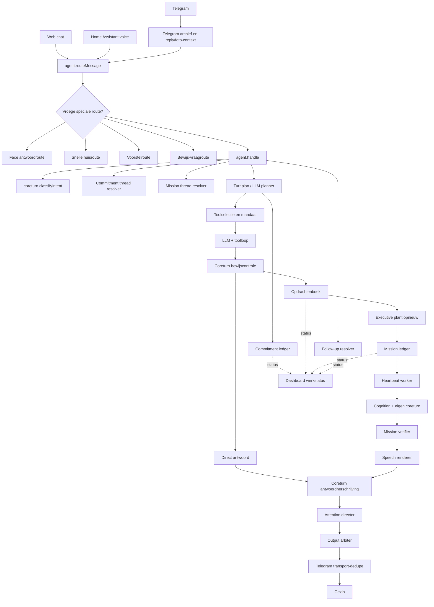
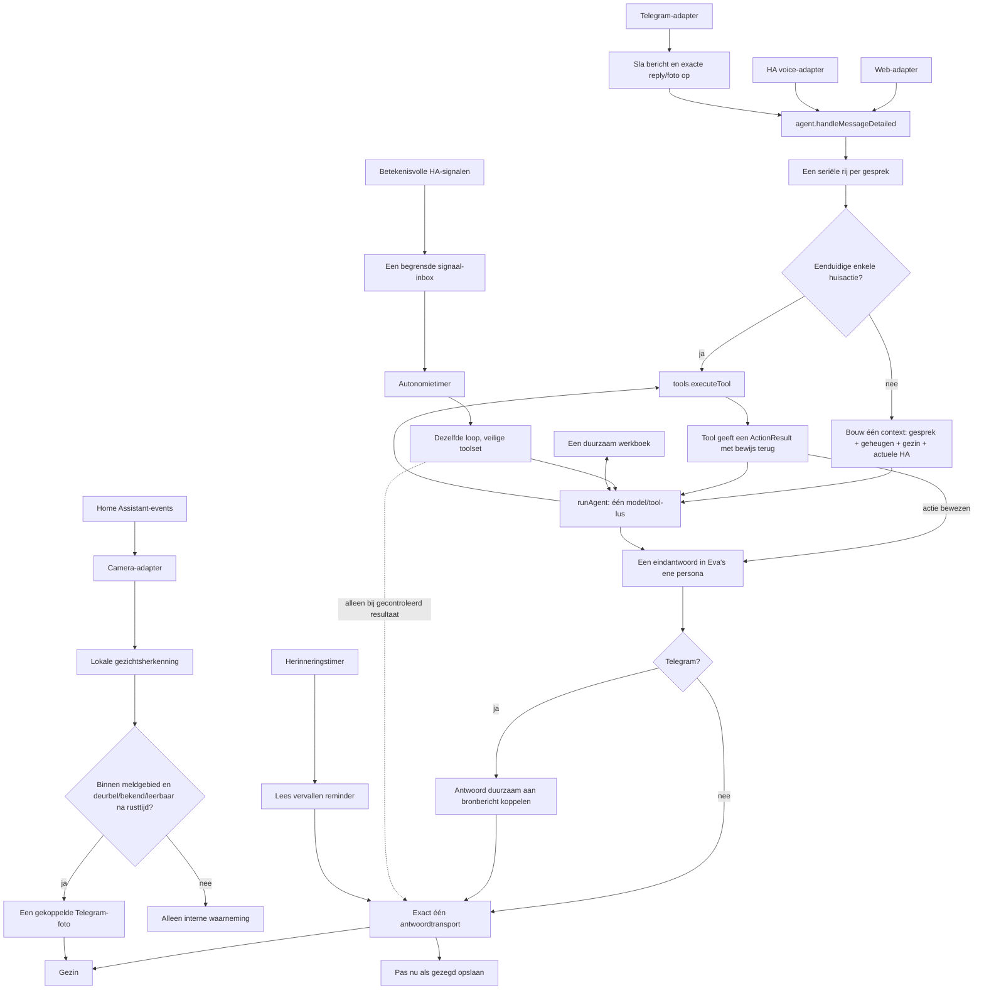
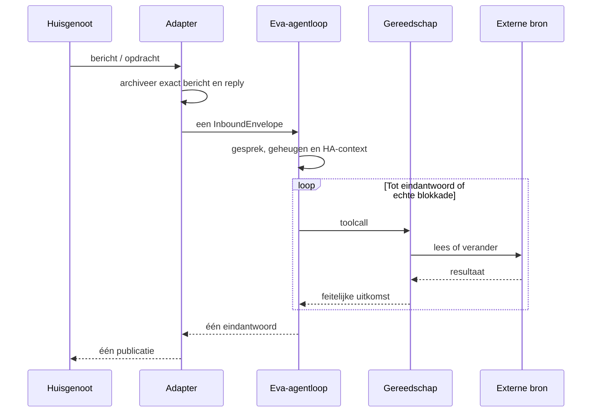

# Eva Runtimekaart

Dit document is het architectuurcontract voor Eva. Het beschrijft niet wat de
code *bedoelt* te doen, maar welke component op ieder moment eigenaar is van een
bericht, handeling, resultaat en verzending.

## Oude live route (31 juli 2026)

Probleem: intentie wordt tot negen keer beslist, werk heeft vier statusbronnen,
en tekst kan drie keer inhoudelijk veranderen. Een verzendstatus kan bovendien
teruglekken naar de werkstatus. Daardoor kan Eva intern tegelijk klaar, open en
gemeld zijn.

## Actieve minimale route

### Beurt als sequentie

## Actieve bronkoppeling

| Stap | Bestand | Verantwoordelijkheid |
| --- | --- | --- |
| Processtart | `src/index.js` | Start uitsluitend adapters en de ene kern |
| Gespreksbeurt | `src/mind/agent.js` | Rij, context, model/tool-lus en één antwoord |
| Persoonlijkheid | `src/mind/persona.js` | Eén stabiele Eva-stem |
| Gereedschap | `src/mind/tools.js` | HA, onderzoek, bestanden, geheugen en verzending |
| Telegram | `src/integrations/telegram.js` | Archief, reply/fotobewijs en transport |
| Huiscontext | `src/integrations/homeassistant.js` | Toestand, acties en zintuig-events |
| Camera | `src/mind/perception.js` | Event, lokale herkenning en gekoppelde foto |
| Autonomie | `src/mind/autonomy.js` | Timing en begrensde HA-signaal-inbox; betekenis blijft in `agent.js` |
| Duurzaam werk | `src/mind/work.js` | Alleen doel, volgende stap, bewijs, status en eigenaar |
| Dashboard | `src/web/server.js` | Projectie van agentstatus, geen eigen werkmodel |

De runtime bestaat nu uit 31 JavaScriptmodules en 11.431 regels, inclusief de
statische dashboardclient en de lokale inference-worker. De 78 niet-bereikbare
oude regisseurs zijn fysiek verwijderd. De afzonderlijke Python-breinservice
voor ArcFace en de eigen encoder blijft bestaan. De toestand van voor deze
opschoning staat in
`data/backups/eva-code-before-minimal-core-20260731.tar.gz`.

## Eigenaarschap

| Vraag | Enige eigenaar |
| --- | --- |
| Wat bedoelt dit bericht? | De ene agentloop |
| Welke gespreksdraad hoort erbij? | Exacte reply-context, anders recente sessie |
| Welke actie wordt uitgevoerd? | Het gekozen gereedschap |
| Is de actie gelukt? | De teruggegeven gereedschapsuitkomst |
| Hoe klinkt Eva? | De ene Eva-persona in de agentprompt |
| Is iets naar het gezin gestuurd? | Het Telegram/web-transport |
| Mag autonomie iets in huis veranderen? | In `full` wel voor normale omkeerbare apparaten, met actuele controle en readback; nooit voor sloten, alarmen of geheimen |

## Harde invarianten

1. Een inkomend bericht levert maximaal een zichtbaar antwoord op.
2. Een actieclaim mag alleen steunen op een tooluitkomst uit dezelfde beurt.
3. Een reply-id gaat altijd voor tekstuele of fuzzy draadherkenning.
4. Home Assistant bepaalt de thuislocatie. Eva kiest geen plaats uit modelkennis.
5. Tussenstanden worden niet spontaan verzonden.
6. In `full` kiest Eva zelfstandig doelen en mag ze onderzoeken, bouwen, programma's
   in haar werkruimte uitvoeren, communiceren en normale omkeerbare huisapparaten
   bedienen. Geheimen, sloten/alarmen en wijzigingen buiten haar werkruimte blijven
   technisch onbereikbaar.
7. Een voorstel is geen bijdrage totdat de bruikbaarheid is onderzocht.
8. Geen transportstatus mag een inhoudelijke werkstatus veranderen.
9. Een programma uit Eva's werkruimte krijgt geen procesgeheimen of tokens mee.
10. Een Telegram-reply wordt voor verzending duurzaam aan het ene bronbericht
    gekoppeld en na een herstart hervat in plaats van opnieuw bedacht.

## OpenClaw-vergelijking

Voor deze vergelijking is OpenClaw op 31 juli 2026 ondiep gekloond op commit
`d2b869eda722`. We nemen geen code over; we gebruiken alleen dezelfde nuttige
grenzen:

| OpenClaw-bron | Wat daar leidend is | Eva-equivalent |
| --- | --- | --- |
| `packages/agent-core/src/agent.ts` | Een stateful `Agent` bezit transcript, tools en wachtrijen | `src/mind/agent.js` |
| `packages/agent-core/src/agent-loop.ts` | Assistent -> toolcalls -> toolresultaten -> volgende beurt, in één loop | `runAgent` in `src/brain/llm.js` |
| `src/agents/embedded-agent-runner/lanes.ts` | Een seriële lane per sessie | `queueFor(conversationId)` |
| `src/agents/embedded-agent-runner/run-orchestrator.ts` | Eén session-lane rond een run | `handleMessageDetailed` |

OpenClaw is zelf een groot algemeen platform; minder regels kopiëren is dus
niet het leerpunt. Het leerpunt is eigenaarschap: adapters beslissen niet wat
een bericht betekent, tools schrijven niet het eindantwoord en een sessie heeft
maar één actieve agent-run.

Officiële referenties:

- <https://docs.openclaw.ai/agent-runtime-architecture>
- <https://docs.openclaw.ai/openclaw-agent-runtime>
