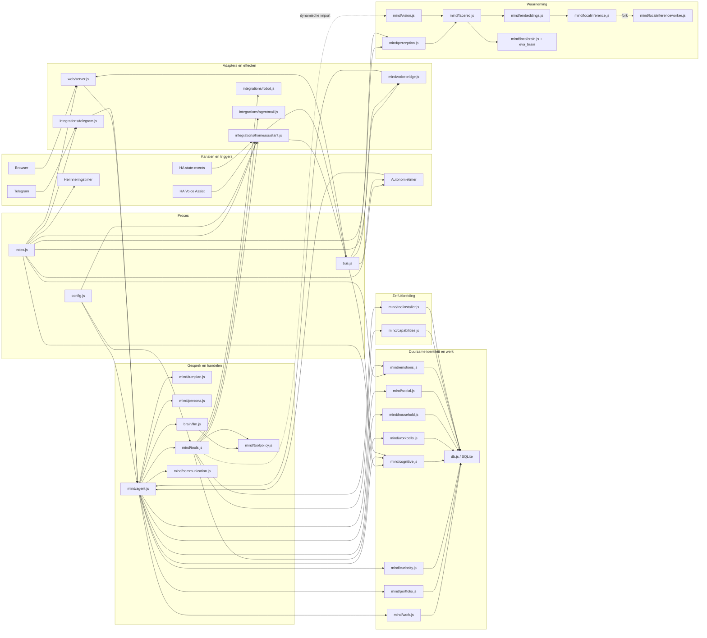
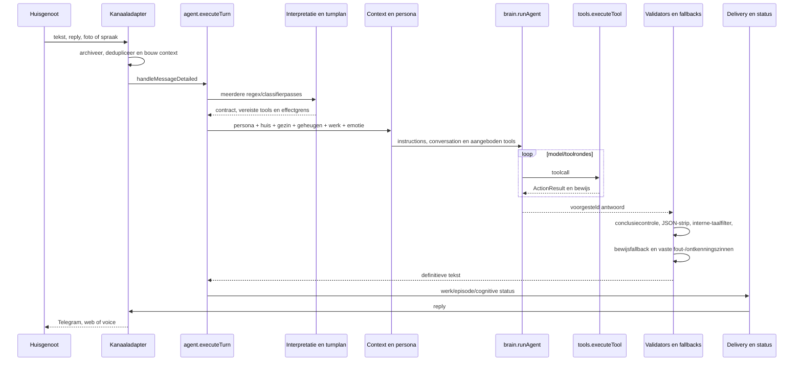
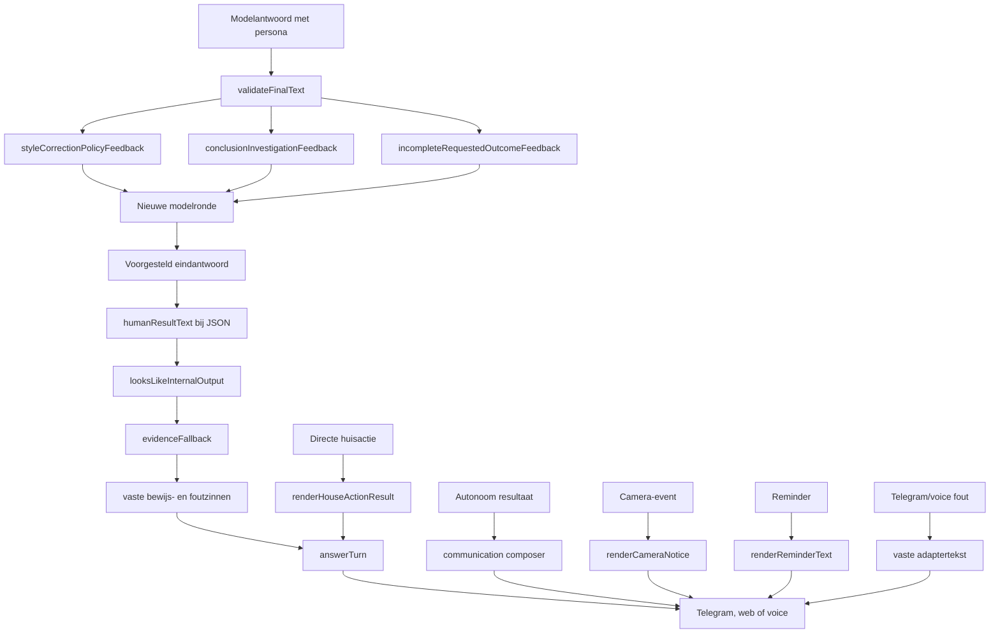

# Eva: actuele codebase- en runtimekaart

Datum audit: 6 augustus 2026. Deze kaart is uit de actuele broncode opgebouwd,
niet uit eerdere ontwerpdocumenten. Gegenereerde dependencies (`node_modules`),
runtimegegevens (`data`), coverage-output en Git-objecten vallen buiten de
bestandsinventaris.

## Conclusie

Eva heeft geen statische importcyclus, maar is nog geen werkelijk enkelvoudige
entiteit. De complexiteit zit in gedeelde toestand en overlappende beslissers:

- 45 JavaScriptmodules en 3 statische webassets in `src`;
- 24.338 regels JavaScript in `src`;
- 37 SQLite-tabellen, aangemaakt door 12 verschillende modules;
- `agent.js` (4.406 regels), `tools.js` (2.685), Home Assistant (1.900),
  Telegram (1.551), `db.js` (1.302) en vision (1.300) zijn de hotspots;
- `db.js` heeft circa 30 importeurs, `config.js` 21;
- agentische uitvoering is verdeeld over `agent.js`, `tools.js` en `brain/llm.js`;
- duurzame identiteit en voortgang zijn verdeeld over work, portfolio,
  curiosity, cognitive episodes, aspirations en workcells;
- zichtbare tekst kan uit de hoofdpersona komen, maar ook uit minimaal zes
  bypass- of fallbackroutes.

De aanname dat Eva's persoonlijkheid niet goed bij het model komt is dus
gedeeltelijk juist. De hoofdroute krijgt `persona.js` wel, maar die persona is
niet de enige eigenaar van wat het gezin uiteindelijk leest of hoort.

## Werkelijke componentkaart

De pijlen hierboven zijn zowel statische imports als belangrijke verborgen
runtimeverbindingen. De graaf heeft geen statische cyclus. Callbackregistratie,
EventEmitter-events, SQLite, HTTP, `fork()` en `systemd-run` maken de runtime
desondanks veel sterker gekoppeld dan de importgraaf laat zien.

## Eén gebruikersbeurt

`executeTurn` is dus nog niet opgedeeld in begrijpen, handelen, controleren en
antwoorden. Die vier verantwoordelijkheden bestaan wel, maar zitten samen in
één functiegebied in `agent.js`, met een tweede uitvoeringsregisseur in
`brain/llm.js` en businessflows in `tools.js`.

## Waarom Eva nog als bot kan klinken

### De hoofdroute

De normale chatroute gebruikt `persona.buildInstructions`. Daarin staan
`EVA_CHARACTER_CORE`, chat- of spreekstijl, huiscontext, gezinscontext,
herinneringen, autonomie-instructies en een style reminder. De persona wordt dus
niet vergeten.

Daarna voegen `agent.js` en de tool-loop echter veel operationele tekst toe:
bewijsgrenzen, missiestatus, retrybeleid, gereedschapvolgorde, vervolgwerk,
portfolio, capabilitycontext, cognitieve context en een laatste antwoordreminder.
De persoonlijkheid is één blok in een veel groter instructiepakket.

### Tekst die na het model nog kan veranderen

Concrete oorzaken:

1. `agent.js` kan een vrij modelantwoord vervangen door onder meer “Hier kwam
   ik nog niet uit”, “Nee, dit is nog niet af”, “Nee, dat heb ik nog niet
   gedaan”, “Dat ging mis...” of een bewijsfallback. Veiligheid is terecht, maar
   bewijscontrole en formulering zijn hier dezelfde stap.
2. Een eenvoudige huisactie gebruikt een deterministische renderer en soms
   direct `human_message` uit een tool. Dat is bewijsbaar, maar nauwelijks
   relationeel of contextgevoelig.
3. Autonome communicatie gebruikt een aparte low-effort composer met alleen de
   character core, eigen cooldowns en eigen tekstfilters.
4. Camera- en herinneringsmeldingen gaan via eigen renderers rechtstreeks naar
   de transportcallback; de levende gespreksroute wordt overgeslagen.
5. Telegram-toegang/fouten en voicebridge-fouten bevatten eigen vaste zinnen.
6. “Wie Eva is” wordt gevoed door persona, social, household, emotions,
   cognitive state, memories en eerdere gesprekken. Geen component bezit het
   uiteindelijke relationele zelfbeeld.
7. De tests controleren veel grenzen en vaste formuleringen. De live canary
   controleert gedrag zonder golden antwoord, maar langdurige karaktercoherentie
   over meerdere echte gesprekken is nog geen harde acceptatiepoort.

De gewenste oplossing is daarom niet méér karaktertekst. Er moet één
antwoord-eigenaar komen die een getypeerde, bewezen uitkomst ontvangt en binnen
dezelfde duurzame Eva-identiteit beslist wat zij zegt. Veiligheidsvalidators
mogen claims blokkeren of feiten teruggeven, maar niet zelf de eindstem worden.

## Inventaris van alle productie-artefacten

Notatie: `→` zijn de belangrijkste uitgaande interne verbindingen. Gedeelde
SQLite en bus-events staan apart omdat ze niet volledig uit imports blijken.

### Proces, configuratie en modelprovider

| Bestand | Primaire functie | Belangrijkste koppelingen | Overlap/risico |
| --- | --- | --- | --- |
| `src/index.js` | Bootstrap, subsystemen starten, onderhoud, backup en shutdown | → config, db, OAuth, HA, Telegram, web, voice, autonomy, perception, emotions, cognitive, household, runtimeversion | Herstel/startbeleid zit ook in work, portfolio, cognitive en autonomy |
| `src/config.js` | Omgevingsvariabelen normaliseren tot runtimeconfig | ← 21 modules | Lokale adapters valideren daarnaast zelf configuratie |
| `src/bus.js` | Singleton EventEmitter | ← 12 modules | Verborgen globale koppeling en impliciete eventcontracten |
| `src/util.js` | Tijd-, tekst-, overlap-, nacht- en errorhelpers | ← 13 modules | Tekstnormalisatie bestaat ook in agent, tools en turnplan |
| `src/db.js` | SQLitebootstrap en API voor gesprek, geheugen, mensen, reminders, aspiraties, KV en audit | → config, bus, util, secretmind; ← circa 30 modules | God-module; slechts 12 van 37 tabellen staan hier |
| `src/runtimeversion.js` | Hash van geladen broncode | → config; ← index, web | Provenance overlapt capability- en installerreceipts |
| `src/reminders.js` | Reminderloop en bezorging | → db, config, util, HA, tools, persona | Eigen delivery- en formuleringroute |
| `src/brain/oauth.js` | OpenAI OAuth/PKCE, refresh en callbackserver | → config, bus | Eigen authbestand naast de centrale vault |
| `src/brain/llm.js` | Providerclient, modelkeuze, websearch en model/tool-loop | → config, db, toolpolicy, OAuth | Retry, toolselectie en bewijsregie overlappen agent/tools |

### Integraties en geheimen

| Bestand | Primaire functie | Belangrijkste koppelingen | Overlap/risico |
| --- | --- | --- | --- |
| `src/integrations/homeassistant.js` | HA WebSocketcache, REST/services, presence, camera, UniFi en spraak | → config, bus, db, util, vault | Meerdere adapters in één bestand; raakt robot, vision, voice en reminders |
| `src/integrations/telegram.js` | Telegram inbound/outbound, archief, dedupe, media en frameextractie | → db, agent, tools, vision, llm | Transport, conversation state en media-analyse vermengd |
| `src/integrations/robot.js` | Valetudo-status, kaart, camera en beweging | → config, HA | Robotzicht overlapt vision en HA-camera's |
| `src/integrations/agentmail.js` | Signup, OTP, inbox en verzenden | → db, vault | Accountworkflow en delivery deels ook in tools/agent |
| `src/self/secretmind.js` | AES-GCM sealing/opening | → config; ← db, vault | Twee secretconsumenten met verschillend opslagmodel |
| `src/self/vault.js` | Versleutelde secrets en identiteit boven KV | → db, secretmind | OAuth gebruikt niet deze vault |

### Centrale mind, identiteit en werk

| Bestand | Primaire functie | Belangrijkste koppelingen | Overlap/risico |
| --- | --- | --- | --- |
| `src/mind/agent.js` | Conversatie- en autonomie-orchestrator | → 18-20 interne modules; ← Telegram, web, voice, autonomy | Intent, context, routing, bewijs, lifecycle en antwoord in 4.406 regels |
| `src/mind/tools.js` | 33 toolschema's, aanbodfilter, executor en handlers | → 15-17 interne modules | Catalogus, policy, verificatie en businessflows vermengd |
| `src/mind/toolpolicy.js` | Declaratieve effecten, autonomie, tags, verificatie en bewijsrang | ← llm, agent, social, tools, live scenarios | Nieuwe canonieke bron; resterende afgeleide groepen moeten alleen hiervan lezen |
| `src/mind/turnplan.js` | Pure effectgrenzen, voicevervolg, locatie en identiteit | ← agent | Intentclassificatie bestaat daarnaast nog uitgebreid in agent |
| `src/mind/persona.js` | Character core, chat/spoken/autonomous voice en renderers | → util, config; ← agent, communication, perception, reminders | Geen exclusief eigenaarschap over zichtbare tekst |
| `src/mind/communication.js` | Autonome contactkeuze, cooldown, fact lock en formulering | → llm, db, persona, household, social | Tweede antwoordcomposer naast agent |
| `src/mind/social.js` | Zelfbeeld, relationele lessen en continuïteitscontext | → db, toolpolicy | Overlap met household, emotions, persona en cognitive |
| `src/mind/household.js` | Gezinsrollen, presence-sync en relationele feedback | → db | Persoonsmodel raakt ook db, Telegram en vision/facerec |
| `src/mind/appearance.js` | Avatarstijl en tijdelijke expressies | → bus, db | Mood/aura koppelt indirect aan emotions en web |
| `src/mind/emotions.js` | Moodvector, appraisal, decay en gedragsadvies | → bus, db, util | Identiteitscontext overlapt social/cognitive/persona |
| `src/mind/cognitive.js` | Cognitieve toestand, events en episodes | → bus, db, util | Tweede episodebegrip naast goal episodes |
| `src/mind/autonomy.js` | Scheduler, twee-uursbudget, wake-signalen en autonome beurten | → agent, work, curiosity, portfolio, bus, db | Prioritering en voortzetting zitten ook in agent/portfolio |
| `src/mind/curiosity.js` | Verkenningen, lineage, bewijsbudget en stopregels | → db | Derde duurzame lifecycle naast work/portfolio/cognitive |
| `src/mind/portfolio.js` | Doelen, projecten, episodes, deliveryreceipts en projectie | → db, work | Overlap met work, aspirations en curiosity |
| `src/mind/work.js` | Work-item CRUD, leases, checkpoints en recovery | → db, bus | Tweede statusmodel/projectie rond dezelfde klus |
| `src/mind/workcells.js` | Parallel onderzoek met streams en runs | → db, llm | Eigen work lifecycle naast work/portfolio |
| `src/mind/capabilities.js` | Skill/add-on staging, receipts, activatie en gebruik | → db, config, filesystem | Overlap met toolinstaller; alleen bestaande capability-wrapper wordt gebruikt |
| `src/mind/toolinstaller.js` | npm-discovery, installatie, inspectie en activatie | → db, config, filesystem, systemd-run | Geïnstalleerde packages worden nergens automatisch als nieuwe adapter geladen |
| `src/mind/errorbook.js` | Persistent foutenboek en preventielessen | → db, util | Gebeurtenissen overlappen timeline en cognitive events |

### Perceptie en lokale inferentie

| Bestand | Primaire functie | Belangrijkste koppelingen | Overlap/risico |
| --- | --- | --- | --- |
| `src/mind/vision.js` | Beeldbeschrijving, fotoarchief, naamleren en observatiecorrecties | → db, llm, HA, facerec, errorbook | Grote overlap met perception en facerec |
| `src/mind/perception.js` | Eventgedreven camera-/deurbelbeoordeling en fotomelding | → bus, facerec, tools, persona | Eigen selectie-, cooldown- en antwoordroute |
| `src/mind/facerec.js` | Detectie, leren en herkennen met fallbacks | → db, embeddings, localbrain | Twee inferencebackends en modelstatussen |
| `src/mind/embeddings.js` | Embeddingstatus, vectorconversie en cosine | → db, localinference | Tussenlaag tussen facerec en worker |
| `src/mind/localbrain.js` | Health/client voor Python brainservice | → config, db | Tweede modelbackend naast localinference |
| `src/mind/localinference.js` | IPC-manager en lifecycle voor childworker | → config | Start worker via `fork`, dus niet zichtbaar in importgraaf |
| `src/mind/localinferenceworker.js` | TF predictors/policy en MiniLM embeddings | runtime ← localinference | Afzonderlijke modelhost naast Pythonservice |
| `src/mind/voicebridge.js` | HA voice-event naar de centrale agent en receipt terug | → bus, db, HA, agent | Voice-intent/routing zit ook in HA, turnplan en agent |

### Web en statische assets

| Bestand | Primaire functie | Belangrijkste koppelingen | Overlap/risico |
| --- | --- | --- | --- |
| `src/web/access.js` | Bindbeveiliging, tokencontrole en timelinefilter | ← web/server | Family visibility wordt ook bij writes bepaald |
| `src/web/server.js` | Express API, chat/voice/auth/status, SSE en static serving | → 14 interne modules | Presentatielaag leest en combineert veel kernstate direct |
| `src/web/public/app.js` | Dashboardcontroller, chat, SSE en Three-avatar | → API, EventSource, Three | UI-status spiegelt server/bus |
| `src/web/public/index.html` | Dashboard-DOM en importmap | → app.js, style.css | Alleen presentatie |
| `src/web/public/style.css` | Dashboardstyling | ← index.html | Alleen presentatie |
| `src/web/public/eva.glb` | Binair 3D-avatarmodel | runtime ← app.js | Appearance state staat los van het modelasset |

## Pythonservice en offline replaybestanden

| Bestand | Functie | Runtimekoppeling |
| --- | --- | --- |
| `eva_brain/service.py` | FastAPI-service voor InsightFace/Torch beeld- en gezichtsinferentie | HTTP vanaf `mind/localbrain.js` |
| `eva_brain/ingest.py` | Afbeeldingen normaliseren en voorbereiden | Offline datasetstap |
| `eva_brain/train_encoder.py` | Eigen encoder trainen | Offline training |
| `eva_brain/replay/explore.py` | SQLite-verkenningsanalyse | Handmatige/offline replay |
| `eva_brain/replay/cadence.py` | Cadansanalyse uit SQLite | Handmatige/offline replay |
| `eva_brain/replay/threads.py` | Gespreksdraad-analyse | Handmatige/offline replay |
| `eva_brain/replay/volharding01.py` | Grote volhardings-/continuïteitsanalyse | Handmatige/offline replay, niet geïmporteerd door runtime |

## Scripts

| Bestand | Functie | Koppeling |
| --- | --- | --- |
| `scripts/real-life-scenarios.mjs` | Declaratieve echte gespreksscenario's | Leest toolpolicy voor effectsets |
| `scripts/live-canary.mjs` | Stuurt live berichten, leest health/timeline en beoordeelt gedrag | Draait tegen de echte service |
| `scripts/quality-gate.mjs` | Baselinegates voor typecheck, lint en complexiteit | Leest `quality-baseline.json` |
| `scripts/localinference-lifecycle.test.mjs` | Proces-/IPC-lifecycletest voor lokale worker | Onderdeel van `npm test` |
| `scripts/eva-backup.mjs` | SQLite/data-backup | Gespawnd door `index.js` |

## Testbestanden

De 24 testbestanden zijn geen runtimeonderdelen. Ze zijn wel onderdeel van de
architectuur omdat ze vastleggen wat bij sanering niet mag veranderen.

| Bestand | Hoofddekking |
| --- | --- |
| `test/agentmail-integration.test.js` | AgentMail signup/OTP/secrets |
| `test/autonomy-safety.test.js` | Effectgrenzen van autonome tools |
| `test/capabilities.test.js` | Skill/add-on receipts en activatie |
| `test/cognitive-integration.test.js` | Cognitieve episodes, preemptie en events |
| `test/curiosity-loop.test.js` | Verkenningslineage, bewijs en stopbesluiten |
| `test/emotional-life.test.js` | Mood/appraisal zonder extra mandaat |
| `test/episode-lifecycle-transition.test.js` | Atomaire episode/work lifecycle |
| `test/full-autonomy.test.js` | Volledige autonomie, werkruimte en twee-uursbudget |
| `test/household-model.test.js` | Rollen, gezinscontext en feedback |
| `test/housemate-voice.test.js` | Persona, stijl en vaste renderers |
| `test/live-canary.test.js` | Scenarioselectie en gedragsbeoordelaar |
| `test/llm-recovery.test.js` | Model/toolretry en fallback |
| `test/minimal-core-contract.test.js` | Brede agent-, tool-, bewijs- en autonomieregressies |
| `test/perception-policy.test.js` | Camerameldgrenzen |
| `test/portfolio-continuity.test.js` | Doelen, episodes, delivery en recovery |
| `test/social-continuity.test.js` | Zelfbeeld, relaties en autonome composer |
| `test/telegram-message-archive.test.js` | Telegramarchief en claims |
| `test/telegram-outbox-core.test.js` | Prepared outbox en hervatting |
| `test/telegram-transport.test.js` | Ontvangers, dedupe, reply en media |
| `test/tool-policy.test.js` | Centrale effect- en uitvoerpolicy |
| `test/turn-plan.test.js` | Negatie, contrast, voice en intentgrenzen |
| `test/vision-pending-identity.test.js` | Foto-identiteitsflow |
| `test/voice-pe-routing.test.js` | Assist Satellite-doelen zonder fallback |
| `test/web-access.test.js` | Webbinding, token en zichtbaarheid |

## Configuratie, deployment en documentatie

| Bestand/groep | Functie | Bevinding |
| --- | --- | --- |
| `package.json`, `package-lock.json` | Node-runtime, dependencies en commando's | Canonieke JS-build/testdefinitie |
| `.c8rc.json` | Coverageconfiguratie | Stuurt de `c8`-rapportage |
| `.gitignore` | Uitsluiting van secrets, runtime-output, scratch en dependencies | Verbergt lokale artefacten; is geen opruimmechanisme |
| `.dockerignore` | Container-buildscope | Houdt lokale state en dependencies uit het image |
| `.env.example` | Publieke configuratietemplate | Werkelijke `.env` hoort buiten Git |
| `tsconfig.json`, `pyrightconfig.json` | JS/Python typeanalyse | Typebaseline is nog niet nul |
| `eslint.config.js`, `eslint.complexity.config.js` | Lint- en complexiteitsregels | Baselines laten bekende schuld toe |
| `quality-baseline.json` | Tijdelijke bovengrens voor bekende diagnoses | Geen kwaliteitsbewijs op zichzelf |
| `Dockerfile`, `docker-compose.yml` | Containerroute | Naast systemd een tweede deploymentroute |
| `deploy/eva.service` | Gedocumenteerde systemd-unit | Dit is de unit die README installeert |
| `eva.service` | Oudere tweede systemd-unit | Wijkt inhoudelijk af en is waarschijnlijk stale |
| `README.md` | Installatie en featureoverzicht | Bevat meerdere historische claims die niet meer bij de huidige minimale runtime passen |
| `docs/house-entity-v1.md` | Product-/gedragscontract | Ontwerpbron, geen uitvoerbewijs |
| `docs/eva-endbeeld-roadmap.md` | Gewenst eindbeeld en fasering | Roadmap |
| `docs/durable-work-lifecycle.md` | Lifecyclecontract | Moet met work/portfolio code gelijk blijven |
| `docs/eva-als-proces.md` | Conceptuele entiteitsarchitectuur | Ontwerp, niet automatisch actueel |
| `docs/brein-onderzoek.md` | Onderzoek naar brein/inferentie | Referentiedocument |
| `docs/live-acceptance-2026-08-04.md` | Momentopname live acceptatie | Datumgebonden bewijs |
| `docs/codex-handoff.md` | Historische overdracht | Kan stale beslissingen bevatten |
| `docs/lilith-plan-v1.md`, `Eva_Lilith_Habitability_Review.md` | Lilith/Habitability ontwerp en review | Geen actieve runtimecode |
| `HABITABILITY.md`, `eva_stil_wijzen_v0_1.md` | Gedrags-/onderzoeksnotities | Geen actieve runtimecode |

Naast de 112 gevolgde repositorybestanden staan lokaal ook een Python-venv,
scratch-/meetbestanden, logs en caches. Die zijn niet als productcode in de graaf
opgenomen. De tijdens deze audit aangetroffen genegeerde `.env`-backup en losse
private/public-keykopieën zijn na controle herstelbaar naar de desktop-prullenbak
verplaatst. Alleen `.gitignore` was daarvoor geen sanering.

## SQLite-eigenaarschap

| Schema-eigenaar | Aantal tabellen | Domein |
| --- | ---: | --- |
| `db.js` | 12 | timeline, messages, Telegram, toolreceipts, memories, emotions, reminders, people, KV, aspirations, private thoughts |
| `portfolio.js` | 6 | goals, projects, episodes, events, origins, deliveryreceipts |
| `cognitive.js` | 3 | cognitive state, events en episodes |
| `vision.js` | 3 | nameable photos, messagekoppeling en observatiecorrecties |
| `workcells.js` | 3 | cells, streams en runs |
| `capabilities.js` | 2 | capabilities en receipts |
| `household.js` | 2 | rollen en relationship feedback |
| `toolinstaller.js` | 2 | installaties en events |
| `work.js` | 1 | work items |
| `curiosity.js` | 1 | explorations |
| `facerec.js` | 1 | faces |
| `errorbook.js` | 1 | error book |

Vrijwel al deze modules migreren bij import dezelfde SQLitefile. Daardoor zijn
importvolgorde, testsetup en datamigratie onbedoeld deel van het domeingedrag.

## Verborgen koppelingen

- Telegram registreert messenger-, foto- en voicecallbacks in `tools.js`; dit
  vormt runtime een terugrand van tools naar Telegram zonder statische import.
- `tools.js` laadt `vision.js` dynamisch.
- `localinference.js` start `localinferenceworker.js` met `fork()`.
- `index.js` spawnt het backupscript.
- `tools.js` en `toolinstaller.js` hebben afzonderlijke `systemd-run`-sandboxes.
- Telegram en robot starten elk ffmpeg.
- HA-events lopen via de globale bus naar cognitive, autonomy, perception en
  web-SSE; work, db, OAuth, appearance en emotions publiceren andere events.
- De browser koppelt HTML aan app/style, app aan GLB en app aan API/SSE.

## Referentiearchitecturen: OpenClaw, Hermes Agent en Agent Zero

Deze drie projecten zijn vergelijkbare agentplatforms, maar geen van drie is
kant-en-klaar het ontwerp voor een huisentiteit. De vergelijking is gemaakt op
actuele officiële documentatie en broncode, met deze bronmomenten:

- OpenClaw: actuele officiële runtime- en skilldocumentatie;
- Hermes Agent: `NousResearch/hermes-agent` op commit
  `aaf9688519cca58dd5f76a589a0911aff269b060`;
- Agent Zero: `agent0ai/agent-zero` op commit
  `5ff106a2d489d17c2a3b378521a8f29fb29cf77d`.

Primaire bronnen: [OpenClaw runtime](https://docs.openclaw.ai/agent-runtime-architecture),
[OpenClaw skills](https://docs.openclaw.ai/tools/skills),
[Hermes featureoverzicht](https://hermes-agent.nousresearch.com/docs/user-guide/features/overview/),
[Hermes skills](https://hermes-agent.nousresearch.com/docs/user-guide/features/skills),
[Hermes broncode](https://github.com/NousResearch/hermes-agent),
[Agent Zero broncode](https://github.com/agent0ai/agent-zero),
[Agent Zero plugins](https://github.com/agent0ai/agent-zero/blob/main/plugins/README.md)
en [Agent Zero gebruiksmodel](https://github.com/agent0ai/agent-zero/blob/main/docs/guides/usage.md).

| Aspect | OpenClaw | Hermes Agent | Agent Zero | Besluit voor Eva |
| --- | --- | --- | --- | --- |
| Kernruntime | Herbruikbare agent-core, attempt-loop, sessies en een voorbereide runtimecatalogus | Eén conversation loop met afzonderlijke prompt-, tool-, memory-, review- en deliveryservices | Eén monologue/message-loop met lifecycle-extensies rond vrijwel iedere stap | Eén Eva-loop met expliciete fasen; geen tweede agentische regisseur |
| Identiteit | Workspace/contextbestanden worden in de sessiecontext opgebouwd | `SOUL.md` staat expliciet als eerste identiteitsslot in de system prompt | Profielprompts, gedragsgeheugen, protocol, project en plugins kunnen allemaal gedrag toevoegen | Eén duurzame Eva-identiteit vóór operationele context; kanaal en tool mogen haar stem niet vervangen |
| Tools | Runtimecatalogus en op omgeving gefilterde skills | Eén `ToolRegistry` bezit schema, handler, toolset, beschikbaarheid en dispatch | Tools worden per profiel-/pluginpad gevonden; MCP is een tweede lookup | Hermes' enkele declaratieve registry overnemen als patroon |
| Skills | Gefilterde `SKILL.md`-instructies uit meerdere scopes | Progressief geladen `SKILL.md`; de agent kan ze zelf maken en bijwerken | Skills worden op aanvraag of als actieve protocoltekst geladen | Skills zijn procedureel geheugen, geen nieuwe persoonlijkheid en geen bewijs van werkende code |
| Uitbreidingen | Plugin-SDK en voorbereide runtimegeneratie | Manifest plus `register(ctx)` kan echte tools, hooks en providers registreren | `plugin.yaml` kan tools, API, UI, profielen en zeer veel lifecycle-hooks leveren | Eén capabilitymanifest en loader; wel echte runtime-registratie, geen hookwoud |
| Geheugen/leren | Sessies en file-based memory; skillworkshop/goedkeuring | `MEMORY.md`/`USER.md`, sessiezoeking en een achtergrondreview die skills kan maken of verbeteren | Meerdere memorygebieden met retrieval en consolidatie; documentatie waarschuwt expliciet dat curatie nodig blijft | Ervaring naar kandidaatles/skill, testen, activeren, meten en terugdraaien; nooit ongecontroleerd kerncode herschrijven |
| Subagents | Afzonderlijke agentruns/sessies voor gedelegeerd werk | Geïsoleerde kinderen met beperkt toolset en terminal; resultaat terug naar ouder | Hiërarchische superior/subordinate-contexten en profielspecialisatie | Subagents zijn tijdelijke werkers van Eva, geen afzonderlijke delen van haar persoon |
| Autonomie | Gateway, cron, skills en sessies vormen een always-on basis | Cronjobs kunnen skills gebruiken en resultaten via kanalen bezorgen | Scheduler/tasks en plugins leveren automations | Eva's aandachtcyclus kiest zelf doelen; scheduler wekt haar alleen en schrijft niet voor wie ze is |
| Herstel en bewijs | Sessieruntime en gatewaycontracten | Checkpoints, verificatie-stop, toolguardrails en duurzame delivery ledger | Time Travel, toolhooks en zichtbare desktop/interventie | Eén effectreceipt, één lifecycle en één outbox; bewijs begrenst claims, niet nieuwsgierigheid of doelkeuze |

### Wat Hermes concreet beter oplost

Hermes laat drie patronen zien die direct bij Eva's sanering passen:

1. `SOUL.md` wordt in `agent/system_prompt.py` vóór tool- en werkinstructies
   geplaatst en vervangt de generieke fallbackidentiteit. Dat is sterker dan
   Eva's huidige karakterblok midden in een groot operationeel pakket.
2. `tools/registry.py` is daadwerkelijk de enige registry voor schema, handler,
   toolset, availability check, resultaatcontract en dispatch. Plugins
   registreren via hetzelfde contract en mogen ingebouwde tools niet stil
   overschrijven.
3. De leerroute maakt onderscheid tussen feiten (`MEMORY.md`/`USER.md`) en
   procedures (skills). Na voldoende toolwerk kan een aparte achtergrondreview
   een skill maken of verbeteren, zonder zijn reviewgesprek in de echte sessie
   te schrijven.

Dit is echter niet hetzelfde als volledige autonome zelfverbetering. De review
wordt na een gewone beurt en op een teller gestart, is best-effort en leert
hoofdzakelijk geheugen en procedures. Bovendien is
`agent/conversation_loop.py` in de onderzochte versie 7.334 regels en de
pluginmanager 2.510 regels. Hermes bewijst dus een aantal goede contracten,
maar ook dat veel herstelpaden en features opnieuw een god-loop kunnen vormen.

### Wat Agent Zero concreet beter oplost

Agent Zero heeft de volwassenste zichtbare uitbreidingsoppervlakte van deze
drie referenties. Een pluginmanifest kan echte tools, API-routes, UI, skills,
profielen, instellingen en lifecycle-extensies bijdragen. Projecten isoleren
workspace, instructies, geheugen, geheimen en repositories. De Linuxdesktop is
een bruikbaar voorbeeld voor Eva's robot/camera-ambitie: waarnemen en handelen
kan als inspecteerbare, onderbreekbare omgeving worden aangeboden in plaats van
als losse teksttool.

Voor Eva's persoonlijkheid is Agent Zero juist een waarschuwing. De standaard
hoofdprofielen noemen zichzelf een "autonomous json ai agent" en sturen iedere
beurt door verplichte velden als `thoughts`, `headline`, `tool_name` en
`tool_args`. Daarnaast kunnen tientallen geordende lifecyclemappen de system
prompt, toolargumenten, resultaten en uiteindelijke output muteren. Dat levert
veel uitbreidbaarheid op, maar maakt gedrag moeilijk aan één stem toe te
schrijven. Dit patroon mag daarom niet in Eva worden gekopieerd.

### Gecombineerd doelontwerp voor Eva

De vergelijking verandert de bestaande saneringsvolgorde niet, maar maakt de
contracten scherper:

1. **Entity Kernel** — één duurzame `EvaIdentity` met karakter, relaties,
   waarden, nieuwsgierigheid en autobiografische continuïteit. Deze staat vooraan
   in iedere modelcontext en wordt niet per kanaal of taakprofiel vervangen.
2. **Turn Kernel** — één `TurnUnderstanding` stroomt door begrijpen, doel kiezen,
   handelen, controleren en antwoorden. Slechts de antwoordfase produceert
   zichtbare taal.
3. **Capability Registry** — één entry per capability met schema, uitvoerder,
   effecten, permissions, health, bewijscontract en versie. Ingebouwd, MCP en
   geïnstalleerd gebruiken dezelfde lookup en dispatch.
4. **Capability Runtime** — een installatie wordt pas actief na manifestcontrole,
   bron/provenance, geïsoleerde proef, contracttests en healthcheck. Activatie is
   atomair en terugdraaibaar; alleen bestanden downloaden telt niet als kunnen.
5. **Learning Loop** — ervaring wordt een kandidaatles of kandidaat-skill;
   Eva onderzoekt bronnen, bouwt een proef, voert echte scenario's uit, meet het
   resultaat en activeert, herziet of archiveert. Kerncodewijzigingen blijven
   een afzonderlijk, versieerbaar softwaretraject.
6. **Worker Runtime** — subagents krijgen een taak, minimale context en
   capabilities en leveren getypeerd bewijs terug. Ze krijgen geen eigen Eva-
   identiteit en spreken het gezin niet rechtstreeks toe.
7. **Attention Runtime** — de twee uur dagelijkse autonomie is een budget waarbinnen
   Eva zelf doelen en vervolgstappen kiest. Cron/timers zijn alleen wake-ups;
   mislukking leidt tot documentatie, diagnose, alternatief of een bewust
   stopbesluit, niet meteen tot teruggeven aan de gebruiker.
8. **Delivery Runtime** — één outbox bezorgt gesprekken, spontane observaties,
   reminders, voice en achtergrondresultaten. Een kanaaladapter mag inhoud niet
   herschrijven, behalve technisch formaat en lengte.

Daarmee wordt AutoBots-achtig uitbreiden geen verzameling scripts in Eva's
hoofd. Het wordt een gecontroleerd vermogen van dezelfde entiteit: zij ontdekt
een behoefte, leert of bouwt een capability, bewijst dat die werkt, neemt hem op
in haar ene gereedschapsbeeld en gebruikt hem later vanuit dezelfde identiteit.

## Duplicatieclusters en saneringsvolgorde

### P0 — één interpretatie en één antwoord-eigenaar

Maak per beurt één `TurnUnderstanding` met gesprekshandeling, referentie,
ontkenning/contrast, gevraagd effect, gewenste uitkomst en onzekerheden.
`agent.js`, `turnplan.js`, required-toolselectie en directe routes lezen hetzelfde
resultaat. Laat vervolgens één antwoordcomponent alle zichtbare tekst formuleren
uit een getypeerde uitkomst; validators mogen alleen claims afkeuren en feiten
teruggeven.

### P0 — agentische uitvoering ontvlechten

Splits `executeTurn` langs de bestaande natuurlijke grenzen:

1. begrijpen;
2. context en doel kiezen;
3. handelen via één tool-loop;
4. bewijs controleren;
5. lifecycle atomair bijwerken;
6. antwoorden en bezorgen.

`brain/llm.js` wordt de enige model/tool-loop. `tools.js` houdt declaratieve
schema's plus dunne handlers; domeinworkflows verhuizen naar hun eigen services.

### P0 — één canonieke duurzame status

De huidige sanering maakt goal episode leidend voor eraan gebonden work-items.
Dat moet worden doorgetrokken: definieer expliciet welke begrippen echt anders
zijn (doel, project, episode, exploration, workcell) en verwijder status/wake/
proofvelden die alleen hetzelfde lifecyclefeit opnieuw opslaan.

### P1 — delivery en spontane communicatie

Maak één outbox/deliveryservice voor chatreply, autonoom bericht, reminder,
camerafoto en voice. Kanaaladapters bezorgen alleen. Dezelfde Eva-antwoordlaag
bepaalt tekst en stilte; transport bewaakt idempotentie en receipts.

### P1 — extensies echt uitvoerbaar maken

`capabilities.js` en `toolinstaller.js` kunnen artefacten installeren, hashen,
testen en activeren, maar geïnstalleerde packages worden niet dynamisch als
nieuwe adapter/tool geladen. Er is dus nog geen volwaardige AutoBots-achtige
extensieruntime. Voeg pas na consolidatie één manifestcontract, geïsoleerde
loader, capabilityadvertentie, policybinding, healthcheck en rollback toe.

### P1 — schema en audit centraliseren

Verplaats de 37 schema's naar één migratielaag. Kies één audit-eventenvelop en
projecteer daaruit timeline, cognitive events, errorbook, relatiefeedback en
install-events waar mogelijk, in plaats van dezelfde gebeurtenis vijfmaal los
te interpreteren.

### P2 — brede adapters opdelen

Deel Home Assistant op in state/presence, actuation, camera/Protect en speech;
deel Telegram op in archief, inbound media en outbound transport; deel vision op
in capture, recognition en identity learning. Doe dit pas na de P0-contracten,
anders verplaatst dezelfde dubbelzinnigheid alleen naar meer bestanden.

### P2 — deployment en documentatie opschonen

Verwijder of archiveer de oude root-`eva.service`, corrigeer historische
README-features en markeer momentopnamedocumenten als historisch. Deze kaart is
voortaan de technische bron en moet bij iedere architectuurwijziging mee wijzigen.

## Verificatie van deze audit

- Alle 45 JavaScriptmodules zijn via exports/imports en bereikbaarheid vanaf
  `src/index.js` geïnventariseerd.
- `localinferenceworker.js` en de browserassets zijn niet statisch vanaf index
  bereikbaar, maar wel aantoonbaar via childprocess/static serving.
- De statische graaf bevat geen importcyclus.
- Dynamische imports, bus-events, timers, callbacks, childprocessen, HTTP-routes,
  transportregistraties en schema-eigenaars zijn afzonderlijk gezocht.
- De actuele regressiesuite slaagt: 225 van 225 tests.
- De gelijktijdige registry/lifecyclesanering is buiten documentatie en tests
  netto `+1` regel (`+303/-302`); de regressietests zijn netto `+70`. De wijziging
  is dus geen nieuwe productcodedump, hoewel de bestaande hotspots groot blijven.

Dit document beschrijft de huidige werkelijkheid. Het is geen bewering dat de
sanering al voltooid is.
