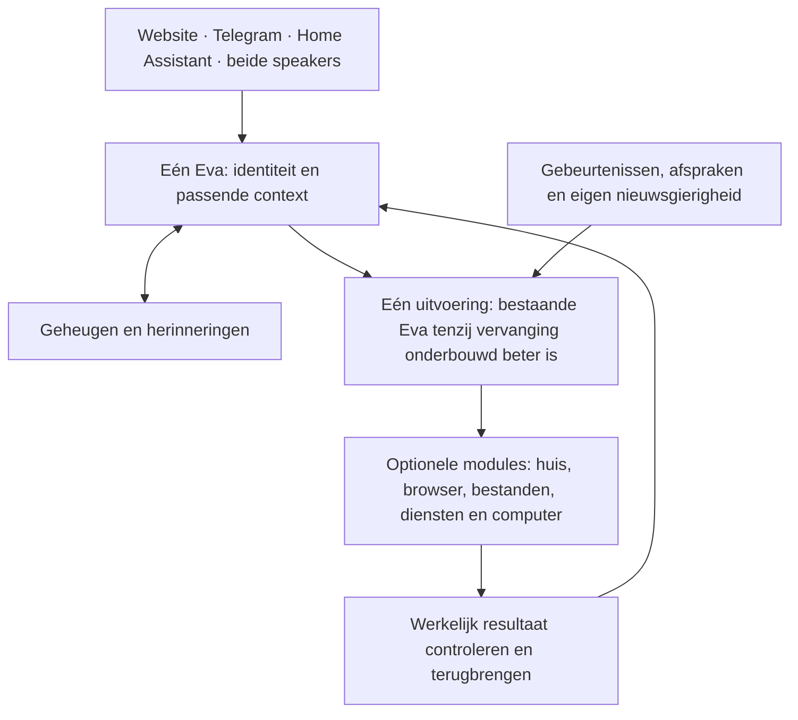

# Eva2 — het complete bouwplan

## Eigenaaropdracht 29 september 2026 — gerichte zelfverbetering, eerst bruikbare opleveringen

Neem de aanpak van AIDE en AIDE² op binnen L3: enkele codevarianten vergelijken,
vooraf vaste taken en harde grenzen, onafhankelijke afgeschermde eindbeoordeling,
en alleen aantoonbare winst integreren. Hergebruik bestaande kandidaat-, evaluatie-
en vrijgavevoorzieningen; geen algemeen optimalisatieplatform.
[Onderzoek, proefvoorwaarden en actuele uitkomst](experiments/aide-20260929/README.md)
zijn vastgelegd. Er is nog geen verbeterkandidaat of gemeten voordeel.

**Uitvoervolgorde:** eerst de eenvoudigste nog open bruikbare uitkomsten afmaken,
met bestaande code als vertrekpunt. AIDE-vervolg staat gepland en draait niet.
Bestaande afhankelijkheden en acceptaties blijven geldig. Een proefdocument of
bijgewerkt dashboard telt niet als afgeronde Eva-functie.

**Uitvoerplan · actief goal sinds 28 september 2026.** Dit gaat over Eva voor het gezin.
Er wordt geen zakelijke versie uitgewerkt. De eigenaar heeft uitvoering volgens dit
plan gestart. Het plan zelf is geen gebouwde of geïnstalleerde functie en verandert
geen eerdere acceptatie. De actuele voortgang staat op het
[bestaande werkbord](WERKBORD.md).

## Wat we gaan opleveren

**Eén herkenbare digitale huisgenoot die je kent, meedenkt, initiatief neemt en
werk afmaakt — terwijl je gewoon met haar kunt blijven praten.**

Ze is warm, soms grappig, nieuwsgierig en heeft een eigen onderbouwd oordeel. Ze
onthoudt zelf relevante dingen, verwerkt veranderingen en ontwikkelt haar gedrag.
Ze bedient het huis via algemene mogelijkheden, doet digitaal werk, leert onbekende
werkwijzen en hervat projecten. Jij hoeft geen geheugenbeheerder of programmeur
van iedere nieuwe vaardigheid te zijn.

| Jij wilt… | Dat betekent concreet |
|---|---|
| Natuurlijk contact | Snel begroeten, een vraag tussendoor beantwoorden, onderbreken en stoppen — ook tijdens onderzoek |
| Eén Eva | Dezelfde identiteit, passende context en taakstatus via website, Telegram, HA en beide Voice PEs |
| Echt geheugen | Later terugkomen op een onderwerp; correcties en tijdelijke uitzonderingen begrijpen; privé blijft privé |
| Zelfstandigheid | Opdrachten afmaken, resultaat controleren, terugmelden en meerdaags werk vervolgen |
| Aanwezigheid | Een nuttige opmerking, humor, een eigen onderzoek of huisbijdrage; ook weten wanneer stilte passend is |
| Slimme huisbediening | Alle bestaande HA-apparaten, diensten en automatiseringen gebruiken, maken en aanpassen zonder exacte namen te eisen |
| Leren en zelfverbetering | Een onbekende werkwijze leren, bij ander werk toepassen en een verbetering op werkelijk voordeel beoordelen |
| Een beheersbaar product | Modules kiezen, normaal installeren, bijwerken en herstellen met behoud van gegevens |
| Aantoonbaar beter | Dezelfde taken vergelijken met Eva1 en concurrenten; winst én verlies zichtbaar maken |

## Wat al bestaat bepaalt wat moet veranderen

**Dit plan beschrijft eindresultaten, geen lijst met 24 nieuw te bouwen functies.**
De bestaande inventarisatie laat werkende en geaccepteerde mogelijkheden zien.
Per opdracht staat nu [welk bestaand resultaat we gebruiken, wat nog ontbreekt en
welke wijziging gerechtvaardigd is](design/blueprint-2026-09-28/delivery-plan.md#existing-capabilities-and-change-decisions).
Ontbrekende gebruiksbewijzen worden geen automatische herbouwopdrachten.

Hermes was voorgesteld om eigen uitvoeringscode over te nemen. **Het voordeel van
die vervanging is niet aangetoond.** De beperkte broncontrole blijft UNKNOWN;
aanvullende proeven zijn gestopt en Hermes is niet geïnstalleerd. Eerst moet een
concreet tekort worden afgewogen tegen behouden of gericht aanpassen van Eva.
Pas bij onderbouwd voordeel volgt de noodzakelijke compatibiliteitscontrole.
Dit geldt voor iedere bouwsteen. Ook de bestaande Pydantic-uitvoering veranderen
is geen doel op zich. De volledige ambitie blijft staan.

**Hergebruiken waar het past:** Hindsight en de bestaande geheugenbronnen, LiveKit,
de algemene HA-API, browserbediening, taak-/effect-/resultaatbewijzen en bestaande
installatievoorzieningen. Eva1 blijft de praktische referentie voor huisvaardigheid,
persoonlijkheid en spontane aanwezigheid. Alle broncode behouden is geen doel;
informatie en bruikbaar gedrag behouden wel.

| Onderdeel | Dit bestaat al | Het resterende werk betreft |
|---|---|---|
| Gesprek en stem | Gesprek tijdens onderzoek, streaming, spraak en laptoponderbreking | Snelheid en gelijke werking via de echte ingangen |
| Personen en geheugen | Geaccepteerd onthouden, corrigeren, inzien en wissen; privégrenzen | Gewijzigde koppelingen en langdurige gezinscontinuïteit |
| Taken en huis | Onderzoek, taakbediening, resultaten, algemene HA-API en browser | Complete moeilijke opdrachten zonder ontwikkelaarshulp |
| Initiatief | Eva1-aanwezigheid en geïnstalleerde huishoudroute in Eva2 | Nuttige, hoorbare samenhang; camera/agenda-aansluiting vaststellen |
| Leren en projecten | Werkwijzen opslaan/hergebruiken, hervatten en een geholpen zelfverbetering | Onbekende werkwijze zelfstandig leren en meerdaags werk afronden |
| Installatie en modules | Wizard, provisioning, herstel en terugweg | Gewone volledige installatie en optionele modules zonder handwerk |
| Vergelijking | Protocol, hulpmiddelen en eerdere deelvergelijkingen | Actuele gelijke vergelijking met Eva1 en concurrenten |
| Eindoplevering | Installatie-/controlevoorzieningen en afzonderlijke acceptaties | Eén compleet geheel en zeven dagen werkelijk gezinsgebruik |

Dit vat bestaande bewijzen samen; het is geen nieuwe gebruiksproef of verklaring
dat elk groot onderdeel af is. De exacte beperkingen en bronnen staan per opdracht
in de uitvoerspecificatie. Een open oordeel of ontbrekende proef is geen bouwdefect.

## Wat technisch onderscheidend moet worden

Het onderzoeksvoorstel is **uitvoerbare ervaring**: Eva leert bij een taak welke
handelingen mogelijk zijn, welke uitkomsten ze verwacht en wanneer die kennis niet
meer geldig is. Ze kan zo een aanpak vooraf onderzoeken en bij veranderingen gericht
bijleren. De complete specificatie beschrijft de gegevens, koppelingen en proeven.

Deze techniek krijgt één begrensde vergelijking met gewone bestaande skills. Alleen
als de extra techniek aantoonbaar helpt en haar totale leerkosten verantwoord zijn,
wordt ze onderdeel van de aanbevolen samenstelling. Bij verlies valt deze oplossing
af; het vereiste technische onderscheid blijft dan open. Een dagelijkse bruikbare
Eva en een bewezen technische doorbraak zijn twee afzonderlijke opleveroordelen.

## De vaste bouwvolgorde

De acht bestaande productstappen blijven herkenbaar. Elke stap is opgesplitst in
kleinere complete opleveringen; de precieze opdrachten staan in de
[uitvoerspecificatie](design/blueprint-2026-09-28/delivery-plan.md).

| Volgorde | Wat je daarna daadwerkelijk kunt gebruiken | Wanneer het af is |
|---|---|---|
| **Vooraf · wijzigingen onderbouwen** | Bestaand werk en concrete resterende tekortkomingen per opdracht | Elke wijziging heeft bewijs en een kleinste voldoende oplossing; vervanging heeft aantoonbare meerwaarde |
| **1 · Gesprek en stem** | Praten terwijl meerdere opdrachten lopen; antwoord bij de juiste vraag | Alle vier ingangen en beide echte speakers voldoen aan de betreffende gesprek-/spraakgevallen |
| **2 · Personen en geheugen** | Een onderwerp later voortzetten en correcties terugzien | De juiste context komt bij de juiste persoon; gedeelde speakers geven geen privé-inhoud |
| **3 · Werk en huis afmaken** | Onderzoek, algemene HA-bediening, browser/bestanden en taakbediening | Het gevraagde resultaat is echt gecontroleerd, opgeslagen en teruggebracht; stoppen/overnemen werkt |
| **4 · Aanwezigheid en initiatief** | Eva merkt kansen op, doet nuttig werk en komt erop terug | Initiatief leidt tot resultaat; passende stilte en gezinswaardering zijn apart beoordeeld |
| **5 · Leren en projecten** | Nieuwe werkwijzen leren, hergebruiken en langdurig werk hervatten | Zonder ontwikkelaarshints een andere opdracht uitvoeren; één zelfverbetering aantoonbaar beoordelen |
| **6 · Installatie en modules** | Zelf modules kiezen, installeren, bijwerken en herstellen | Gewone bediening op de ondersteunde installatie; gegevens en afgeronde acties blijven behouden |
| **7 · Vergelijking** | Zien waarin Eva beter, gelijk of slechter is | Bestaande vergelijkingscriteria toegepast, ontbrekend bewijs blijft open |
| **8 · Dagelijks gebruik** | Eén complete eindversie in huis proberen | Technische eindcontrole, zeven dagen gezinsgebruik en jouw expliciete oordeel |

Een nieuwe functie telt pas als bruikbare oplevering na installatie en controle van
de echte ingang. Het oordeel van jou staat apart. Er komt geen extra punt bij de
voortgangsteller omdat er een document, reparatie of losse test is gemaakt.

## Onderzoek bepaalt de bouw; eindvergelijking toetst de uitkomst

Gebruik het bestaande Eva1-/concurrentenonderzoek vóór de betreffende bouwkeuze
om hergebruik en concrete verbetercriteria vast te leggen. Vul uitsluitend een
beslissend ontbrekend gegeven gericht aan. Herhaal geen brede vergelijking na
elke kleine oplevering; controleer dan tegen de vastgelegde eindvoorwaarden.
De geïntegreerde eindkandidaat krijgt de geplande gelijke eindvergelijking.
Aanvullend vergelijkingsonderzoek tussendoor vereist een relevante veranderde
aanname of tegenvallend resultaat. Een ontwerpkeuze is nog geen bewezen voorsprong.

Dagelijkse gebruikersfuncties blijven voorop staan. Installatie-/herstelwerk mag
ze alleen onderbreken bij een concrete noodzakelijke afhankelijkheid; de rest
blijft in stap6. B0 wordt niet opnieuw uitgevoerd. Bron, images, pakketbestanden,
configuratie en relevante kern-/werkerversies horen bij één samenhangende wijziging.
Optimaliseer aantoonbare vertraging en verbruik met behoud van antwoordkwaliteit,
geheugen en taakzelfstandigheid. Geen nieuwe kanaal-/apparaatscriptjes om een proef
te halen, geen terugkerende brede audit en geen willekeurige tijd- of poginglimiet.

## Hoe we rondjes voorkomen

- **Eén opdracht heeft één zichtbare uitkomst.** Bijvoorbeeld een tussenvraag vóór
  het onderzoeksresultaat beantwoorden, met correcte koppeling van beide antwoorden.
- **Vooraf zijn scope en afmaakpunt bekend.** Bestanden, eigenaar, gerichte controle,
  inspanningsraming en relevante afhankelijkheden worden op het bestaande bord gezet.
- **Maximaal twee uitvoerders naast de coördinator.** Geen overlappende bestanden;
  samenhang en één gebundelde review horen bij iedere complete oplevering.
- **Eerst bestaand bewijs gebruiken.** Een afgeronde acceptatie wordt alleen geraakt
  wanneer de nieuwe samenstelling dat gedrag verandert of een regressie aantoont.
- **Geen automatische nieuwbouw.** Iedere opdracht benoemt bestaand gedrag, bewijs,
  resterend tekort en de keuze: behouden, aansluiten, verbeteren of alleen beproeven.
  Vervangen vergt een concreet voordeel boven de kleinste voldoende aanpassing.
- **Geen eindeloze proefherhaling.** Een nieuwe poging vereist een gewijzigde oorzaak.
  Een mislukte onderzoekshypothese mag gewoon worden afgewezen.
- **Na een begrensd werkvenster een resultaat of concrete blokkade.** Voorlopige
  ramingen gebruiken 2–4, 4–8 of 8–16 technische werkuren; grotere opdrachten worden
  voor uitvoering verdeeld. Dit zijn geen beloofde doorlooptijden of creditprijzen.
- **Gebruikersproeven blokkeren onafhankelijk werk niet.** Hun uitslag wordt ook niet
  stilzwijgend ingevuld. Brede eindtests gebeuren op het complete geheel.

Er komt geen zelfbedacht dagmaximum voor jouw gewone gebruik. We meten wel totaal
verbruik en verwijderen onnodige modelcalls, context en herhaling. Ontwikkelcredits
en Eva-gebruik worden afzonderlijk gerapporteerd; onbekende kosten blijven onbekend.

## Wat nog niet bewezen is

Een overstap op Hermes heeft nog geen aangetoond voordeel. Compatibiliteit met de
bestaande provider-, geheugen- en taakgrenzen is evenmin volledig bewezen.
Echte Voice PE-vertraging en continu
spreken blijven hardware-/routeproeven; een laptop bewijst dat niet. De huidige
firmware blijft tijdens de basiscontrole staan. Technisch onderscheid en lagere kosten
zijn hypotheses totdat de vergelijking ze ondersteunt.

De eerste installer richt zich op de huidige Windows/WSL- en Linux-opstelling.
Andere native besturingssystemen zijn vervolgwerk. Privé blijft via Telegram; alle
algemene HA-functies blijven voor beide speakers beschikbaar. Onderzoek naar financiële
kansen begint met informatie en een proefportefeuille; echte handel hoort niet
stilzwijgend bij dit plan.

## Technische uitwerking voor de bouw

| Document | Wat erin staat |
|---|---|
| [Architectuur](design/blueprint-2026-09-28/architecture.md) | Moduleverantwoordelijkheden, gegevenscontracten, gesprek/werk tegelijk, spraak, geheugen, migratie en beheer |
| [Platformkeuze](design/blueprint-2026-09-28/platform-decision.md) | Voorwaardelijke Hermes-kandidaat, ontbrekende vervangingsonderbouwing en noodzakelijke koppelingen |
| [Leren en initiatief](design/blueprint-2026-09-28/learning-and-initiative.md) | Geheugenontwikkeling, persoonlijkheid, initiatief, reflectie, skills en begrensde technische vernieuwing |
| [Opleverstappen](design/blueprint-2026-09-28/delivery-plan.md) | Kleine opdrachten, afhankelijkheden, eindvoorwaarden, ramingen, vergelijking en aansluiting op de negen dashboardonderdelen |

**Eerstvolgende functionele uitkomst blijft C1:** warme snelle gesprekken en een
tussenvraag tijdens echt werk via Telegram en website. Bestaand bewijs van
gelijktijdig gesprek en onderzoek wordt gebruikt; alleen het resterende tekort
rechtvaardigt werk. De vaste acht productstappen blijven staan.
