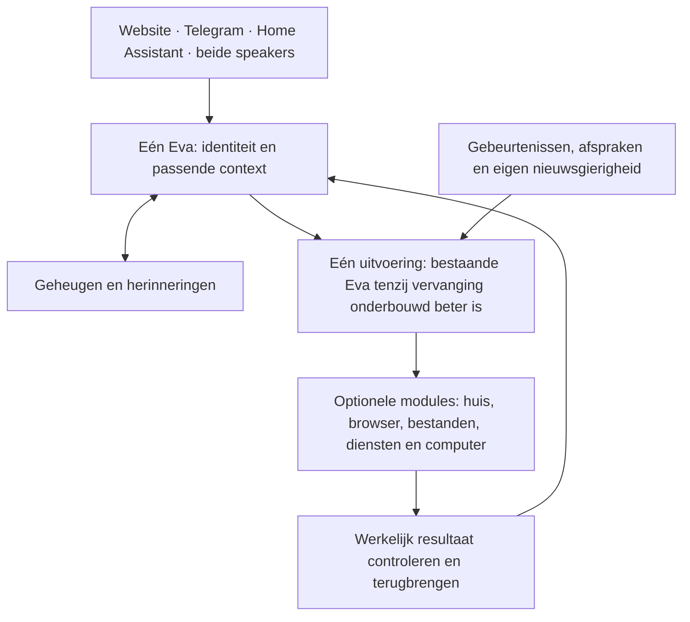

# Eva2 — het complete bouwplan

## Actueel besluitplan — 2 oktober: jij beschrijft de wens, Eva regelt de mogelijkheid

Dit is de actuele productrichting en uitvoervolgorde. De eerdere tekst onderaan
blijft volledig bewaard voor scope en eindvoorwaarden; zij verplicht niet tot
vooraf ingebouwde kanalen of de oude volgorde. Dit plan is geen runtime-oplevering.
[Technische vergelijking en basiskeuze](design/blueprint-2026-09-28/platform-decision.md)
· [Architectuur](design/blueprint-2026-09-28/architecture.md) · [Werkbord](WERKBORD.md).

**Het product:** een warme, eigenzinnige, slimme huisgenoot die jullie kent,
meedenkt, initiatief neemt en werk afmaakt. Je beschrijft in gewone taal wat je
wilt; Eva onderzoekt en regelt de benodigde mogelijkheden. Je hoeft vooraf geen
communicatieplatform of integratiecatalogus te kiezen.

| Hoofduitkomst | Wat je merkt |
|---|---|
| **Eva als persoon** | Humor, belangstelling en onderbouwd eigen oordeel; dezelfde Eva tijdens gesprek en werk, ook via een later toegevoegd kanaal. |
| **Geheugen** | Relevante ervaringen gebruiken, correcties verwerken en later verdergaan; privé blijft bij de juiste persoon. |
| **Eigen initiatief** | Vanuit jullie leven zinvol werk kiezen, uitvoeren en terugkomen met resultaat; ook weten wanneer stilte passend is. |
| **Zelfstandig werk** | Nieuwe behoeften begrijpen, geschikte oplossingen vinden of bouwen, aansluiten, gebruiken en beheren. |

Dit zijn vier productuitkomsten, geen vier nieuwe agents of te herbouwen systemen.

**Iedereen krijgt passende ondersteuning.** Eva leert geleidelijk wat jouw dochter
bij huiswerk helpt en welke informatie jij bij crypto-onderzoek nodig hebt. Ze
verbindt doelen, voorkeuren, afspraken en toegestane waarnemingen per persoon.
E-mail, post, afval en een wekker zijn voorbeelden van mogelijke bijdragen, geen
productcatalogus. Bij een afspraak betrekt zij bijvoorbeeld ook reistijd,
voorbereiding en gewoontes; ze volgt niet blind een vaste agenda-minus-reistijdregel.
Wat zij zelfstandig mag doen leert zij uit jullie expliciete afspraken; die hoeft
ze niet bij iedere gewone handeling opnieuw te vragen. Privékennis blijft gescheiden.

### Eerst huisgenoot: Eva ontwikkelt zich vanuit het dagelijks leven

Je begint met een gewone chat. De installatie biedt een paar optionele aansluitingen;
geen technische keuzelijst die je eerst volledig moet invullen. Eva leert door praten,
relevante vragen stellen, antwoorden onthouden en toegestane waarnemingen. Zij komt
later zelf terug op wat nog speelt, ook als je geen nieuwe opdracht hebt gegeven.

**Opmerken → begrijpen → een eigen bedoeling vormen → onderzoeken of vragen →
handelen of iets leren/bouwen → het effect zien → onthouden en bijsturen.**

Die samenhang wordt de hoofdoplevering. Het is geen extra agentlus: de bestaande
initiatief-, geheugen- en taakvoorzieningen moeten dit gezamenlijk uitvoeren.

| Doorlopend onderdeel van haar dag | Concreet gedrag |
|---|---|
| Mensen en omgeving leren kennen | Betekenisvolle antwoorden en voorkeuren onthouden; toegestane bronnen gericht verkennen; feiten, vermoedens en onbekenden scheiden. |
| Eigen aandacht en intenties | Bedenken waar zij kan bijdragen, een vraag bewaren, iets onderzoeken en een toezegging morgen zelf hervatten. |
| Handelen en mogelijkheden ontwikkelen | Eerst bestaande middelen gebruiken; een nieuwe vaardigheid of koppeling alleen toevoegen wanneer die een echte bijdrage mogelijk maakt. |
| Reflectie en vooruitdenken | Ervaringen en fouten verwerken, alternatieven overwegen en de volgende dag voorbereiden. Een denkbeeldige uitkomst wordt geen echte herinnering. |
| Persoonlijkheid laten doorwerken | Warmte, humor, nieuwsgierigheid en een eigen oordeel bepalen óók haar keuzes en voorstellen; niet alleen de formulering van antwoorden. |

De robotstofzuiger is een illustratie. Eva kan een toegestaan gevonden apparaat
onderzoeken, vaststellen welk model het is en of camera/geluid werkelijk toegankelijk
zijn, dat verbinden aan wat het gezin wil en met een onderbouwd idee komen. Een camera
op het apparaat bewijst geen bruikbare API. De uiteindelijke bijdrage kan communicatie,
iets anders of bewust niets zijn; we bouwen geen stofzuigerbeveiligingsfunctie vooraf.

“Slapen/dromen” krijgt technisch betekenis als selectieve verwerking van ervaringen,
het onderzoeken van mogelijkheden en voorbereiding van latere aandacht. Geen eindeloze
modelcalls om actief te lijken. Nieuwe gebeurtenissen, open bedoelingen en relevante
veranderingen zetten werk in gang; zonder aanleiding kan Eva stil zijn. Dit is gedrag
van een digitale huisgenoot, geen bewijs van bewustzijn.

**Niet alle code hoeft on the fly te worden gemaakt.** Een stabiele uitvoerbasis blijft
nodig om te kunnen praten, onthouden, onderzoeken en uitbreiden. Beproefde software
hergebruiken is vaak slimmer dan die opnieuw schrijven. Wat op behoefte moet ontstaan
is de samenstelling, het geleerde gedrag en de ontbrekende mogelijkheid. Persoonlijke
ontwikkeling hoeft geen codewijziging te zijn. Algemene onderhoudsinfrastructuur is
niet het doel van die ontwikkeling; merkbare gezinswaarde wel.

### De ervaring die de techniek moet opleveren

Bijvoorbeeld: **“Ik wil je voortaan via een andere app spreken; regel dat.”**
Eva onderzoekt de aansluiting, hergebruikt een geschikte uitbreiding of maakt
haar zelf. Zij installeert en configureert die en controleert ontvangen én
antwoorden met dezelfde identiteit en bevoegd geheugen. De oude route verdwijnt
pas wanneer je die wilt vervangen en het nieuwe contact werkt.

Dit is geen vooraf gekozen app. Hetzelfde vermogen geldt voor andere diensten,
hulpmiddelen en automatiseringen. Een eenmalige taak wordt niet automatisch een
permanente plugin. Alleen echte persoonlijke handelingen, zoals aanmelden,
een account bevestigen of hardware aansluiten, blijven zo nodig bij jou. Eva
bereidt alles voor en vraagt precies de ontbrekende handeling met een werkende
link en duidelijke stap. Zonder bruikbare toegang onderzoekt ze een alternatief;
een technisch onmogelijke of onbevestigde aansluiting heet niet geregeld.

### Wat de vergelijking verandert

| Basis | Sterk en herbruikbaar | Grens voor deze wens |
|---|---|---|
| Eva1 | Gedrag, huisaanwezigheid, programmeren en vaardigheid maken/beproeven/gebruiken. | Lokale add-ons zijn beperkt; een pakket als actief registreren start nog geen nieuw communicatiekanaal. |
| Eva2 | Geaccepteerd geheugen, persoonsgrenzen, blijvende taken/resultaten, dynamische MCP-tools en providerplugins. | Nieuwe software installeren, werkelijk starten en als kanaal activeren is niet compleet aangesloten. |
| Hermes | Algemene uitvoering, nieuwe kanaalplugins, pluginbeheer, skills en externe geheugeninterface. | Eva's specifieke persoons-, publieks- en taakafspraken moeten op de gepinde versie nog daadwerkelijk aansluiten. |
| Agent Zero | Bestaande werkwijze én voorzieningen om plugins zelf te maken, installeren, controleren en beheren. | Als losse programmeerwerker levert hij niet automatisch zijn pluginhost aan Eva. |
| OpenClaw | Nieuwe kanaalplugins buiten meegeleverde kanalen, met installatie en runtimebeheer. | Geen aangetoond kleiner Eva-integratiegat; de bekeken plugin-API is experimenteel. |

Concurrenten zijn dus niet beperkt tot hun meegeleverde functies. Zelf uitbreiden
is bestaande techniek. Eva's beoogde voordeel zit in het begrijpen van jullie
behoefte én zelfstandig bruikbaar maken en blijven gebruiken van de oplossing.
Dat voordeel is nog niet bewezen. Exacte bronnen en beperkingen staan in de basiskeuze.

### Eén aanbevolen basis, met een beslissende controle

**Advies: behoud Eva2 als integratiebasis en maak haar bestaande huisgenootgedrag
samenhangend bruikbaar.** Eva2 heeft al geheugen, intenties, reflectie, taken en
initiatief dat dezelfde uitvoeringskern kan gebruiken. Eva1 levert de praktische
referentie voor aanwezigheid en gedrag. Het aangetoonde tekort rechtvaardigt nu
geen migratie van dit geheel voordat Eva zelf iets nuttigs kan bijdragen.

Hermes blijft de sterkste kandidaat wanneer vervanging van algemene kanaal-/plugin-
afhandeling aantoonbaar nodig is; Agent Zero levert relevante bestaande zelfbouw-
en beheerpatronen. Geen van beide levert alleen door installatie de betrokken
huisgenoot op. De eerdere voorlopige Hermes-voorkeur is na de volledige lokale
broncontrole en jouw verduidelijking niet de bouwopdracht geworden.

Voor ontbrekende uitvoering hergebruiken we een bestaande uitvoerder en de huidige
MCP/provider-/installatievoorzieningen. Voor kanalen hoort daar echte ontvangst,
antwoordbinding en activering bij. Alleen een shell aansluiten voldoet niet.
Ontstaat hier toch omvangrijke nieuwe algemene infrastructuur, vergelijk dan die
concrete ontbrekende verantwoordelijkheid met de gepinde Hermes-oplossing vóór
bouwen. Alleen een aangetoond voordeel rechtvaardigt vervanging; geen verplichte
platformproef wanneer de bestaande aansluiting voldoende is.

De eerdere DesktopCommander-keuze is daarom een mogelijke losse uitvoerder, geen
complete architectuurkeuze of eerstvolgende installatieopdracht. Er komt geen extra
planner, geheugen of pluginregister uitsluitend om een nieuwe indeling te volgen.
De basiskeuze bevat de vervangingsvoorwaarden; deze planfase verandert geen runtime.

### Minimale basis en complete uitvoerstappen

Eva heeft een eerste tekst-/beheer-ingang, modeltoegang, identiteit, geheugen,
taakuitvoering en een werkruimte nodig om uitbreidingen te realiseren. Telegram,
WhatsApp, browser, HA, camera en spraak zijn geen verplichte standaardbundel.
Reeds gevraagde mogelijkheden in Jaaps installatie blijven behouden: voor hem hoort
full-duplex spraak via speakers bij de gewenste oplevering. Andere huishoudens kunnen
die weglaten; Eva moet de gekozen mogelijkheid wel kunnen realiseren en onderhouden. Een kanaal
verzorgt transport; het krijgt geen eigen persoonlijkheid of opdrachtinterpretatie.

| Volgorde | Complete uitkomst | Bestaand werk | Eindvoorwaarde |
|---|---|---|---|
| 1 | Eva leert het gezin kennen en komt zelf met een werkelijk uitgevoerde bijdrage terug. | I1, M3; M1/M2 en taakuitvoering behouden | Eigen aandacht/bedoeling leidt via dezelfde kern tot een nuttig resultaat, ook zonder recente speakersessie; geen vooraf gecodeerd voorbeeld. Jaap beoordeelt de waarde. |
| 2 | Vanuit een ontdekte behoefte of jouw wens een ontbrekende mogelijkheid realiseren. | L3.2/L3.3, O1.2 en relevante T2/T3/I2-aansluiting | Zelf kiezen/maken, activeren, gebruiken en terugmelden; een nieuw kanaal ontvangt én antwoordt. Codex schrijft geen voorbeeldadapter om de proef te halen. |
| 3 | Uit ervaring groeien en later zelfstandig verdergaan. | I1/I2, M3, L1/L2; bestaande R1-hypothese afzonderlijk | Correcties, nieuwe omstandigheden en eigen ervaringen beïnvloeden latere keuzes; hergebruik bij een andere behoefte zonder nieuwe kernregel of ontwikkelaarshulp. |
| 4 | Gekozen mogelijkheden samen opleveren en eerlijk vergelijken. | F1, P1/P2, F2; resterend geselecteerd C/O-werk | Afgesproken vergelijking, zeven dagen gezinsgebruik en echt eindoordeel; verliezen blijven zichtbaar. |

Dit maakt geen nieuwe taak-ID's of afrondingen. De 24 opdrachten/44 kleine taken
blijven uitvoerdetails en bewijs, geen 44 vooraf te programmeren producten.
De oorspronkelijke eindcriteria blijven gelden. Een concrete noodzakelijke uitvoeringsafhankelijkheid
wordt binnen dezelfde uitkomst opgelost; I1 hoeft niet op algemene zelfprogrammering te wachten.
Bekende plugin installeren en
werkelijk ontbrekende koppeling maken worden apart beoordeeld; de agent wijzigt
haar eigen afgeschermde eindgevallen of beoordelingsregels niet.

### Welk werk geen aparte bouwopdracht meer is

- Geen kernfunctie per apparaat, app, dienst of voorbeeld; geen dubbele planner,
  geheugenopslag of pluginregistry wanneer de gekozen basis die al levert.
- T2.2, T2.4, T3.2, I1.1, I2.1 en I2.2 zijn opdrachten voor Eva. Codex verhelpt
  alleen bewezen ontbrekende algemene aansluitingen.
- De 16 afgeronde kleine taken worden niet herbouwd. Van de 28 open kaartjes gaan
  5 over spraak, 1 over optionele installatie en 8 over vergelijking/eindoplevering/
  acceptatie. Dat zijn geen 14 extra intelligentiesystemen. Stemwerk blokkeert de
  algemene uitbreidingsuitkomst niet; telefoon blijft optioneel.
- Geen verwijderronde om alleen minder code te hebben. Vervangen uitvoering verdwijnt
  zodra haar verantwoordelijkheid werkelijk is overgenomen; gegevens blijven behouden.

Er is geen verantwoord percentage overbodige code vastgesteld. De bestaande
AIDE/AIDE²- en innovatieproef blijven begrensd L3/R1-werk; geen extra optimalisatie-
platform of voorwaarde voor gewone taken. Controle, review en installatie worden
per complete uitkomst gebundeld. Onbekende ontwikkelcredits worden niet geschat.
Voorsprong wordt gemeten op resultaat, hulp, wachttijd en totaal verbruik, niet op
plugin- of testaantallen. Gebouwd, geïnstalleerd en geaccepteerd blijven gescheiden.

---

## Bewaarde eerdere uitwerking — scope en historische besluiten

De actuele beslislaag hierboven vervangt tegenstrijdige prioriteiten en verplichte
standaardkeuzes hieronder. Bestaande eindvoorwaarden blijven behouden; oude
nummering is geen verplichte productarchitectuur of bouwvolgorde.

## Eigenaarcorrectie 2 oktober — algemene zelfstandigheid vóór stemwerk

Eva moet zelf kunnen onderzoeken, programmeren, mogelijkheden toevoegen en verbeteren,
en met nuttig werk aan het gezin bijdragen. “Regel voice” en de vuilnisbakken zijn
voorbeelden van zulke opdrachten; geen losse functies die Codex vooraf uitschrijft.
Warmte, humor, eigen oordeel en initiatief blijven onderdeel van hetzelfde product.

**Eerst L3.2/L3.3:** een gewone programmeeropdracht door Eva laten eindigen in een
werkende, gecontroleerde en toegepaste verbetering. De bestaande codevoorstellen,
procedure-uitvoering en operatorrelease hergebruiken. Eerst gericht vaststellen of
een algemene programmeerwerkruimte werkelijk aangesloten is; dynamische MCP-toegang
is nog niet vastgesteld. Alleen ontbrekende algemene overgangen aansluiten. Eva
schrijft de concrete productwijziging; Codex doet dat niet namens haar om de proef
groen te maken. Onafhankelijke beoordeling blijft buiten de optimaliserende agent.

Vervolgens algemene huis-/dienstuitvoering en nuttig initiatief (T2, I1/I2, T3),
met herkenbaar gedrag (M3). Stemwerk C3/C4 is ondersteunend en geen voorwaarde voor
zelfstandige uitvoering via Telegram. De acht productgroepen hieronder blijven
scopegroepen; hun nummers verplichten niet tot volledige spraakafronding vóór leren
of programmeren. Bestaande afgeronde taken en alle eindcriteria blijven behouden.
De actuele taakverdeling staat uitsluitend op het [werkbord](WERKBORD.md).

Zelf kansen zoeken om het gezin financieel te ondersteunen hoort bij initiatief,
breder dan cryptohandel: nuttig werk, verifieerbare resultaten en opbrengst tegenover
kosten. Bestaand mandaat blijft gelden; geen winstbelofte of automatische toestemming
voor nieuwe uitgaven of verplichtingen.

## Eigenaaropdracht 29 september 2026 — gerichte zelfverbetering, eerst bruikbare opleveringen

Neem de aanpak van AIDE en AIDE² op binnen L3: enkele codevarianten vergelijken,
vooraf vaste taken en harde grenzen, onafhankelijke afgeschermde eindbeoordeling,
en alleen aantoonbare winst integreren. Hergebruik bestaande kandidaat-, evaluatie-
en vrijgavevoorzieningen; geen algemeen optimalisatieplatform.
[Onderzoek, proefvoorwaarden en actuele uitkomst](experiments/aide-20260929/README.md)
zijn vastgelegd. Er is nog geen verbeterkandidaat of gemeten voordeel.

**Historische volgorde 29 september, vervangen door de prioriteit hierboven:**
eenvoudige bruikbare uitkomsten eerst. De oorspronkelijke AIDE-ronde is zonder
kandidaat afgesloten; een gewijzigd vervolg is geen automatische herhaling.
Bestaande afhankelijkheden en acceptaties blijven geldig. Een proefdocument of
bijgewerkt dashboard telt niet als afgeronde Eva-functie.

**Uitvoerplan · actief goal sinds 28 september 2026.** Dit gaat over Eva voor het gezin.
Er wordt geen zakelijke versie uitgewerkt. De eigenaar heeft uitvoering volgens dit
plan gestart. Het plan zelf is geen gebouwde of geïnstalleerde functie en verandert
geen eerdere acceptatie. De actuele voortgang staat op het
[bestaande werkbord](WERKBORD.md).

## Wat we gaan opleveren

**Eén herkenbare digitale huisgenoot die je kent, meedenkt, initiatief neemt en
werk afmaakt — terwijl je gewoon met haar kunt blijven praten.**

Ze is warm, soms grappig, nieuwsgierig en heeft een eigen onderbouwd oordeel. Ze
onthoudt zelf relevante dingen, verwerkt veranderingen en ontwikkelt haar gedrag.
Ze bedient het huis via algemene mogelijkheden, doet digitaal werk, leert onbekende
werkwijzen en hervat projecten. Jij hoeft geen geheugenbeheerder of programmeur
van iedere nieuwe vaardigheid te zijn.

| Jij wilt… | Dat betekent concreet |
|---|---|
| Natuurlijk contact | Snel begroeten, een vraag tussendoor beantwoorden, onderbreken en stoppen — ook tijdens onderzoek |
| Eén Eva | Dezelfde identiteit, passende context en taakstatus via website, Telegram, HA en beide Voice PEs |
| Echt geheugen | Later terugkomen op een onderwerp; correcties en tijdelijke uitzonderingen begrijpen; privé blijft privé |
| Zelfstandigheid | Opdrachten afmaken, resultaat controleren, terugmelden en meerdaags werk vervolgen |
| Aanwezigheid | Een nuttige opmerking, humor, een eigen onderzoek of huisbijdrage; ook weten wanneer stilte passend is |
| Slimme huisbediening | Alle bestaande HA-apparaten, diensten en automatiseringen gebruiken, maken en aanpassen zonder exacte namen te eisen |
| Leren en zelfverbetering | Een onbekende werkwijze leren, bij ander werk toepassen en een verbetering op werkelijk voordeel beoordelen |
| Een beheersbaar product | Modules kiezen, normaal installeren, bijwerken en herstellen met behoud van gegevens |
| Aantoonbaar beter | Dezelfde taken vergelijken met Eva1 en concurrenten; winst én verlies zichtbaar maken |

## Wat al bestaat bepaalt wat moet veranderen

**Dit plan beschrijft eindresultaten, geen lijst met 24 nieuw te bouwen functies.**
De bestaande inventarisatie laat werkende en geaccepteerde mogelijkheden zien.
Per opdracht staat nu [welk bestaand resultaat we gebruiken, wat nog ontbreekt en
welke wijziging gerechtvaardigd is](design/blueprint-2026-09-28/delivery-plan.md#existing-capabilities-and-change-decisions).
Ontbrekende gebruiksbewijzen worden geen automatische herbouwopdrachten.

Hermes was voorgesteld om eigen uitvoeringscode over te nemen. **Het voordeel van
die vervanging is niet aangetoond.** De beperkte broncontrole blijft UNKNOWN;
aanvullende proeven zijn gestopt en Hermes is niet geïnstalleerd. Eerst moet een
concreet tekort worden afgewogen tegen behouden of gericht aanpassen van Eva.
Pas bij onderbouwd voordeel volgt de noodzakelijke compatibiliteitscontrole.
Dit geldt voor iedere bouwsteen. Ook de bestaande Pydantic-uitvoering veranderen
is geen doel op zich. De volledige ambitie blijft staan.

**Hergebruiken waar het past:** Hindsight en de bestaande geheugenbronnen, LiveKit,
de algemene HA-API, browserbediening, taak-/effect-/resultaatbewijzen en bestaande
installatievoorzieningen. Eva1 blijft de praktische referentie voor huisvaardigheid,
persoonlijkheid en spontane aanwezigheid. Alle broncode behouden is geen doel;
informatie en bruikbaar gedrag behouden wel.

| Onderdeel | Dit bestaat al | Het resterende werk betreft |
|---|---|---|
| Gesprek en stem | Gesprek tijdens onderzoek, streaming, spraak en laptoponderbreking | Snelheid en gelijke werking via de echte ingangen |
| Personen en geheugen | Geaccepteerd onthouden, corrigeren, inzien en wissen; privégrenzen | Gewijzigde koppelingen en langdurige gezinscontinuïteit |
| Taken en huis | Onderzoek, taakbediening, resultaten, algemene HA-API en browser | Complete moeilijke opdrachten zonder ontwikkelaarshulp |
| Initiatief | Eva1-aanwezigheid en geïnstalleerde huishoudroute in Eva2 | Zelfgekozen werk uitvoeren/afleveren en relevante bronnen voor algemene automatisering kiezen |
| Leren en projecten | Werkwijzen opslaan/hergebruiken, hervatten en een geholpen zelfverbetering | L1/L2 behouden; algemene programmeeruitvoering en toegepaste eigen verbetering afmaken |
| Installatie en modules | Wizard, provisioning, herstel en terugweg | Gewone volledige installatie en optionele modules zonder handwerk |
| Vergelijking | Protocol, hulpmiddelen en eerdere deelvergelijkingen | Actuele gelijke vergelijking met Eva1 en concurrenten |
| Eindoplevering | Installatie-/controlevoorzieningen en afzonderlijke acceptaties | Eén compleet geheel en zeven dagen werkelijk gezinsgebruik |

Dit vat bestaande bewijzen samen; het is geen nieuwe gebruiksproef of verklaring
dat elk groot onderdeel af is. De exacte beperkingen en bronnen staan per opdracht
in de uitvoerspecificatie. Een open oordeel of ontbrekende proef is geen bouwdefect.

## Wat technisch onderscheidend moet worden

Het onderzoeksvoorstel is **uitvoerbare ervaring**: Eva leert bij een taak welke
handelingen mogelijk zijn, welke uitkomsten ze verwacht en wanneer die kennis niet
meer geldig is. Ze kan zo een aanpak vooraf onderzoeken en bij veranderingen gericht
bijleren. De complete specificatie beschrijft de gegevens, koppelingen en proeven.

Deze techniek krijgt één begrensde vergelijking met gewone bestaande skills. Alleen
als de extra techniek aantoonbaar helpt en haar totale leerkosten verantwoord zijn,
wordt ze onderdeel van de aanbevolen samenstelling. Bij verlies valt deze oplossing
af; het vereiste technische onderscheid blijft dan open. Een dagelijkse bruikbare
Eva en een bewezen technische doorbraak zijn twee afzonderlijke opleveroordelen.

## De acht productgroepen en hun eindvoorwaarden

De acht bestaande productstappen blijven herkenbaar. Elke stap is opgesplitst in
kleinere complete opleveringen; de precieze opdrachten staan in de
[uitvoerspecificatie](design/blueprint-2026-09-28/delivery-plan.md).

| Productgroep | Wat je daarna daadwerkelijk kunt gebruiken | Wanneer het af is |
|---|---|---|
| **Vooraf · wijzigingen onderbouwen** | Bestaand werk en concrete resterende tekortkomingen per opdracht | Elke wijziging heeft bewijs en een kleinste voldoende oplossing; vervanging heeft aantoonbare meerwaarde |
| **1 · Gesprek en stem** | Praten terwijl meerdere opdrachten lopen; antwoord bij de juiste vraag | Telegram en beide speakers voldoen aan de betreffende gevallen; bestaande web-/paneelroute blijft optioneel |
| **2 · Personen en geheugen** | Een onderwerp later voortzetten en correcties terugzien | De juiste context komt bij de juiste persoon; gedeelde speakers geven geen privé-inhoud |
| **3 · Werk en huis afmaken** | Onderzoek, algemene HA-bediening, browser/bestanden en taakbediening | Het gevraagde resultaat is echt gecontroleerd, opgeslagen en teruggebracht; stoppen/overnemen werkt |
| **4 · Aanwezigheid en initiatief** | Eva merkt kansen op, doet nuttig werk en komt erop terug | Initiatief leidt tot resultaat; passende stilte en gezinswaardering zijn apart beoordeeld |
| **5 · Leren en projecten** | Nieuwe werkwijzen leren, hergebruiken en langdurig werk hervatten | Zonder ontwikkelaarshints een andere opdracht uitvoeren; één zelfverbetering aantoonbaar beoordelen |
| **6 · Installatie en modules** | Zelf modules kiezen, installeren, bijwerken en herstellen | Gewone bediening op de ondersteunde installatie; gegevens en afgeronde acties blijven behouden |
| **7 · Vergelijking** | Zien waarin Eva beter, gelijk of slechter is | Bestaande vergelijkingscriteria toegepast, ontbrekend bewijs blijft open |
| **8 · Dagelijks gebruik** | Eén complete eindversie in huis proberen | Technische eindcontrole, zeven dagen gezinsgebruik en jouw expliciete oordeel |

Een nieuwe functie telt pas als bruikbare oplevering na installatie en controle van
de echte ingang. Het oordeel van jou staat apart. Er komt geen extra punt bij de
voortgangsteller omdat er een document, reparatie of losse test is gemaakt.

## Onderzoek bepaalt de bouw; eindvergelijking toetst de uitkomst

Gebruik het bestaande Eva1-/concurrentenonderzoek vóór de betreffende bouwkeuze
om hergebruik en concrete verbetercriteria vast te leggen. Vul uitsluitend een
beslissend ontbrekend gegeven gericht aan. Herhaal geen brede vergelijking na
elke kleine oplevering; controleer dan tegen de vastgelegde eindvoorwaarden.
De geïntegreerde eindkandidaat krijgt de geplande gelijke eindvergelijking.
Aanvullend vergelijkingsonderzoek tussendoor vereist een relevante veranderde
aanname of tegenvallend resultaat. Een ontwerpkeuze is nog geen bewezen voorsprong.

Dagelijkse gebruikersfuncties blijven voorop staan. Installatie-/herstelwerk mag
ze alleen onderbreken bij een concrete noodzakelijke afhankelijkheid; de rest
blijft in stap6. B0 wordt niet opnieuw uitgevoerd. Bron, images, pakketbestanden,
configuratie en relevante kern-/werkerversies horen bij één samenhangende wijziging.
Optimaliseer aantoonbare vertraging en verbruik met behoud van antwoordkwaliteit,
geheugen en taakzelfstandigheid. Geen nieuwe kanaal-/apparaatscriptjes om een proef
te halen, geen terugkerende brede audit en geen willekeurige tijd- of poginglimiet.

## Hoe we rondjes voorkomen

- **Eén opdracht heeft één zichtbare uitkomst.** Bijvoorbeeld een tussenvraag vóór
  het onderzoeksresultaat beantwoorden, met correcte koppeling van beide antwoorden.
- **Vooraf zijn scope en afmaakpunt bekend.** Bestanden, eigenaar, gerichte controle,
  inspanningsraming en relevante afhankelijkheden worden op het bestaande bord gezet.
- **Maximaal twee uitvoerders naast de coördinator.** Geen overlappende bestanden;
  samenhang en één gebundelde review horen bij iedere complete oplevering.
- **Eerst bestaand bewijs gebruiken.** Een afgeronde acceptatie wordt alleen geraakt
  wanneer de nieuwe samenstelling dat gedrag verandert of een regressie aantoont.
- **Geen automatische nieuwbouw.** Iedere opdracht benoemt bestaand gedrag, bewijs,
  resterend tekort en de keuze: behouden, aansluiten, verbeteren of alleen beproeven.
  Vervangen vergt een concreet voordeel boven de kleinste voldoende aanpassing.
- **Geen eindeloze proefherhaling.** Een nieuwe poging vereist een gewijzigde oorzaak.
  Een mislukte onderzoekshypothese mag gewoon worden afgewezen.
- **Na een begrensd werkvenster een resultaat of concrete blokkade.** Voorlopige
  ramingen gebruiken 2–4, 4–8 of 8–16 technische werkuren; grotere opdrachten worden
  voor uitvoering verdeeld. Dit zijn geen beloofde doorlooptijden of creditprijzen.
- **Gebruikersproeven blokkeren onafhankelijk werk niet.** Hun uitslag wordt ook niet
  stilzwijgend ingevuld. Brede eindtests gebeuren op het complete geheel.

Er komt geen zelfbedacht dagmaximum voor jouw gewone gebruik. We meten wel totaal
verbruik en verwijderen onnodige modelcalls, context en herhaling. Ontwikkelcredits
en Eva-gebruik worden afzonderlijk gerapporteerd; onbekende kosten blijven onbekend.

## Wat nog niet bewezen is

Een overstap op Hermes heeft nog geen aangetoond voordeel. Compatibiliteit met de
bestaande provider-, geheugen- en taakgrenzen is evenmin volledig bewezen.
Echte Voice PE-vertraging en continu
spreken blijven hardware-/routeproeven; een laptop bewijst dat niet. De huidige
firmware blijft tijdens de basiscontrole staan. Technisch onderscheid en lagere kosten
zijn hypotheses totdat de vergelijking ze ondersteunt.

De eerste installer richt zich op de huidige Windows/WSL- en Linux-opstelling.
Andere native besturingssystemen zijn vervolgwerk. Privé blijft via Telegram; alle
algemene HA-functies blijven voor beide speakers beschikbaar. Onderzoek naar financiële
kansen begint met informatie en een proefportefeuille; echte handel hoort niet
stilzwijgend bij dit plan.

## Technische uitwerking voor de bouw

| Document | Wat erin staat |
|---|---|
| [Architectuur](design/blueprint-2026-09-28/architecture.md) | Moduleverantwoordelijkheden, gegevenscontracten, gesprek/werk tegelijk, spraak, geheugen, migratie en beheer |
| [Platformkeuze](design/blueprint-2026-09-28/platform-decision.md) | Voorwaardelijke Hermes-kandidaat, ontbrekende vervangingsonderbouwing en noodzakelijke koppelingen |
| [Leren en initiatief](design/blueprint-2026-09-28/learning-and-initiative.md) | Geheugenontwikkeling, persoonlijkheid, initiatief, reflectie, skills en begrensde technische vernieuwing |
| [Opleverstappen](design/blueprint-2026-09-28/delivery-plan.md) | Kleine opdrachten, afhankelijkheden, eindvoorwaarden, ramingen, vergelijking en aansluiting op de negen dashboardonderdelen |

**Eerstvolgende functionele uitkomst: L3.2/L3.3**, zoals hierboven gespecificeerd.
C1.1/C1.2, L1/L2 en andere bestaande acceptaties worden niet opnieuw gebouwd.
Een opgeslagen codevoorstel of een door Codex uitgevoerde productwijziging voldoet
niet aan zelfstandige uitvoering door Eva.
