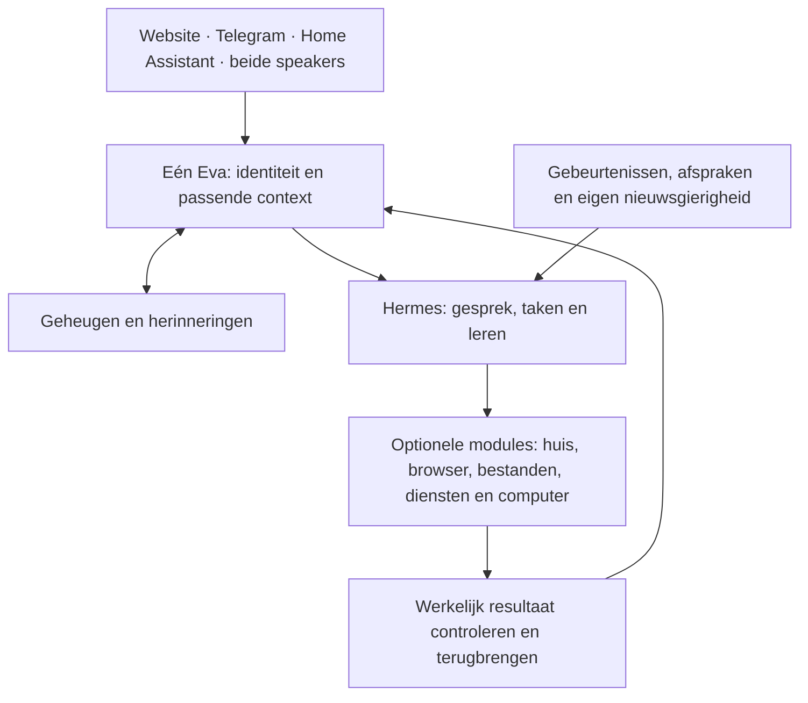

# Eva2 — het complete bouwplan

**Ontwerpvoorstel · 28 september 2026.** Dit gaat over Eva voor het gezin. Er wordt
geen zakelijke versie uitgewerkt. Dit plan is nog geen gebouwde of geïnstalleerde
Eva en verandert geen eerdere acceptatie. De actuele voortgang staat op het
[bestaande werkbord](WERKBORD.md).

## Wat we gaan opleveren

**Eén herkenbare digitale huisgenoot die je kent, meedenkt, initiatief neemt en
werk afmaakt — terwijl je gewoon met haar kunt blijven praten.**

Ze is warm, soms grappig, nieuwsgierig en heeft een eigen onderbouwd oordeel. Ze
onthoudt zelf relevante dingen, verwerkt veranderingen en ontwikkelt haar gedrag.
Ze bedient het huis via algemene mogelijkheden, doet digitaal werk, leert onbekende
werkwijzen en hervat projecten. Jij hoeft geen geheugenbeheerder of programmeur
van iedere nieuwe vaardigheid te zijn.

| Jij wilt… | Dat betekent concreet |
|---|---|
| Natuurlijk contact | Snel begroeten, een vraag tussendoor beantwoorden, onderbreken en stoppen — ook tijdens onderzoek |
| Eén Eva | Dezelfde identiteit, passende context en taakstatus via website, Telegram, HA en beide Voice PEs |
| Echt geheugen | Later terugkomen op een onderwerp; correcties en tijdelijke uitzonderingen begrijpen; privé blijft privé |
| Zelfstandigheid | Opdrachten afmaken, resultaat controleren, terugmelden en meerdaags werk vervolgen |
| Aanwezigheid | Een nuttige opmerking, humor, een eigen onderzoek of huisbijdrage; ook weten wanneer stilte passend is |
| Slimme huisbediening | Alle bestaande HA-apparaten, diensten en automatiseringen gebruiken, maken en aanpassen zonder exacte namen te eisen |
| Leren en zelfverbetering | Een onbekende werkwijze leren, bij ander werk toepassen en een verbetering op werkelijk voordeel beoordelen |
| Een beheersbaar product | Modules kiezen, normaal installeren, bijwerken en herstellen met behoud van gegevens |
| Aantoonbaar beter | Dezelfde taken vergelijken met Eva1 en concurrenten; winst én verlies zichtbaar maken |

## De technische basis die ik aanbeveel

**Hermes als algemene uitvoeringsmotor**, met een beperkte Eva-laag voor identiteit,
persoon-/publiekscontext, huisintegratie en betrouwbare resultaatterugmelding.
Hermes krijgt de algemene gespreks-/taaklus; de oude Eva-lus blijft daar niet onder
meedraaien. Dit is een onderbouwde voorkeur, nog geen bewezen prestatievoorsprong.

Voor de bouw controleren we één keer of de gekozen release de noodzakelijke
koppelingen werkelijk ondersteunt. Als daarvoor een eigen fork van de hele agentlus
nodig blijkt, is de vaste terugval de normale meerstapsuitvoering van Pydantic AI.
We beginnen dan geen nieuwe rondreis langs alle frameworks.

**Hergebruiken waar het past:** Hindsight en de bestaande geheugenbronnen, LiveKit,
de algemene HA-API, browserbediening, taak-/effect-/resultaatbewijzen en bestaande
installatievoorzieningen. Eva1 blijft de praktische referentie voor huisvaardigheid,
persoonlijkheid en spontane aanwezigheid. Alle broncode behouden is geen doel;
informatie en bruikbaar gedrag behouden wel.

## Wat technisch onderscheidend moet worden

Het onderzoeksvoorstel is **uitvoerbare ervaring**: Eva leert bij een taak welke
handelingen mogelijk zijn, welke uitkomsten ze verwacht en wanneer die kennis niet
meer geldig is. Ze kan zo een aanpak vooraf onderzoeken en bij veranderingen gericht
bijleren. De complete specificatie beschrijft de gegevens, koppelingen en proeven.

Deze techniek krijgt één begrensde vergelijking met gewone bestaande skills. Alleen
als de extra techniek aantoonbaar helpt en haar totale leerkosten verantwoord zijn,
wordt ze onderdeel van de aanbevolen samenstelling. Bij verlies valt deze oplossing
af; het vereiste technische onderscheid blijft dan open. Een dagelijkse bruikbare
Eva en een bewezen technische doorbraak zijn twee afzonderlijke opleveroordelen.

## De vaste bouwvolgorde

De acht bestaande productstappen blijven herkenbaar. Elke stap is opgesplitst in
kleinere complete opleveringen; de precieze opdrachten staan in de
[uitvoerspecificatie](design/blueprint-2026-09-28/delivery-plan.md).

| Volgorde | Wat je daarna daadwerkelijk kunt gebruiken | Wanneer het af is |
|---|---|---|
| **Vooraf · basis controleren** | Een gekozen, aansluitbare uitvoering zonder productie te vervangen | Publieke koppelingen voor gesprek, werk, geheugen, stop en resultaat passen; één eigenaar per taak |
| **1 · Gesprek en stem** | Praten terwijl meerdere opdrachten lopen; antwoord bij de juiste vraag | Alle vier ingangen en beide echte speakers voldoen aan de betreffende gesprek-/spraakgevallen |
| **2 · Personen en geheugen** | Een onderwerp later voortzetten en correcties terugzien | De juiste context komt bij de juiste persoon; gedeelde speakers geven geen privé-inhoud |
| **3 · Werk en huis afmaken** | Onderzoek, algemene HA-bediening, browser/bestanden en taakbediening | Het gevraagde resultaat is echt gecontroleerd, opgeslagen en teruggebracht; stoppen/overnemen werkt |
| **4 · Aanwezigheid en initiatief** | Eva merkt kansen op, doet nuttig werk en komt erop terug | Initiatief leidt tot resultaat; passende stilte en gezinswaardering zijn apart beoordeeld |
| **5 · Leren en projecten** | Nieuwe werkwijzen leren, hergebruiken en langdurig werk hervatten | Zonder ontwikkelaarshints een andere opdracht uitvoeren; één zelfverbetering aantoonbaar beoordelen |
| **6 · Installatie en modules** | Zelf modules kiezen, installeren, bijwerken en herstellen | Gewone bediening op de ondersteunde installatie; gegevens en afgeronde acties blijven behouden |
| **7 · Vergelijking** | Zien waarin Eva beter, gelijk of slechter is | Bestaande vergelijkingscriteria toegepast, ontbrekend bewijs blijft open |
| **8 · Dagelijks gebruik** | Eén complete eindversie in huis proberen | Technische eindcontrole, zeven dagen gezinsgebruik en jouw expliciete oordeel |

Een nieuwe functie telt pas als bruikbare oplevering na installatie en controle van
de echte ingang. Het oordeel van jou staat apart. Er komt geen extra punt bij de
voortgangsteller omdat er een document, reparatie of losse test is gemaakt.

## Hoe we rondjes voorkomen

- **Eén opdracht heeft één zichtbare uitkomst.** Bijvoorbeeld een tussenvraag vóór
  het onderzoeksresultaat beantwoorden, met correcte koppeling van beide antwoorden.
- **Vooraf zijn scope en afmaakpunt bekend.** Bestanden, eigenaar, gerichte controle,
  inspanningsraming en relevante afhankelijkheden worden op het bestaande bord gezet.
- **Maximaal twee uitvoerders naast de coördinator.** Geen overlappende bestanden;
  samenhang en één gebundelde review horen bij iedere complete oplevering.
- **Eerst bestaand bewijs gebruiken.** Een afgeronde acceptatie wordt alleen geraakt
  wanneer de nieuwe samenstelling dat gedrag verandert of een regressie aantoont.
- **Geen eindeloze proefherhaling.** Een nieuwe poging vereist een gewijzigde oorzaak.
  Een mislukte onderzoekshypothese mag gewoon worden afgewezen.
- **Na een begrensd werkvenster een resultaat of concrete blokkade.** Voorlopige
  ramingen gebruiken 2–4, 4–8 of 8–16 technische werkuren; grotere opdrachten worden
  voor uitvoering verdeeld. Dit zijn geen beloofde doorlooptijden of creditprijzen.
- **Gebruikersproeven blokkeren onafhankelijk werk niet.** Hun uitslag wordt ook niet
  stilzwijgend ingevuld. Brede eindtests gebeuren op het complete geheel.

Er komt geen zelfbedacht dagmaximum voor jouw gewone gebruik. We meten wel totaal
verbruik en verwijderen onnodige modelcalls, context en herhaling. Ontwikkelcredits
en Eva-gebruik worden afzonderlijk gerapporteerd; onbekende kosten blijven onbekend.

## Wat nog niet bewezen is

De gekozen Hermes-release moet passen bij de bestaande providerroute, afgeschermde
geheugenkoppeling en duurzame taak-/effectgrenzen. Echte Voice PE-vertraging en continu
spreken blijven hardware-/routeproeven; een laptop bewijst dat niet. De huidige
firmware blijft tijdens de basiscontrole staan. Technisch onderscheid en lagere kosten
zijn hypotheses totdat de vergelijking ze ondersteunt.

De eerste installer richt zich op de huidige Windows/WSL- en Linux-opstelling.
Andere native besturingssystemen zijn vervolgwerk. Privé blijft via Telegram; alle
algemene HA-functies blijven voor beide speakers beschikbaar. Onderzoek naar financiële
kansen begint met informatie en een proefportefeuille; echte handel hoort niet
stilzwijgend bij dit plan.

## Technische uitwerking voor de bouw

| Document | Wat erin staat |
|---|---|
| [Architectuur](design/blueprint-2026-09-28/architecture.md) | Moduleverantwoordelijkheden, gegevenscontracten, gesprek/werk tegelijk, spraak, geheugen, migratie en beheer |
| [Platformkeuze](design/blueprint-2026-09-28/platform-decision.md) | Waarom Hermes, exacte basis, terugval, hergebruik en welke oude routes verdwijnen |
| [Leren en initiatief](design/blueprint-2026-09-28/learning-and-initiative.md) | Geheugenontwikkeling, persoonlijkheid, initiatief, reflectie, skills en begrensde technische vernieuwing |
| [Opleverstappen](design/blueprint-2026-09-28/delivery-plan.md) | Kleine opdrachten, afhankelijkheden, eindvoorwaarden, ramingen, vergelijking en aansluiting op de negen dashboardonderdelen |

**Eerstvolgende bouwopdracht:** de begrensde Hermes-koppelproef. Daarna de eerste
complete gespreksoplevering: een warme snelle reactie, werkelijk aangenomen achtergrondwerk
en een passende tussenvraag vóór dat werk klaar is. Dat wordt het eerste zichtbare
resultaat van de gekozen basis; de rest van het complete plan blijft daarna vaststaan.
