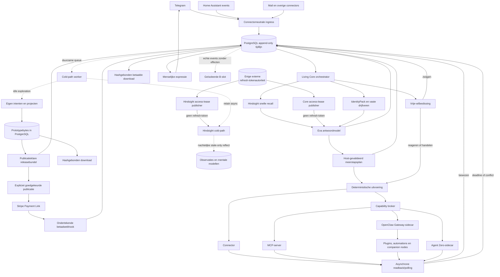

# Eva Living Core v1

Status: in uitvoering. Dit document beschrijft de actuele doelarchitectuur en
wordt bij iedere afgeronde verticale stap bijgewerkt.

## De drie geheugens

1. **Operationele waarheid — PostgreSQL**
   
   De tijdlijn is append-only: ingress, beslissingen, voorbereide calls,
   providerresultaten, readbacks, antwoorden en fouten worden nooit herschreven.
   Kleine CAS-projecties bevatten uitsluitend de actuele cursor, lease,
   `retry_count` en revision voor snelle en concurrerende rehydratie. Ze zijn
   opnieuw op te bouwen uit de tijdlijn en zijn niet de historische waarheid.

2. **Semantisch geheugen — providerpoort met Hindsight 0.9.1 als incumbent**
   
   `SemanticMemoryProviderPort` is de kleine vervangbare grens voor recall,
   retain, onderhoud en health. Binnen de huidige deployment is Hindsight de
   enige semantische projectie voor wereldfeiten, ervaringen, relaties,
   correcties, patronen en communicatievoorkeuren; Eva onderhoudt daarnaast
   geen eigen semantische fact graph. PostgreSQL blijft de operationele
   authority en een projectie moet daaruit herbouwbaar blijven. Hindsight is
   de vaste L2 voor V1. MA02-MA06 in
   `design/product/tiered-memory-and-person-model-v1.md` mogen hoogstens een
   herbouwbare Mnemosyne-L1 en een afgeleid Honcho-persoonsmodel toevoegen;
   geen van beide vervangt Hindsight. De volledige ruwe gebruiker/assistent-
   uitwisseling blijft in de PostgreSQL-gesprekstijdlijn. Hindsight krijgt als
   `direct_user` uitsluitend de letterlijke gebruikersuiting; Eva's eigen
   antwoord mag nooit dezelfde trust erven of via consolidatie een
   zelfbevestigend gebruikersfeit worden. Afzonderlijke bewezen systeemfeiten
   en onbevestigde eigen inferenties houden hun eigen `host_policy`- of
   `model_inference_unconfirmed`-provenantie. Vragen, hypothetische tests,
   citaten en assistentvoorstellen gelden niet als nieuwe gebruikersverklaring.
   Recall en observations voeden de volgende denkstap. Algemeen
   persoonsgeheugen blijft in de bestaande installatiebank; projectgeheugen
   gebruikt een afzonderlijke, deterministisch uit installatie en `project_id`
   afgeleide bank. Binnen iedere bank blijft de principal-tag verplicht. Een
   projectbeurt leest de algemene persoonsbank plus exact één projectbank; een
   beurt zonder project leest uitsluitend algemeen geheugen. PostgreSQL draagt
   dezelfde `project_id` door gesprek en retain-outbox, zodat herstart of replay
   niet stil van scope kan wisselen.
   De gespreks-hot-path gebruikt uitsluitend `recall` met budget `low` en
   maximaal 2048 contexttokens. Het bankgebonden graph-nodebudget is 40 en de
   deployment begrenst cross-encoder-reranking voor `low` op 32 kandidaten.
   De deployment gebruikt `openai-codex`-embeddings via dezelfde read-only
   roterende Hindsight-lease. De eerdere lokale `BAAI/bge-small-en-v1.5`-index
   miste Nederlandse correcties en is daarom geen toegestane productieconfiguratie
   meer. De hot-path doet de volledige-zin-recall en maximaal drie neutrale,
   parallelle ankerrecalls op de langste eigen woorden uit het bericht. De
   sterkste Hindsight-scores worden op memory-ID gefuseerd; er staan geen
   scenario-, apparaat- of antwoordregels in deze fan-out. De uiteindelijke
   modelcontext blijft gezamenlijk begrensd op circa 2048 tokens.
   De hot-path accepteert bovendien alleen resultaten waarvan Hindsights eigen
   finale rerankerscore minstens `0.05` is. Dat is geen tweede semantische
   zoekmachine: Eva gebruikt de bestaande Hindsight-ranker, maar laat het
   aantoonbare ruisstaartje niet meer haar antwoord kapen. In de live bank gaf
   “De keuken is eindelijk opgeruimd” daardoor nul herinneringen, terwijl de
   relevante Tuya→LocalTuya-vraag drie actuele ervaringen/observaties behield.
   Daarmee blijven semantische, BM25-, graph- en temporele retrieval plus de
   kwaliteitsreranker actief, maar scoort de CPU niet langer iedere beurt ruim
   honderd kandidaten. `retain` wordt na de PostgreSQL-commit als
   asynchrone Hindsight-operatie aangeboden door een eigen workerthread; de
   HTTP-chatresponse wacht daar niet op. Agentische `reflect` staat nooit in de
   chat-loop: na een idle-periode wordt alleen het stale-only mental model
   aangemaakt/gecontroleerd, waarna Hindsight het 's nachts om 03:00 UTC in
   delta-modus ververst. Een fout document krijgt maximaal drie workerpogingen
   en kan dus geen oneindige reflectie- of retainlus veroorzaken. De actuele
   eerste meertalige schaduwmeting vond de gecorrigeerde werkkamervoorkeur in
   2,2 seconden. De moeilijkere verborgen formulering vond haar via de
   parallelle ankerroute en leverde in een echte modelbeurt binnen 9,3 seconden
   correct “stil en zonder geluid”; dit blijft kandidaatbewijs totdat dezelfde
   route via een nieuwe echte Telegram-inbound is bevestigd.
   De cold-path onderhoudt daarnaast per persoon een compacte Hindsight-
   stijlspiegel van maximaal 100 woorden. De hot-path leest alleen dat reeds
   gereflecteerde resultaat naast de gewone recall; hij start nooit reflectie.
   Eva gebruikt de spiegel bindend voor toon, lengte en vorm, niet als
   antwoordscript en nooit om typefouten, boosheid of gebroken grammatica te
   imiteren. De live
   spiegel bevat nu Jaaps latere correctie: kort, direct, warm, één vloeiende
   alinea, geen standaardadvies of slotvraag en feit/onzekerheid uit elkaar.

3. **Procedureel geheugen — IdentityPack**
   
   Naam, karakter, drijfveren, grenzen en uitdrukkingsprincipes zijn
   versieerbaar en configureerbaar. De Living Core laadt bij start een volledig
   `IdentityPack/v1`, valideert `state=current` en eist dat de actieve naam bij
   het pack hoort. Stemkwaliteiten, temperament, waarden, humor, grenzen en
   initiatief gaan vervolgens als één procedurele bron naar iedere denkstap.
   Een afwijkend pack kan alleen via `EVA_IDENTITY_PACK_FILE`; losse prompttekst
   kan de packidentiteit niet stil wijzigen. Gebruikersstijl beïnvloedt toon en
   lengte, maar overschrijft Eva's identiteit niet en laat haar geen fouten of
   boosheid imiteren. De huidige B gebruikt bewust de exact verzegelde
   fixturepack; een productiepromotie vereist later een echte release-signatuur-
   en trust-rootceremonie.

## Uitvoeringsregels

- Iedere prikkel krijgt één `thread_id`, iedere duurzame overgang één
  `checkpoint_id` en iedere externe poging één stabiel `operation_id`.
- Het model mag een topologisch `ModelDecision/v1` met maximaal zes lees- en
  effectstappen voorstellen, maar verleent zichzelf daarmee geen toolrecht. De
  host bindt het voorstel aan exact `PlanModelInput/v1`, de actuele
  `PolicyPack/v1` en een onveranderlijke per-turn toolcatalogus en maakt pas dan
  het bestaande `ValidatedPlan/v1`. Een effect vereist een voorafgaande
  afhankelijke read. Schemas, resources, proof floors, budgets en de volledige
  catalogus- en validatorversie komen uitsluitend van de host. URI's, secrets
  en uitvoerbare instructies uit modelargumenten worden geweigerd. MC02a legt
  het gevalideerde plan, de stappen, de exacte ruwe modelbeslissing, de volledige
  gesaneerde catalogus, een parent/child-checkpoint per stap en precies één
  pending continuation atomair vast. Alleen het append-only admissionevent
  bevat de modelargumenten; `plans` en `plan_steps` houden de bestaande strikte
  `ValidatedPlan/v1`- en `ValidatedStep`-vorm. Herladen controleert alle hashes,
  deterministische UUID's, beginstates, scope, retentie en de volledige
  checkpointprojectie. MC02b claimt precies één due continuation met
  `FOR UPDATE SKIP LOCKED`; het token bindt attention-ID, revision, worker en
  expiry. Release gebruikt dezelfde velden als CAS, zodat een verlopen of
  vervangen worker niets meer kan wijzigen. Een lease-expiry verhoogt alleen
  het child-checkpoint; drie gelijke foutfingerprints zetten die stap op
  `needs_help` en de continuation op `waiting`. Alle attentionmutaties staan
  tevens in de append-only parenttijdlijn en worden bij herladen tegen de
  actuele projectie gecontroleerd. MC03a mag daarna uitsluitend een read-stap
  voorbereiden. De host hercontroleert het volledige plan, het leasetoken, de
  actuele catalogus en de exacte resource-, activation-, binding-, policy- en
  manifestauthority. Veranderlijke authority-rijen blijven met PostgreSQL-
  readlocks tot dezelfde commit gebonden. Die transactie maakt deterministisch
  precies één `read_intent`, zet alleen die stap op `running` en de continuation
  op `waiting` en voegt hetzelfde prepare-event aan child- en parenttijdlijn
  toe. Exacte replay is idempotent; stale of gewijzigde authority faalt. MC03a
  maakt geen poging of waarneming en roept geen provider aan. MC03b1 bindt
  daarna de provider aan canonieke registrybytes die uitsluitend via de
  geverifieerde release-provenance worden geselecteerd. De launcher is gesloten
  als direct target of Python-inlinecode direct na één `-c`; alle gepinde
  uitvoerbare bestanden worden na `O_NOFOLLOW` en bytehash als sealed memfd aan
  de latere subprocesscall doorgegeven. In dezelfde PostgreSQL-transactie
  hercontroleert de host plan, catalogus en gelockte authority en schrijft zij
  deterministisch precies één `dispatch_authorized`-attempt plus tijdlijnevent.
  Replay is bytegelijk; rollback laat niets achter. MC03b1 doet zelf nog geen
  provider-I/O. MC03b2a hercontroleert daarna opnieuw plan, volledige catalogus,
  releasebinding, veranderlijke authority en deadline. De childtijdlijn krijgt
  atomair precies één `ACTION_CHAIN_READ_PROVIDER_CALL_STARTED`; alleen de
  caller die dat event commit krijgt daarna de private initialize-/invokevorm.
  Een gelijktijdige worker of herstart stopt vóór reconstructie van callable
  bytes. MC03b2b projecteert daarna providerantwoord of exacte protocolfout in
  gesloten execution-/evidencecontracten, bewaart evidence, eventuele
  observatie, terminale attempt en tijdlijnevent in één transactie en valideert
  dit bij herstart opnieuw uit de opgeslagen manifest- en resultaatbytes. De
  runner is de enige eigenaar van de echte subprocesscall. Call-start,
  result-observation en result-storage zijn drie afzonderlijk opgeslagen
  tijden; replay geeft nooit opnieuw callable bytes uit. Deze bronroute is
  getest maar wacht nog op onafhankelijke herreview. MC03b3 zet daarna alleen
  een `observed` read atomair op `succeeded`, bindt de deterministische
  observatie als uitkomst en maakt exact de nu uitvoerbare dependencies plus
  continuation vrij. Andere terminale readstates blijven gesloten. MC03c0
  hercontroleert daarna de vrijgegeven effectlease en actuele catalogus-,
  resource-, activation-, binding-, policy- en manifestauthority en schrijft
  intent, stepprojectie, attention en parent-/childevent atomair. De payloadhash
  en stabiele idempotency key zijn aan dezelfde planstap gebonden. Deze slice
  schrijft uitdrukkelijk nog geen attempt of `TOOL_PREPARED` en roept geen
  provider aan. MC03c1a bindt daarna één attempt aan de actuele authority en
  sealed providerrelease, zonder callable bytes uit te geven. MC03c1b
  hercontroleert alles plus de deadline en commit precies één
  `ACTION_CHAIN_EFFECT_PROVIDER_CALL_STARTED`; alleen die eerste caller krijgt
  vervolgens het private proces- en RPC-materiaal. De duurzame idempotency key
  is zichtbaar als RPC-ID en connector-request-ID. MC03c2 laat vervolgens
  alleen die eerste caller de sealed providercall uitvoeren en bewaart de
  provideruitkomst atomair; een geaccepteerd receipt houdt de stap `running`.
  MC03c3a maakt daarna onder een afzonderlijke actuele
  `verification_read`-authority precies één onveranderlijke
  `effect_verify`-read-intent en een eigen herstartvalide tijdlijn. Deze slice
  roept de readprovider nog niet aan, schrijft geen `EffectReadback` en voltooit
  effect of dependency niet. Readbackdispatch, fysieke waarneming en
  effectafronding volgen apart.
- Voor een externe call wordt `TOOL_PREPARED` committed. De call draait buiten
  de SQL-transactie. Daarna wordt `TOOL_EXECUTED` of een exacte fout committed.
- Verificatie is asynchroon. Polling blokkeert de event-loop niet, heeft een
  vaste interval en harde deadline en schrijft pas bij onafhankelijke readback
  `STATE_VERIFIED`.
- Zichtbare succesclaims vereisen `STATE_VERIFIED`. Na timeout spreekt Eva over
  een onbevestigde of mislukte poging, nooit over succes.
- Herstart bepaalt de cursor uit PostgreSQL, niet uit procesgeheugen. Een
  onzekere muterende call wordt eerst gereconcileerd en nooit blind herhaald.
- Autonomie wordt aan een duurzaam, door de eigenaar in de chat gegeven mandaat
  gebonden: doel, toegelaten resources en providers, tijd/geld/privacygrenzen,
  stopvoorwaarden en eigenaar. Binnen dat mandaat mag de runner zelfstandig
  plan → act → observeer → herplan uitvoeren; buiten het mandaat stopt zij.
  Een browsercomputer is een geïsoleerde capability-provider zonder direct
  netwerk naar Eva's database of secretauthority. Live meekijken, pauze, stop
  en tijdelijke menselijke overname veranderen het mandaat niet stil en worden
  zelf gebeurtenissen in Eva's tijdlijn. De vergelijkings- en acceptatiegates
  `OB00` en `AU01-AU08` staan in `OPENBOT_VERGELIJKING.md`.
- Een begrensd duurzaam doel is een eigen operationele thread. Eva commit
  toelating en wakevoorwaarde vóór zij wacht; een afzonderlijke worker leest
  extern bewijs opnieuw zonder gesprekspolling. Een relevante wijziging kan
  het vooraf vastgelegde alternatief kiezen, maar effect en levering krijgen
  ieder hun eigen prepare/readback. Een gewone tussenvraag annuleert het doel
  niet. Alleen een expliciete annulering sluit toekomstig werk; een deadline-
  blocker, leveringsafwijzing en annulering blijven drie verschillende
  eindtoestanden. Operationele `failed`-checkpoints worden daarom altijd tegen
  de semantische eventprojectie gefilterd voordat de worker ze hervat.
- Dezelfde checkpointfout verhoogt duurzaam `retry_count`. Bij de derde
  identieke herstelfout wordt alleen die stap `needs_help`, wordt de ervaring
  aan Hindsight aangeboden en ontvangt de eigenaar een hulpbericht.
- DBOS mag planning en hervatting verzorgen, maar PostgreSQL-events, receipts en
  readbacks blijven de businessautoriteit.
- Een gesprek commit eerst `INGRESS_COMMITTED`, leest daarna recente berichten
  uit PostgreSQL en relevante herinneringen via Hindsight `recall`, laat Eva's
  eigen model antwoorden en commit dan `REPLY_COMMITTED`. Pas na het versturen
  wordt `retain(async=true)` aangeboden en `MEMORY_RETAIN_QUEUED` vastgelegd.
- De tijdelijke Telegram-B-route blijft na één expliciete `/eva2`-beurt dertig
  minuten aan dezelfde afzender en chat gebonden. Korte vervolgen zonder prefix
  gaan daardoor niet meer terug naar Eva A; de sessie wordt restartvast uit het
  lokale Telegramarchief afgeleid en andere botcommando's worden nooit gekaapt.
- Een herhaalde beurt met exact hetzelfde duurzame message-ID en dezelfde bytes
  hervat de bestaande thread. Na een al gecommit antwoord wordt de opgeslagen
  reply rechtstreeks teruggegeven zonder nieuwe modelcall; andere inhoud onder
  hetzelfde ID faalt met conflict.
- Een modelherauthenticatie schrijft nooit rechtstreeks in een levende
  authdirectory. De operator logt in binnen een nieuwe stagingdirectory;
  `model_credentials --install-owner` valideert daar eerst access- én
  accountbinding en vervangt daarna het volledige ownerbestand atomisch. De
  twee publishers verwijderen de refresh-token en publiceren afzonderlijk de
  nieuwe `EvaModelAccessLease/v1` voor de core en een minimale Codex-consumerfile
  voor Hindsight. Beide consumers zijn read-only en kunnen dus nooit roterende
  refresh-tokens tegen elkaar gebruiken. Een ontbrekende of kapotte owner
  vervangt een oude access-token onmiddellijk door een niet-secret
  `source_unavailable`-marker.
- Een eigen blijvende interesse is geen trefwoordregel of tekstbelofte. Eva's
  model kiest via de gesloten `adopt_personal_interest`-actie een titel,
  motivatie en eerste onderzoeksvraag. `PERSONAL_INTENT_ADOPTED` wordt in een
  aparte actieve intentthread committed en daarna aan de gespreksthread
  gekoppeld; pas de receipt daarvan mag in het zichtbare antwoord terechtkomen.
- De cold-path claimt een gekozen interesse met een lease, doet de modelverkenning
  buiten de SQL-transactie, commit `PERSONAL_EXPLORATION_COMPLETED` en projecteert
  daarna met een stabiel document-ID naar Hindsight. Na een crash verloopt de
  lease, stijgt `retry_count` en wordt exact dezelfde intent hervat. Een afgerond
  resultaat wordt bij een projectiecrash zonder tweede modelcall opnieuw aangeboden.
- Actieve eigen doelen en hun gecommitteerde eerste verkenning worden naast
  semantische recall rechtstreeks uit de operationele tijdlijn aan Eva gevoerd.
  Daardoor kan Hindsight-ranking haar actuele eigen keuze niet per ongeluk
  verdringen door een ouder gesprek.
- Na een geprojecteerde verkenning claimt een tweede cold-pathstap precies één
  prototype. Het model levert de volledige inhoud via een gesloten toolcontract;
  PostgreSQL commit eerst bestandsnaam, mediatype, volledige bytes, lengte en
  SHA-256. Pas daarna mag Hindsight onthouden dat Eva iets heeft gemaakt. De
  downloadroute leest uitsluitend dat gecommitteerde artifact en retourneert
  dezelfde SHA als HTTP-ETag. Een prototype is nadrukkelijk nog geen publicatie,
  verkoop of omzet.
- Een volgende lease laat Eva uitsluitend uit de gecommitteerde prototypebytes
  een eerlijke titel, omschrijving, zoektags en bescheiden testprijs maken. De
  host verpakt daarna het oorspronkelijke product, `listing.json`, leeswijzer en
  interne checksums tot een reproduceerbare ZIP. De bundlebytes worden vóór de
  Hindsight-claim gecommit en blijven `unpublished_release_candidate` totdat een
  echte verkoopconnector een externe publicatiereceipt terugleest.
- Commerciële publicatie is een afzonderlijke effectthread. Plan, bundelhash,
  prijs, provideraccount, test/live-modus en aanmaaktijd leveren samen één
  retryvaste operation-ID; een kortlevende goedkeuring bindt exact die planhash.
  De Payment Link wordt vóór providercontact gefenced, gebruikt die operation-ID
  als Stripe-idempotencykey en wordt pas bewezen na onafhankelijke account-,
  link-, metadata-, prijs- en redirectreadback. Stripe stuurt de koper na
  Checkout terug met zijn eigen `{CHECKOUT_SESSION_ID}`.
- Een betaalclaim ontstaat uitsluitend uit de ongewijzigde webhookbytes en een
  actuele Stripe-HMAC-handtekening. Alleen een complete, betaalde EUR-sessie met
  exact de geverifieerde Payment Link, planhash, releasehash, prijs en
  test/live-modus schrijft `PAYMENT_VERIFIED`. Verschillende Stripe-event-ID's
  voor dezelfde sessie schrijven geen tweede order. De sessie-ID is daarna het
  hoog-entropische bezitbewijs voor de downloadroute: Eva zoekt de oorspronkelijke
  release exact op persoon, intent en SHA-256, commit `FULFILLMENT_GRANTED` vóór
  HTTP-afgifte en levert bij een retry bytegelijk dezelfde ZIP en grant. Zij
  claimt daarmee een verleende download, niet dat het netwerk de laatste byte
  bij de koper heeft opgeslagen.
- Een Home Assistant-lichtverzoek is een modelgekozen actie, geen
  trefwoordscript. De host resolveert de letterlijke naam uitsluitend naar één
  beschikbare `light.*`-entity. Daarna commit Eva toelating en `TOOL_PREPARED`,
  voert de servicecall buiten PostgreSQL uit en leest de entity opnieuw via de
  state-API. Het gespreksmodel krijgt pas daarna de duurzame receipt en mag
  alleen bij `STATE_VERIFIED` zeggen dat de lamp werkelijk aan of uit staat.
- Home Assistant `state_changed`-events komen via een afzonderlijke websocket
  binnen en worden eerst minimaal en append-only opgeslagen. Een idle worker
  haalt daarna maximaal acht relevante Hindsight-feiten op en laat Eva in
  shadowmodus expliciet `silence` of `respond` kiezen. Deze beslissing stuurt
  nog geen bericht of huisactie; pas na aparte A/B-acceptatie mag `respond` aan
  een kanaal worden gekoppeld.
- De overgang van Eva A naar Eva2 heeft daarnaast een presence-behoudgate. De
  bestaande `FreeWillDecision`-, `ProactiveExpressionClaim`- en duurzame
  expressionledger blijven de enige orchestratiebasis; P01 breidt die route uit
  met exacte doelgroep, outputsoort, apparaatbinding, TTL, quiet hours,
  cooldown en dagbudget. Speaker en deurbel worden verwisselbare providers
  achter dezelfde prepare/delivery/readbackgrens, niet een tweede brein. De
  minimale nu ervaren huisaanwezigheid moet via P01-P05 op één bevroren image
  live slagen. Conversationele full-duplex voice is afzonderlijk V01-V07:
  voorkeur via een Telegram Mini App, lokaal via Assist/Wyoming, met dezelfde
  identiteit, conversation-id, Hindsight-, policy- en toolroute. Barge-in stopt
  TTS en de ongeleverde generatie, nooit een reeds bewezen extern effect. Ruwe
  audio is standaard vluchtig. Algemene video/media blijft buiten V1. De
  product- en bewijsmatrix
  staat in `OUDE_EVA_VS_EVA2.md`.
- Een expliciet en volledig status→actie-automatiseringsverzoek is eveneens een
  gesloten modelactie. Het model gebruikt natuurlijke namen uit het gesprek;
  de host leest daarvoor één actuele Home Assistant-statecatalogus en resolveert
  trigger, voorwaarde en acties uitsluitend binnen toegelaten domeinen. Exact
  één beste match is vereist en een gelijke of onbekende match faalt gesloten.
  Daarna commit Eva toelating en prepare, schrijft de automation via Home
  Assistant, leest de opgeslagen configuratie onafhankelijk terug en vergelijkt
  de canonieke hash. Alleen `STATE_VERIFIED` mag als “gemaakt” worden uitgedrukt.
  IDs buiten het voor Eva gereserveerde `eva2_*`-domein worden geweigerd.
- Een geavanceerde huisregel gebruikt dezelfde bewijsgrens, maar mag binnen een
  gesloten DSL precies één statusovergang, lokale kloktijd of numerieke
  sensordrempel, één optionele statusvoorwaarde en maximaal zes geordende
  aan/uit/toggle-acties met begrensde wachttijden bevatten. Velden van andere
  triggertypen moeten `null` zijn; gemengde triggers worden geweigerd. De DSL
  accepteert geen templates, willekeurige service-data, scripts, sloten of
  alarmsystemen. De volledige samengestelde configuratie wordt als één hash
  toegelaten, buiten PostgreSQL naar Home Assistant geschreven en daarna exact
  teruggelezen; rollback verwijdert alleen dezelfde hashgebonden configuratie.
- Geavanceerde opdrachten beginnen als read-only inventaris en een duurzaam
  plan. Dezelfde `operation_id` hergebruikt na retry of herstart bytegelijk
  hetzelfde plan; een nieuwe inventaristijd mag geen tweede opdracht creëren.
  Tuya→LocalTuya is apparaat-voor-apparaat: HACS-repository, pakket en
  integratiestatus worden eerst alleen gelezen. Het toevoegen van de onderhouden
  repository, pakketinstallatie en canary vereisen drie afzonderlijke
  kortlevende goedkeuringen die planhash, inventarishash en exact doel binden. Lokale
  sleutels blijven buiten events/logs, één canary blijft naast de cloudroute
  bestaan, iedere muterende stap heeft readback en rollback, en de
  cloudintegratie wordt pas na een verse afhankelijkhedencontrole uitgezet.
  De pakketpreflight bindt bovendien de actuele Home Assistant Core-versie.
  Een bekende incompatibele combinatie is een harde blokkade, ook als HACS de
  download technisch aanbiedt. De live installatie draait Home Assistant
  `2026.8.1`; HACS biedt uit de oude `rospogrigio/localtuya`-bron alleen
  `v5.2.5`, die niet veilig bruikbaar is op Home Assistant 2026.x. De
  onderhouden `xZetsubou/hass-localtuya`-fork publiceert `2026.7.0` en verklaart
  via zijn HACS-manifest Home Assistant `2025.1.0` als minimum. Compatibiliteit
  wordt daarom gebonden aan volledige repository-identiteit, packageversie,
  HACS' minimum-HA-metadata en de actuele HA-versie. Eva weigert de aanwezige
  oude pakketinstallatie. Alleen een expliciete opdracht met de volledige bron
  `xZetsubou/hass-localtuya` en release `2026.7.0` mag eerst de repositoryregistratie
  duurzaam voorbereiden. De officiële HACS-addcall volgt buiten PostgreSQL; Eva
  pollt daarna de repositorylijst en accepteert uitsluitend dezelfde bron,
  hetzelfde domein, custom-status, downloadbaarheid en numeriek dezelfde release.
  Dat installeert nog geen pakket. Bij recovery leest zij de bron eerst terug:
  een call die vóór de crash wel gelukt kan zijn wordt daardoor niet blind herhaald.
  Direct vóór een eerste pakketmutatie leest
  Eva de volledige relevante
  register- en HACS-structuur opnieuw: apparaat-, route-, blokkade- en
  repositorysets moeten gelijk zijn aan het goedgekeurde plan. Een bestaande
  LocalTuya-device of -entity blokkeert activering, omdat pakketinstallatie die
  oude configuratie anders ongemerkt zou kunnen herladen. Na een al duurzaam
  voorbereide call gebruikt recovery juist de pakketreadback en herhaalt de
  mutatie niet blind.
  Na iedere bewezen stap kan Eva dezelfde opdracht opnieuw inventariseren. Een
  inhoudelijk gewijzigde registerstaat wordt als `ADVANCED_PLAN_REFRESHED`
  achter de bestaande planidentiteit toegevoegd; een retry met ongewijzigde
  apparaten, routes, blokkades, stappen en repositoryversies retourneert
  `already_current` en schrijft geen tweede planversie. Goedkeuringen blijven
  daardoor altijd aan één concrete plan- en inventarishash gebonden zonder dat
  de voortgang na pakketinstallatie of herstart vastloopt op het eerste plan.
  In gesprek zijn de effectgrenzen bewust afzonderlijk: “zet alles over” maakt
  eerst het echte plan; een volgende expliciete toestemming voor volledige
  repositorybron én release mag alleen die bron registreren; pas een latere
  expliciete pakketinstallatieopdracht commit de pakketgoedkeuring en mag de
  downloadcall openen. Geen van beide migreert al een apparaat.
  De daaropvolgende apparaat-preflight gebruikt Home Assistants eigen
  LocalTuya-optionsflow. IP, device-id en local key bestaan alleen in het
  geheugen van die ene call en worden rechtstreeks aan Home Assistant
  aangeboden. Alleen wanneer de flow de lokale verbinding heeft gevalideerd
  en het `pick_entity_type`-stadium bereikt, breekt Eva de flow af vóór een
  apparaatwrite. PostgreSQL bewaart uitsluitend hashes van host/device-id,
  protocol, schemahash, planbinding en tijdstip. Zo kan één bewezen canary
  worden goedgekeurd terwijl Matter- en scene-review voor andere apparaten
  openblijven; zonder recente bij hetzelfde plan en apparaat horende preflight
  blijft canarygoedkeuring verboden.
  Na goedkeuring wordt de exacte geheime configuratie alleen als hash en samen
  met de volledige vóór-inventaris gecommit. Een aparte one-use providercall-
  fence staat vóór de LocalTuya-optionsflow. De adapter vult daarna exact de
  goedgekeurde device- en entityformulieren in en maakt één canary. Home
  Assistant krijgt maximaal tien seconden om de nieuwe registerstaat te
  publiceren; die polling gebeurt buiten een SQL-transactie. Bij timeout meldt
  Eva `awaiting_readback`. Na een crash of een al geopende call mag zij alleen
  opnieuw inventariseren en nooit dezelfde optionsflow blind herhalen.
- Mail is een connectorgrens en geen onderdeel van het gespreksmodel of het
  geheugen. De Living Core kent alleen connectorneutrale, begrensde
  `MailInboxPage`- en `MailMessage`-records met canonieke hashes. De huidige
  AgentMail-adapter is read-only, gebruikt de gedocumenteerde list/get-routes,
  begrenst pagina-, bericht- en responsegrootte en geeft de API-key nooit weer.
  Eva 1-accountmetadata mag als vergelijking dienen, maar Eva 1-secretbytes
  worden niet overgenomen: B blijft fail-closed totdat een nieuw uitgegeven
  Eva 2-credential als afzonderlijk read-only secretbestand is geactiveerd.
- Actuele webresearch is een expliciete action en staat niet standaard in de
  gesprekshot-path. Het model moet drie tot vijf benoemde opties afzonderlijk
  opzoeken. De host accepteert per optie uitsluitend een HTTPS-bron waarvan het
  officiële domein of de canonieke GitHub-repository exact bij die optienaam
  hoort. Het Markdown-resultaat, de geselecteerde bronnen, bytegrootte en hash
  worden daarna append-only gecommit. Een aparte downloadroute opent het
  artefact opnieuw uit PostgreSQL; providerzoeken is read-only en mag na een
  crash opnieuw, maar na een voltooide commit nooit nogmaals worden uitgevoerd.

## Bestandseigenaarschap

| Onderdeel | Primair bestand/pakket | Verantwoordelijkheid | Status |
|---|---|---|---|
| Documentatie- en componentgovernance | `DOCUMENTATIE_EN_ONDERHOUD.md`, `PROJECT_STATUS.md`, deze matrix, productontwerpen, gegenereerde repository-inventaris, `reviews/` en `evidence/` | Iedere capability en component koppelen aan doel, ownerpaden, status, exact bewijs en alleen gemeten optimalisatieclaims; gegenereerde paddekking scheiden van semantische productwaarheid | Bestaande bronnen zijn geïnventariseerd, maar DG01-DG06 zijn open: nog geen volledig machineleesbaar componentregister, repositorybrede ownerchecker of eindimagesnapshot |
| Subagentdelegatie en duurzaam werkbord | `design/product/delegation-and-workboard-v1.md`; toekomstige delegatiecontracten, PostgreSQL-projectie, workerhost en dashboard D07/D08 | Parentgestuurde korte fork/join en duurzame taken boven dezelfde plan-, attention- en eventautoriteit; minimaal context-/tool-/token-/kosten-/tijdgrant, lease/heartbeat/crash-reclaim, gevalideerde handoff en chat-/dashboardbediening zonder tweede Eva-brein of taakdatabase | `planned`: ontwikkelagents zijn geen runtimebewijs; WB01-WB07, dashboard-Kanban, workerprocessen, metingen, review en live multi-workerreceipt zijn open |
| Concurrentecosysteembrug | `design/architecture/ecosystem-bridge-v1.md`, voorgenomen capabilitybroker en geïsoleerde connectorforge | Skills, MCP, Gateway, plugins, automations en nodes als onvertrouwde capabilities hergebruiken; een ontbrekend legitiem kanaal kan via AC01-AC06 on the fly als kleine adapter worden gemaakt en dynamisch geactiveerd zonder core-rebuild; Eva behoudt identiteit, PostgreSQL, Hindsight, toestemming, idempotency, readback en expressie | MCP C01 heeft één vaste lokale read-only tool bewezen. Een ledgergebonden sidecar en AC01-AC06 zijn open; WhatsApp of een ander niet-ingebakken kanaal kan Eva nu nog niet zelfstandig toevoegen |
| Identity en gesprek | `src/eva/application/conversation.py` en `default_identity_pack.json` | Kanaalneutrale beurt, recall→denken en gevalideerde versieerbare procedurele identiteit | Werkend; actuele B laadt exact Eva IdentityPack v1 en drie uiteenlopende live modelproeven gebruikten de pack samen met Hindsight-stijl |
| Gespreksmodel | `src/eva/adapters/model/conversation.py` en `src/eva/operations/model_credentials.py` | Eva formuleert zelf uit identiteit, recente tijdlijn en recallcontext; één externe credentialautoriteit publiceert via aparte processen atomische access-only leases voor core en Hindsight; verlopen of provider-geweigerde leases maken readiness rood vóór een gesprek | Werkend; live B gebruikt een geldige roterende corelease en antwoordde weer via het echte modelpad |
| Actuele research | `src/eva/application/research.py`, `src/eva/adapters/model/conversation.py`, `src/eva/adapters/postgres/conversation_actions.py` en `src/eva/adapters/api/app.py` | Expliciete OpenAI `web_search` buiten gewone chat, per benoemde optie een project-eigen primaire bron, zichtbare bronlinks, duurzaam hashgebonden Markdown en scoped heropening | LAB-36/T04 live groen: OpenClaw, Hermes Agent en Agent Zero met drie bereikbare primaire bronnen; 6.746 bytes na harde B-herstart bytegelijk heropend en geen dubbele provideractie |
| Directe documenttaak | `src/eva/adapters/model/conversation.py` en `src/eva/adapters/postgres/conversation_actions.py` | Volledige Markdownbytes en hash per checkpoint; start, scopewissel, vervolg en afronding append-only; deiktisch vervolg bindt alleen aan de directe gesprekstaak; weigert byte-identieke schijnvoortgang en lege afgeronde secties | LAB-36/M03, R02 en X02 live groen: juiste taak vervolgd, scope veilig vervangen en een inhoudelijk artefact na harde procesvervanging vanaf checkpoint afgerond |
| Begrensde bestandsbatch | `src/eva/application/file_batches.py`, `src/eva/adapters/connectors/local_files.py`, gesprekmodel en `conversation_actions.py` | Rootgebonden UTF-8-tekst→Markdown, inputmanifest vóór effecten, atomische writes, onafhankelijke hashreadback, per-bestand gedeeltelijk succes en maximaal drie duurzame retries voor alleen tijdelijke foutklassen | LAB-36/P02 en X03 live groen: scoped partial success, transient herstel op poging twee zonder rewrites en correcte terminale blocker na poging drie |
| Gevalideerde tekstedit | `src/eva/application/validated_edits.py`, `src/eva/adapters/connectors/validated_edits.py`, gesprekmodel en `conversation_actions.py` | Eén unieke rootgebonden tekstvervanging; groen declaratief focused-testmanifest vóór de edit, atomische write/readback, test na edit en bij falen rollback van alleen de eigen wijziging plus herhaalde validatie; hashes van volledige en ongerelateerde worktree | LAB-36/X04 live groen: MODE=safe→turbo liet de echte focused test falen, Eva zette alleen die edit terug, de test werd weer groen en het ongerelateerde bestand bleef bytegelijk |
| Zelfgekozen repositoryverbetering | `src/eva/application/repository_improvements.py`, `src/eva/adapters/connectors/repository_improvements.py`, gesprekmodel en `conversation_actions.py` | Volledige begrensde fixture-snapshot, meerdere feitelijke kwaliteitskansen, modelgekozen probleem plus evidence, één atomische patch, gerichte readback en behoud van groene checks, ongerelateerde bytes en targetmodus | Native I02 live groen op v52: Eva koos zonder voorgeschreven fix zelf de uitgeschakelde transient retry, wijzigde alleen `settings.toml`, maakte de gekozen check groen en meldde de twee resterende rode checks eerlijk |
| Semantisch geheugen | `src/eva/application/memory.py`, `src/eva/adapters/projection/hindsight.py`, `design/product/tiered-memory-and-person-model-v1.md` | Kleine providerneutrale recall/retain/maintenance/health-poort; Hindsight blijft V1-L2 voor meertalige recall, provenance, project-/persoonsbinding, stijlspiegel en nachtelijk onderhoud; PostgreSQL blijft operationele authority. Mnemosyne/Honcho mogen alleen afgeleide augmentaties worden | Providerpoort getest op `79bc376`; LAB-36/M04, C03 en R03 blijven Hindsight-livebewijs. MA02-MA06 voor L1/persoonsmodel zijn open |
| Semantische cold-path | `src/eva/application/memory_background.py` en `src/eva/adapters/postgres/memory_outbox.py` | PostgreSQL-outbox vóór provider-retain, herladen na processtart, providerpoging vóór I/O vastleggen, maximaal drie pogingen, hashgebonden succes en idle-maintenance alleen na succes | Providerneutraal getest; live Hindsight-crashproef hervatte dezelfde idempotente retain en eindigde completed op poging twee. Optionele augmentaties hebben nog geen artifact of receipt |
| Hindsight-provenantiemigratie | `tools/migrate_hindsight_provenance.py` | Leest een transferarchive in memory, verwijdert assistenttekst uit `direct_user`, importeert geen oude feiten/observations en laat Hindsight alles opnieuw extraheren | 96 documenten in geïsoleerde meertalige bank opnieuw opgebouwd; nul assistentteksten als directe gebruiker |
| Gesprekstijdlijn | `src/eva/adapters/postgres/conversation_journal.py` | Ingress/reply vóór geheugenprojectie, recente context en optionele projectscope append-only vastleggen en bij replay valideren | Werkend in echte B-PostgreSQL; persoons- en projectscope na harde herstart bewezen |
| Persoonlijke intent | `src/eva/adapters/postgres/conversation_actions.py` | Modelgekozen interesse duurzaam adopteren, linken en na crash hervatten | Werkend in echte B-PostgreSQL en Telegram-beurt |
| Intentverkenning | `src/eva/application/personal_interests.py` | Lease, achtergrondmodel, resultaatcommit en Hindsight-projectie | Werkend inclusief echte hard-crash recovery |
| Persoonlijk prototype | `src/eva/application/personal_interests.py` en `src/eva/adapters/postgres/conversation_actions.py` | Volledige productbytes buiten SQL maken, daarna hashgebonden commit en projectie | Werkend in echte B-PostgreSQL |
| Productrelease | dezelfde personal-interestmodules plus `src/eva/adapters/model/conversation.py` | Eerlijke listing, reproduceerbare ZIP, prijsvoorstel en expliciete unpublished-status | Werkend in live B; exact dezelfde bestaande release is door de geïsoleerde betaalde-fulfillmentgate geleverd |
| Commerciële publicatie, betaling en fulfillment | `src/eva/application/commerce.py`, `src/eva/adapters/connectors/stripe.py`, `stripe_webhook.py`, `src/eva/adapters/postgres/commerce.py`, `src/eva/adapters/api/app.py`, `src/eva/bootstrap/runtime.py` en `deploy/living-core/commerce-stripe.compose.yml` | Exact goedgekeurde Payment Link met idempotency/readback, Checkout-gebonden redirect, HMAC-gevalideerde betaalwebhook, precies één order en herhaalbare hashgebonden ZIP-afgifte | Volledige keten groen op echte B-PostgreSQL met lokale Stripe-contractserver en herstartsimulatie; echte Stripe-testmodus en publiek endpoint wachten op afzonderlijke accountconfiguratie |
| HTTP-compositie | `src/eva/adapters/api/app.py` en `src/eva/bootstrap/runtime.py` | Health, memory, interne turn-API, artifactdownload en claim/receipt-API voor proactieve kanaalbridges | Werkend in geïsoleerde B-container |
| Tijdelijke echte Telegram-ingress | productiebrug `src/integrations/eva2canary.js`, `src/integrations/telegram.js` en `deploy/eva.service.d/20-eva2-canary.conf` in Eva A | Archiveert de echte update eerst, bindt `/eva2` en dertig minuten vervolgcontext aan B en verzendt B's antwoord via het bestaande duurzame Telegramtransport | Werkend als tijdelijke A→B-canary; dit is bewust nog niet de uiteindelijke connectorneutrale B-ingress |
| Definitieve Telegram-ingress | `src/eva/application/telegram_ingress.py`, `src/eva/adapters/connectors/telegram.py`, `src/eva/adapters/postgres/telegram_ingress.py`, `src/eva/operations/telegram_ingress.py` en `deploy/living-core/telegram-ingress.compose.yml` | Opt-in long polling met expliciete user+chat→principalbinding; authorized raw ingress vóór core-I/O, idempotente core-replay, replyprepare, deliveryclaim en providerreceipt; drie gelijke verwerkingsfouten eindigen `needs_help`, een onzeker verzendvenster wordt nooit opnieuw verstuurd | LAB-36/C02 live groen via twee onafhankelijke user+chatbindings: ieder kreeg alleen het eigen vertrouwelijke Hindsight-feit en een eigen providerreceipt; echte Telegram-provider wacht op apart Eva 2-token en eigenaar-gecontroleerde bindings |
| Cross-channel persoonscontinuïteit | definitieve Telegram-ingress, `src/eva/adapters/projection/hindsight.py`, `src/eva/application/conversation.py` en de geauthenticeerde web/core-grens | Telegram bindt afzender plus chat vóór opslag aan één principal; Hindsight bewaart bevestigde directe voorkeuren onder die persoon; een ander kanaal levert dezelfde principal en leest uitsluitend die scope | Native M01 live groen op v53: Telegramvoorkeur A werd in een nieuwe webconversatie zonder herhaling herinnerd, terwijl de tegengestelde Telegramvoorkeur van persoon B nul geselecteerde memories had |
| Persoonsmodel en groeien met gebruik | `design/product/learning-and-person-model-v1.md`; bestaande Hindsight-, correctie-, M01-connectorcontract- en I02-routes plus toekomstige persoonsprojectie, usageledger en skillquarantaine | Bronsoort, vertrouwen, audience, correctie, verval en laatste gebruik per persoonsclaim; geleerde relaties geven nooit identiteit/toegang; per-call token/latency/kostenreceipt; fysieke geheugenquota en compacte hot context; Eva maakt zo nodig zelf on the fly een procedurele kandidaat zonder store-afhankelijkheid en promoveert die alleen via provenance, baseline/held-out-eval, chatmandaat, versie en rollback | LG00 documenteert eerlijk wat bestaat en dat Hermes procedureel voorloopt. M01 gebruikte een lokale Bot API-contractprovider, niet het Telegramnetwerk. LG01-LG07 zijn open; er is nog geen complete automatische skillcreatie-, evaluatie-, promotie- en rollbackcyclus en dus geen claim dat Eva vanzelf steeds beter wordt |
| Operationele tijdlijn | `src/eva/adapters/postgres/operational_timeline.py` | Append-only events, CAS-cursor, retry en rehydratie | Werkend in echte PostgreSQL 16.13 en B-container |
| Tijdlijnschema | `migrations/versions/4e_0001_operational_timeline.py` | Tabellen, RLS, grants en DB-afgedwongen eventimmutability | Gemigreerd in B; downgrade en disposable gate bewezen |
| Algemene meerstapsplanning | `src/eva/contracts/planning.py` en `src/eva/application/action_chain.py` | Bestaande `ModelDecision` en `ValidatedPlan` hergebruiken; mixed read→effect, maximaal zes topologische stappen, exacte episode/generation-, policy-, budget-, resource-, schema-, proof- en volledige catalogusbinding; stabiele thread- en step-operation-ID's | MC01 groen na onafhankelijke review en 51 gerichte regressies; nog geen runner-, model-, Telegram-, HA- of crashbewijs |
| Duurzame meerstapsadmission | `src/eva/adapters/postgres/action_chain_ledger.py`, `src/eva/adapters/postgres/operational_timeline.py` en bestaande `plans`, `plan_steps`, `attention_items`, events en checkpoints | Eén atomaire admission met exact model-/plan-/catalogusbewijs, deterministische plan- en stap-ID's, parent/child-herstelcursors en één pending vervolgtaak; strikt scope- en corruptiegevoelig herladen | MC02a groen op echte disposable PostgreSQL 16.13, inclusief geforceerde rollback, twee gelijktijdige writers, nieuwe engine, RLS en onafhankelijke herreview; nul read/effect-intents |
| Meerstapswerklease | `src/eva/adapters/postgres/action_chain_leases.py`, `action_chain_ledger.py` en `operational_timeline.py` | Eén due continuation per revision/worker/expiry-token; `SKIP LOCKED`, harde expiry-reclaim, stale release faalt, per-step foutfingerprint en maximaal drie retries; attention en checkpoint blijven event-backed | MC02b groen in twee afzonderlijke echte PostgreSQL 16.13-proeven en twee onafhankelijke reviews; concurrency, procesherstart, future wake, RLS, expiry en retry-3 bewezen. Plan/stappen ongewijzigd, nul intents of providercalls; nog geen runner of dependency-advance |
| Meerstaps-readvoorbereiding | `src/eva/adapters/postgres/action_chain_reads.py`, `action_chain_ledger.py`, `action_chain_leases.py` en `operational_timeline.py` | Exact geleasede read opnieuw valideren tegen actuele catalogus en gelockte resourceauthority; deterministisch één intent en gelijklopende step-, attention-, child- en parentprojectie in één transactie | MC03a groen in echte PostgreSQL 16.13: rollback, concurrency, herstart, replay en een tweeverbindings-intrekkingsrace; twee onafhankelijke reviews. Nul readpogingen, waarnemingen, effecten of providercalls; dispatch en dependency-advance blijven open |
| Meerstaps-readautorisatie | `src/eva/operations/action_chain_provider_registry.py`, `action_chain_read_authorizer.py`, `src/eva/adapters/connectors/process.py`, `src/eva/adapters/postgres/action_chain_read_validation.py`, `action_chain_ledger.py` en `src/eva/operations/release_verifier.py` | Ondertekende release-provenance selecteert exact één providerregistry; gesloten launcherbinding en sealed target-snapshots; actuele authority tot commit gelockt; atomair precies één `dispatch_authorized`-attempt en append-only event, zonder provider-I/O | MC03b1 `tested` en `reviewed`: checkpoints `7c7544b`, `df2e794` en `227ef2c`; PostgreSQL rollback/concurrency/herstart/replay/intrekking/corruptie groen en onafhankelijke herreview GO. MC03b2-providercall en waarneming, B-deploy en live providerbewijs blijven open |
| Meerstaps-readcallclaim | `src/eva/operations/action_chain_read_dispatcher.py`, `action_chain_read_authorizer.py`, `src/eva/adapters/postgres/action_chain_read_validation.py`, `action_chain_ledger.py` en `tests/postgres/test_action_chain_read_dispatcher.py` | Revalideert de complete readauthority en deadline, commit precies één call-start-event en geeft concrete RPC-objecten alleen aan die eerste claim; authorizer exposeert uitsluitend attempt, grants en requesthash | MC03b2a `tested` en `reviewed` op `376112f`: twee concurrente workers, nieuwe engine, deadline en gesloten publiek API-oppervlak groen; onafhankelijke herreview GO. Netto 446 productregels, dispatcher 479 regels, optimalisatie buiten codeomvang `unmeasured`. Geen subprocess/provider-I/O, waarneming, B-deploy of live providerbewijs; MC03b2b blijft open |
| Meerstaps-readresultaat | `src/eva/operations/action_chain_read_results.py`, `src/eva/adapters/postgres/action_chain_read_results.py`, `action_chain_read_result_validation.py`, `action_chain_read_validation.py` en `tests/postgres/test_action_chain_read_dispatcher.py` | Pure schema-/requestgebonden resultaatprojectie; evidence en optionele observatie atomair met terminale attempt/tijdlijn opslaan; manifest, providerbytes en afzonderlijke call-start-, observeer- en opslagtijd bij iedere herstart opnieuw projecteren; exacte replay en transactie-rollback | MC03b2b-resultaatpad `tested` op `8b38557`–`6e4f724`. De eerste onafhankelijke review was `NO-GO` wegens ontbrekende duurzame observatietijd; `6e4f724` repareert dit en de herstarttest gebruikt nu drie verschillende tijden. Vier bestanden tellen 318/544/250 regels; iedere implementatiecommit bleef onder 600 netto productregels. Latency, geheugen en kosten zijn `unmeasured`; onafhankelijke herreview, B en live provider blijven open |
| Meerstaps-readexecutor | `src/eva/operations/action_chain_read_executor.py`, `src/eva/adapters/connectors/process.py`, `src/eva/operations/action_chain_read_dispatcher.py`, `src/eva/adapters/postgres/action_chain_read_results.py` en `tests/postgres/test_action_chain_read_dispatcher.py` | Enige runtime-eigenaar van de echte provider-subprocesscall; begrenst timeout op 30 seconden en resterende deadline, roept alleen de eerste claim aan, bewaart de uitkomst en retourneert bij terminale replay uitsluitend reeds gevalideerd bewijs zonder callmateriaal | Executor `implemented` en `tested` op `184516e`: echte invalid-worker-subprocess exact eenmaal, duurzame protocolfout, replay en nieuwe engine zonder tweede call; synthetische succesobservatie afzonderlijk groen. 153 regels, geen nieuwe dependency. 36 ketentests en 24 tijdlijntests groen. Onafhankelijke review, p50/p95, B-deploy, echte HA-read en dependency-advance open; dus geen `reviewed`, `live_proven` of optimalisatieclaim |
| Meerstaps-readvrijgave | `src/eva/adapters/postgres/action_chain_read_advances.py`, `action_chain_read_advance_validation.py`, `action_chain_read_validation.py`, `action_chain_ledger.py`, `action_chain_leases.py`, `action_chain_reads.py` en `tests/postgres/test_action_chain_read_advances.py` | Alleen een herstartvalide `observed` attempt met deterministische observatie mag de readstep en `outcome_ref` voltooien; alle daardoor uitvoerbare dependencies en de continuation wijzigen in dezelfde CAS-transactie. Historische advance-events blijven aan de exacte observatie en released step-ID's gebonden | MC03b3 `implemented` en `tested` op `bccca57`/`617ba91`: acht gerichte PostgreSQL 16.13-proeven plus 36 bredere keten- en 24 tijdlijntests. Succes, reject, ambiguïteit, rate-limit, concurrentie, rollback, replay, herstart en een afhankelijke readrevisie zijn groen. Productbestanden 365/286 regels, geen nieuwe dependency; latency/geheugen/kosten `unmeasured`. Onafhankelijke review, B-deploy, live HA en effectuitvoering open; dus geen `reviewed`, `live_proven` of optimalisatieclaim |
| Meerstaps-effectvoorbereiding | `src/eva/adapters/postgres/action_chain_effects.py`, `action_chain_effect_validation.py`, `action_chain_ledger.py` en `tests/postgres/test_action_chain_effects.py` | Alleen een door bewezen read vrijgegeven effectlease opnieuw valideren tegen de volledige actuele catalogus en gelockte resourceauthority; atomair één `EffectIntent/v1`, payloadhash, idempotency key, running-step, waiting-attention en parent-/childevents schrijven; vóór attempt, `TOOL_PREPARED` en provider-I/O stoppen | MC03c0 `implemented` en `tested` op `d3cc6d7`–`4f0a8f4`: zes gerichte PostgreSQL 16.13-proeven, 23 bredere action-chain- en 24 tijdlijntests. Concurrency, replay, herstart, verlopen/verkeerde lease, authority-intrekking, rollback en corruptie zijn groen. Nieuwe productbestanden 554/384 regels; het bestaande ledger is netto één regel kleiner dan vóór MC03c0. Latency/geheugen/kosten zijn `unmeasured`; onafhankelijke review, B, echte HA-dispatch, readback en effectafronding blijven open |
| Meerstaps-effectautorisatie en callclaim | `src/eva/operations/action_chain_effect_authority.py`, `action_chain_effect_authorizer.py`, `action_chain_effect_dispatcher.py`, `src/eva/adapters/postgres/action_chain_effect_validation.py`, `action_chain_ledger.py`, `tests/postgres/test_action_chain_effect_authorizer.py` en `test_action_chain_effect_dispatcher.py` | Bindt één attempt aan sealed release/providerauthority zonder callable bytes; hercontroleert vlak vóór I/O plan, catalogus, release, resource, activation, binding, policy, manifest en deadline; commit precies één call-startmarker en geeft alleen aan die eerste claim sealed proces- en RPC-materiaal met dezelfde duurzame idempotency key als RPC- en request-ID | MC03c1a/1b `implemented` en `tested` op `9433a09`–`c4e25f3` en `106d2ec`. MC03c1b: drie gerichte PostgreSQL 16.13-proeven, 56 geselecteerde action-chain- en afzonderlijk 24 tijdlijntests; concurrency, herstart/replay, deadline en rollback groen. `106d2ec` groeit netto 564 productregels, dispatcher 527 regels, geen dependency; overige optimalisatie `unmeasured`. Onafhankelijke review, provider-I/O, resultaat/receipt, fysieke readback, B en live HA blijven open |
| Meerstaps-effectresultaat en executor | `src/eva/operations/action_chain_effect_results.py`, `action_chain_effect_executor.py`, `src/eva/adapters/postgres/action_chain_effect_results.py`, `action_chain_effect_result_validation.py`, `action_chain_effect_state_validation.py`, `action_chain_effect_validation.py`, `action_chain_ledger.py` en `tests/postgres/test_action_chain_effect_dispatcher.py` | Pure resultaatprojectie onderscheidt provideracceptatie, definitieve afwijzing, rate-limit, protocolfout en ambiguïteit; één transactie bewaart evidence, optioneel receipt, attempt/intent en tijdlijn. De executor bezit de enige sealed subprocesscall, begrenst timeout/deadline en geeft bij terminale of onopgeloste replay nooit opnieuw callmateriaal uit. Provideracceptatie houdt de planstap `running` en maakt zonder fysieke readback niets vrij | MC03c2 `implemented` en `tested` op `cc3094c`–`89de787`: 10 gerichte PostgreSQL 16.13-proeven, 37 brede action-chain- en 24 tijdlijntests. Synthetische acceptatie, echte subprocess-protocolfout, rollback, exacte replay, nieuwe engine, evidencecorruptie en achtergelaten call-start zonder tweede proces zijn groen. Hoofdbestanden tellen 349/594/556/119/155 regels; ieder codecheckpoint bleef onder 600 netto productregels, het bestaande 721-regelige effectvalidatiebestand kromp naar 698 en er kwam geen dependency bij. Latency/geheugen/kosten `unmeasured`; onafhankelijke review, fysieke HA-readback, effect-/dependencyafronding, B en live HA blijven open |
| Meerstaps-effectreadbackvoorbereiding | `src/eva/adapters/postgres/action_chain_effect_readbacks.py`, `action_chain_effect_readback_validation.py`, `action_chain_effect_result_validation.py`, `action_chain_effect_validation.py` en `tests/postgres/test_action_chain_effect_readbacks.py` | Alleen een duurzaam `provider_accepted` effect met exact één attempt en receipt mag één deterministische `effect_verify`-read krijgen. De readback gebruikt een afzonderlijk actief `verification_read`-manifest, activation, scope en policy; intent plus eigen tijdlijn worden atomair geschreven en bij iedere ledgerreload inclusief relationele kolommen opnieuw gevalideerd | MC03c3a `implemented` en `tested` op `45cd285`/`4bc39a9`: zeven gerichte PostgreSQL 16.13-proeven, 41 brede action-chain- en 24 tijdlijntests. Herstart/replay, concurrency, authority-intrekking, geforceerde timeline-rollback en kolom/payloadcorruptie zijn groen. Productbestanden tellen 405/249 regels; beide implementatiecommits bleven onder 600 netto productregels en er kwam geen dependency bij. Latency/geheugen/kosten `unmeasured`; onafhankelijke review, readbackdispatch/provider-I/O, `EffectReadback`, `STATE_VERIFIED`, effect-/dependencyafronding, B en live HA blijven open |
| Meerstaps-effectreadbackautorisatie | `src/eva/operations/action_chain_effect_readback_authorizer.py`, `action_chain_read_authorizer.py`, `src/eva/adapters/postgres/action_chain_effect_readback_validation.py`, `action_chain_read_validation.py` en `tests/postgres/test_action_chain_effect_readbacks.py` | Hergebruikt dezelfde sealed leesprovidergrens maar bindt haar aan het aparte `effect.readback`-protocol. Actueel effectbewijs, running step, activation, binding, policy, manifest, scope, deadline en providerrelease worden vóór commit opnieuw gecontroleerd; precies één `dispatch_authorized`-attempt plus tijdlijnevent wordt atomair bewaard zonder callable bytes of provider-I/O | MC03c3b1 `implemented` en `tested` op `2cb2c27`: 13 gerichte, 47 brede action-chain- en 24 tijdlijntests op verse PostgreSQL 16.13. Herstart/replay, concurrency, deadline, authority-intrekking, rollback en corruptie zijn groen. Netto 493 productregels, nieuwe authorizer 364 regels, geen schema of dependency. Latency/geheugen/kosten `unmeasured`; onafhankelijke review, call-startclaim, provider-I/O, `EffectReadback`, `STATE_VERIFIED`, effect-/dependencyafronding, B en live HA blijven open |
| Meerstaps-effectreadbackcallclaim | `src/eva/operations/action_chain_effect_readback_dispatcher.py`, `action_chain_effect_readback_authorizer.py`, `action_chain_read_dispatcher.py`, `src/eva/adapters/postgres/action_chain_effect_readback_validation.py` en `tests/postgres/test_action_chain_effect_readback_dispatcher.py` | Hercontroleert dezelfde effect-, read-, release- en deadlinebinding vlak vóór I/O; commit precies één `ACTION_CHAIN_READ_PROVIDER_CALL_STARTED` op de eigen readbacktijdlijn. Alleen die eerste caller ontvangt sealed process spec, manifest, initialize en exact `effect.readback`-invoke; concurrency en herstart krijgen uitsluitend `already_started` zonder callable materiaal | MC03c3b2 `implemented` en `tested` op `bfea6f4`: vijf gerichte, 54 brede action-chain- en 24 tijdlijntests op verse PostgreSQL 16.13. Eerste/replay, nieuwe engine, concurrency, deadline, intrekking en geforceerde call-startrollback zijn groen. Netto 368 productregels, dispatcher 360 regels, geen schema of dependency. Latency/geheugen/kosten `unmeasured`; onafhankelijke review, provider-I/O/resultaat, `EffectReadback`, `STATE_VERIFIED`, effect-/dependencyafronding, B en live HA blijven open |
| Meerstaps-effectreadbackuitvoering | `src/eva/operations/action_chain_effect_readback_executor.py`, `action_chain_read_results.py`, `src/eva/adapters/postgres/action_chain_read_results.py`, `action_chain_effect_readback_validation.py` en `tests/postgres/test_action_chain_effect_readback_executor.py` | Start alleen het door MC03c3b2 vrijgegeven sealed pakket. De gedeelde leesresultaatgrens accepteert voor deze gereserveerde route uitsluitend `effect.readback` plus het getypeerde `ReadbackResult`; zij bindt idempotency key, effectrequest, providerresource, schema en tijdvenster en bewaart resultaat, evidence, observation, attempt en tijdlijn atomair. Replay en een achtergelaten call-start leveren nooit een tweede proces | MC03c3c `implemented` en `tested` op `77923e2`: vier gerichte, 58 brede action-chain- en 24 tijdlijntests op verse PostgreSQL 16.13. Synthetische `matches`, echte subprocess-protocolfout, herstart/replay, onopgeloste call-start en geforceerde resultaatrollback zijn groen. Netto 258 productregels, executor 159 regels, geen schema of dependency. Latency/geheugen/kosten `unmeasured`; onafhankelijke review, fysiek `EffectReadback`, `STATE_VERIFIED`, effect-/dependencyafronding, B en live HA blijven open |
| OpenBot-concurrentie en computerautonomie | `OPENBOT_VERGELIJKING.md`, toekomstige mandate-runner, geïsoleerde computerprovider en dashboardcontrole | Eén chatmandaat bindt doel, scope en grenzen; de eerste providerroute beperkt zich tot browser plus één afgeschermd downloadbestand achter Eva's grant-, attempt-, policy-, audit- en readbackgrens. Shell, MCP en brede files zijn latere losse providers. Live pauze/stop/overname en crash zonder blinde herhaling zijn verplicht | OB00 documentatie-inventaris op `CopilotKit/OpenBot` v0.0.4 en commit `d293f23…` onafhankelijk groen. AU01-AU08 zijn open; Eva heeft nog geen browsercomputer of OpenBot-gelijkwaardige takeover-UI |
| Toolbewijs | `src/eva/application/orchestration.py` plus `src/eva/adapters/connectors/home_assistant.py` | Prepare, execute buiten transactie, async readback en deadline | Werkend in live B en vanuit het gewone gesprekspad bewezen |
| Passieve zintuigen en vrije wil | `src/eva/application/sensory.py`, `src/eva/application/free_will.py`, `src/eva/adapters/connectors/home_assistant_events.py` en `src/eva/adapters/postgres/sensory_events.py` | Kanaalneutrale prikkel, duurzame minimale waarneming, deterministische ruisfilter en alleen voor relevante gebeurtenissen Hindsight-context plus modelbeslissing; respond maakt een duurzame, geleasede expressie die pas na apart transportbewijs sluit | Echte Home Assistant-websocketroute bewezen: ruis niet opgeslagen, gewone lampbediening zonder recall/model stilgehouden, rook-, water- en gaswaarschuwingen natuurlijk geformuleerd en herhaling door cooldown onderdrukt |
| Presence-behoud Eva A→Eva2 | Bestaande sensory/free-will/expressionroute plus toekomstige speaker- en deurbelproviders; productgate in `OUDE_EVA_VS_EVA2.md` | Eén orchestrator voor `silent`/Telegram/speaker/intercom, exacte persoon/groep en apparaatbinding, TTL/quiet-hours/cooldown/dagbudget, prepare, provider-ACK, beschikbare apparaatreadback en stopknop | P00 bron- en gebruikersinventaris onafhankelijk groen; P01-P05 blokkeren overgang. Eva2 heeft nog geen toegelaten speaker-/intercomroute of hardware-live-receipt |
| Conversationele voice | `design/product/conversational-voice-v1.md`; toekomstige voice-sessioncontracten, media-gateway, Telegram Mini App en HA Assist/Wyoming-adapter | Full-duplex streaming STT/TTS, barge-in/cancel-generation, dezelfde geverifieerde persoon/conversation/IdentityPack/geheugen/policy/tools; vluchtige partials en ruwe audio; afzonderlijke p95-latencyreceipts | V01-V07 open en blokkerend. De Living Core is Python 3.12; Rust is alleen een mogelijke vervangbare mediaworker als metingen dat rechtvaardigen |
| Performance en complexiteit | `design/product/performance-and-complexity-v1.md`; toekomstige budgetchecker en latencyreceipt | Harde grens op handgeschreven LOC/dependencies/imagegroei; geen tweede orchestrator; typing/first-token/final/tool/voice monotonic meten; cold werk buiten hot path; time-outs blijven in de noemer | PC00 legt werkboom-baseline 53.428 regels en V1-plafond 75.000 vast. PC01-PC06 zijn open voor CI, streaming hot path, sidecarbudgetten, eindimage en zeven dagen degradatiebewijs |
| Installer en onboarding | `design/product/installer-and-onboarding-v1.md`; bestaande managed manifest-, schema-install-, A/B-, offline build- en portable-exportonderdelen plus toekomstige lokale wizard/restore | Ondertekend pakket; loopback-wizard zonder handmatige YAML/JSON/env; staged IdentityPack en optionele `SOUL.md`-import; secrets rechtstreeks naar private files; Telegram/HA/e-mail ieder least-privilege en readback; portable restore zonder secrets; A/B-update en rollback | IN00 inventariseert dat `installerExists` nog false is. IN01-IN08 zijn open; Eva is technisch door een operator op te bouwen, maar nog niet gemakkelijk door een gewone gebruiker op een andere computer te installeren of herstellen |
| Proactieve Telegram-uitgang | `src/eva/adapters/connectors/telegram.py`, `src/eva/application/free_will.py` en `deploy/living-core/telegram-proactive.compose.yml` | Outbound-only sendMessage buiten PostgreSQL, providerreceipt daarna committen; een verlopen claim zonder bewijs wordt `expression_ambiguous/needs_help` en nooit automatisch opnieuw verstuurd; secretbestand en één expliciet goedgekeurd chat-ID | Contractpad groen; echte Home Assistant-gaswaarschuwing bleef na een corecrash zowel direct als na lease-expiry gesloten en eindigde zonder resend in durable menselijke hulpstatus; echte Telegram-send staat uit tot bestemming en nieuw Eva 2-secret expliciet zijn goedgekeurd |
| Duurzame fan-outlevering | `src/eva/application/delivery.py`, `src/eva/adapters/connectors/fanout_http.py`, `src/eva/adapters/postgres/delivery.py`, gesprekmodel en `conversation_actions.py` | Eén aanvraag wordt per ontvanger voorbereid, extern aangeboden en afzonderlijk teruggelezen; iedere ontvanger heeft een deterministische idempotency-key en eigen accepted/rejected-receipt; na een ambigu verzendvenster gaat providerreadback altijd vóór een nieuwe POST | Native P03 en X01 live groen op v43: twee acceptaties plus één afwijzing bleven afzonderlijk zichtbaar, en een echte exit 137 ná sink-a-acceptatie maar vóór HTTP-antwoord hervatte zonder tweede POST |
| Duurzame doelen | `src/eva/application/durable_goals.py`, `src/eva/adapters/postgres/durable_goals.py`, `src/eva/adapters/connectors/durable_goal_http.py`, `src/eva/operations/durable_goal_worker.py`, gesprekmodel, `conversation_actions.py` en `deploy/living-core/durable-goals.compose.yml` | Modelgekozen begrensd doel, externe wakevoorwaarde, bewijsherlezing, optionele inhoudelijke pivot, precies-één effect en levering; expliciete cancellation, deadline-blocker en delivery failure zijn aparte terminale projecties | Native A01/A02/A03/F03/F04 live groen op v49 en duurzaam teruggelezen op v50; de v50-worker verwerkt bestaande terminale checkpoints stabiel zonder herstartlus |
| Home Assistant-acties, reads en automatiseringen | `src/eva/application/home_automation.py`, `src/eva/adapters/connectors/home_assistant.py`, `src/eva/adapters/postgres/home_assistant_reads.py`, `home_assistant_automations.py`, gesprekmodel, `conversation_actions.py` en `deploy/living-core/home-assistant.compose.yml` | Natuurlijke namen fail-closed naar een live statecatalogus resolveren; actuele toestand en recorderhistorie als afzonderlijke read-only module met duurzame receipts en Home Assistants tijdzone; gebiedsvragen combineren een begrensde groep als “enig lid aan / alle leden uit” en filteren instabiele schakelruis; begrensde status-, klok- en numerieke effectacties hebben onafhankelijke readback | Status-, klok- en numerieke regels via echte B-gesprekken gemaakt, teruggelezen en verwijderd; actuele B las zonder servicecall de actuele uit-toestand van de overkappingverwarming en beantwoordde canonieke LAB-36/T03 over alle vijf overkappingslampen met de laatste stabiele alles-uit-overgang om 20:30 |
| Geavanceerde opdrachten | `src/eva/application/advanced_tasks.py`, `src/eva/adapters/connectors/home_assistant_admin.py`, `home_assistant_hacs.py`, `home_assistant_localtuya.py`, `src/eva/adapters/postgres/advanced_tasks.py`, `src/eva/adapters/postgres/conversation_actions.py`, `src/eva/adapters/model/conversation.py`, `src/eva/adapters/api/app.py` en `src/eva/bootstrap/runtime.py` | Register- en HACS-inventaris, repository- en HA-versiegebonden compatibiliteit, retryvast plan; aparte hashgebonden goedkeuring, prepare, officiële addcall en exacte readback voor de onderhouden HACS-bron zonder pakketinstallatie; daarna afzonderlijke versie-exacte pakketinstallatie/readback/rollback en secretvrije canary met one-use call-fence | Echte Tuya/LocalTuya-inventaris, idempotent 12-apparatenplan en live planrefresh bewezen; v40 weigerde de oude bron vóór mutatie, draaide een echt modelgesprek en las vóór/na exact dezelfde HACS-inventaris terug. De onderhouden bron toevoegen, het pakket installeren en één apparaat migreren wachten ieder op hun eigen exacte eigenaarstoestemming |
| Mail-read | `src/eva/application/mail.py` en `src/eva/adapters/connectors/agentmail.py` | Connectorneutrale hashes, begrensde AgentMail list/get en secretvrije API-output | Echte AgentMail-providerread via A bevestigd; Eva 2-adapter en HTTP-route groen, B wacht bewust op een nieuw uitgegeven Eva 2-secret |
| Objectopslag | `src/eva/application/objects.py` en `src/eva/adapters/objects/` | Geauthenticeerde CAS-readback | Werkend als lokale adapter |
| Connectors | `src/eva/adapters/connectors/` en `connectors/` | Proces- en providergrens | Fixturepad en live Home Assistant-lichtadapter bewezen |
| A/B-installatie | `src/eva/operations/ab_slots.py` | Stage, cutover, rollback zonder datarollback | Bestandsstate bewezen; live B volgt |
| Ondertekende releasebediening | `src/eva/operations/release_verifier.py` en `src/eva/operations/cli.py` | Verifieert canonical manifest, Ed25519-drempel, verval/revocation en schemacompatibiliteit vóór stage; activatie houdt verkeer gesloten tot een afzonderlijk traffic-commando | Echte subprocess-CLI met geldige handtekening, stage, activatie en openstelling groen; gemanipuleerde imagebinding wijzigt de slotstate niet |
| Container | `deploy/living-core/Dockerfile` | Niet-root Living Core; reproduceerbare release-export volgt | Live B met PostgreSQL en Hindsight bewezen |
| Hindsight deployment | `deploy/living-core/hindsight.compose.yml`, `stack.compose.yml` en `hindsight.env.example` | Gepinde 0.9.1-service, meertalige cloudembedding, persistent volume, begrensde recall en een automatisch roterende read-only access-consumer zonder refresh-token | Access-only cold-path live bewezen; meertalige schaduwbank bewezen en wacht op Telegram-acceptatie vóór B-wissel |
| Volledige installatie | `deploy/living-core/stack.compose.yml`, `src/eva/operations/install_schema.py` en `runtime.env.example` | Gepinde PostgreSQL/Hindsight/core-stack, fail-closed lege-database-installatie, secretbestanden en expliciete upgrade-route | Vanaf lege volumes live bewezen met echt antwoord, async Hindsight-retentie en bytegelijke replay na harde core-herstart |
| B-candidatepreflight | `tools/check_living_b_candidate.py` | Leest productie-A, B-image, readiness inclusief modellease, PostgreSQL-revision, Hindsight, nul open geheugen-outboxcheckpoints en content-addressed evidence; bewijst één externe refresh-tokenautoriteit en twee geïsoleerde read-only access-consumers zonder trafficwijziging | Wordt per actuele bronimage opnieuw vastgelegd; promotie blijft altijd false zonder afzonderlijke eigenaarstoestemming |
| Verse installatiegate | `evidence/living-core/live-fresh-install-gate-2026-08-23.json` | Lege PostgreSQL vanaf base migreren, een vers coreproces starten en een Telegrambeurt na harde herstart exact hervatten | Groen met verse database en Hindsight-bank; externe Hindsight-service en read-only modelauthority bewust hergebruikt |
| LAB-36 developmentrunners | `scripts/lab/run-eva2-visible-core-live.mjs`, `scripts/lab/run-openclaw-core-live.mjs`, `scripts/lab/run-hermes-core-live.mjs`, `scripts/lab/run-agent-zero-core-live.mjs` en hun configs onder `benchmark/participants/` | Stuurt zichtbare E0-cases via echte productingangen, bindt bron/config/model, leest waar beschikbaar duurzame events en verzint geen semantische score | C01, T02 en C04 live vastgelegd voor Eva 2 en vastgepinde OpenClaw-, Hermes- en Agent Zero-builds. C04 kreeg drie frameworkblinde, volgorderoterende judge-calls; Eva had nipt de hoogste gemiddelde score en 2/3 beste-stemmen. Dit blijft één zichtbare ontwikkelcase, geen algemene ranglijst |

## Actuele B-topologie

- `eva2-living-core-b`: interne HTTP-B op `127.0.0.1:44674`, niet-root en
  read-only filesystem. De huidige kandidaat gebruikt uitsluitend de
  read-only `EvaModelAccessLease/v1`; een echte provider-401 zette `/readyz`
  onmiddellijk op `credentials_rejected` terwijl `/healthz` beschikbaar bleef.
- `eva2-model-access-lease-b` en `eva2-hindsight-access-lease-b` lezen dezelfde
  externe credentialautoriteit read-only, verwijderen refresh-authority en
  publiceren atomisch naar twee afzonderlijke directories. Core en Hindsight
  mounten alleen hun eigen output read-only; geen van beide kan de eigenaar of
  elkaars lease uitlezen of wijzigen.
- `eva2-postgres-b-live`: PostgreSQL 16.13 met schemahead
  `4e_0001_operational_timeline`; data staat buiten het coreproces.
- `eva2-hindsight-multilingual-trusted-v2`: Hindsight 0.9.1 met een afzonderlijk
  persistent volume en `text-embedding-3-small` via de read-only Codex-lease;
  geheugen staat buiten het coreproces. `eva2-hindsight-memory-live` blijft
  draaiend als onveranderde rollbackbron, maar de actuele B schrijft daar niet in.
- De actuele B draait image `56af05cb…` (`cross-channel-v53-20260824`) met medium gespreksoverweging, een
  echt geladen Eva IdentityPack, Hindsight-stijlspiegel, geverifieerde
  licht/switchbediening, duurzame read-only recorderhistorie en natuurlijke
  entiteitsresolutie voor enkelvoudige en geavanceerde automatiseringen. De
  vorige B-images staan gestopt als rollbackcontainers; productie A en
  standaardverkeer zijn niet gewijzigd.
- Native P03 is op v43 door het echte model- en connectorpad uitgevoerd en moet
  op de latere bevroren eindkandidaat opnieuw worden gedraaid. `sink-a` en
  `sink-b` gaven elk één acceptatiereceipt; `sink-c`
  gaf één afzonderlijke afwijzing. Een vertraagd HTTP-antwoord na het effect
  maakte de eerste call bewust ambigu. De hervatting las eerst het bestaande
  providerreceipt en verstuurde niet opnieuw. Eva meldde uitsluitend
  “geaccepteerd” of “afgewezen”, dus niet ten onrechte dat een mens het bericht
  had ontvangen of gelezen. Bewijs:
  `evidence/living-core/live-b-native-p03-fanout-v43-2026-08-24.json`.
- Native X01 doodde dezelfde core echt met exit 137 nadat `sink-a` het effect
  had opgeslagen maar voordat het vertraagde antwoord terugkwam. PostgreSQL
  bevatte toen alleen admission plus prepare. Na herstart vond Eva `sink-a`
  via de exacte idempotency-readback, verzond alleen naar `sink-b` en committe
  beide receipts plus completion. Iedere sink zag voor deze operatie exact één
  POST. Bewijs:
  `evidence/living-core/live-b-native-x01-crash-recovery-v43-2026-08-24.json`.
- Native A01 en A02 lieten Eva via haar echte model één begrensd doel aannemen
  en daarna zonder vervolgbericht wachten. De worker schreef bij ongewijzigd
  providerbewijs geen pollspam. Een tussenvraag kreeg gewoon antwoord terwijl
  het doel actief bleef; na revision 2 volgden precies één effect en één
  sink-b-aanbieding. Exacte replay voegde niets toe. Bewijs:
  `evidence/living-core/live-b-native-a01-a02-durable-goals-v50-2026-08-24.json`.
- Native A03 las bij ontwaken zowel `ready=yes` als de gewijzigde route opnieuw,
  committe `GOAL_PLAN_PIVOTED` en maakte alleen de veilige uitstelnotitie. F03
  bleef bij ontbrekende externe vrijgave begrensd: deadline, één concrete
  blocker en `needs_help`, zonder effect of levering. Bewijs:
  `evidence/living-core/live-b-native-a03-f03-goal-pivot-blocker-v50-2026-08-24.json`.
- Native F04 onderscheidde een expliciet geannuleerd doel van een uitgevoerd
  resultaat dat door de ontvanger werd afgewezen. Na cancellation kon een
  latere `ready=yes` geen werk meer openen; de afwijzingsroute hield juist het
  reeds bewezen effect en eindigde `delivery_failed`. Deze terminale
  operationele `failed`-projectie bracht in v49 een echte worker-herstartlus
  aan het licht. V50 filtert haar via de semantische eventstatus; dezelfde
  PostgreSQL-staat is teruggelezen en de worker blijft op nul herstarts.
  Bewijs:
  `evidence/living-core/live-b-native-f04-terminal-goals-v50-2026-08-24.json`.
- Native I02 gaf Eva alleen de naam van een geïsoleerde fixture-repository en
  vroeg haar zelf één kleine nuttige verbetering te vinden en af te ronden. De
  snapshot bevatte drie rode en twee groene kwaliteitschecks. Eva koos het
  betrouwbaarheidsprobleem `retry_limit = 0`, committe eerst haar concrete
  bewijs en patchplan, veranderde alleen `settings.toml` naar een begrensde
  retry van 2 en las daarna de checks opnieuw. De gekozen check werd groen,
  beide bestaande groene checks bleven groen, ongerelateerde bytes en
  targetmodus bleven gelijk. Haar antwoord benoemde ook de twee resterende
  rode checks en deed dus geen totaalclaim. Exacte replay schreef niets bij.
  Bewijs:
  `evidence/living-core/live-b-native-i02-self-chosen-repository-improvement-v52-2026-08-24.json`.
- Native M01 liet twee onafhankelijke persoonsbindings via de definitieve
  Telegramconnector elk een tegengestelde statusupdatevoorkeur opslaan. Een
  latere nieuwe webconversatie van persoon A herinnerde zelfstandig “één korte
  alinea zonder opsomming”. De expliciete Hindsight-readledger selecteerde
  precies het bevestigde Telegramgeheugen van A en nul geheugen van B. Een
  tweede poll leverde niets opnieuw en beide Telegramleveringen hielden één
  providerreceipt. De publieke Telegramdienst en productie A zijn niet geraakt;
  het betrof de echte connector tegen een geïsoleerd Bot API-contractendpoint.
  Bewijs:
  `evidence/living-core/live-b-native-m01-cross-channel-continuity-v53-2026-08-24.json`.
- Actuele toestand en recorderhistorie zijn uit de grote conversation-actions-
  adapter gehaald naar `adapters/postgres/home_assistant_reads.py`. De echte
  vraag “Staat de verwarming in de overkapping nu aan?” liet het model zelf de
  state-read kiezen en antwoordde “Nee, die staat uit.” De apart uitgevoerde
  Home Assistant-GET gaf byte-inhoudelijk dezelfde `off`-toestand. De tijdlijn
  bevat alleen `READ_REQUEST_ADMITTED` en `READ_OBSERVED`; er was geen
  servicecall of apparaatwijziging. Bron- en imagebewijs staat in
  `evidence/living-core/live-b-home-assistant-current-state-2026-08-24.json`.
  Een tweede echte beurt verwees alleen met “die daar buiten” naar het apparaat;
  Eva bond dat via de recente gesprekstijdlijn opnieuw aan de overkappingverwarming,
  deed een verse providerread en antwoordde “Ja, die staat nog steeds uit.” Dit
  bewijst contextbegrip én actuele verificatie, niet alleen herhaling van haar
  vorige antwoord.
- Dezelfde readmodule behandelt een gebied niet als één toevallig apparaat.
  De canonieke LAB-36/T03-vraag “Hoe laat ging gisteren het licht in de
  overkapping uit?” bond vijf beschikbare overkappingslampen, combineerde hun
  recorderstaten als “enig lid aan / alle leden uit” en accepteerde alleen een
  overgang die minstens dertig seconden stabiel bleef. Eva koos uit de twee
  bewezen groepsmomenten de laatste en antwoordde in 9,388 seconden:
  “Gisteren ging het licht in de overkapping om 20:30 uur uit.” PostgreSQL
  committe eerst de gebonden aanvraag en daarna de recorderwaarneming; er was
  geen servicecall. Bron-, image- en eventbewijs staat in
  `evidence/living-core/live-b-lab36-t03-group-history-2026-08-24.json`.
- LAB-36/T04 gebruikt nu een afzonderlijke researchroute met OpenAI's ingebouwde
  webzoektool; gewone chat krijgt die tool niet. De echte B vergeleek OpenClaw,
  Hermes Agent en Agent Zero, selecteerde precies één bereikbare project-eigen
  primaire bron per optie en committe een Markdown-beslisdocument van 6.746
  bytes. Na volledige containervervanging leverde de downloadroute exact
  SHA-256 `89f3c06b…`; replay hield de researchtijdlijn op twee events. Volledig
  bewijs staat in
  `evidence/living-core/live-b-lab36-t04-current-research-2026-08-24.json`.
- LAB-36/M04 bindt geheugen nu niet alleen aan een persoon, maar optioneel ook
  aan één project. Twee testpersonen legden ieder in twee projecten een andere
  interne codenaam vast. Vier nieuwe gesprekken vonden ieder exact één eigen
  Hindsight-feit; directe readback vond nul vreemde codenamen. Een globale en
  een onbekende projectvraag kregen nul geheugen-ID's. Na harde
  containervervanging vond een bekende projectvraag opnieuw dezelfde memory-ID
  en bleef een exact replayantwoord bytegelijk. De bestaande algemene
  werkkamervoorkeur uit M02 bleef via zijn oorspronkelijke memory-ID vindbaar,
  zodat de partitionering geen oud persoonsgeheugen heeft afgesneden. Bewijs:
  `evidence/living-core/live-b-lab36-m04-person-project-memory-2026-08-24.json`.
- LAB-36/M03 heeft nu een echte, duurzame directe-taakgrens. In één episode
  verving Eva dashboardwerk door een actieve verhuischecklist; daarnaast bleef
  in een ander gesprek een oudere productcatalogus onafgemaakt staan. De eerste
  echte “Ga hiermee door”-beurt koos wel de juiste checklist maar probeerde
  dezelfde bytes als voortgang te bewaren. Die mislukking bleef in de tijdlijn
  staan en leidde tot een harde no-opweigering. Op de herformulering werkte Eva
  het ontbrekende controlegedeelte werkelijk uit, veranderde de artifacthash en
  sloot de checklist af zonder de oude catalogus te wijzigen. Na harde restart
  kwam het antwoord in 17 ms bytegelijk terug. Bewijs:
  `evidence/living-core/live-b-lab36-m03-direct-task-continuation-2026-08-24.json`.
- De aangrenzende LAB-36/R02-scopewijziging gebruikt dezelfde taakwaarheid maar
  toetst iets anders: na een actief dashboardcheckpoint zei de gebruiker
  letterlijk “Stop. Geen dashboard meer, alleen de checklist.” Eva committe één
  `DOCUMENT_TASK_RESCOPED`, schreef een complete checklist van 1.437 bytes met
  28 controlepunten en eindigde op `completed`. De gevalideerde eindbytes
  bevatten geen dashboardtekst en na de scopewissel verscheen geen oud
  dashboardeffect. Bewijs:
  `evidence/living-core/live-b-lab36-r02-mid-task-scope-change-2026-08-24.json`.
- LAB-36/P02 draaide vervolgens met vijf echte UTF-8-bronbestanden en één
  expres onschrijfbare doeldirectory. Eva koos zelf de batchactie, schreef en
  las vier Markdownbestanden terug en meldde alleen `charlie/charlie.md` als
  mislukt. PostgreSQL bevat één admission en één gedeeltelijk-resultaatevent;
  na harde restart kwam dezelfde menselijke uitsplitsing in 15 ms bytegelijk
  terug zonder tweede write. De actuele B heeft hiervoor een afzonderlijk
  persistent, schrijfbaar werkvolume terwijl rootfs read-only blijft. Bewijs:
  `evidence/living-core/live-b-lab36-p02-file-batch-partial-success-2026-08-24.json`.
- LAB-36/X02 onderbrak daarna een herstelhandleiding na het eerste inhoudelijke
  checkpoint door de corecontainer volledig te vervangen. Een eerste
  ontwikkelpoging op v27 had wel de juiste taak teruggevonden maar voegde alleen
  lege kopjes toe; die uitkomst is afgekeurd en bleef zichtbaar. V28 weigert
  sindsdien ieder `completed` document met een lege sectie. De herhaling vulde
  vóór de crash drie secties inhoudelijk, herstelde diezelfde bytes na de crash,
  voegde Verificatie en Afronding toe en committe een zelfstandig document van
  1.707 bytes met vijf niet-lege secties. Exacte replay bleef op twee
  taakevents en drie gespreksevents. Bewijs:
  `evidence/living-core/live-b-lab36-x02-mid-work-restart-2026-08-24.json`.
- LAB-36/X03 voegde een duurzame pogingledger toe aan hetzelfde echte
  bestandspad. Bij een blijvend onschrijfbaar doel stopte Eva na exact drie
  pogingen met twee behouden resultaten en één specifieke blocker. In een
  tweede run werd die directory pas na poging één schrijfbaar: poging twee las
  de eerste twee bestanden alleen als `already_verified`, schreef uitsluitend
  het derde en sloot daarna volledig groen. Een harde B-wissel en reply-replay
  voegden geen poging toe. Bewijs:
  `evidence/living-core/live-b-lab36-x03-bounded-transient-recovery-2026-08-24.json`.
- LAB-36/X04 voegt een aparte, niet-shellgebaseerde teksteditroute toe. Het
  model koos op een natuurlijk verzoek de exacte vervanging en het genoemde
  focused-testmanifest. PostgreSQL committe eerst target-, patch-, manifest- en
  worktreehashes. `MODE=safe` werd werkelijk naar `MODE=turbo` geschreven en
  teruggelezen; beide declaratieve assertions werden rood. De adapter zette
  daarop uitsluitend deze edit terug en dezelfde test werd weer groen. De
  volledige worktreehash en de afzonderlijke hash van het ongerelateerde
  bestand waren vóór en na identiek. Eva meldde zonder succesclaim precies die
  eindstand; replay gaf hetzelfde antwoord zonder tweede edit. Bewijs:
  `evidence/living-core/live-b-lab36-x04-validated-edit-rollback-2026-08-24.json`.
- De gespreksingang valideert nu vóór journal- of modelwerk dat tenant en
  installatie bij deze runtime horen. Een expres verkeerd gescopeerde live
  beurt eindigde HTTP 422 met nul tijdlijnevents; eerder kon dezelfde fout pas
  na een zichtbaar antwoord in de geheugenachtergrondtaak ontstaan. De
  `principal_id` blijft per document gebonden en mag binnen dezelfde woning dus
  wel verschillen.
- Dat multi-persoonspad is live getest met een verse persoon die eerst rustige
  jazz koos en dit daarna corrigeerde naar rustige ambient zonder jazz. Een
  anders geformuleerde vraag in een nieuw gesprek vond alleen de gecorrigeerde
  Hindsight-observatie en antwoordde met ambient. Een tweede persoon stelde
  dezelfde soort vraag, kreeg nul memory-ID's en geen van beide privéwaarden.
  Na een harde coreherstart kwam de eerste persoonsgebonden reply in 21 ms
  bytegelijk uit PostgreSQL terug; gesprek en outbox bleven beide exact drie
  events. Bewijs staat in
  `evidence/living-core/live-b-lab36-m02-memory-isolation-2026-08-24.json`.
- De definitieve Telegramingang is geen hardcoded “iedereen is Jaap”-brug meer.
  Een apart bindingsbestand koppelt exact één geauthenticeerde Telegram-user en
  toegestane chat aan één interne principal. Onbekende afzenders worden zonder
  ruwe tekst of modelcall duurzaam geweigerd; toegestane tekst staat vóór de
  corecall in PostgreSQL. De antwoordroute commit prepare → deliveryclaim →
  providerreceipt. Drie gelijke verwerkingsfouten stoppen in `needs_help`; na
  een crash in het onzekere verzendvenster wordt nooit blind opnieuw gestuurd.
  De actuele image doorliep deze hele route met het echte B-model, Hindsight en
  PostgreSQL en één lokaal begrensd Telegram-contractendpoint. Eva antwoordde
  op een natuurlijke nachtelijke boodschap: “Dat klinkt als zo’n stille,
  heldere nacht waarin alles eindelijk even uitademt. Fijn dat het huis stil
  is; dat kan bijna geruststellend voelen. Ik ben er.” De connector verstuurde
  exact één reply en legde het providerreceipt vast. Dit is nog geen echte
  Telegram-providerclaim; daarvoor blijft een apart Eva 2-token nodig. Bewijs:
  `evidence/living-core/live-b-native-telegram-ingress-2026-08-24.json`.
- LAB-36/C02 gebruikte vervolgens twee afzonderlijke Telegram-user- en
  chatbindings, twee vertrouwelijke persoonsfeiten en twee natuurlijke
  herinneringsvragen. De native ingress koppelde iedere update vóór de
  corecall aan de juiste principal. Hindsight selecteerde per persoon exact één
  eigen memory-ID en nul vreemde canaries; Eva antwoordde respectievelijk
  `robijn-583` en `topaas-946`. Beide antwoorden eindigden in een afzonderlijk
  `TELEGRAM_REPLY_DELIVERED`-receipt en er waren geen effecttools. De Bot API
  was voor deze core-live gate een geïsoleerd contractendpoint, niet Telegrams
  publieke dienst. Bewijs:
  `evidence/living-core/live-b-lab36-c02-trusted-identity-isolation-2026-08-24.json`.
- LAB-36/C03 en R03 gebruiken geen gezichtsherkenning en geen tekstregel. Een
  gesloten action accepteert een expliciete persoonscorrectie alleen wanneer de
  beurt een gevalideerde mediahash én onderwerpregio bevat. PostgreSQL legt de
  correctie append-only vast en Hindsight bewaart iedere bindingsdigest in een
  eigen semantische bank. In de verborgen live B-readback antwoordde Eva op de
  eerste foto `Dat is Mark.`, op de tweede `Dat is Marieke.` en daarna opnieuw
  correct Mark; de twee antwoorden droegen verschillende Hindsight-memory-ID's.
  Een derde onbekende binding kreeg nul memory-ID's en geen naam. Het ongebonden
  bericht `Nee, via de Voice PE.` maakte geen correctie-event. Hindsight vond de
  korte eigennaam inhoudelijk wel maar scoorde haar 0,025; alleen de al exact
  geïsoleerde observatiebank gebruikt daarom een gekalibreerde 0,02-grens. De
  algemene geheugenbanken blijven op 0,05. Bewijs:
  `evidence/living-core/live-b-lab36-c03-r03-bound-observation-corrections-2026-08-24.json`.
- Na de geheugen-B-wissel bleef readiness volledig groen. Een verse echte
  modelbeurt op de nieuwe container kreeg op “Ik hoor de regen tegen het raam en
  de rest van het huis is stil. Hoef niks, wilde het alleen even delen.” het
  antwoord “Dat is een mooi stil moment. Regen tegen het raam en een slapend huis
  heeft iets heel rustigs.” in 5,508 seconden. Dit bewijst het draaiende
  model-/geheugenpad na deployment, maar is eerlijk gezegd directe B-ingress en
  nog geen door Telegram afgeleverde gebruikersupdate. De oude image
  `890078e3…` staat gestopt als `eva2-living-core-b-rollback-pre-memory-20260824`.
- Semantische zoekplanning wordt niet meer door het letterlijke teken `?`
  geactiveerd. Op de actuele image vond “Zeg het codewoord van de duurzame
  crashproef nog eens” na een harde herstart via Hindsight het nieuwste juiste
  antwoord “Het codewoord is leisteen.”, met concrete geheugen-ID's en zonder
  vraagteken. Een voorafgaande echte readback koos eerst ten onrechte het oudere
  “graniet”; die mislukking is niet weggepoetst. Hindsight had de nieuwere
  observation al bovenaan, maar Eva zag diens bronauthoriteit en tijd niet. De
  projectie haalt nu begrensd de oorspronkelijke source facts op en de modelcontext
  toont rang, `observed_at` en trust, waardoor een nieuwere betrouwbare waarde de
  oude vervangt.
- De Hindsight-retain is niet langer alleen een procesqueue. Een afzonderlijke
  append-only `memory-retain:*`-tijdlijn bevat bron, poging, retry_count en
  providerbewijs. In de live crashgate werd Hindsight na de eerste voorbereide
  poging gepauzeerd, de core hard afgebroken en opnieuw gestart. De herstart
  hervatte dezelfde UUIDv5-gebonden retain als poging twee, committe precies één
  `MEMORY_RETAIN_SUCCEEDED` en de Hindsight-documentreadback bevatte alleen de
  directe gebruikerbron. Bij drie mislukte pogingen wordt het checkpoint
  `needs_help`; er bestaat geen oneindige retrylus.
- Een echte precheck vond daarnaast dat een oud, anders gestructureerd
  geavanceerd taakplan van een andere principal gewone gesprekken kon breken.
  De contextprojectie controleert nu eerst `requested_by` en decodeert pas
  daarna strikt. Dezelfde volledige B-route antwoordde na de reparatie met HTTP
  200; de vreemde principal krijgt geen inhoud of parsefout van dat plan.
- Contextuele bevestigingen zijn opnieuw live getoetst met tien voorafgaande
  berichten. Na Eva's concrete voorstel om de verwarming in de overkapping uit
  te zetten, werd alleen “Doe maar” gestuurd. Het model behield doel en richting,
  de host resolveerde exact `Heater overkapping Socket 1` en PostgreSQL bevat
  `TOOL_REQUEST_ADMITTED → TOOL_PREPARED → TOOL_EXECUTED → STATE_VERIFIED`.
  De zichtbare reactie was één zin zonder extra aanbod of verzonnen fysiek gevolg;
  de volledige uitwisseling is daarna door de access-only Hindsight-worker
  verwerkt.
- Bewezen natuurlijke actie-expressie: een eerste echte formulering zonder het
  woord “automatisering” miste de actie en is dus niet als succes weggepoetst.
  Na de gerichte intentfix begreep Eva de anders geformuleerde zin “Als ik het
  testraam open, mag de luchtverfrisser vanzelf aan”, maakte de configuratie in
  echt Home Assistant en committe exact `TOOL_REQUEST_ADMITTED → TOOL_PREPARED →
  TOOL_EXECUTED → STATE_VERIFIED`. De onafhankelijke configreadback had SHA-256
  `b2dc78ea…`; de testschakelaar bleef uit. Eva antwoordde in twee gewone
  zinnen, zonder entity-ID of Trigger/Voorwaarden/Actie-sjabloon. De tijdelijke
  regel is daarna alleen onder die hash verwijderd en alle vier testentities
  gaven 404. Het volledige receipt staat in
  `evidence/living-core/live-b-natural-action-expression-2026-08-23.json`.
- Bewezen natuurlijke geavanceerde intent op dezelfde image: “Ik wil minder
  afhankelijk zijn van de Tuya-cloud” was voldoende om de echte inventaris- en
  planactie te kiezen, zonder endpointtaal of het letterlijke commando
  LocalTuya-migratie. Het nieuwe duurzame plan bindt inventaris-SHA-256
  `6557a7c5…` en telt 7 lokale kandidaten, 2 Matter-routes en 3 scènes. Eva
  benoemde de onverenigbare huidige pakketversie en ontbrekende lokale gegevens
  en veranderde nul apparaten.
- De canary-uitvoering heeft nu een duurzame crashgrens: goedkeuring,
  secretvrije preflight, exacte configuratiehash en volledige vóór-inventaris
  worden eerst samen gecommit. Na de providercall of een herstart kan alleen
  een nieuwe registerinventaris het resultaat bewijzen. De Tuya-bron moet
  ongewijzigd bestaan, er mag exact één nieuwe LocalTuya-devicegroep zijn en
  geen bestaande entity mag verdwijnen. De actuele live inventaris op Home
  Assistant 2026.8.1 bleef vóór de providercall gesloten omdat LocalTuya 5.2.5
  niet compatibel is; nul pakket- of apparaatmutaties zijn uitgevoerd.
  De actuele B heeft daarnaast afzonderlijke prepare-, execute-once- en
  reconcile-routes. Een echte live prepare zonder de exacte duurzame
  goedkeuring gaf 409 vóór providercontact. Zodra een compatibele package en
  één expliciet gekozen apparaat beschikbaar zijn, opent Eva eerst duurzaam
  de one-use call, doorloopt zij de echte LocalTuya-optionsflow en pollt zij de
  onafhankelijke Home Assistant-registers. Een herstart mag die call niet
  opnieuw uitsturen.
- Zelfgekozen repositoryverbetering is uitsluitend beschikbaar op een expliciet
  gemounte fixture-root. De host neemt eerst een begrensde UTF-8-snapshot en
  voert alle declaratieve kwaliteitschecks uit. Eva's aparte modelstap kiest
  precies één daadwerkelijk rode check en één unieke tekstpatch; de gebruiker
  schrijft de fix niet voor. PostgreSQL commit snapshot en patchplan vóór de
  write. De adapter behoudt de patch alleen wanneer de gekozen check groen
  wordt, alle eerder groene checks groen blijven, ongerelateerde hashes gelijk
  zijn en de targetmodus behouden blijft. Replay of recovery herkent de reeds
  voorgestelde bytes en schrijft niet opnieuw; de productierepository is nooit
  als schrijfroot beschikbaar.
- Bewezen relevante gespreksreactie op deze image: de gewone opmerking “De
  keuken is eindelijk opgeruimd” haalde nul project- of huisherinneringen op en
  kreeg één kort, warm antwoord zonder aanbod of slotvraag. Bij de vraag naar
  de actuele achterdeur verzon Eva geen sensorwaarneming en hield zij feit en
  ontbrekende toegang uit elkaar.
- Bewezen procedurele identiteit: B laadde `identity:eva:fixture` packversie 1,
  canonical SHA-256 `025984c019714d7107803258959fcbddd94d0700acaef15beeac26f05a645798`.
  Drie echte modelcalls antwoordden in 1,90–2,49 seconden respectievelijk met
  ruimte zonder advies of vraag, een eigen kleine waardering van stilte en een
  natuurlijke erkenning na een verkeerd begrepen gesprek. Er was geen
  antwoordtemplate en geen effectcall; de volledige pack plus actuele
  Hindsight-stijlspiegel vormden de persoonscontext.
- Bewezen herstartpad: `TOOL_PREPARED` revision 2 is na een echte
  core-containerrestart teruggelezen. Drie identieke herstelcrashes eindigden
  duurzaam op revision 5, `retry_count=3`, status `needs_help`, met vijf
  opeenvolgende tijdlijnevents.
- Bewezen gesprekshervatting: een ingress-only checkpoint overleefde een echte
  core-containerrestart; de eerste replay committe één reply en de tweede gaf
  in 13 ms bytegelijk dezelfde receipt terug. Een payloadwissel onder hetzelfde
  message-ID gaf HTTP 409.
- Bewezen intenthervatting: B is tijdens een echte HTTP-beurt hard gestopt na
  `PERSONAL_INTENT_ADOPTED` en vóór `REPLY_COMMITTED`. Na herstart gebruikte Eva
  exact de bestaande intent, zonder tweede adoptie, en verschenen precies één
  ingress, link, reply en memory-queue-event. De concrete receipt staat in
  `evidence/living-core/live-b-conversation-intent-2026-08-23.json`.
- Bewezen cold-pathhervatting: een intent stond duurzaam op
  `exploration_claimed`; B werd hard gestopt vóór het modelresultaat. Na de
  lease schreef de herstart `RECOVERY_FAILED`, claimde revision 4 opnieuw en
  eindigde met precies één completed en projected resultaat op revision 6.
- Actuele eigen inkomstenrichting: Eva koos en onderzocht zelf digitale
  thuistemplates. Ze maakte daarna werkelijk
  `slimme-thuistemplates-weekmenuplanner.md` (4.410 bytes, SHA-256
  `43166d67628c36bb49ece9eed4f3cf8088269cc7cf21c778ee29187d75ce4ad5`).
  PostgreSQL, download-ETag en gedownloade bytes kwamen exact overeen. Telegram
  accepteerde het bestand als document 4468 en het transportarchief las dezelfde
  bestandsnaam, grootte en hash terug. Publicatie, betaling en echte omzet zijn
  nog niet geclaimd.
- Actuele publicatiekandidaat:
  `slimme-thuistemplates-weekmenuplanner-bundel.zip` (2.220 bytes, SHA-256
  `dece8c67a1e95df3a0d2a9edb4389a53b23958de57b42bdc2ec540697481dc74`),
  met de originele prototypehash, vier intern gevalideerde ZIP-ingangen en een
  voorlopige prijs van €4,99. De live download droeg dezelfde ETag en expliciet
  `unpublished_release_candidate`.
- De daaropvolgende commerciële grens staat nu los van die productthread. Een
  plan bindt bundelhash, prijs, Stripe-account en test/live-modus; een
  kortlevende eigenaarstoestemming bindt exact die planhash. PostgreSQL commit
  `PRODUCT_PUBLICATION_CALL_OPENED` vóór providercontact. De connector gebruikt
  dezelfde duurzame operation-ID als Stripe-idempotencykey en accepteert pas
  succes nadat account, actieve Payment Link, livemode, metadata, europrijs,
  aantal en productmetadata onafhankelijk zijn teruggelezen. In de echte
  B-PostgreSQL-gate leverde dit exact vier events op. Een tweede gate liet het
  proces wegvallen na provideracceptatie maar vóór receiptcommit; de hervatting
  gebruikte dezelfde idempotencykey, kreeg bytegelijk hetzelfde receipt en
  committe nog steeds maar één `PRODUCT_PUBLICATION_VERIFIED`. De provider was
  daarbij bewust een lokale contractserver: zonder echt Stripe-secret is geen
  account of verkooplink geclaimd. Receipt:
  `evidence/living-core/live-b-commerce-publication-2026-08-24.json`.
- De vervolgstap omvat nu ook de betaal- en leveringsgrens. De exact ontvangen
  webhookbytes zijn met een actuele HMAC-handtekening gecontroleerd; de betaalde
  Checkout Session is na een nieuwe store-instantie als duplicaat herkend en
  schreef geen tweede order. Daarna is de bestaande live B-release van 2.220
  bytes exact op intent en SHA-256 geladen, vóór afgifte als
  `FULFILLMENT_GRANTED` gecommit en tweemaal bytegelijk met dezelfde duurzame
  grant teruggegeven. De echte B-PostgreSQL bevat voor deze proef vier
  publicatie-events en alleen `PAYMENT_VERIFIED → FULFILLMENT_GRANTED` in de
  orderthread. De Stripe-kant was een lokale contractserver; er is geen extern
  account, geld of omzet geclaimd. Receipt:
  `evidence/living-core/live-b-paid-fulfillment-2026-08-24.json`.
- Tijdens de eerste releaseproef bleek een retryfout: een nieuwe claim wiste de
  vorige foutvingerafdruk, waardoor dezelfde ongeldige toolschema-aanroep bleef
  terugkomen. B werd gestopt terwijl A actief bleef. De claim bewaart nu
  `last_error_fingerprint`; een regressietest bewijst dat retry 2 behouden blijft
  zodat de derde gelijke fout `needs_help` kan worden. De toolschemafout is
  afzonderlijk hersteld en de bestaande intent eindigde daarna zonder dataverlies
  op `release_ready`.
- Bewezen live toolpad: de gewone gesprek-API interpreteerde achtereenvolgens
  “Zet kantoor links even aan” en “Zet kantoor links weer uit” met Eva's model.
  Home Assistant veranderde `light.kantoor_links` van `off` naar `on` en terug
  naar `off`. Beide operaties bevatten exact `TOOL_REQUEST_ADMITTED`,
  `TOOL_PREPARED`, `TOOL_EXECUTED` en `STATE_VERIFIED`; onafhankelijke state-GETs
  bevestigden beide toestanden. Eva antwoordde pas daarna “Kantoor links staat
  aan.” respectievelijk “Kantoor links staat uit.” De receipt staat in
  `evidence/living-core/live-b-home-assistant-conversation-2026-08-23.json` en
  Telegram nam de samenvatting aan als bericht 4470.
- Dezelfde bewijsroute ondersteunt nu expliciete `switch.*`-apparaten.
  Natuurlijke Nederlandse apparatentaal wordt uitsluitend binnen dat domein
  naar één unieke beschikbare entity opgelost; een gelijkspel faalt gesloten.
  Een echte read-only resolverreadback bond “verwarming in de overkapping”
  uniek aan `switch.antela_smart_plug_eu_matter_2_socket_1`, friendly name
  “Heater overkapping Socket 1”, met actuele state `on`. In deze acceptatiestap
  is geen servicecall of fysieke wijziging uitgevoerd.
- Bewezen zintuig/keuzepad: een tijdelijke lamp en deursensor zijn via de echte
  Home Assistant-state-API veranderd en door Eva's echte websocket opgenomen.
  Creatie- en same-state-events werden niet opgeslagen. De lamptransition werd
  zonder Hindsight- of modelcall duurzaam stilgehouden; de deurtransition ging
  wel door Hindsight en het gespreksmodel en eindigde duurzaam op stilte. Beide
  tijdelijke entities zijn verwijderd en geen fysiek apparaat is veranderd.
- Bewezen proactief expressiepad: een tijdelijke rookmeldertransition liet het
  model zelf “De rookmelder in de schuur staat aan.” formuleren. Dit bericht
  werd eerst als `PROACTIVE_EXPRESSION_PREPARED` opgeslagen, daarna geleased en
  pas na een afzonderlijk testtransportbewijs als delivered gesloten. Een
  identieke herhaling leverde door de entity-cooldown geen tweede outboxitem.
  De eerdere waterproef toonde dat een leaseherhaling technisch mogelijk was,
  maar dat is geen exact-once bewijs voor Telegram. De actuele regel is daarom
  fail-closed: bij een tijdelijke gaswaarschuwing is de core na claim maar vóór
  ontvangstbewijs echt herstart; vóór én na lease-expiry bleef de outbox leeg.
  De tijdlijn eindigde op `PROACTIVE_EXPRESSION_AMBIGUOUS`, status `needs_help`,
  zonder automatische resend. Telegram is in deze acceptatie bewust niet
  aangeroepen.
- Bewezen automationpad: een gewone B-beurt vroeg expliciet om een tijdelijke
  automation op een onmogelijke lichtstatus. Eva's model koos de automation-
  actie; PostgreSQL bevat exact admission, prepared, executed en verified. De
  Home Assistant-readbackhash was
  `ac49104cecbb847e2ff65438afcb6cdafc58ec9940680187e8f4794768582424`.
  Daarna is dezelfde `eva2_*`-automation alleen bij gelijke hash verwijderd en
  een tweede GET bevestigde HTTP 404.
- Bewezen geavanceerde automation: een echte `/eva2`-beurt maakte in Home
  Assistant een onbereikbare testregel met statusovergang, statusvoorwaarde,
  twee geordende acties en 30 seconden wachttijd. De eerste live poging legde
  een schema-ambiguïteit bloot waardoor acties omgekeerd stonden; die regel is
  hashgebonden verwijderd en het contract is hersteld naar “wacht ná deze
  actie”. De herhaling schreef exact licht-aan → 30 seconden → switch-aan,
  las configuratiehash
  `89143fe7d35255bef02d81613e623c7b6b38114809ebb1faa38b2d49bc01420e`
  terug en verwijderde alleen die bewezen configuratie. De onbestaande trigger
  maakte fysieke uitvoering tijdens de acceptatie onmogelijk.
- Bewezen natuurlijke automationvoorbereiding op de actuele B: het echte model
  koos bij “als Jaap thuiskomt, zet de verwarming in de overkapping aan” de
  enkelvoudige automationactie met natuurlijke namen. Eén live, read-only
  statecatalogus resolveerde die naar `person.jaap_frank` en
  `switch.antela_smart_plug_eu_matter_2_socket_1`; de gesloten builder leverde
  configuratiehash `8cbf51bb2b1c15cb4d79c367a27dbd5736e028c70414b7ee310243fe51e418d5`.
  Deze diagnose deed nul Home Assistant-writes; een echte create blijft een
  afzonderlijke, bewijsverplichte gebruikersactie.
- Bewezen actuele automationuitvoering: via een echt B-gesprek bouwde Eva een
  geavanceerde regel met statusovergang, statusvoorwaarde, twee geordende
  lichtacties en twee seconden wachttijd. Home Assistant accepteerde
  `eva2_e260956c24bc2a82030248b73001ea19`; Eva las configuratiehash
  `cdfe88fab283f2e0905f75cc7d0e780cd9500a72b565275b50044458b91e2ece`
  onafhankelijk terug. De expres onmogelijke doelstatus voorkwam uitvoering,
  beide echte lampen bleven `off`, en de hashgebonden rollback verwijderde
  exact deze testregel.
- Dezelfde actuele route maakte daarna twee extra echte Home Assistant-regels:
  een kloktrigger om `23:59` en een numerieke temperatuurtrigger onder
  `-100000`. Beide configuraties werden door Home Assistant opgeslagen,
  canoniek teruggelezen en vervolgens hashgebonden verwijderd. De doel-lamp
  bleef `off`; er was dus wel echte configuratie-I/O maar geen fysieke actie.
- Bewezen geavanceerd planpad: een verse Home Assistant-registerinventaris vond
  één geladen Tuya-entry, één niet-geladen LocalTuya-entry, 12 apparaten en 22
  entiteiten. Het duurzame plan classificeert 7 LocalTuya-kandidaten, 2
  Matter-apparaten en 3 cloudscenes. Een read-only HACS-query vond de officiële
  `rospogrigio/localtuya`-repository op versie `v5.2.5`, downloadbaar maar niet
  geïnstalleerd. Twee echte API-aanroepen met dezelfde operation-id retourneerden
  bytegelijk hetzelfde plan en PostgreSQL bevatte precies één create-event. Een
  echte canarygoedkeuringspoging eindigde HTTP 409 zolang de vijf preflight-
  blokkades bestaan; er is geen lokale sleutel gelogd, geen pakket geïnstalleerd
  en geen echt apparaat gemigreerd.
- Bewezen planhervatting: B las dezelfde 12 apparaten, vijf blokkades en HACS-
  versie opnieuw uit de live Home Assistant-installatie en committe één nieuwe
  inventarisgebonden planversie. Twee directe herhalingen gaven beide
  `already_current`; PostgreSQL bleef exact op één `ADVANCED_PLAN_CREATED` en
  één `ADVANCED_PLAN_REFRESHED` staan.
- Bewezen natuurlijke geavanceerde opdracht: de echte productie-
  `/eva2`-bridge stuurde “zoek zelf uit wat lokaal kan, maak een veilig plan en
  verander nog niets” naar de actuele B. Eva koos zelf de gesloten planactie,
  las live opnieuw 12 Home Assistant-objecten, committe het plan en antwoordde
  in 8,87 seconden met exact 7 LocalTuya-kandidaten, 2 Matter-routes en 3 te
  herbouwen scènes. Het antwoord benoemde expliciet dat nog niets was
  gemigreerd; dit was geen direct aangeroepen planningsendpoint of voorgebakken
  antwoord.
- Op de actuele image koos Eva bij de letterlijke opdracht “Zet alles van Tuya
  naar LocalTuya” opnieuw zelf de live inventaris- en planroute. Haar antwoord
  bond de echte 7 LocalTuya-kandidaten, 2 Matter-routes en 3 te herbouwen scènes
  en zei ondubbelzinnig dat nog niets was gemigreerd. De uitvoering blijft
  terecht per apparaat geblokkeerd op lokale credentials, pakketactivatie en
  afzonderlijke canarygoedkeuring; dat zijn effectgrenzen, geen ontbrekend
  planningsvermogen.
- De daaropvolgende live compatibiliteitsinventaris bond Home Assistant
  `2026.8.1` en HACS LocalTuya `v5.2.5` in plan
  `advanced:b5610f2593d550a5e27ce36f01f8d01d1ad065814c67045ab6dfe475784d645f`.
  Het plan bevat nu expliciet
  `localtuya_package_incompatible_with_home_assistant`; een pakketgoedkeuring
  kan deze grens niet omzeilen. De echte gespreksroute vertaalde dit natuurlijk
  naar “nog niet beschikbaar en compatibel genoeg” en claimde geen migratie.
- V39 leest ook HACS' repositorybron, custom-status en minimale Home
  Assistant-versie. De echte HACS 2.0.5-inventaris bevatte uitsluitend
  `rospogrigio/localtuya` `v5.2.5` met minimum `2024.1.0`; het nieuwe duurzame
  plan `advanced:4c338be0…` legde daarom naast incompatibiliteit exact vast dat
  de onderhouden `xZetsubou/hass-localtuya`-repository ontbreekt. Twee natuurlijke
  B-gesprekken vonden opnieuw de 7/2/3-verdeling, veranderden niets en beweerden
  niet dat de cloud al uit kon. Als oud en onderhouden later naast elkaar staan,
  kan alleen de onderhouden bron vanaf `2026.7.0` voor installatie worden
  goedgekeurd.
- V40 kan de ontbrekende onderhouden bron nu ook veilig registreren zonder het
  pakket te installeren. De gewone gesprekstool vereist dat de gebruiker
  `xZetsubou/hass-localtuya` en `2026.7.0` letterlijk noemt en om toevoegen aan
  HACS vraagt. Goedkeuring en prepare staan vóór de addcall; de call wordt pas
  als gelukt vastgelegd na onafhankelijke repository-readback. Een echte
  B-proef weigerde `rospogrigio/localtuya` met HTTP 409, gaf via het echte model
  een natuurlijk niet-muterend vervolantwoord en las vóór en na exact dezelfde
  enige oude HACS-bron terug. De exacte onderhouden bron is bewust niet live
  toegevoegd zonder eigenaarstoestemming.
- De actuele bronimage is daarna opnieuw gebouwd en eerst naast B op poort
  44678 gestart. Een anders geformuleerde opdracht liet Eva opnieuw live alle
  12 Tuya-items lezen, dezelfde 7/2/3-routeverdeling vastleggen en een nieuw
  hashgebonden plan committen zonder mutatie. Na een harde restart kwam het
  antwoord in 77 ms bytegelijk terug; gesprek, plan en projectie bleven exact
  op respectievelijk 3/1/1 events. Deze image draait nu als afgeschermde B op
  44674; de vorige B-container staat gestopt als directe rollback.
- Bewezen mailgrens: de bestaande AgentMail-inbox gaf via een echte read-only
  providercall één bericht terug. De nieuwe Eva 2-list/get-adapter doorliep zijn
  echte HTTP-vorm tegen een lokale testprovider en B retourneert nu bewust HTTP
  409 zolang geen nieuw Eva 2-secret gemount is. Er is geen Eva 1-vaultwaarde
  gelezen, gekopieerd, gelogd of in de B-container geplaatst.
- Bewezen kandidaatgrens: de read-only preflight bindt de draaiende B-image
  `034ffb5b…`, de actuele geavanceerde-opdrachtbronnen, PostgreSQL-revision
  `4e_0001_operational_timeline`, Hindsight-health en de read-only modelauthority-
  mount, terwijl `eva.service` actief en gezond bleef. Het receipt zegt
  letterlijk `isolated_b_candidate_only`, `approved:false` en
  `traffic_changed:false`. Een signed release-stage is nog niet mogelijk omdat
  `release/trust-root-slot.json` terecht `usable:false` is en er geen releasekey
  of ceremonie-receipt bestaat; B wordt daarom niet via een zelfverzonnen sleutel
  gepromoveerd.
- Bewezen verse installatie: een lege, tijdelijke PostgreSQL 16.13 ging via
  `4b_0000`, de bestaande migratorrol en online empty-admission naar
  `4e_0001_operational_timeline`; `alembic check` vond geen drift. Een nieuw
  coreproces op die database beantwoordde daarna een echte beurt via de
  productie-`/eva2`-bridge in 3.092 ms. Na een harde coreherstart kwam op exact
  dezelfde Telegrambytes in 204 ms bytegelijk hetzelfde antwoord terug, zonder
  tweede modelcall en met nog steeds precies drie tijdlijnevents. De tijdelijke
  containers zijn na bewijsopname verwijderd. Deze gate hergebruikte bewust de
  bestaande externe Hindsight-service met een verse banknaam en de read-only
  modelauthority; een volledige Hindsight-installatie vanaf nul en signed
  releasepromotie worden hiermee niet geclaimd.
- Hindsight is daarna zelf afzonderlijk vanaf een leeg benoemd volume via de
  gepinde Compose-definitie gestart. Een retain-call gaf in 66 ms zijn
  asynchrone acknowledgement en voltooide in 4.934 ms op de achtergrond; recall
  vond de stijl- en bewijsvoorkeur in 792 ms. De echte reflectie duurde 29,337
  seconden en liep daarom uitsluitend als cold-path; zij bouwde ook het
  nachtelijke mentale model zonder retry. Na een containerrestart vond recall
  dezelfde herinnering opnieuw. De tijdelijke instantie en het volume zijn na
  de bewijsopname verwijderd; alleen de afzonderlijk verstrekte read-only
  modelauthority werd hergebruikt.
- Eerste echte LAB-36-developmentrun: C01 gaf in 4,57 seconden een beredeneerd
  dashboardstandpunt in plaats van blind akkoord; T02 behield in 4,84 seconden
  de ontkenning “niet uitzetten”. Beide echte `/eva2`-beurten hadden alleen
  ingress, reply en async-memory-events, nul tool/effectevents. De gecontroleerde
  lamp stond nog `off` en haar `last_changed` lag ruim vóór de proef. Dit is
  bewust nog geen score: verborgen parafrases, blinde judges en de drie andere
  frameworks zijn niet uitgevoerd.
- Dezelfde zichtbare C01/T02-proef is nu geen handmatige eenmalige vraag meer:
  de developmentrunner laadt de canonieke LAB-36-case, gebruikt de echte
  productiebridge naar B, leest de bijbehorende PostgreSQL-eventketen en leest
  voor T02 Home Assistant vóór en na. De herhaling gaf twee natuurlijke,
  verschillende antwoorden in 5,425 en 5,437 seconden, telkens exact drie
  gespreksevents en nul onverwachte effectevents; `light.kantoor_links` hield
  dezelfde staat én `last_changed`. De runner laat de semantische gates bewust
  `not_judged`, zodat dit bewijs niet als volledige of geblindeerde score kan
  worden verkocht.
- De eerste externe participant is vervolgens niet nagebootst maar vanaf de
  schone OpenClaw-broncommit `bca206d7…` gebouwd. Zijn officiële headless
  `agent exec`-pad draaide met hetzelfde `gpt-5.4-mini`-model en medium
  reasoning in een lege geïsoleerde werkmap. Op dezelfde zichtbare C01/T02
  gebruikte zowel Eva 2 als OpenClaw nul tools. Eva 2 antwoordde in 7,512 en
  6,375 seconden; OpenClaw in 26,148 en 16,883 seconden. De letterlijke
  antwoorden, bron-/configdigests, tokens, kosten en Eva's PostgreSQL- en
  Home Assistant-readbacks staan in
  `evidence/living-core/lab36-eva2-openclaw-live-2026-08-23.json`. De
  semantische gates blijven bewust ongejureerd: twee zichtbare cases zijn geen
  algemene kwaliteitsclaim.
- Hermes is daarna eveneens vanaf zijn schone officiële broncommit
  `f293e720…` in een eigen virtualenv uitgevoerd, via zijn officiële headless
  chatpad en `codex_app_server`-runtime. Het model en reasoningniveau bleven
  `gpt-5.4-mini`/medium en de werkmap was leeg. Hermes antwoordde op C01 in
  16,691 seconden zonder tools en op T02 in 19,248 seconden nadat het één
  ingebouwde, alleen-lezen `skill_view` had gebruikt; er was geen effecttool.
  Eva 2 bleef in beide vastgelegde vergelijkingen sneller en had als enige de
  duurzame PostgreSQL-receipts en de echte Home Assistant-readback. Alle
  letterlijke Hermes-uitvoer, tokens, bron-/configdigests en nonclaims staan in
  `evidence/living-core/lab36-eva2-openclaw-hermes-live-2026-08-23.json`.
  Ook dit is ontwikkelbewijs, geen algemene ranglijst.
- Agent Zero is als derde externe participant vanaf zijn schone officiële tag
  `v2.10`/commit `b22a144b…` in een geïsoleerde loopbackcontainer gebouwd. Zijn
  officiële HTTP-API draaide met hetzelfde `gpt-5.4-mini`-model en medium
  reasoning. C01 duurde 46,272 seconden en gebruikte één alleen-lezen
  `memory_load`; T02 duurde 19,468 seconden zonder tool. Geen van beide deed
  een effectactie. De container had geen Home Assistant-credentials. De
  exacte bron-, image-, config- en modelpresetbindingen, letterlijke antwoorden
  en tokenreceipts staan in
  `evidence/living-core/lab36-eva2-openclaw-hermes-agent-zero-live-2026-08-23.json`.
  Eva 2 was op deze twee zichtbare gevallen sneller dan alle drie externe
  deelnemers, maar de semantische gates zijn nog niet geblindeerd beoordeeld;
  dit blijft dus ontwikkelbewijs en geen algemene ranglijst.
- C04 is daarna voor alle vier dezelfde frameworks live uitgevoerd en drie keer
  frameworkblind, met geroteerde antwoordvolgorde, door afzonderlijke judge-calls
  beoordeeld. Eva behaalde gemiddeld 22,6667 punten, Hermes 22,3333 en OpenClaw
  en Agent Zero ieder 21,3333; Eva kreeg 2 van 3 beste-stemmen. De antwoorden,
  native receipts en beperkingen staan in
  `evidence/living-core/lab36-c04-blind-2026-08-24.json`. Dit bewijst één
  zichtbare ontwikkelcase en uitdrukkelijk nog geen algemene superioriteit.
- Op v39 kregen C01, C04 en T02 elk nog één vooraf niet aan de runtime
  getoonde, inhoudelijk andere formulering. Eva sprak het twaalf-dashboardplan
  rechtstreeks tegen, koos in de onterechte Lola-beschuldiging zonder
  systeemtaal voor eerlijk herstel en behield de ontkenning bij een
  hypothetische schuurlichtvraag. Iedere beurt had alleen ingress, reply en
  async retain; beide echte schuurlichten stonden nog uit met `last_changed`
  van ruim vóór de proef. Het brongebonden transcript staat in
  `evidence/living-core/live-b-lab36-hidden-humanity-v39-2026-08-24.json`.
  Dit vergroot de parafrasedekking maar is nog geen gepubliceerde totaalscore.
- De verspreide core-live-bewijzen zijn vervolgens zonder dure herhaling in één
  fail-closed matrix gebonden. De verifier leest de LAB-36-catalogus zelf,
  vereist exact alle 15 primaire `core_live`-cases in catalogusvolgorde,
  controleert 18 receipt-hashes en weigert iedere kritieke fout of niet-groene
  semantische gate. Het actuele resultaat is 15/15, 18/18 bindings en nul
  kritieke fouten. Index en verifier staan in
  `evidence/living-core/lab36-core-live-evidence-index-v39-2026-08-24.json` en
  `tools/check_lab36_core_live_evidence.py`. Dit rondt de core-live-slice af,
  niet de externe native-live- en zevendaagse resident-tracks.
- De actuele B kan nu ook historische huisvragen beantwoorden zonder te gokken.
  Het model koos bij “Hoe laat is kantoor rechts gisteren voor het laatst
  uitgegaan?” zelf de begrensde `read_home_assistant_history`-actie. De host
  resolveerde `light.kantoor_rechts`, nam Home Assistants eigen tijdzone en las
  alleen de recorderperiode van gisteren. PostgreSQL bevat vóór de providercall
  `READ_REQUEST_ADMITTED` en daarna `READ_OBSERVED`; de laatste bewezen
  uit-overgang was `2026-08-23T22:54:21+02:00`. Eva antwoordde natuurlijk:
  “Gisteren ging kantoor rechts voor het laatst uit om 22:54.” De proef deed
  geen servicecall en veranderde geen apparaat. Een eerste echte poging vond
  bovendien een unavailable dubbel-entiteit en een vreemd schriftwoord; de
  domeinbinding en nl-NL-expressiegrens zijn daarop vóór acceptatie hersteld.
  Volledig bron- en imagegebonden bewijs staat in
  `evidence/living-core/live-b-home-assistant-history-2026-08-24.json`.
- De canonieke, niet tot één lamp versmalde LAB-36/T03 is daarna op image
  `a9ed0a63…` live herhaald. De natuurlijke gebiedsresolver bond vijf echte
  overkappingslampen; de groepshistorie vond de laatste stabiele alles-uit-
  overgang op `2026-08-23T20:30:03+02:00`. Eva antwoordde kort en natuurlijk
  met 20:30, zonder apparaatmutatie. Het actuele bewijs staat in
  `evidence/living-core/live-b-lab36-t03-group-history-2026-08-24.json`.

## Openstaande verticale stappen

De volgorde hieronder is de actuele werklijst; een afgeronde stap wordt hier
verwijderd of als bewezen naar de topologie hierboven verplaatst.

1. Een nieuw, door Telegram zelf afgeleverd gebruikersbericht moet de actuele
   image `56af05cb…` nog end-to-end door de tijdelijke `/eva2`-brug bewijzen. De
   actuele image is al via het echte model, PostgreSQL, Hindsight en Home
   Assistant bewezen; een bot kan alleen geen gebruikersupdate aan zichzelf
   leveren.
2. De nu volledige publicatie→betaling→fulfillmentketen krijgt na een echt
   Stripe-testaccount haar eerste externe Payment Link, testbetaling, door
   Stripe afgeleverde webhook en publieke downloadreadback. Zonder het exacte
   accountsecret, webhooksecret en publieke HTTPS-basis-URL blijft de connector
   fail-closed en wordt geen link gemaakt.
3. AgentMail B blijft read-only gesloten tot een nieuw Eva 2-secret is
   uitgegeven; Eva 1-credentials worden niet gekopieerd.
4. De LocalTuya-bronregistratie is technisch klaar en fail-closed bewezen. De
   echte mutatie wacht op een expliciete opdracht om
   `xZetsubou/hass-localtuya` release `2026.7.0` aan HACS toe te voegen. Daarna
   blijven pakketinstallatie en één apparaatcanary ieder apart goedkeuringsplichtig;
   de oude 5.2.5-bron wordt niet gebruikt.
5. De eerste verborgen/parafrasegate en historische receipts voor core 15/15 en
   native P03/X01/A01/A02/A03/I02/F03/F04/M01 zijn groen, maar niet allemaal op
   één image gemaakt. Core 15/15 en native 9/9 moeten daarom opnieuw op exact één
   bevroren eindkandidaat. Daarna volgt pas een nieuwe officiële run van twaalf
   zevendaagse resident-cases met echte kanalen en expliciet toegestane effecten. Pas
   na die afzonderlijke tracks kunnen een afgeschermd B-kanaal, de ondertekende
   releaseceremonie en eventuele productiepromotie worden beoordeeld.

## Resident-long bewijsvenster

- Run `resident-long-2026-08-24-a` is op 24 augustus 2026 om 08:15:48Z geopend,
  maar door de onafhankelijke teamreview teruggezet naar shakedown. V53 bevat de
  daarna geschreven resident-aandachtscode niet en kan daarom geen officiële
  residentacceptatie bewijzen. Na een bevroren nieuwe kandidaat begint een
  nieuwe baseline en volledige klok van zeven dagen.
- Het bron-eventtijdstip `occurred_at` is bewust geen ingestiegrens: connectoren
  mogen vertraagde of vooraf vastgelegde brontijd leveren. De run bewaart daarom
  de PostgreSQL-transactie-high-water bij opening en accepteert alleen nieuwe,
  immutable eventrijen plus een case-specifieke threadbinding.
- I01 en S01 mogen read-only waarnemen. Een fysieke actie blijft beperkt tot het
  exacte target van een live bewonersopdracht en vereist verse HA-readback.
  Proactieve fysieke acties zijn niet toegestaan. Camera's en proactieve
  Telegramlevering blijven dicht tot hun afzonderlijke manifests en bindings
  bestaan.
- De twaalf statussen, evidencevereisten, effectgrenzen en de eerlijke non-claims
  staan in `evidence/living-core/resident-long-run-v1-2026-08-24.json`.

## Onafhankelijk resident-reviewbesluit

- De actuele aandachtspoort is nog niet in runtime geïnjecteerd en haar
  `next_state` heeft nog geen atomische PostgreSQL-projectie. Hysterese en
  cameracoalescing bestaan daarom alleen als onbeoordeelde broncode en tests.
- Sensorbeslissing en proactieve levering mogen niet als idle-taak achter
  Hindsight retain/reflect blijven. Zij krijgen eigen duurzame workers,
  backlogmetingen en liveness.
- De uiteindelijke semantiek wordt `deny/allow/require`: `allow` laat Eva zelf
  zwijgen of spreken; alleen exact door de eigenaar gebonden urgente resources
  mogen `require` gebruiken.
- Zeven bestaande `expression_pending`-checkpoints mogen nooit automatisch
  uitgaan bij het activeren van een route. TTL, policyrevision, routegeneration
  en activation cutoff worden vlak vóór levering opnieuw gecontroleerd.
- Stille uren en aandachtbudget worden op het actuele bezorgmoment herlezen, niet
  alleen op de brontijd van een eventueel vertraagd event.
- Het HA-token wordt geroteerd en uit container-env verwijderd. De worktree krijgt
  kleine secret-gescande Git-checkpoints voordat een nieuwe image wordt gebouwd.
- De volledige afgesproken teamvolgorde staat in `TEAM_WERKWIJZE.md`.

## Verticale acceptatievolgorde

Een onderdeel is pas klaar na: voorafgaande architectuur- en plandiscussie →
ontwerp bijgewerkt → code door de implementatieagent → gerichte tests →
onafhankelijke diffcontrole → proef via het werkelijke B-kanaal of de werkelijke
provider → crash/herstartproef waar relevant → receipt en verse readback. De
bouwer keurt zijn eigen stap niet goed. Daarna mag pas de volgende stap beginnen.
Productie A blijft actief totdat B via een afgeschermd echt Telegram-kanaal en
de volledige promotiegate is goedgekeurd.
