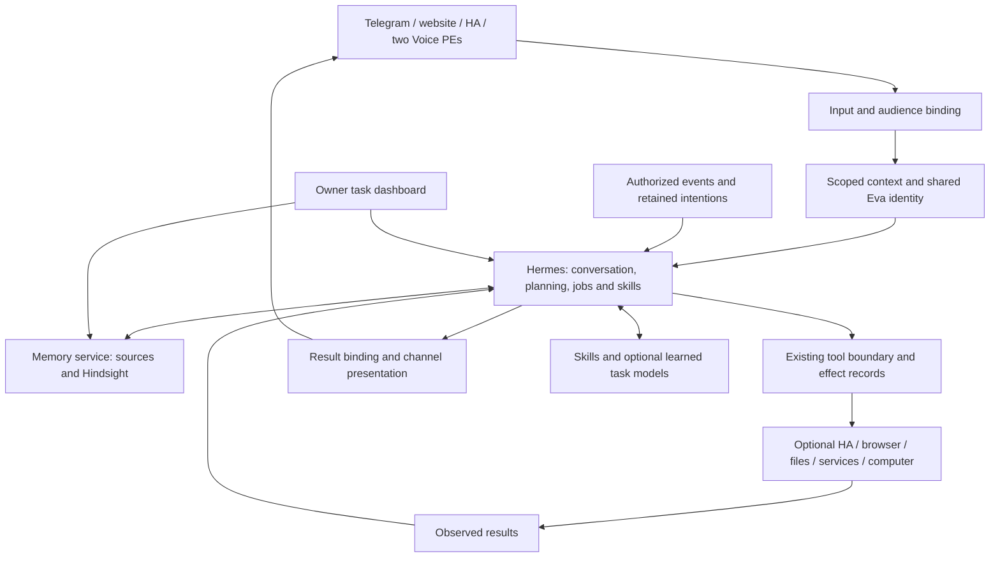

# Eva2 complete-product architecture

Design candidate, 28 September 2026. Source baseline `e94f384551d78b8b7ae158d8688cd3a75fa81cda`.
This specifies proposed behavior and seams; it does not describe a new installed release.
Owner scope: the complete family housemate. No business edition is included.
[Owner plan](../../EVA2_BOUWPLAN.md) · [Delivery specification](delivery-plan.md) ·
[Platform decision](platform-decision.md) · [Learning and initiative](learning-and-initiative.md).
Live progress remains in [WERKBORD](../../WERKBORD.md) and its existing JSON source.

**Controlling correction, 28 September:** the Hermes ownership and migration design
below is conditional. Existing Eva capabilities must be mapped first and replacement
must have a supported advantage over the smallest sufficient retained implementation.
Public API compatibility alone is not that advantage. No old loop, scheduler, memory,
channel or installer is replaced merely to match this diagram. The
[delivery mapping](delivery-plan.md#existing-capabilities-and-change-decisions) states
what is already present and what remains a defect or an untested outcome.

## 1. Product contract and bounded finish

Eva is one recognizable, warm, curious housemate with her own reasoned judgment,
automatic memory, useful spontaneous activity, voice and general digital competence.
She can disagree, ask a useful question, investigate something herself, finish work,
learn a new procedure and return later. Family members need not administer memory
or know Home Assistant entity names. Personality and relationship continuity are
part of early deliveries, not a decorative final prompt.

The release covers the eight existing product steps: conversation/voice; personal
continuity; complete work; presence/initiative; learning/projects/self-improvement;
installation/operations; comparative evidence; one integrated release and family use.
The delivery specification maps concrete slices to these steps and the nine dashboard
categories. Universal human-equivalent capability and worldwide novelty are research
ambitions, not infinitely expanding release criteria. EV-003's existing comparative
thresholds remain visible and cannot be replaced with a single favorable demo.

### Explicit boundaries

- Both existing speakers may use all Home Assistant devices, services and automations,
  including creating/editing automations, under the existing household mandate.
- Private conversations and private results stay on the verified private route,
  currently Telegram. Speaker/device recognition does not establish the individual.
- The local token-free owner page trusts the configured local computer; it is not
  automatically a safe shared-family identity. Optional household browser mode must
  be explicitly scoped and must not inherit the owner's private context.
- Existing subscriptions and local resources are the default. No new paid provider
  route or invented daily token/call allowance. Task progress and usage must be visible.
- Money-making opportunities include research and a paper portfolio first. Actual
  trading, spending or commitments outside the current mandate need their own decision.
- Current services and information remain intact while candidate selection is tested.
  Source reuse is a decision, not an obligation to preserve every implementation.

## 2. One execution owner and a narrow Eva integration layer

Recommended candidate: Hermes as the general agent platform, subject to the bounded
compatibility gate in [platform-decision.md](platform-decision.md). Existing Eva code
supplies reusable adapters and records. A platform switch is not an achieved advantage.

| Responsibility | Single authority | Eva-specific work | Must not become |
|---|---|---|---|
| Conversation, planning, child work, job lifecycle | Selected platform | Bind identity, context, tools and original destinations | Another single-step outer agent loop |
| Personality and relationship policy | One versioned Eva identity profile | Shared purpose, tone, interests, corrections; scoped relationship data | A different persona per channel/worker |
| Remembered evidence and corrections | Existing canonical source/provenance storage | Person/audience scope, correction/deletion propagation | Several independent extractors writing conflicting memories |
| Semantic recall/reflection | Selected Hindsight integration | Supply only authorized sources/bank scope | Hindsight plus another compulsory memory engine |
| External action truth | Existing effect/result records | Stable logical operation identity, readback and ambiguity | Another planner or a false exactly-once promise |
| Task display | Read model of platform events plus effect/result references | Clear status, stop/correction, timestamps | A second writable task database |
| Module installation/configuration | One module registry and existing deployment tooling | Dependencies, versions, data ownership, disabled behavior | A plugin marketplace project before Eva works |
| Initiative and reflection scheduling | Selected platform's scheduler | Relevant authorized events, intention policy, quiet behavior | Another permanent autonomous loop |

A private platform profile/process and the household profile can be isolated while
sharing the same identity definition and supported contracts. They do not share raw
private memory. Isolation is not a second personality or unrestricted cross-profile
message bus. Exactly one executor owns each task. Cross-profile sharing is explicit.

## 3. Contract sketch for implementation

These names define semantics, not newly installed endpoints. Prefer the selected
platform's public schemas and the current Eva identifiers; put only missing fields in
adapter metadata. Do not invent a replacement tool protocol, event bus or workflow DSL.
Existing API consumers remain compatible during cutover. Schema examples are design
requirements to translate at the seam, not a parallel production schema migration.

| Contract | Required semantics | Owner / checks |
|---|---|---|
| `InputEnvelope` | `input_id`, route/device, conversation ID, authenticated principal or household identity, audience, text/audio reference, timestamp, optional explicit task reference | Ingress binds identity from credentials; text such as "I am Jaap" cannot set it |
| `ContextSnapshot` | Identity-profile revision, subject/audience, allowed memory revisions, relevant dialogue, active task summaries, selected tool capabilities | Context service filters before model input; bounded relevance, not the whole tool catalog/history |
| `TaskHandle` | Stable Eva task ID, platform run ID, originating input, subject/audience, requested outcome, original destination, current platform revision | Platform owns lifecycle; ID mapping and display projection cannot independently start/retry a job |
| `TaskEvent` | Task/run ID, monotonic revision, event ID, state, visible progress, timestamps, result/effect references | Duplicate events ignored; out-of-order events cannot reopen a stopped/completed task |
| `EffectRecord` | Logical operation ID, task ID, target, action digest, observed-before reference, dispatch state, observed-after/reference, uncertainty | Existing execution boundary; writes are never retried merely because a response was lost |
| `ResultEnvelope` | Task ID, original input/destination, audience, output/artifact references, evidence, limitations and delivery identity | Delivery checks scope and current channel availability, never attaches to the newest unrelated question |
| `MemoryRevision` | Source ID, subject/audience, fact/preference/time qualification, revision, correction/tombstone and provenance | Canonical source service; derived retrievals/skills must honor corrections and forgetting |
| `SkillArtifact` | Standard skill files, version, source/evidence, applicability, dependencies, outcome checks, permitted tools and usage | Platform skill mechanism; ordinary skills work without experimental task models |
| `ModuleManifest` | ID/version/source pin/license reference, capabilities, dependencies, credential references, owned data, health and disable/migration behavior | Registry/deployment; no private values in the manifest or dashboard |

### Context and cost control on the actual hot path

Expose a compact capability index and retrieve only needed tool schemas/document
sections. Keep recent dialogue, relevant authorized memory and brief task summaries
separate; report their contribution to input context where measurable. Do not attach
the full house inventory, all skills or all open-task transcripts to a greeting.
Cache only with subject/audience/source-version keys and invalidate on relevant change.
Use inexpensive recall on the contact path; reflective memory/model processing belongs
to background work unless the question requires it. A template can acknowledge receipt
through the existing central mechanism; it cannot invent accepted/completed work or
replace the conversational answer. All channels observe the same admission events.
Usage records distinguish contact, worker, memory and learning work; a cached input
is not assumed free. Model selection reuses configured allowed provider roles; a tool
or document cannot change that configuration or turn on a metered fallback.

Every artifact/result references its source rather than copying unlimited context.
A worker carries an allowed context snapshot, not the full private conversation. A
later correction can make an affected plan stale; check changed assumptions before
the next relevant action and before sensitive result delivery. Not every new message
invalidates every job. Conversation order and task order remain distinct.

### Commands and states

Map submit, inspect, steer, cancel and resume to the selected platform's public
operations. A successful durable admission returns a task handle. Receipt of speech
may be acknowledged earlier, but "I started work" requires actual admission.

Display states: accepted/queued, running, waiting for information, interrupted,
needs reconciliation, completed, failed, stopped. These are projections of native
states, not a second lifecycle. Completed means the requested artifact/effect has
been independently observed. A useful partial result stays partial.

A lost process may leave a platform run unknown. Reconcile external effects first;
resume from a supported checkpoint or create an explicit linked successor attempt.
Do not mark a fresh replanning attempt as an exact continuation. Previously completed
logical effects remain visible and cannot be replayed blindly.

## 4. Interaction while work continues

1. Ingress supplies the authorized envelope and a compact context snapshot.
2. The fast conversation model handles greetings and ordinary questions directly.
   No mandatory expensive router before each turn. It can submit longer work using
   the platform's ordinary background tool; complex work gets an appropriate model.
3. Background work has its own task/context and cannot hold the conversation lock.
   Several tasks may run within configured resources. Saturation is reported, not
   silently serialized behind a long research reply.
4. "How are you?" is a new conversational turn. A correction mentioning a task steers
   that task. Ambiguous "stop that" asks only the missing disambiguation; a global
   explicit stop cancels relevant active work without pretending to undo past effects.
5. A task finishes into its original result envelope. The conversation can introduce
   the result naturally while preserving who asked, what it answers and its audience.

Warmth is configured as consistent behavior: direct, friendly, sometimes humorous,
with an independent judgment. A normal greeting must not trigger repetitive body/
consciousness disclaimers. Eva must not fabricate experiences or completed actions.
Persistent interests and relationship developments derive from actual interactions;
changes to her core identity are versioned, not randomly rewritten by each worker.

## 5. Voice is one policy with different physical transports

Retain the functioning LiveKit/browser route and both HA/Voice PE bindings initially.
HA handles its native audio pipeline; the same conversation/task semantics sit behind
it. No new STT/TTS engine, device-specific intent scripts or rewritten wakeword engine.
A pipeline record must identify actual STT/TTS providers and local/network execution;
local availability is not evidence that the current route uses local recognition.

For long work, return the short turn after actual job admission rather than awaiting
the final research result. Existing result-after-session delivery carries the final
answer when the speaker is free; a later wakeword can inspect or steer the same work.
Respect interruption and stop as distinct operations: interrupting speech need not
cancel an accepted research job unless the user asks to stop that work.

HA 2026.9.2's observed short-text streaming boundary is a known constraint. A webpage
or software HA request cannot establish physical short receipt or duplex behavior.
First inspect the pinned integration/device capabilities, then test each actual
speaker. Keep current firmware. If continuous listening/barge-in requires a supported
transport or firmware change, record that exact dependency and alternative; do not
spend repeated patches attempting a capability the transport cannot expose. The full
voice criterion remains open until physical evidence exists.

Proposed measurable engineering targets, not achieved values or new owner claims:
- First visible receipt <=0.5 s after finalized input at ingress, p95.
- First audible receipt <=1 s median and <=2 s p95 from the end of the utterance,
  measured on each physical route with STT/network/TTS portions reported separately.
- A greeting/simple social answer starts within <=1.5 s median and <=3 s p95 from
  finalized input; a receipt is not counted as the substantive social answer.
- Stop/interrupt reaches the executor/audio transport within <=0.5 s p95 after the
  recognized stop, with actual audible stopping measured separately.
- Background work does not delay unrelated conversation until its completion.

Development samples cannot establish p95. Use a declared latency sample window on
the release candidate, report sample counts and provider conditions, and retain the
existing EV-003 relative thresholds. Missing measurements remain missing.

## 6. Optional modules and graceful absence

| Module | Reuse / integration candidate | Behavior when unavailable or disabled |
|---|---|---|
| Text conversation | Selected platform and current channel adapters | At least the local page remains available when Telegram is absent |
| Personal memory | Hindsight + current evidence/correction storage | Explicit limited-memory mode, no claim to remember unavailable facts |
| Voice | Existing LiveKit and native HA adapters | Text still works; pending tasks/results remain accessible |
| Home Assistant | Existing general API; ha-mcp only if it fills a proven gap | Explain missing access; no guessed device action; other work continues |
| Browser | Existing Playwright/shared Chrome and isolated sessions | Non-browser tools remain; affected task waits with a concrete reason |
| Files, services, code/computer | Existing tool adapters plus selected platform sandbox tools | Missing optional tool can be installed through the module process; no new core intent function |
| Perception | Existing HA camera/event access and a selected vision-capable route | No claim about unseen bins/visitors; event descriptions include time and uncertainty |
| Initiative | Selected scheduler plus event/intention policy | Requested tasks still work; pausing initiative does not delete intentions |
| Learning | Standard skills and optional task-model eligibility | General reasoning and ordinary skills work without experimental learning |

For native computer applications, evaluate the selected platform's supported control
surface against a real required task before adding a desktop agent. Browser control
alone does not establish general desktop control. Login/2FA is an explicit human step.

Module lifecycle: declared -> installed -> configured -> enabled -> degraded/disabled.
A new installation adds pinned dependencies, validates access and one relevant contract,
and makes capabilities discoverable. Disable removes them from new task selection,
identifies affected active work and preserves memory/artifacts. Uninstall never
silently deletes user data. Changing a tool schema notifies skill eligibility.
The installer shows real readiness per module, not an all-green package count.

## 7. Data, migration and future upgrades

Use existing canonical IDs where possible. Export sources, memory corrections and
tombstones, person/audience scope, task/effect/result history, skill artifacts and
module settings. Secrets remain credential references handled by existing tooling.
No cross-family data sharing or public skill publication is implicit.

Migrate one responsibility at a time with a single active owner. Read-only shadow
inspection may compare contexts; do not run two executors on the same effectful input.
Drain existing jobs or keep them attached to their old owner until concluded; imported
old completion records are history, not runnable jobs. Move Telegram ingress away
from its current Bottie dependency only when the replacement handles real messages
and original-response binding; do not turn off Eva1 to discover that Eva2 depended on it.

After the candidate takes over a complete route, retire that route's previous active
planner/handler and scheduling configuration. Keep data readers/history as needed.
List exact removed entries in the release receipt. An inactive archived implementation
is not the same as a second running executor.

Future readiness means versioned public interfaces, portable user data and skills,
provider adapters, conformance cases, pinned updates and rollback. It is not a promise
that arbitrary future packages are compatible. Prefer upstream contribution for a
missing generic seam; avoid a permanent platform fork. Reassess a dependency only for
an actual changed need, maintenance issue or measured advantage.

## 8. Owner control and truthful delivery

The runtime owner page shows conversation, current jobs, their results, module health,
relevant memory controls and measured use. It reads canonical services and sends native
commands. The project dashboard separately shows implementation progress and owner
acceptance. Neither should imply an installed feature from a source commit alone.

Each delivery records source/version, what can now be used, known limitations, one
short try-it path, relevant checks and rollback. One independent review is bundled
around the complete slice. Stop repeating passed tests when nothing relevant changed.

The current architecture is supported by the [baseline](../../research/2026-09-27-system-choice/baseline.md),
[platform research](../../research/2026-09-27-system-choice/platforms.md),
[building blocks](../../research/2026-09-27-system-choice/building-blocks.md) and
[technical hypothesis](../../research/2026-09-27-system-choice/technical-differentiation.md).
These sources document their coverage and dates; the complete repository has not been
reread for this design. New blueprint files are specifications, not product evidence.
