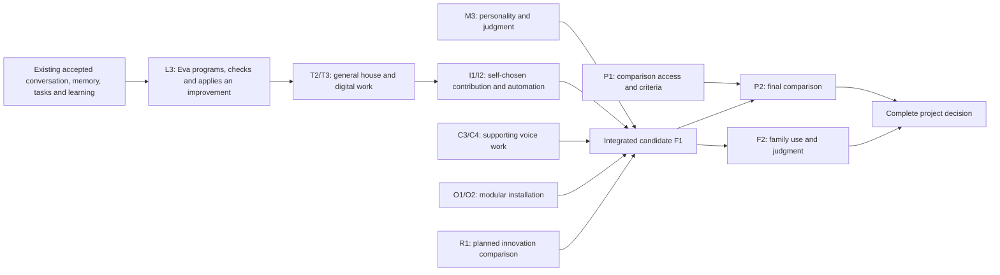

# Eva2 delivery specification

Design candidate, 28 September 2026. This is a fixed scope/dependency specification,
not another workboard. Actual assignments and progress live only in
[WERKBORD](../../WERKBORD.md) and `execution-workboard-v1.json`.
[Architecture](architecture.md) · [Platform](platform-decision.md) ·
[Learning/initiative](learning-and-initiative.md) · [Owner overview](../../EVA2_BOUWPLAN.md).

## Owner priority amendment — 2 October 2026

The primary outcome is a capable autonomous family member, including programming,
self-improvement, useful initiative, personality and judgment. Voice is a supporting
interface and an example of a feature Eva should eventually arrange herself.
The numbered groups below retain scope, not a voice-first execution gate.
Current assignments remain only in the canonical workboard.

Review of all 24 slices and 44 small tasks separates Codex integration work from
Eva's own execution. Each slice has a `responsibilityReview`; open small tasks carry
visible next actions. Completed tasks, acceptance and original finish conditions are
unchanged. Existing L1 procedure learning and L2 project continuation are retained.

First outcome: L3.2/L3.3, an ordinary programming request leading to a useful Eva-authored,
executed, independently assessed and installed improvement. The inspected component
tools only support narrow edits and candidate preparation; the assisted SHA improvement
required Codex import/install. No general programming executor is established by inspected
source bindings. A dynamically admitted MCP executor remains unverified; inspect that
specific availability before implementing or selecting another executor. Reuse the existing
delegated task loop, tools, isolated execution, operator import and managed release.
Connect missing handoffs rather than removing the runner's no-live-install instruction
without a real implementation. An evaluator remains independent of candidate generation.
One microfix or failed experiment does not finish general programming capability.

After that outcome, proceed through T2 and I1/I2/T3 according to real dependencies;
M3 behavior belongs throughout. I1 does not require whole-component voice or personality
acceptance to deliver a permitted useful contribution. I2 needs the relevant general
HA operations and result route, not a new dedicated camera/bin feature.
Voice and family acceptance retain their own open criteria. Financial contribution is
self-directed useful work/opportunity research within the existing mandate, not a promise
of profit or automatic spending/trading authorization. This is a plan correction, not
a newly delivered function or app-goal activation.

## 1. What is being delivered

One installed Eva for this household: warm conversation and judgment; automatic
personal continuity; useful initiative; all existing HA functions through both
speakers; complete digital tasks while conversation continues; learning and long
projects; optional modules; ordinary installation/update/restore; comparative and
family evidence. Existing accepted memory, streaming and interruption records are
preserved with their original scope. The present project is not reset to zero.

No business edition, new general agent framework, own foundation-model training,
new audio engine, cross-platform installer for every OS, automatic real-money
trading or limitless simulation project is included. These are not prerequisites
for the agreed complete household product. Linux/WSL on the current Windows host
is the first installation target; other native OS packages are explicit follow-up.
The installer must nevertheless use a general module manifest, not hardcoded Jaap paths.

## 2. Dependency order and small complete outcomes

The existing eight product steps remain the parent structure. B0 is the short
pre-build basis gate, not a ninth product feature. Independent slices may run in
parallel only when they do not share files or require an unfinished contract.

Existing EVA1/competitor research informs choices and fixed outcome criteria before
implementation. Fill only decision-relevant gaps. During slices verify the outcome
against those criteria; do not rerun a broad comparative study per delivery. New
comparative work requires a materially changed assumption or a contrary result.
Step7 applies the planned final comparison to the integrated candidate; a design
expectation is not evidence of achieved superiority.
F1 freezes the candidate before the final P2 comparison; family use F2 may run
alongside that comparison. Both results are required for the complete project decision.
Existing installation capability is reused by any justified functional change;
B0 does not require another candidate package. Step6 proves the remaining ordinary owner flow and restore. Broad relocation
and release-hardening work must not take over the earlier functionality slices.

### Estimation and resource discipline

The effort labels below are provisional engineering estimates: S=2–4 focused hours,
M=4–8, L=8–16. They are neither elapsed-time promises nor Codex-credit estimates.
They were full-slice design estimates, not measured remaining work. B0 now separates
already delivered behavior, actual defects and missing evidence. Re-estimate only the
necessary remainder before dispatch; a platform change is conditional, not an estimate
assumption. Do not add these numbers into a sales deadline.

For each dispatched slice, choose the smallest complete outcome below, record exact
files/base commit, one end condition, expected effort and known runtime trial budget.
An L slice must be split into bounded complete cases before dispatch. At one M-sized
work window without the end condition, report the actual blocker and revise the
slice instead of silently extending it. No speculative estimate is a spending mandate.

Runtime Eva retains the owner's existing subscription/mandate and provider limits;
there is no new daily call/token quota. Controlled comparison runs have predeclared
finite limits, separate from normal usage. Codex development usage and Eva runtime
usage are separate. Count all known learning, worker, memory and failed-attempt calls;
unknown credits/prices remain unknown. Never substitute receipt latency for answer speed.

### B0 — justify necessary changes from existing capabilities

**Outcome:** an evidence-linked decision for each slice: retain, connect, fix, verify,
or conditionally replace. Existing functionality is not rebuilt to satisfy a future
diagram. This owner correction applies to all components, not just Hermes. Current
installation stays active; there is no fresh whole-repository audit or test campaign.

Use the matrix below and existing research/receipts. Missing family approval, hardware
access or a current end-to-end measurement is not evidence that an implementation is
absent. A code change requires a concrete failed requirement or a demonstrated missing
connection. Replacement additionally needs a supported advantage over the smallest
sufficient retained change, with migration implications. The source-only Hermes pass
ended UNKNOWN; it does not establish that advantage. Remaining compatibility work is
conditional, not the automatic first build task.

- Only if replacement is justified, finish the source/API/license/allowed-provider compatibility matrix. Use the
  [platform decision](platform-decision.md); do not install the whole shortlist.
- A provider-free delayed job must allow another input, steering, cancellation,
  original-destination result and observation of process-loss ambiguity.
- Reserve the two decisive EV-003 development cases for C1/L1 after implementation
  authorization: overlapping work/conversation and unfamiliar documentation plus reuse,
  each twice with equal access/model/resources. Do not duplicate these live runs in B0.
  Comparable existing receipts may substitute for new baseline runs; otherwise mark
  the current comparative evidence missing until the corresponding slice is runnable.
- Establish the provider resolver from source and stubs. Real access and model latency
  remain a C1 installation check. A credential limitation is unknown compatibility,
  not a task-quality loss. Freeze realistic development-run envelopes before those calls.
- Compatibility GO: public hooks implement the contracts without preserving the old outer loop,
  memory/audience/effect boundaries pass, usage can be observed and a complete task
  is possible. This is not a comparative win or an independent replacement mandate.
  A failed gate returns to the concrete gap and the narrower retained alternative;
  UNKNOWN never becomes an invented failure. No indefinite platform tour.

Exit artifact: existing capability/gap/change mapping, justified execution decision,
and scope-adjusted estimates. Any replacement must also have the exact pin/interface
evidence above. Old S/M/L values are conditional full-slice estimates, not authority
to spend that time rebuilding components already delivered.

## Existing capabilities and change decisions

This is the 28 September mapping of existing evidence to the planned outcomes,
not a new runtime audit or new completion claims. Older receipts retain their
stated build/date/scope. The baseline worker checked eight registered source hashes;
the coordinator used the listed learning/installation receipts. Product scope stays
fixed, but these slices are not 24 missing implementations. Current assignment and
completion remain in the existing JSON workboard, not this table.

Types: **defect** = observed failed requirement; **evidence** = behavior not fully
demonstrated; **unknown** = bounded inspection still needed; **research** = optional
unproven mechanism. A historical installed fix is not a current open defect unless
a later failure establishes regression. Existing accepted outcomes are retained.

| Slice | Existing capability | Remaining gap and evidence type | Necessary next action | Evidence |
|---|---|---|---|---|
| B0 | Eva already has a model loop, durable worker, task controls, memory and result binding. | **Unknown:** Hermes replacement benefit is unestablished; its five contracts remain UNKNOWN. | Retain current execution while deciding the smallest change for a concrete gap. No more platform probes solely to justify the proposal. | [BASE], [HERMES] |
| C1 | Contact model, Telegram streaming, work admission and actual conversation during research. | **Evidence:** Telegram/web parity and desired content latency are not fully demonstrated; overlap is not absent. | Reuse ingress, persona and task routes. Verify only missing cases; fix measured latency/routing defects. No automatic loop replacement. | [BASE], [OVERLAP] |
| C2 | Durable tasks, original-question binding, stop/resume/correction and retained results. Session-closure defect was fixed and installed. | **Evidence:** two independently steered tasks plus reconnect are not fully demonstrated together. | Keep task/effect/result stores and controls; verify the missing combination, then repair only a demonstrated seam. | [CONTINUITY] |
| C3 | General HA, registered speaker identities, native sessions and later result delivery. | **Defect:** pinned HA pipeline does not flush short acknowledgement segments. **Evidence:** complete behavior on both physical devices. | Retain bindings; solve the named transport gap only if required by the end condition. Verify actual speakers; no assumed firmware rebuild. | [CONTINUITY], [HA-SHORT] |
| C4 | LiveKit/browser speech, native HA transport and owner-accepted laptop interruption. | **Evidence:** full wakeword/interruption/continued speech and current latency; historical owner feedback reported unnatural voice/long pauses. | Preserve audio paths; measure missing physical behavior before choosing a specific repair. No new speech engine by default. | [BASE], [BOARD] |
| M1 | Automatic memory/correction/use and inspection/forgetting are owner-accepted; source authority and Hindsight already composed. | **Evidence:** extended family continuity; a changed platform integration would need relevant checks. No new general memory defect shown. | Keep memory service, data and acceptances. Wire only a justified changed integration; ordinary later recall belongs in family use. | [GE01], [GE02] |
| M2 | Household/private separation and additional private destination guard already installed. | **Evidence:** newly changed combined paths, not a demonstrated new disclosure. | Keep authorization and destination checks. Check affected boundaries only; no new identity system or private speaker biometrics. | [PRIVATE] |
| M3 | Shared character, preferences and memory correction exist; Eva1 supplies valued humor/judgment. | **Evidence:** evolving interests/opinions and temporary exceptions across the whole product. Absence of code not established. | Reuse persona/memory. Identify missing behavior or context revision before adding code. | [BASE], [GE01] |
| T1 | Real research completed, saved and returned; source/document tools and durable runner exist. | **Defect:** a complete multi-step path exceeds its actual execution envelope. **Evidence:** general research quality. | Retain tools/storage/readback; fix the concrete full-task path. A native-loop change remains conditional on solving that gap, not platform fashion. | [OVERLAP], [BUDGET] |
| T2 | General HA API for both speakers; real harmless automation created, edited and read back. | **Defect:** observed task needed coordinator resume after budget failure. **Evidence:** broad semantic requests via physical entrances. | Reuse HA discovery/API/effect verification; address execution gap and speaker wiring. No device-specific functions or second HA planner. | [HA], [HA-TASK] |
| T3 | Isolated browser and shared Chrome, takeover and fresh-observation recovery exist. | **Evidence/access:** last existing bridge check had no shared tab; no missing recovery link found. General desktop capability unknown. | Reuse browser/file adapters; verify the real shared-tab case when available. Add an adapter only for a concrete unsupported task. | [CHROME], [CHROME-RECOVERY], [BASE] |
| T4 | Owner page already has task/result/status/control surfaces and measured/partial/unknown usage. | **Evidence:** all task combinations/accounting sources; not an absent dashboard. | Keep existing UI and task projections. Connect only demonstrated missing controls/fields; no second task truth or dashboard rebuild. | [UI], [CONTINUITY] |
| I1 | Eva1 doorbell presence; Eva2 household initiative composition, quiet hours and delivery installed. | **Evidence:** audible usefulness/silence as a whole. Earlier missing household composition is already fixed. | Reuse perception, policy, scheduler and delivery. Verify a useful outcome; do not rebuild initiative for lack of owner acceptance. | [INITIATIVE], [BASE] |
| I2 | Camera/HA perception, retained initiative decisions, research and result storage exist. | **Unknown:** required calendar availability and camera/calendar context connection not established by this inventory. | Inspect that named connection only; connect existing services, add a missing generic adapter only if confirmed. No bin-specific core rule. | [PRESENCE], [INITIATIVE] |
| L1 | Procedure storage/discovery/execution and unassisted reuse exist; initial learning needed help. | **Defect:** unseen documentation task never saved/executed the procedure; reviewed path needs at least 8 tools/9 responses versus 6/8 limits. | Retain learned artifacts and tools; finish the complete failing learning path and verify new-input reuse. No new learning engine by assumption. | [REUSE], [BUDGET], [LEARNING] |
| L2 | Durable tasks/effects, resume and project artifacts exist; prior document project was a prepared two-step case. | **Evidence:** general multi-day planning/continuation without developer intervention, not absence of persistence. | Keep ledger, artifacts and reconciliation. Establish missing continuation behavior before adding planning/state machinery. | [BASE], [CONTINUITY] |
| L3 | Eva produced a small source fix; evaluation, import, installation and rollback exist. Assisted case improved 71/90 to 90/90. | **Evidence:** autonomous improvement on held-out cases; assistance means the general criterion remains open. | Reuse improvement/evaluation/release route. Fix only missing autonomous handoff; do not rebuild evaluator or release system. | [IMPROVEMENT] |
| R1 | Ordinary procedure reuse is the comparison baseline; task-model concept has prior art and no Eva implementation evidence. | **Research:** marginal benefit, total learning cost and technical distinction unproven. | Keep optional and bounded. Build an isolated candidate only when ordinary skills are runnable; reject on loss without relabeling existing skills as novel. | [REUSE], [RESEARCH] |
| O1 | Wizard, target provisioning and nine-service preparation exist, with installed subcomponents. | **Unknown/evidence:** ordinary bootstrap without handwritten target settings and optional module omission are not fully demonstrated. | Reuse wizard/composition. Identify exact absent input/module seam; integrate it, not another installer. | [INSTALL] |
| O2 | Export/restore, release/rollback and isolated complete wizard restore exist. | **Evidence:** fixture used schema0009, not production0007 migration; in-process API was not an owner browser trial. Module disable/re-enable not established. | Reuse restore and release paths. Check only ordinary module/data lifecycle gaps; no fresh restore subsystem. | [RESTORE], [INSTALL] |
| P1 | EV-003 protocol, prior controlled runs and Inspect/accounting scaffolding exist. | **Evidence/unknown:** complete runnable manifest and equal connected access, current Eva1 baseline. | Reuse protocol/scorers; finish version/access manifests and only missing adapter bindings. No benchmark framework rebuild. | [BENCH], [BASE] |
| P2 | Historical wins/losses/unavailable cases and concrete task receipts exist. | **Evidence:** no complete contemporary equal-task superiority result. | Run the frozen comparison only once its candidate/access/run budget is ready. Preserve losses; this is evaluation, not feature construction. | [BENCH], [BASE] |
| F1 | Managed installation, provenance, rollback and component checks already used. | **Evidence:** one integrated final candidate meeting all required behavior. | Compose/freeze and run the relevant release checks on that candidate; repair observed blockers only. No new release architecture by default. | [IMPROVEMENT], [RESTORE], [BOARD] |
| F2 | Specific memory/streaming/interruption acceptance exists, and Eva1 is used by the family. | **Evidence:** seven days on the eventual complete candidate plus explicit owner judgment. | Real family use after technical readiness. Preserve prior accepted scope; do not invent acceptance or construct a new feature because judgment is pending. | [GE01], [GE02], [BOARD] |

The concrete reviewed failure in T1/T2/L1 concerns a whole-task execution contract.
One correction may close shared work across these slices; do not implement it three
times. Other open end conditions chiefly describe evidence/integration gaps, not
permission to replace functioning subsystems. This mapping is not an assertion that
all unspecified details work. Resolve remaining unknowns at the relevant bounded
assignment, not by sending every subsystem through a new audit.

[BASE]: ../../research/2026-09-27-system-choice/baseline.md
[HERMES]: ../../experiments/b0-platform-20260928/README.md
[OVERLAP]: ../../evidence/product/household-public-overlap-20260925.json
[CONTINUITY]: ../../evidence/product/household-result-continuity-installed-20260925.json
[HA-SHORT]: ../../evidence/product/ha-short-receipt-boundary-20260925.json
[BOARD]: ../product/execution-workboard-v1.json
[GE01]: ../../evidence/product/CO-008-GE-01-owner-acceptance-2026-09-10.json
[GE02]: ../../evidence/product/GE-02-owner-acceptance-2026-09-12.json
[PRIVATE]: ../../evidence/product/private-continuity-boundary-installed-20260924.json
[BUDGET]: ../../evidence/product/digital-task-budget-candidate-20260927.json
[HA]: ../../evidence/product/shared-ha-general-installed-20260925.json
[HA-TASK]: ../../evidence/product/ha-configuration-readback-installed-20260924.json
[CHROME]: ../../evidence/product/personal-chrome-controls-installed-20260922.json
[CHROME-RECOVERY]: ../../evidence/product/chrome-inflight-recovery-2026-09-12.json
[UI]: ../../experiments/react-admin-dashboard-v1/src/main.jsx
[INITIATIVE]: ../../evidence/product/household-initiative-installed-20260924.json
[PRESENCE]: ../../evidence/product/household-presence-gap-20260924.json
[REUSE]: ../../evidence/product/procedure-unassisted-reuse-20260925.json
[LEARNING]: ../../evidence/product/external-documentation-learning-source-only-20260925.json
[IMPROVEMENT]: ../../evidence/product/component-self-improvement-assisted-20260924.json
[RESEARCH]: ../../research/2026-09-27-system-choice/technical-differentiation.md
[INSTALL]: ../../evidence/product/installer-composed-preparation-20260925.json
[RESTORE]: ../../evidence/product/restore-full-route-20260925.json
[BENCH]: ../product/comparable-agent-benchmarks-v1.md

### Step1 — one conversation and voice

| Slice | Usable outcome and end condition | Integration responsibility | Effort |
|---|---|---|---|
| C1 | Telegram and local page answer a greeting warmly; a real background request gets a bound task, and a social question is answered before that job completes | Existing ingress/context/task routes first; replace an outer loop only after justified decision | M |
| C2 | Two concurrent tasks receive independent corrections/stop and return to their original questions after reconnect; owner can see their real state | Platform event mapping, result projection and existing owner page | M |
| C3 | Existing HA and both physical Voice PEs reach the same semantics; background task admission returns a short turn and later result is retrievable | Native HA bindings, existing audio/session/result adapter | L |
| C4 | Browser voice and actual speaker capabilities are measured for wakeword, interruption and continued conversation; all required route cases pass or have an explicit unresolved hardware/transport blocker | Existing LiveKit/native transports; no new speech engine | M |

Each slice preserves one identity, authorized memory and result policy. A greeting
is evaluated for actual content latency. Simple response generation does not pay for
an expensive research/router call. Acknowledgment is honest about receipt/admission.
A software-only Voice PE proxy test cannot close C3/C4's physical part. If hardware
prevents the required behavior, complete independent work and keep voice open.

### Step2 — people, memory and continuity

| Slice | Usable outcome and end condition | Responsibility | Effort |
|---|---|---|---|
| M1 | A verified person resumes a prior topic from another permitted session; correction, explicit forgetting and source inspection still work | Existing source/Hindsight service bound to selected platform | M |
| M2 | Unknown speaker/another family member cannot elicit private facts, summaries, hints or private job results; shared HA work remains available | Pre-model audience filtering and result delivery context | S |
| M3 | Eva carries forward relevant preferences, opinions/interests and temporary exceptions without requiring manual memory maintenance | Shared identity plus authorized relationship/temporal context | M |

Do not rebuild GE-01/GE-02. Recheck only integrations actually changed. Private speaker
biometrics are not required: private information stays on Telegram. Recognizing a
household member for non-private personalization is a separate capability whose
certainty cannot be upgraded by a spoken name. Real later-day/week continuity remains
in the family trial; fabricated timestamps alone do not prove lived continuity.

### Step3 — complete work, including general house control

| Slice | Usable outcome and end condition | Responsibility | Effort |
|---|---|---|---|
| T1 | Research a new question, use appropriate sources, resolve missing material facts or report the concrete exhausted access gap, save and deliver the result | Selected platform + existing search/document tools/result store | M |
| T2 | Discover HA devices/services/automations by meaning; complete a room/comfort request and create/change/read back an automation through the shared core, available to chat, Telegram and both speakers | Existing general HA API, no entity- or channel-specific core functions | M |
| T3 | Complete a browser/file/service task, preserve a saved artifact, allow owner takeover and resume from fresh observation | Existing isolated/shared browser and tool adapters | L |
| T4 | Owner page shows queued/running/waiting/done/failed/stopped, result and stop/steer controls, with measured usage and channel/module health | Current dashboard framework and canonical task projection | M |

T1 does not turn unverifiable facts into invented certainty. It tries relevant
available primary sources and alternate permitted evidence; its report records what
was actually checked. Financial analysis distinguishes observations from predictions.
T2 retains all authorized HA capability types, not a preselected lamp list.
Owner clarification, 1 October: evaluate semantic selection and actual execution
through a suitable installed text route, reusing valid version-bound evidence.
Verify changed channel adapters and household bindings separately; do not repeat
the whole HA capability suite on every speaker. C3/C4 retain physical audio,
listening, interruption and audible delivery checks. Text-based core work does
not depend on the continuous speech route being finished.
T3 includes a native application only where required by the declared case; browser
success cannot claim all desktop software. Required login is visible human assistance.

### Step4 — presence and initiative

| Slice | Usable outcome and end condition | Responsibility | Effort |
|---|---|---|---|
| I1 | Eva chooses a useful household action or observation from real context, completes authorized work and reports to the appropriate audience; irrelevant events cause silence | Platform scheduler, event/intention policy and existing HA/doorbell access | M |
| I2 | Eva discovers relevant camera/calendar sources and creates an observation/reminder automation from an ordinary request using general tools; self-chosen research produces a source-backed proposal without repeatedly resurfacing suggestions. Bin monitoring is an example, not a core feature or prerequisite owner source selection (owner clarification 1 October). | Existing discovery, perception/calendar modules, general HA automation tools, initiative pipeline and retained decisions | M |

I1 must preserve valued Eva1 doorbell/home presence. Examples are evaluation cases,
not hardcoded rules. Warmth, humor, useful curiosity and independent judgment are
human-rated separately. Missed opportunities count alongside annoying interruptions.
Unknown image age/object identity stays uncertain. Income opportunities can yield
research, proposals and a paper portfolio; no automatic trading mandate is invented.
See the detailed [intention/learning design](learning-and-initiative.md).

### Step5 — learning, long projects and self-improvement

| Slice | Usable outcome and end condition | Responsibility | Effort |
|---|---|---|---|
| L1 | Learn a previously unseen digital procedure from documentation, save a standard skill and apply it to a different input without a developer hint or new core function | Selected platform skill mechanism + existing artifact/tools | M |
| L2 | A multi-day project retains its outcome, dependencies, artifacts and next action; restart and explicit correction resume useful work without duplicate effects | Same platform task ownership, effect reconciliation and project artifacts | M |
| L3 | One bounded self-improvement is evaluated against held-out cases and either promoted with measured benefit and rollback, or rejected with its cost/result recorded | Existing sandbox/versioning + platform skill process | M |
| R1 | Optional task-model eligibility demonstrates marginal benefit over ordinary skills and preconditions under changed conditions, including total learning cost | Optional module from the technical research proposal | M research cap, separate decision |

L1–L3 are product requirements. R1 is a research hypothesis and must not block usable
ordinary memory, skills or the family release. If R1 loses, reject this mechanism;
report that no technical breakthrough was established and retain the broader innovation
ambition as open research. The owner's requested technical distinction remains an
open requirement; a usable daily release must not be advertised as fulfilling that
requirement. Do not silently relabel an upstream feature as the invention.
Self-improvement scope starts with skills/context/module candidates, not unrestricted
self-editing of production or training a new foundation model.

### Step6 — manageable installation and optional modules

| Slice | Usable outcome and end condition | Responsibility | Effort |
|---|---|---|---|
| O1 | A fresh supported Linux/WSL target installs text Eva through the owner wizard; voice/HA/browser modules can be added or omitted without editing code/config files | Existing installer/deployment plus module manifest | M |
| O2 | Disable/re-enable a module, update and roll back, restore exported identity/memory/artifacts; affected tasks remain understandable and no effects replay | Existing release/restore tools and authoritative data stores | M |

Reuse installation/restore code already built. A clean-room rehearsal belongs here,
not a recurring prerequisite to every feature. The current household installation
remains the first actual user; generality means no hardcoded personal paths/IDs, not
all operating systems shipping simultaneously. Document host prerequisites and real
external-provider requirements. New paid route/license decisions remain explicit.

### Step7 — evidence of better

P1 (M preparation): register versions, tasks and independent readbacks with existing
Inspect/EV-003. Add actual Eva1 as the practical baseline; the selected upstream
platform alone is also a baseline so the value of Eva's additions is measurable.
OpenClaw, Hermes and Agent Zero remain the named comparative set. Keep equal-model
and native-product results separate. Already seen demonstrations are not held-out cases.

P2 (L, runtime consumption unknown until run manifest): run the frozen protocol once
on the integrated candidate, preserve wins/losses and unavailable routes. Full EV-003
means six families, twelve cases per family, three blocks, two human raters and the
existing thresholds. Its scale is materially larger than a development case; record
estimated calls from the actual manifest before running. Official AgentBench/GAIA/
OSWorld cases use their own scorers and permitted datasets, reported separately.
No new benchmark framework. Missing access/budget produces an explicit incomplete
comparison; it cannot silently pass the complete superiority requirement.

A research comparison can finish with a loss. The complete project's superiority
criterion stays open when required thresholds are missed. The coordinator proposes
one bounded corrective outcome or an explicit owner scope decision; never endless
retrying or changing the test to declare victory.

### Step8 — one integrated release and real use

F1 (M plus scheduled tests): freeze a candidate, run relevant combined checks once,
independent review, clean installation/update/rollback, start/restart and healthy
real channel bindings. Fix only identified release blockers; changed behavior reruns
its affected checks, not automatically the whole research program.

F2 (seven calendar days of family use, effort depends on findings): use the actual
website/Telegram/both speakers; record warmth, natural conversation, later recall,
initiative/usefulness/annoyance and complete work. Owner acceptance is explicit and
separate from technical installation. A release is technically complete only when
its required functional gates are satisfied; the full agreed project stays open for
unmet comparative or family-acceptance criteria. No silence-based approval.

## 3. Traceability to the nine existing dashboard categories

| Existing category | Required slices for the complete new composition | Existing acceptance stays |
|---|---|---|
| Answer stream | C1/C2 | Accepted Telegram streaming scope |
| Conversations | C1/C2, M3, F2 | Existing corrected private conversation evidence |
| Memory | M1/M2/M3 | GE-01/GE-02; changed integration checked separately |
| Initiative | I1/I2, F2 | Existing AU-008 result, human usefulness still separate |
| Tools and services | T1/T2/T3 | Existing receipts retain their original task scope |
| Voice and presence | C3/C4, I1, F2 | Laptop interruption and confirmed ordinary speaker use |
| Independent work | C2, L1/L2/L3 | Existing bounded reuse/project artifacts |
| Browser and takeover | T3 | Existing real/shared versus isolated mode evidence |
| Installation and recovery | O1/O2, F1 | Existing installed components and rollback records |

The count must not increase for this document or for R1 being described. All nine
can display both retained outcomes and concrete remaining scope. No ambiguous
"proven as a basis" label. Built, checked, installed and owner accepted are separate.

## 4. Execution rules that prevent another repair loop

1. One main integration commit on GitHub. At dispatch, verify source/tests/locks and
   current owner decisions. Independent branches start there; no ad hoc checkout copies.
2. Root owns shared wiring/contracts/primary documents. At most two bounded executors;
   give separate file paths and an end-to-end case. Review is bundled within that team.
3. Complete a slice through installed usable outcome after authorization, not just a
   patch. Keep old data and a working rollback. A source checkpoint is not installation.
4. Use the existing-capability matrix and proof first. A missing acceptance is not
   missing code; no work is dispatched without its concrete gap and smallest sufficient
   action. No extra audit or repeated identical trial. Keep one
   planner per task. A missing platform seam goes through the explicit adapter/platform
   decision; it never licenses adding a parallel planner. A generic fork requires a
   new documented decision and is a NO-GO for the proposed Hermes path.
5. New ideas go after fixed scope. A blocker affects dependent work only. A missing
   owner opinion/physical test does not stop independent technical slices.
6. Update the existing board at assignment, blocker and delivery. Show real active
   workers, last usable result, next action, exact try-it instructions and unknown costs.
7. A research result has a finite decision: adopt, reject or explicitly unknown.
   A failure receives one diagnosed correction path; no automatic repeated campaign.

## 5. First implementation assignment after the design decision

B0 first links every slice to existing capability, remaining evidence and necessary
change. Root integrates the decisions; one bounded worker checks the existing evidence,
followed by a bundled review. No further Hermes probe or replacement is warranted
without its comparative justification. Then C1 addresses only the actual remaining
conversation gap through the retained route unless replacement has been justified.
M1/C2 may require only relevant integration verification, not rebuilding existing
memory or task controls. Preserve existing endpoints and accepted outcomes.

The design phase itself performs no feature implementation, installations, live model
trials or new paid routes. It ends with source-backed decisions, this delivery sequence,
review and an accurate board. Remaining technical unknowns have named gates rather
than being hidden in a promise that the entire architecture is already proven.
