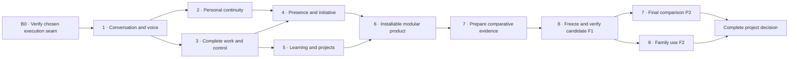

# Eva2 delivery specification

Design candidate, 28 September 2026. This is a fixed scope/dependency specification,
not another workboard. Actual assignments and progress live only in
[WERKBORD](../../WERKBORD.md) and `execution-workboard-v1.json`.
[Architecture](architecture.md) · [Platform](platform-decision.md) ·
[Learning/initiative](learning-and-initiative.md) · [Owner overview](../../EVA2_BOUWPLAN.md).

## 1. What is being delivered

One installed Eva for this household: warm conversation and judgment; automatic
personal continuity; useful initiative; all existing HA functions through both
speakers; complete digital tasks while conversation continues; learning and long
projects; optional modules; ordinary installation/update/restore; comparative and
family evidence. Existing accepted memory, streaming and interruption records are
preserved with their original scope. The present project is not reset to zero.

No business edition, new general agent framework, own foundation-model training,
new audio engine, cross-platform installer for every OS, automatic real-money
trading or limitless simulation project is included. These are not prerequisites
for the agreed complete household product. Linux/WSL on the current Windows host
is the first installation target; other native OS packages are explicit follow-up.
The installer must nevertheless use a general module manifest, not hardcoded Jaap paths.

## 2. Dependency order and small complete outcomes

The existing eight product steps remain the parent structure. B0 is the short
pre-build basis gate, not a ninth product feature. Independent slices may run in
parallel only when they do not share files or require an unfinished contract.

Comparison cases are defined before implementation and collected during relevant
slices. Step7 combines final results; comparison is not postponed until then.
F1 freezes the candidate before the final P2 comparison; family use F2 may run
alongside that comparison. Both results are required for the complete project decision.
Installation capability starts with the candidate package in B0 and develops through
the slices; step6 proves the complete ordinary owner flow and restore. Broad relocation
and release-hardening work must not take over the earlier functionality slices.

### Estimation and resource discipline

The effort labels below are provisional engineering estimates: S=2–4 focused hours,
M=4–8, L=8–16. They are neither elapsed-time promises nor Codex-credit estimates.
They assume the selected platform supplies the documented seams and existing adapters
are reusable. B0 must replace those assumptions with evidence before subsequent
estimates are used as scheduling commitments. Do not add these into a sales deadline.

For each dispatched slice, choose the smallest complete outcome below, record exact
files/base commit, one end condition, expected effort and known runtime trial budget.
An L slice must be split into bounded complete cases before dispatch. At one M-sized
work window without the end condition, report the actual blocker and revise the
slice instead of silently extending it. No speculative estimate is a spending mandate.

Runtime Eva retains the owner's existing subscription/mandate and provider limits;
there is no new daily call/token quota. Controlled comparison runs have predeclared
finite limits, separate from normal usage. Codex development usage and Eva runtime
usage are separate. Count all known learning, worker, memory and failed-attempt calls;
unknown credits/prices remain unknown. Never substitute receipt latency for answer speed.

### B0 — choose the execution basis with one bounded gate (M, high uncertainty)

**Outcome:** one selected execution owner and a runnable isolated integration skeleton,
using pinned upstream and an adapter-size estimate. Current installation stays active.

- First finish the source/API/license/allowed-provider compatibility matrix. Use the
  [platform decision](platform-decision.md); do not install the whole shortlist.
- A provider-free delayed job must allow another input, steering, cancellation,
  original-destination result and observation of process-loss ambiguity.
- Reserve the two decisive EV-003 development cases for C1/L1 after implementation
  authorization: overlapping work/conversation and unfamiliar documentation plus reuse,
  each twice with equal access/model/resources. Do not duplicate these live runs in B0.
  Comparable existing receipts may substitute for new baseline runs; otherwise mark
  the current comparative evidence missing until the corresponding slice is runnable.
- Establish the provider resolver from source and stubs. Real access and model latency
  remain a C1 installation check. A credential limitation is unknown compatibility,
  not a task-quality loss. Freeze realistic development-run envelopes before those calls.
- GO: public hooks implement the contracts without preserving the old outer loop,
  memory/audience/effect boundaries pass, usage can be observed and a complete task
  is possible. Otherwise apply the one documented fallback; no indefinite platform tour.

Exit artifact: exact pin, interface map, observed limitations, go/no-go and revised
S/M/L estimates. No general performance superiority claim from this gate.

### Step1 — one conversation and voice

| Slice | Usable outcome and end condition | Integration responsibility | Effort |
|---|---|---|---|
| C1 | Telegram and local page answer a greeting warmly; a real background request gets a bound task, and a social question is answered before that job completes | Ingress/context adapter and selected platform session; retire replaced text outer loop | M |
| C2 | Two concurrent tasks receive independent corrections/stop and return to their original questions after reconnect; owner can see their real state | Platform event mapping, result projection and existing owner page | M |
| C3 | Existing HA and both physical Voice PEs reach the same semantics; background task admission returns a short turn and later result is retrievable | Native HA bindings, existing audio/session/result adapter | L |
| C4 | Browser voice and actual speaker capabilities are measured for wakeword, interruption and continued conversation; all required route cases pass or have an explicit unresolved hardware/transport blocker | Existing LiveKit/native transports; no new speech engine | M |

Each slice preserves one identity, authorized memory and result policy. A greeting
is evaluated for actual content latency. Simple response generation does not pay for
an expensive research/router call. Acknowledgment is honest about receipt/admission.
A software-only Voice PE proxy test cannot close C3/C4's physical part. If hardware
prevents the required behavior, complete independent work and keep voice open.

### Step2 — people, memory and continuity

| Slice | Usable outcome and end condition | Responsibility | Effort |
|---|---|---|---|
| M1 | A verified person resumes a prior topic from another permitted session; correction, explicit forgetting and source inspection still work | Existing source/Hindsight service bound to selected platform | M |
| M2 | Unknown speaker/another family member cannot elicit private facts, summaries, hints or private job results; shared HA work remains available | Pre-model audience filtering and result delivery context | S |
| M3 | Eva carries forward relevant preferences, opinions/interests and temporary exceptions without requiring manual memory maintenance | Shared identity plus authorized relationship/temporal context | M |

Do not rebuild GE-01/GE-02. Recheck only integrations actually changed. Private speaker
biometrics are not required: private information stays on Telegram. Recognizing a
household member for non-private personalization is a separate capability whose
certainty cannot be upgraded by a spoken name. Real later-day/week continuity remains
in the family trial; fabricated timestamps alone do not prove lived continuity.

### Step3 — complete work, including general house control

| Slice | Usable outcome and end condition | Responsibility | Effort |
|---|---|---|---|
| T1 | Research a new question, use appropriate sources, resolve missing material facts or report the concrete exhausted access gap, save and deliver the result | Selected platform + existing search/document tools/result store | M |
| T2 | Discover HA devices/services/automations by meaning; complete a room/comfort request and create/change/read back an automation through either speaker | Existing general HA API, no entity-specific core functions | M |
| T3 | Complete a browser/file/service task, preserve a saved artifact, allow owner takeover and resume from fresh observation | Existing isolated/shared browser and tool adapters | L |
| T4 | Owner page shows queued/running/waiting/done/failed/stopped, result and stop/steer controls, with measured usage and channel/module health | Current dashboard framework and canonical task projection | M |

T1 does not turn unverifiable facts into invented certainty. It tries relevant
available primary sources and alternate permitted evidence; its report records what
was actually checked. Financial analysis distinguishes observations from predictions.
T2 retains all authorized HA capability types, not a preselected lamp list.
T3 includes a native application only where required by the declared case; browser
success cannot claim all desktop software. Required login is visible human assistance.

### Step4 — presence and initiative

| Slice | Usable outcome and end condition | Responsibility | Effort |
|---|---|---|---|
| I1 | Eva chooses a useful household action or observation from real context, completes authorized work and reports to the appropriate audience; irrelevant events cause silence | Platform scheduler, event/intention policy and existing HA/doorbell access | M |
| I2 | Camera/calendar context supports a useful reminder, and self-chosen research produces a source-backed proposal; suggestions are not repeatedly resurfaced | Same initiative pipeline, perception/calendar modules and retained decisions | M |

I1 must preserve valued Eva1 doorbell/home presence. Examples are evaluation cases,
not hardcoded rules. Warmth, humor, useful curiosity and independent judgment are
human-rated separately. Missed opportunities count alongside annoying interruptions.
Unknown image age/object identity stays uncertain. Income opportunities can yield
research, proposals and a paper portfolio; no automatic trading mandate is invented.
See the detailed [intention/learning design](learning-and-initiative.md).

### Step5 — learning, long projects and self-improvement

| Slice | Usable outcome and end condition | Responsibility | Effort |
|---|---|---|---|
| L1 | Learn a previously unseen digital procedure from documentation, save a standard skill and apply it to a different input without a developer hint or new core function | Selected platform skill mechanism + existing artifact/tools | M |
| L2 | A multi-day project retains its outcome, dependencies, artifacts and next action; restart and explicit correction resume useful work without duplicate effects | Same platform task ownership, effect reconciliation and project artifacts | M |
| L3 | One bounded self-improvement is evaluated against held-out cases and either promoted with measured benefit and rollback, or rejected with its cost/result recorded | Existing sandbox/versioning + platform skill process | M |
| R1 | Optional task-model eligibility demonstrates marginal benefit over ordinary skills and preconditions under changed conditions, including total learning cost | Optional module from the technical research proposal | M research cap, separate decision |

L1–L3 are product requirements. R1 is a research hypothesis and must not block usable
ordinary memory, skills or the family release. If R1 loses, reject this mechanism;
report that no technical breakthrough was established and retain the broader innovation
ambition as open research. The owner's requested technical distinction remains an
open requirement; a usable daily release must not be advertised as fulfilling that
requirement. Do not silently relabel an upstream feature as the invention.
Self-improvement scope starts with skills/context/module candidates, not unrestricted
self-editing of production or training a new foundation model.

### Step6 — manageable installation and optional modules

| Slice | Usable outcome and end condition | Responsibility | Effort |
|---|---|---|---|
| O1 | A fresh supported Linux/WSL target installs text Eva through the owner wizard; voice/HA/browser modules can be added or omitted without editing code/config files | Existing installer/deployment plus module manifest | M |
| O2 | Disable/re-enable a module, update and roll back, restore exported identity/memory/artifacts; affected tasks remain understandable and no effects replay | Existing release/restore tools and authoritative data stores | M |

Reuse installation/restore code already built. A clean-room rehearsal belongs here,
not a recurring prerequisite to every feature. The current household installation
remains the first actual user; generality means no hardcoded personal paths/IDs, not
all operating systems shipping simultaneously. Document host prerequisites and real
external-provider requirements. New paid route/license decisions remain explicit.

### Step7 — evidence of better

P1 (M preparation): register versions, tasks and independent readbacks with existing
Inspect/EV-003. Add actual Eva1 as the practical baseline; the selected upstream
platform alone is also a baseline so the value of Eva's additions is measurable.
OpenClaw, Hermes and Agent Zero remain the named comparative set. Keep equal-model
and native-product results separate. Already seen demonstrations are not held-out cases.

P2 (L, runtime consumption unknown until run manifest): run the frozen protocol once
on the integrated candidate, preserve wins/losses and unavailable routes. Full EV-003
means six families, twelve cases per family, three blocks, two human raters and the
existing thresholds. Its scale is materially larger than a development case; record
estimated calls from the actual manifest before running. Official AgentBench/GAIA/
OSWorld cases use their own scorers and permitted datasets, reported separately.
No new benchmark framework. Missing access/budget produces an explicit incomplete
comparison; it cannot silently pass the complete superiority requirement.

A research comparison can finish with a loss. The complete project's superiority
criterion stays open when required thresholds are missed. The coordinator proposes
one bounded corrective outcome or an explicit owner scope decision; never endless
retrying or changing the test to declare victory.

### Step8 — one integrated release and real use

F1 (M plus scheduled tests): freeze a candidate, run relevant combined checks once,
independent review, clean installation/update/rollback, start/restart and healthy
real channel bindings. Fix only identified release blockers; changed behavior reruns
its affected checks, not automatically the whole research program.

F2 (seven calendar days of family use, effort depends on findings): use the actual
website/Telegram/both speakers; record warmth, natural conversation, later recall,
initiative/usefulness/annoyance and complete work. Owner acceptance is explicit and
separate from technical installation. A release is technically complete only when
its required functional gates are satisfied; the full agreed project stays open for
unmet comparative or family-acceptance criteria. No silence-based approval.

## 3. Traceability to the nine existing dashboard categories

| Existing category | Required slices for the complete new composition | Existing acceptance stays |
|---|---|---|
| Answer stream | C1/C2 | Accepted Telegram streaming scope |
| Conversations | C1/C2, M3, F2 | Existing corrected private conversation evidence |
| Memory | M1/M2/M3 | GE-01/GE-02; changed integration checked separately |
| Initiative | I1/I2, F2 | Existing AU-008 result, human usefulness still separate |
| Tools and services | T1/T2/T3 | Existing receipts retain their original task scope |
| Voice and presence | C3/C4, I1, F2 | Laptop interruption and confirmed ordinary speaker use |
| Independent work | C2, L1/L2/L3 | Existing bounded reuse/project artifacts |
| Browser and takeover | T3 | Existing real/shared versus isolated mode evidence |
| Installation and recovery | O1/O2, F1 | Existing installed components and rollback records |

The count must not increase for this document or for R1 being described. All nine
can display both retained outcomes and concrete remaining scope. No ambiguous
"proven as a basis" label. Built, checked, installed and owner accepted are separate.

## 4. Execution rules that prevent another repair loop

1. One main integration commit on GitHub. At dispatch, verify source/tests/locks and
   current owner decisions. Independent branches start there; no ad hoc checkout copies.
2. Root owns shared wiring/contracts/primary documents. At most two bounded executors;
   give separate file paths and an end-to-end case. Review is bundled within that team.
3. Complete a slice through installed usable outcome after authorization, not just a
   patch. Keep old data and a working rollback. A source checkpoint is not installation.
4. Use existing proof first. No extra audit or repeated identical trial. Keep one
   planner per task. A missing platform seam goes through the explicit adapter/platform
   decision; it never licenses adding a parallel planner. A generic fork requires a
   new documented decision and is a NO-GO for the proposed Hermes path.
5. New ideas go after fixed scope. A blocker affects dependent work only. A missing
   owner opinion/physical test does not stop independent technical slices.
6. Update the existing board at assignment, blocker and delivery. Show real active
   workers, last usable result, next action, exact try-it instructions and unknown costs.
7. A research result has a finite decision: adopt, reject or explicitly unknown.
   A failure receives one diagnosed correction path; no automatic repeated campaign.

## 5. First implementation assignment after the design decision

B0 only: prove the recommended platform's public execution/memory/provider seams in
an isolated adapter candidate. Root integrates contracts; one executor owns the
platform adapter; the second checks memory/result/audience and reviews the whole seam.
No household firmware change, production cutover or retirement until this gate closes.
Then C1 is the first usable improvement, followed by independent M1 and C2 work once
the shared input/context/task contracts are stable. Candidate code paths are proposals
until B0 decides the binding; preserve existing endpoints during transition.

The design phase itself performs no feature implementation, installations, live model
trials or new paid routes. It ends with source-backed decisions, this delivery sequence,
review and an accurate board. Remaining technical unknowns have named gates rather
than being hidden in a promise that the entire architecture is already proven.
