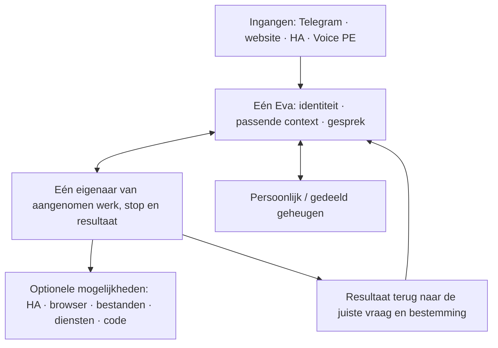

# Eva2: systeemonderzoek vóór een nieuw bouwplan

27 september 2026 · onderzoeksbasis c025550b · brononderzoek, geen nieuwe productrelease.

**Nieuw eigenaarbesluit na dit onderzoek:** eerst verwachtingen uitvragen en het plan opnieuw schrijven. Bestaande code of architectuur hoeft niet behouden te blijven. Onderstaande bevindingen en shortlist zijn onderzoeksinvoer, geen vastgesteld plan.

**De eerdere keuze om de eigen Eva2-uitvoering steeds verder uit te bouwen is onvoldoende onderbouwd.** Er bestaan inmiddels volledige platforms die veel van dat algemene werk overnemen. De keuze tussen behouden en vervangen moet over de hele huisgenoot gaan: gesprek, geheugen, initiatief, huis, digitale taken en onderhoud samen.

**Er is nog geen bewijs dat Eva2 als geheel beter is dan Eva1, of dat één onderzocht alternatief Eva's complete doel al haalt.** De tabel hieronder geeft geschiktheid op basis van bronnen, geen gemeten ranglijst.

## Aanvulling: technisch onderscheid

De eigenaar verlangt ook een concrete technische bijdrage. Het voorstel en de
aangetoonde overlap met bestaand onderzoek staan in [technisch onderscheid](technical-differentiation.md).
Dit is een onderzoekshypothese, geen bewezen innovatie of gekozen implementatie.

## Het landschap in één overzicht

🟢 = past bij die rol volgens bronnen; 🟠 = wezenlijke aansluiting of onzekerheid; — = niet als die productbasis onderzocht. Geen snelheids- of kwaliteitsscores.

| Systeem | Als basis voor de hele Eva | Waarde | Beslissende beperking |
|---|---|---|---|
| **Eva1** | 🟠 Werkende dagelijkse referentie | Herkenbaarheid, huisbediening, aanwezigheid; door Jaap gewaardeerd | Geen actuele gelijke metingen van snelheid, efficiëntie en autonomie |
| **Huidige Eva2** | 🟠 Veel bruikbare onderdelen, geheel niet af | Geaccepteerd geheugen; taak-/resultaatbinding; algemene HA-route | Eigen uitvoering en integratie veroorzaken nog onvoltooide taken en veel tussenwerk |
| **OpenClaw** | 🟢 Serieuze volledige kandidaat | Gateway, kanalen, sessies, tools, achtergrondwerk en plugins | Eén standaard Gateway is een gedeelde vertrouwensgrens; privégezinscontext en echte Voice PE-route niet bewezen |
| **Hermes** | 🟢 Serieuze volledige kandidaat | Gesprek naast achtergrondwerk, skills, geheugen, gateway; Python | Lopende taken worden na procesverlies onzeker; profielgeheugen is niet vanzelf persoonsafscherming |
| **Letta** | 🟠 Relevante volledige uitdager | Doorlopende agentidentiteit, geheugen, skills en kanalen | Nieuwe actieve basis; lokale kanaalbackend nog experimenteel genoemd |
| **Agent Zero** | 🟠 Volledige werkbank / mogelijke werkmotor | Algemene digitale uitvoering, projecten, tools, onderagents | Dagelijkse gezinsingangen en precieze taakherstelcontracten niet vastgesteld |
| **OpenCode** | — Gespecialiseerde werker | Code/projectwerk, async server, status en stoppen | Een complete huisgenoot eromheen blijft eigen productwerk |
| **Pi** | — Samenstelbare agentmotor | Model-/toolloop, sessies, uitbreidingen, SDK/RPC | Veel productverantwoordelijkheid blijft bij Eva; opslagcontract is niet automatisch taakherstel |

Onderbouwing en actuele releasecommits: [platformonderzoek](platforms.md). Letta en de bouwstenen: [aanvullend onderzoek](building-blocks.md). Eva1/Eva2 en bestaande proeven: [baseline](baseline.md).

## Wat er werkelijk misgaat in de huidige aanpak

**We gebruiken opensource, maar dragen nog veel van het algemene agentwerk zelf.** De draaiende kern en werker bevatten Pydantic AI 2.37.0. Eva roept dit bewust per enkele model-/toolstap aan; eigen code regelt de omliggende lus en taakuitvoering. Het kiezen van Pydantic AI opnieuw zou dus geen oplossing op zichzelf zijn.

Een concreet gevolg: het onderzochte eerste leerpad vraagt minimaal acht toolacties en negen modelantwoorden, terwijl de huidige bronkandidaat zes en acht toestaat. Losse lees- en budgetreparaties maken dat volledige pad nog niet bruikbaar. Dit rechtvaardigt heroverweging van de uitvoeringslaag; het bewijst niet dat een ander platform automatisch wint.

Bestaande onderdelen worden bovendien langs verschillende installatie-, context- en terugmeldroutes verbonden. Een werkende deelroute is herhaaldelijk te vroeg behandeld als een bijna voltooid product. De oude vergelijking zegt op plaatsen nog dat Eva2 geen stem heeft, terwijl recentere opleveringen dat tegenspreken. Zo ontstaan zowel onnodig werk als overdreven gereedclaims. [Code, bewijs en beperkingen](baseline.md).

**Verbruik:** bronbewijs bevat bijvoorbeeld een geholpen HA-opdracht met 108.076 geregistreerde invoertokens en een geslaagd hergebruik met 43.262. Dat zijn gedeeltelijke Eva-runtimecijfers, geen verklaring of factuur voor Codex-weekcredits. Totale ontwikkelkosten per oorzaak zijn niet betrouwbaar te reconstrueren uit die taaklogs. Een kostenbesparing door overstappen is nog niet gemeten.

## Wat het complete product onderscheidend moet maken

Geheugen, tools, stem, skills en achtergrondagents bestaan al bij anderen. Alleen die functies samen aanbieden is geen bewezen revolutie. Het onderscheid moet zitten in wat het gezin er gedurende dagen van merkt:

| Gebruikerservaring | De samenhang die moet werken |
|---|---|
| **Eva blijft aanwezig terwijl ze werkt.** | Natuurlijk kort contact, meerdere lopende opdrachten, gerichte correcties en stoppen; resultaten bij de juiste oorspronkelijke vraag. |
| **Eva kent de juiste persoon en het juiste publiek.** | Onderwerp later voortzetten, correcties onthouden; privé op Telegram, gedeelde huiscontext op speakers. Geen stemherkenningsproject nodig om algemene huisbediening te leveren. |
| **Eva neemt een bedoeling over.** | “Het is koud in de overkapping” begrijpen met echte HA-context; beschikbare apparaten/automatiseringen ontdekken en het resultaat controleren. Geen nieuwe kernfunctie per apparaat. |
| **Eva maakt onbekend werk af.** | Documentatie begrijpen, gepaste tools kiezen, resultaat bewaren en terugbrengen; een geleerde werkwijze later nuttig toepassen. |
| **Eva neemt nuttig initiatief en blijft soms stil.** | Relevantie, gezinscontext, open afspraken en wat al gedaan is samenwegen; niet steeds dezelfde suggesties of losse meldingen. |
| **Eva blijft van jou en kan veranderen.** | Optionele modules/providers, behoud van gegevens, herkenbaarheid en lopend werk bij een modulewissel; beheer dat je niet voortdurend nodig heeft. |

Dit is een **producthypothese**, geen claim dat geen concurrent dit nastreeft. De mogelijke voorsprong zit in de combinatie: minder aandacht van Jaap nodig, meer afgeronde bedoelingen, sneller contact en lagere totale last. “Revolutionair” wordt niet nog een eindeloze technische afrondingsvoorwaarde; bovenstaande ervaringen zijn te beoordelen.

## Drie volwaardige architectuurrichtingen

| Richting | Wat blijft / wordt vervangen | Verwachte winst — nog geen meting | Grootste last |
|---|---|---|---|
| **A. Eva1/Eva2 gericht afmaken** | Huidige uitvoeringslaag behouden; bewezen tekorten aanpakken | Minste directe migratie, maximaal behoud van bestaande aansluitingen | Wij blijven eigenaar van de algemene agentlus, kanaalintegratie en onderhoud daarvan. De laatste reparaties geven weinig vertrouwen zonder een volledige taakproef. |
| **B. Een bestaand platform als centrale uitvoering** | Hermes of OpenClaw beheert algemeen agentwerk; Eva behoudt vereiste ervaring, bevoegd geheugen, huis-/spraakadapters en bruikbare gegevens | Potentieel veel minder eigen algemene infrastructuur, bestaand taak-/skillgedrag benutten | Aanpassen van bestaande context, resultaat-/stopcontracten, data en echte kanalen. Geen besparing als de oude planner gewoon blijft meedraaien. |
| **C. Upstream agentmotor met dunne eigen productkern** | Bestaande domein-/gegevenskern behouden; generieke uitvoering door bijvoorbeeld Pydantic-native of Deep Agents; gespecialiseerde worker waar nodig | Meer controle over unieke gezins-/spraakervaring met minder zelfgeschreven generieke uitvoering | Kanaalgedrag en productintegratie blijven ons werk; risico dat de “dunne” kern opnieuw een groot framework wordt. |

**Mijn onderzoeksadvies:** B is de belangrijkste uitdager om nu serieus te toetsen, met **Hermes en OpenClaw als eerste kandidaten**. C blijft de tegenkandidaat als de bestaande data-/kanaalgrenzen een platformoverstap aantoonbaar duur of slechter maken. A krijgt geen automatische voorkeur wegens gedane investeringen. Letta blijft expliciet in beeld; bewijs dat de benodigde lokale contracten stabiel zijn kan die shortlist veranderen. Agent Zero blijft een mogelijke werkmotor, niet bij voorbaat slechts een browsertool.

Waarom geen definitieve winnaar: de bronnen beantwoorden de verantwoordelijkheid en beschikbare mechanismen, maar niet Eva's echte reactietijd, zelfstandige taakkwaliteit, familiebeleving of migratiekosten. De eerdere platformproeven hebben verschillende beperkingen; geen daarvan levert een actuele algemene winnaar. [Bestaande vergelijkingsbewijzen](baseline.md#what-past-comparisons-establish).

## Modulaire grens die iedere keuze moet respecteren

Dit is een verantwoordelijkheidsmodel, nog geen keuze voor producten of een bouwopdracht.

- **Eén werkcontract:** taak-ID, eigenaar/publiek, doel, oorspronkelijke bestemming, status, stop/correctie, resultaatafspraak en uitgevoerde effecten. Een werker krijgt geen tweede onafhankelijke taakwaarheid.
- **Eén contextcontract:** identiteit, toegestane herinneringen, recente gespreksonderdelen en relevante open taken. Een kanaal voegt geen eigen karakter of opdrachtinterpretatie toe.
- **Eén modulecontract:** mogelijkheden, afhankelijkheden, versie, gegevens, aan/uitgedrag. Een afwezige browsermodule blokkeert geen gewoon gesprek. Uitschakelen wist geen historie.
- **Verantwoorde migratie:** exporteer/bewaar memories, bronverwijzingen, correcties, taak-/effect-/resultaat-ID's en bestemmingen. Oude uitgevoerde acties worden niet opnieuw aangeboden. Eerst aantonen dat de nieuwe eigenaar het benodigde gedrag overneemt; daarna de vervangen actieve route verwijderen.
- **Gemotiveerde eigen code:** gezin/persoon/publiek, productervaring en aantoonbaar ontbrekende adapters. Een algemene planner, geheugenmotor of browseragent opnieuw bouwen vereist een concreet bewezen gat.

Hindsight, LiveKit en de bestaande algemene HA-route zijn waardevolle hergebruikskandidaten. Pipecat, Honcho, ha-mcp, Playwright MCP, Browser Use, DBOS/Temporal en OpenHands zijn beoordeeld op hun afzonderlijke verantwoordelijkheid; het advies is uitdrukkelijk niet om alles te installeren. [Bouwsteenkeuzes](building-blocks.md).

## Alleen de resterende vragen die de basiskeuze kunnen veranderen

Dit is een onderzoeksprotocol voor de volgende beslisstap, geen nieuw featurebouwplan. Gebruik het bestaande EV-003-protocol en de bestaande meet-/taakregistratie.

| Beslissende vraag | Kleinste nuttige vergelijking | Wat de uitkomst verandert |
|---|---|---|
| Neemt het platform werkelijk algemene uitvoering over zonder ons gedrag kwijt te raken? | Op releasepin de interfaces voor taakstart, gelijktijdig gesprek, correctie, stop, geheugencontext en oorspronkelijke terugmelding nalopen; geen kopie van de hele Eva eromheen | Kandidaat valt af of gerichte adapteromvang wordt zichtbaar |
| Wordt het hele werk beter? | Drie kandidaatfamilies: gesprek tijdens twee opdrachten; onbekende documentatietaak plus later hergebruik; natuurlijke HA-opdracht plus correctie. Selecteer daaruit vooraf twee beslissende gevallen, elk tweemaal, volgens de ontwikkelproef van EV-003. Eva1/Eva2 zijn referenties, Hermes/OpenClaw uitdagers | Resultaat, menselijke hulp en totale model/toolinvoer kunnen het advies voor B bevestigen of ontkrachten |
| Blijft het thuis bruikbaar? | Met de kansrijkste samenstelling dezelfde echte Voice PE-/Telegramvoortzetting, privégrens en nuttig initiatief beoordelen | Softwaredemo wordt niet verward met gezinsgeschiktheid |
| Blijft vervanging echt klein en omkeerbaar? | Bestaande gegevens en een afgeronde plus onderbroken taak als export/importcontract nalopen; modules uitschakelen zonder historie te wissen | Vergelijk migratie- en beheerlast met gerichte aanpassing van A/C |

Vooraf vastleggen: dezelfde taak, toegang, gereedschappen en limieten. Naast een gelijke-modelproef een afzonderlijke productproef met de aanbevolen samenstelling; resultaten niet vermengen. Meet eerste contact en inhoudelijk antwoord apart, onderbreking, correct resultaat, menselijke interventies, totale invoer/uitvoer/calls, wacht-/werkgeheugen en herstel. Gezinsbeleving blijft menselijk. Een beperkte beslisproef kan een architectuur selecteren, maar bewijst geen algemene marktvoorsprong.

Stopregels: geen tweede onveranderde mislukte proef; geen reparatiecampagne om een favoriete kandidaat alsnog te laten winnen; onvoldoende toegang/meetbaarheid = onbekend, geen verliespunt. Eerst oorzaak of ontbrekende voorwaarde benoemen. Vergelijk de volledige gebruikersuitkomst, niet aantallen tests, plugins of commits. Er is nog geen betrouwbare uur-/creditraming voor migratie; die volgt uit de aangetoonde aansluitingen.

## Onderzoeksverantwoording en actuele status

- Twee begrensde onderzoekers plus coördinator; aparte bestanden, geen extra bouwteam.
- Tien kern-/review-/protocolstukken volledig herlezen voor de baseline; aanvullend gerichte broncode, locks, bewijs en actuele officiële documentatie. Dit is geen nieuwe volledige documentatieaudit. Registers vermelden de dekking.
- Core/worker read-only gecontroleerd: geïnstalleerde versies en bronhashes vastgelegd. Geen gedragstest.
- Geen nieuwe Eva-modelcalls, fysieke acties, dependencywijzigingen of installatie. Ontwikkelcredits van dit onderzoek zijn onbekend; nul nieuwe Eva-proefcalls betekent niet nul Codex-verbruik.
- Brononderzoek en integrale synthese zijn opgeleverd. Definitieve architectuur en uitvoerplan volgen uit de bovenstaande beslispunten; zij worden niet als reeds bewezen gepresenteerd.
- De productteller blijft **2 van 9** volgens het bestaande bord. Dit onderzoek maakt geen extra Eva-functie af en heropent geen bestaande acceptatie.

Bronnen: [Eva-baseline en leesregister](baseline.md), [platforms en officiële bronregistratie](platforms.md), [bouwstenen](building-blocks.md), [geïnstalleerde observatie](installed-observation.json). De coördinator blijft verantwoordelijk voor de volgende keuze en het aansluitende concrete plan.
